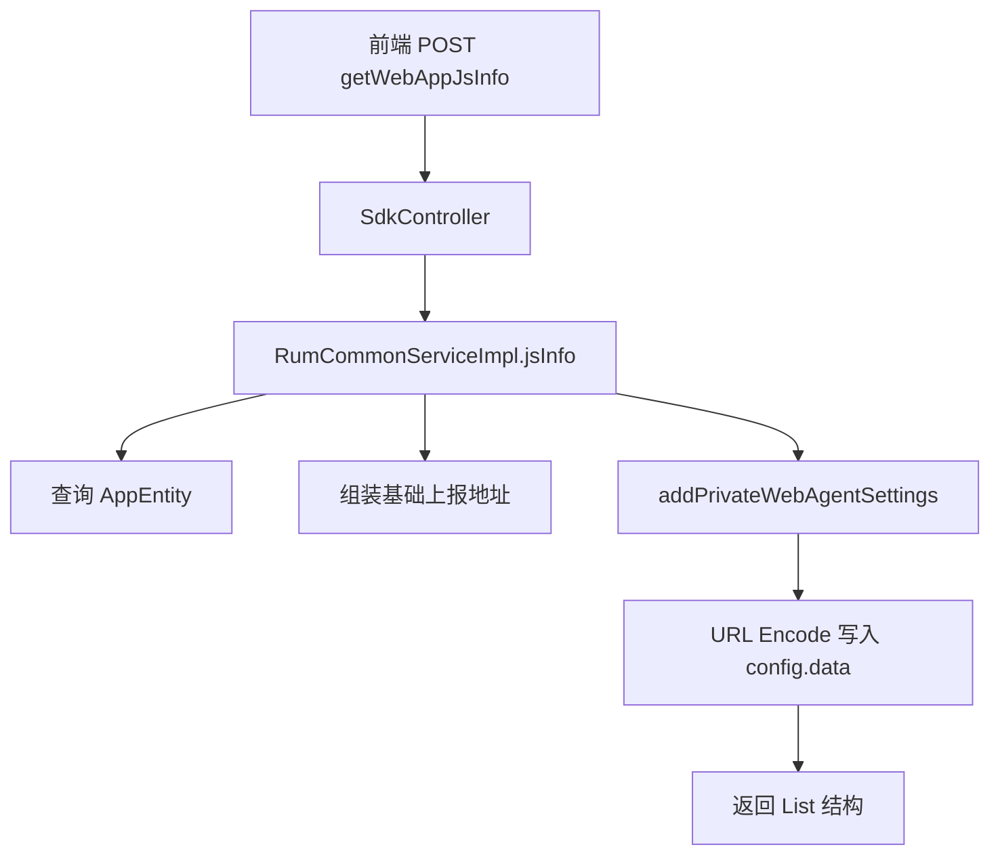

# 其他接口分析

本文档整合 RUM 模块中以下三个接口的完整分析：

1. `querySessionInfo` 与 `querySessionReplay` 接口数据查询及 `duration` 取值逻辑
2. `getWebAppJsInfo` 接口配置说明
3. `saveHeader` 接口分析

---

# 第一部分：querySessionInfo 与 querySessionReplay 接口数据查询及 duration 取值逻辑

## 1. 接口对象

本部分覆盖两个接口：

- `POST /rest/rum/session/search/querySessionInfo`
- `POST /rest/rum/session/replay/querySessionReplay`

完整地址示例：

- `http://{host}/rest/rum/session/search/querySessionInfo`
- `http://{host}/rest/rum/session/replay/querySessionReplay`

本部分基于仓库代码调用链梳理，重点回答：

1. 两个接口完整的数据查询和数据处理逻辑是什么。
2. 响应结果中的 `duration` 字段到底是如何计算出来的。
3. `duration` 在 SQL、Java 服务层、前端消费层分别是什么单位。
4. 两个接口的 `duration` 计算方式有何区别。

## 2. 结论先看

这两个接口的核心特点有三点：

1. **底层数据源是 ClickHouse 视图**
   - `querySessionInfo` 查询表：`one_rum_datasource_snapshot.t_rum_session_view`
   - `querySessionReplay` 查询表：`one_rum_datasource_snapshot.t_rum_common_snapshot_view`（固定过滤 `type=REPLAY`）

2. **接口本身不是直接返回数据库原始结果**
   - 先查 CK 聚合结果
   - 再做 Java 层补充和转换
   - 最终返回响应数据

3. **`duration` 的内部计算口径和最终返回口径不同**
   - `querySessionInfo`：SQL 聚合表达式内部口径为**微秒**，Java 接口返回口径为**毫秒**，前端按毫秒使用
   - `querySessionReplay`：SQL 与 Service 层口径均为**毫秒**，前端按毫秒使用

## 3. querySessionInfo 主要代码位置

### 3.1 Controller

- `newonexm/framework/plugins/rum/rum-core/src/main/java/com/bonree/rum/core/session/controller/SessionSearchController.java`

关键入口：

- `querySessionInfo(@Valid @RequestBody SessionCondition condition, HttpServletRequest request)`

作用：

- 获取当前环境 `envId`
- 写回请求对象
- 调用 `rumCkSessionSearchService.queryBaseCount(...)`

### 3.2 Service 实现

- `newonexm/framework/plugins/rum/rum-core/src/main/java/com/bonree/rum/core/session/service/impl/RumCkSessionSearchService.java`

关键方法：

- `queryBaseCount(SessionCondition condition, HttpServletRequest request, String envId, Integer searchType, String languageType)`

作用：

- 组装查询条件
- 调用 Mapper 查 CK
- 将查询结果转成响应 Map
- 补充应用、城市、健康状态、在线状态等衍生字段
- 处理 `duration`

### 3.3 Mapper 接口

- `newonexm/framework/plugins/rum/rum-database/src/main/java/com/bonree/rum/mysql/rumqueryservice/session/queryservice/query/RumSessionMapper.java`

关键方法：

- `SessionDetailTableEntity queryBaseCount(MetricQueryCondition querySessionList)`

### 3.4 Mapper XML / SQL

- `newonexm/framework/plugins/rum/rum-database/src/main/resources/com/bonree/rum/mysql/rumqueryservice/session/queryservice/query/xml/RumSessionMapper.xml`

关键 SQL：

- `fieldSessionDuration`
- `fieldMinMonitorTime`
- `queryBaseCount`

### 3.5 请求 DTO

- `newonexm/framework/plugins/rum/rum-core/src/main/java/com/bonree/rum/core/session/condition/search/SessionCondition.java`

关键字段：

- `sessionId`，必填
- `deviceId`，可选
- `appId`，可选
- `envId`，服务端注入
- `accountId`
- `isFromOpenApi`

### 3.6 查询结果实体

- `newonexm/framework/plugins/rum/rum-common/src/main/java/com/bonree/rum/common/bean/es/SessionDetailTableEntity.java`

其中 `duration` 映射字段：

- `@JsonProperty(EsFieldConstant.DURATION)`
- `private Long duration;`

## 4. querySessionInfo 完整调用链

完整链路如下：

1. 前端调用：
   - `newonexm/view/rum/src/services/retrieval/sessionDetail.ts`
   - `POST /rest/rum/session/search/querySessionInfo`

2. Controller 接收请求：
   - `SessionSearchController.querySessionInfo`

3. Controller 注入环境：
   - `condition.setEnvId(envId)`

4. 进入 Service：
   - `RumCkSessionSearchService.queryBaseCount(...)`

5. Service 组装过滤条件：
   - `deviceId = ?`，如果传了
   - `sessionId = ?`
   - `appId = ?`，如果传了
   - `monitor_time >= 当前时间 - sessionDaysAgo`

6. 交给 `RumSqlFilterFactory` / `RumSqlFilterUtil`
   - 将过滤条件转成 `MetricQueryCondition`
   - 自动补 `envId`、`accountId`

7. 调用 MyBatis Mapper：
   - `rumSessionMapper.queryBaseCount(metricQueryCondition)`

8. Mapper XML 查询 CK 视图：
   - 表：`one_rum_datasource_snapshot.t_rum_session_view`
   - 聚合出会话的基础信息、计数信息、错误标记、`duration`

9. Service 对查询结果二次加工：
   - 解析 OS 类型
   - 回填 `monitorTime`
   - 转为 `Map<String, Object>`
   - 补 `memberId`
   - 补 `interactiveNum`、`viewNum`、`fatalNum`、`errorQuestionNum`
   - 计算 `isOnline`
   - 计算 `isExistSessionReplay`
   - 通过 CMDB 补城市名称、地区、国家
   - 通过 AppCache 补 `platform`、`appName`、`appAlias`
   - 计算 `isHealth`
   - 最终返回 `RestResponse<Map<String, Object>>`

## 5. querySessionInfo 请求参数逻辑

接口请求体使用 `SessionCondition`，最关键的入参是：

- `sessionId`：必填
- `deviceId`：可选，用于进一步缩小定位范围
- `appId`：可选

Service 里实际构造的过滤条件是：

1. 如果 `deviceId` 非空，则增加：
   - `deviceId = condition.deviceId`

2. 必加：
   - `sessionId = condition.sessionId`

3. 如果 `appId` 非空，则增加：
   - `appId = condition.appId`

4. 时间下界限制：
   - `monitor_time >= 当前时间 - rumConfig.sessionDaysAgo`

这里的 `sessionDaysAgo` 默认配置在：

- `RUMConfig.sessionDaysAgo`
- 默认值：`13`

也就是说，这个接口不会无限制回溯全量历史，而是只在会话保留窗口内查。

## 6. queryBaseCount SQL 做了什么

`queryBaseCount` SQL 的主体如下：

- 按 `sessionId` 聚合
- 从 `t_rum_session_view` 中取该会话的各种聚合指标
- 输出 `SessionDetailTableEntity`

SQL 主要取值包括：

- `sessionId`
- `startTime`
- `member_id`
- `member_type`
- `sessionReplayDocCount`
- `os_name`
- `os_type`
- `app_id`
- `app_version`
- `customer_os_version`
- `access_model_id`
- `device_id`
- `data_center_id`
- `interactiveNum`
- `viewNum`
- `exceptionNum`
- `satisfiedNum`
- `sessionSatisfactionEventTotal`
- `eventNum`
- `fatalNum`
- `errorQuestionNum`
- `cityCode`
- `duration`
- `monitorTimeCk`
- `full_brand_model`
- `crashFlag`
- `anrFlag`
- `selfCrashFlag`
- `actionErrorFlag`
- `h5ErrorFlag`

SQL 里的 `having eventNum > 0` 说明：

- 只有事件数大于 0 的会话才会被返回

## 7. querySessionInfo 的 duration 完整计算逻辑

### 7.1 SQL 计算表达式

`duration` 不是直接取一个字段，而是通过 `fieldSessionDuration` 这个 SQL 片段计算：

```sql
if(
  min("minMonitorTime") is null,
  if(sum("duration") is null,0,sum("duration")),
  (toUnixTimestamp64Milli(max("maxMonitorTime")) - toUnixTimestamp64Milli(min("minMonitorTime")))*1000
)
```

对应位置：

- `RumSessionMapper.xml` 中的 `fieldSessionDuration`

这段逻辑可以拆成两个分支。

#### 分支一：`min(minMonitorTime)` 为空

表达式：

```sql
if(sum("duration") is null,0,sum("duration"))
```

说明：

- 如果当前会话在视图里没有可用的 `minMonitorTime`
- 就退回使用视图中的聚合字段 `sum(duration)`
- 如果 `sum(duration)` 为空，则返回 `0`

#### 分支二：`min(minMonitorTime)` 不为空

表达式：

```sql
(toUnixTimestamp64Milli(max("maxMonitorTime")) - toUnixTimestamp64Milli(min("minMonitorTime")))*1000
```

说明：

1. 先取：
   - `max(maxMonitorTime)`
   - `min(minMonitorTime)`

2. 用 `toUnixTimestamp64Milli(...)` 转成毫秒时间戳

3. 两者相减，得到：
   - 会话结束时间 - 会话开始时间
   - 单位先是 **毫秒**

4. 再乘以 `1000`
   - 将毫秒转换为 **微秒**

所以这个分支最终产出的 `duration` 是 **微秒**

### 7.2 为什么可以判断 SQL 内部口径是微秒

可以从两个地方互相印证：

#### 证据一：SQL 自身的乘法

`toUnixTimestamp64Milli` 的结果是毫秒时间戳差值。

后面又乘 `1000`：

- 毫秒 × 1000 = 微秒

#### 证据二：筛选条件对 `sessionDuration` 的换算

在：

- `RumQueryServiceSnapshotFilterUtil`

中，如果筛选字段是 `sessionDuration`，会把前端输入值乘：

- `1000 * 1000 * 60`

即：

- 分钟 -> 微秒

这说明会话时长的 SQL 过滤口径就是 **微秒**。

对应逻辑：

- `EsAliasConstant.sessionDuration`
- `FilterSqlPartConstants.SESSION_DURATION`

### 7.3 Java Service 层如何处理 `duration`

在 `RumCkSessionSearchService.queryBaseCount(...)` 中：

1. 先从实体中取出：

```java
Double duration = Convert.toDouble(queryList.getDuration());
```

2. 然后写入响应：

```java
data.put(EsAliasConstant.DURATION, EsUtils.checkNum(duration, 0L) / 1000);
```

也就是说：

- SQL 层返回值先进入 `queryList.getDuration()`
- Service 层统一再除以 `1000`

因此：

- **SQL 内部值：微秒**
- **接口返回值：毫秒**

### 7.4 前端如何消费 `duration`

前端会直接拿 `querySessionInfo` 返回的 `duration` 作为毫秒使用。

证据如下：

#### 证据一：格式化工具 `secondTohhmmss`

定义位置：

- `newonexm/view/rum/src/utils/index.ts`

注释和实现都明确写的是：

- 入参是 `mSeconds`
- 即毫秒

核心逻辑：

- `< 1000` 显示 `<1s`
- 否则先 `/1000` 再转 `hh:mm:ss`

#### 证据二：会话详情页面直接展示

位置：

- `newonexm/view/rum/src/packages/retrieval/sessionDetail/container/baseInfo/index.tsx`

展示方式：

```tsx
secondTohhmmss(Number(baseCount.duration))
```

这说明前端认为 `duration` 已经是毫秒。

#### 证据三：时间轴和回放边界计算

位置：

- `newonexm/view/rum/src/packages/retrieval/sessionDetail/sessionDetail.tsx`

逻辑：

```tsx
let endTime = tableList?.[0]?.monitorTime + baseInfo?.duration + 1000 * 60 * 10
```

这里直接把 `duration` 和毫秒时间戳 `monitorTime` 相加，也说明：

- `duration` 的对外返回单位是 **毫秒**

## 8. querySessionInfo 的 duration 最终取值规则总结

响应里的 `duration` 可以总结成以下规则。

### 规则一：优先使用会话开始/结束时间差

当视图中存在：

- `minMonitorTime`
- `maxMonitorTime`

则：

```text
duration_sql = (max(maxMonitorTime) - min(minMonitorTime)) 的毫秒差 * 1000
duration_resp = duration_sql / 1000
```

最终等价于：

```text
duration_resp = max(maxMonitorTime) - min(minMonitorTime)
```

单位：**毫秒**

### 规则二：如果没有可用的 `minMonitorTime`，则回退到 `sum(duration)`

即：

```text
duration_sql = sum(duration)
duration_resp = sum(duration) / 1000
```

前提是 `sum(duration)` 本身也是以微秒口径存储或聚合。

### 规则三：如果回退值也为空，则返回 0

即：

```text
duration_resp = 0
```

## 9. querySessionInfo 的 duration 业务含义

这个接口返回的 `duration`，本质上表示：

- 当前会话持续了多长时间

但它不是简单"某一条事件的 duration 字段"，而是一个**会话级聚合时长**。

其业务优先级是：

1. 如果能明确算出会话起止区间，就取：
   - 会话结束时间 - 会话开始时间

2. 如果算不出起止区间，就退回使用：
   - 视图表里已有的累计 `duration`

因此它更接近：

- **会话总存续时长**

而不是：

- 单事件耗时
- 单页面耗时
- 单操作耗时

## 10. querySessionInfo 响应结果中除 duration 外的主要二次处理

这个接口除了查数，还做了较多业务加工：

1. `memberId`
   - 若查询结果为空，则回退为请求中的 `deviceId`

2. `interactiveNum` / `viewNum` / `fatalNum` / `errorQuestionNum` / `eventNum`
   - 统一做空值兜底

3. `isOnline`
   - 使用：
     - `System.currentTimeMillis() - monitorTime < onLineTime`
   - `onLineTime` 默认是 `60000ms`

4. `isExistSessionReplay`
   - `sessionReplayDocCount > 0 ? 1 : 0`

5. 城市、地区、国家
   - 通过 CMDB 缓存补全

6. 应用名称、别名、平台
   - 通过 `AppCache` 补全

7. `isHealth`
   - 结合崩溃、ANR、自定义异常、页面加载失败、操作失败等标志位
   - 再结合会话满意度规则做最终判定

## 11. querySessionInfo 关键代码索引

### Controller

- `newonexm/framework/plugins/rum/rum-core/src/main/java/com/bonree/rum/core/session/controller/SessionSearchController.java`

### Service

- `newonexm/framework/plugins/rum/rum-core/src/main/java/com/bonree/rum/core/session/service/impl/RumCkSessionSearchService.java`

### Mapper

- `newonexm/framework/plugins/rum/rum-database/src/main/java/com/bonree/rum/mysql/rumqueryservice/session/queryservice/query/RumSessionMapper.java`

### SQL

- `newonexm/framework/plugins/rum/rum-database/src/main/resources/com/bonree/rum/mysql/rumqueryservice/session/queryservice/query/xml/RumSessionMapper.xml`

### 时长筛选常量

- `newonexm/framework/plugins/rum/rum-core/src/main/java/com/bonree/rum/core/common/constants/FilterSqlPartConstants.java`
- `newonexm/framework/plugins/rum/rum-core/src/main/java/com/bonree/rum/core/common/util/RumQueryServiceSnapshotFilterUtil.java`

### 前端接口调用

- `newonexm/view/rum/src/services/retrieval/sessionDetail.ts`

### 前端 `duration` 消费

- `newonexm/view/rum/src/packages/retrieval/sessionDetail/container/baseInfo/index.tsx`
- `newonexm/view/rum/src/packages/retrieval/sessionDetail/sessionDetail.tsx`
- `newonexm/view/rum/src/utils/index.ts`

## 12. querySessionReplay 接口完整查询逻辑

### 12.1 接口对象

目标接口：

- `POST /rest/rum/session/replay/querySessionReplay`

作用：

- 查询会话回放时间轴数据
- 返回回放开始时间、结束时间、总时长、分辨率、文件分片列表

### 12.2 主要代码位置

#### Controller

- `newonexm/framework/plugins/rum/rum-core/src/main/java/com/bonree/rum/core/session/controller/RumSessionReplayController.java`

关键入口：

- `sessionReplay(@Valid @RequestBody SessionReplayCondition condition)`

#### Query Factory

- `newonexm/framework/plugins/rum/rum-core/src/main/java/com/bonree/rum/core/query/factory/RumSessionReplayQueryFactory.java`

作用：

- 在 CK 实现和 ES 实现之间做路由选择

#### Service 实现

- `newonexm/framework/plugins/rum/rum-core/src/main/java/com/bonree/rum/core/query/sessionReplay/service/impl/RumCkSessionReplayServiceImpl.java`

关键方法：

- `sessionReplay(SessionReplayCondition condition)`
- `decorateData(SessionReplayModel sessionReplayModel, List<SessionReplayFile> sessionReplayFiles)`

#### Mapper 接口

- `newonexm/framework/plugins/rum/rum-database/src/main/java/com/bonree/rum/mysql/rumqueryservice/session/queryservice/query/RumSessionReplayMapper.java`

#### Mapper XML / SQL

- `newonexm/framework/plugins/rum/rum-database/src/main/resources/com/bonree/rum/mysql/rumqueryservice/session/queryservice/query/xml/RumSessionReplayMapper.xml`

关键 SQL：

- `querySessionReplayFileIdList`
- `querySessionReplayOtherInfo`

#### 请求 DTO

- `newonexm/framework/plugins/rum/rum-core/src/main/java/com/bonree/rum/core/session/condition/SessionReplayCondition.java`

关键字段：

- `sessionId`，必填
- `deviceId`，可选
- `appId`，可选
- `envId`，服务端注入

#### 响应 DTO

- `newonexm/framework/plugins/rum/rum-database/src/main/java/com/bonree/rum/clickhouse/sessionReplay/entity/SessionReplayModel.java`
- `newonexm/framework/plugins/rum/rum-database/src/main/java/com/bonree/rum/clickhouse/sessionReplay/entity/SessionReplayFile.java`

其中：

- `SessionReplayModel.duration` 注释明确写的是"会话持续时长（单位ms）"
- `SessionReplayFile.duration` 注释也明确写的是"单包的会话持续时长（单位ms）"

### 12.3 请求参数逻辑

接口请求体使用 `SessionReplayCondition`，关键入参是：

- `sessionId`：必填
- `deviceId`：可选
- `appId`：可选

Service 里实际构造的过滤条件是：

1. 如果 `deviceId` 非空，则增加：
   - `deviceId = condition.deviceId`

2. 如果 `sessionId` 非空，则增加：
   - `sessionId = condition.sessionId`

3. 如果 `appId` 非空，则增加：
   - `appId = condition.appId`

4. 固定增加：
   - `type = "REPLAY"`

说明：

- 这个接口查询的不是普通会话总览视图
- 而是只取 `type=REPLAY` 的回放类快照数据

### 12.4 完整调用链

完整链路如下：

1. Controller 接收请求：
   - `RumSessionReplayController.sessionReplay`

2. Controller 注入环境：
   - `condition.setEnvId(envId)`

3. 通过工厂选择查询实现：
   - `RumSessionReplayQueryFactory.getService()`

4. 当前主路径进入：
   - `RumCkSessionReplayServiceImpl.sessionReplay(condition)`

5. Service 组装过滤条件：
   - `deviceId = ?`，如果传了
   - `sessionId = ?`
   - `appId = ?`，如果传了
   - `type = REPLAY`

6. 交给 `RumSqlFilterFactory` / `RumSqlFilterUtil`
   - 构造成 `MetricQueryCondition`

7. 调用两个 Mapper 查询：
   - `querySessionReplayFileIdList(metricQueryCondition)`
   - `querySessionReplayOtherInfo(metricQueryCondition)`

8. Service 调用 `decorateData(...)`
   - 回填 `fileIds`
   - 解析 `displaySize`
   - 计算最终 `duration`

9. 返回：
   - `RestResponse<SessionReplayModel>`

### 12.5 SQL 查询逻辑

这个接口的查询不是一条 SQL 查完，而是两条 SQL 分工查询。

#### SQL 一：查询回放分片列表

对应：

- `querySessionReplayFileIdList`

SQL 逻辑：

```sql
select
  toInt64OrNull(max("otherIndex"['duration'])) / 1000.0 duration,
  toUnixTimestamp64Milli(min(monitor_time)) monitorTime,
  "otherIndex"['eventFileId'] fileId
from one_rum_datasource_snapshot.t_rum_common_snapshot_view
...
group by fileId
order by monitorTime
```

含义：

1. 按 `fileId` 分组
2. 每个回放分片取：
   - `fileId`
   - 该分片最早 `monitorTime`
   - 该分片的 `duration`
3. 按 `monitorTime` 升序排序

这里最关键的是：

- 分片级 `duration = max(otherIndex['duration']) / 1000.0`

也就是说：

- `otherIndex['duration']` 原始值先取最大值
- 再在 SQL 里直接 `/1000.0`
- 映射成 `SessionReplayFile.duration`

#### SQL 二：查询回放整体信息

对应：

- `querySessionReplayOtherInfo`

SQL 逻辑：

```sql
select
  toUnixTimestamp64Milli(min(monitor_time)) startTime,
  toUnixTimestamp64Milli(max(monitor_time)) endTime,
  any(if(otherIndex['wev'] != '', otherIndex['wev'], null)) wev,
  any(if(otherIndex['displaySize'] != '', otherIndex['displaySize'], null)) displaySize
from one_rum_datasource_snapshot.t_rum_common_snapshot_view
...
```

含义：

1. 取整个回放范围的最早 `monitor_time` 作为 `startTime`
2. 取整个回放范围的最晚 `monitor_time` 作为 `endTime`
3. 取任意非空 `wev`
4. 取任意非空 `displaySize`

注意：

- `startTime` 和 `endTime` 都是通过 `toUnixTimestamp64Milli` 得到
- 因此它们本身就是 **毫秒时间戳**

## 13. querySessionReplay 的 duration 如何计算

### 13.1 Service 层最终公式

真正的最终 `duration` 计算发生在：

- `RumCkSessionReplayServiceImpl.decorateData(...)`

关键代码逻辑：

1. 如果 `sessionReplayFiles` 非空：
   - 取最后一个分片的 `duration`

2. 最终计算：

```text
duration = (endTime - startTime) + lastFileDuration
```

对应代码可概括为：

```java
Double duration = 0D;
if (CollectionUtils.isNotEmpty(sessionReplayFiles)) {
  duration = sessionReplayFiles.get(sessionReplayFiles.size() - 1).getDuration();
}
sessionReplayModel.setDuration(sessionReplayModel.getEndTime() - sessionReplayModel.getStartTime() + duration);
```

### 13.2 为什么是"最后一个分片 duration"

因为：

- 分片列表是按 `monitorTime` 升序排序的
- Service 明确取 `sessionReplayFiles.get(sessionReplayFiles.size() - 1)`

所以：

- 前面的分片 `duration` 不会参与最终叠加
- 只会拿最后一个分片的 `duration` 追加到整体时间跨度之后

### 13.3 单测已经确认公式

单测 `RumCkSessionReplayServiceImplTest` 已经明确验证了多个场景，结论一致：

- `duration = endTime - startTime + 最后一个文件 duration`

例如：

1. `startTime=1000, endTime=2000, lastDuration=500`
   - `duration = 1500`

2. `startTime=300, endTime=1300, lastDuration=350`
   - `duration = 1350`

3. 文件列表为空时：
   - `duration = endTime - startTime`

4. 多文件时只取最后一个：
   - 前一个 300，最后一个 700
   - 最终只加 700

### 13.4 querySessionReplay 的 duration 单位

这个接口的 `duration` 对外可以判断为 **毫秒**，证据有三层：

1. `SessionReplayModel.duration` 注释写明单位 ms
2. `SessionReplayFile.duration` 注释写明单位 ms
3. `endTime - startTime` 本身就是毫秒时间戳差值，而它和 `lastFileDuration` 直接相加

所以 `lastFileDuration` 也必须是毫秒量纲，整个结果才能成立。

## 14. querySessionReplay 的 duration 业务含义

这个接口返回的 `duration`，不是"整个会话总时长"，而是：

- 回放时间轴覆盖范围
- 再补上最后一个回放分片尚未被 `endTime - startTime` 完全覆盖的尾部时长

换句话说，它表示的是：

- **回放播放轴的总长度**

而不是：

- 会话视图意义上的全量会话持续时长

## 15. 两个接口 duration 的区别

两个接口虽然都叫 `duration`，但计算逻辑和业务含义不同。

### 15.1 数据源不同

`querySessionInfo`：

- 来自 `t_rum_session_view`
- 是会话聚合视图

`querySessionReplay`：

- 来自 `t_rum_common_snapshot_view`
- 且固定过滤 `type = REPLAY`
- 是回放快照数据

### 15.2 计算逻辑不同

`querySessionInfo.duration`：

- SQL 内部先走 `fieldSessionDuration`
- 优先取：
  - `max(maxMonitorTime) - min(minMonitorTime)` 的时间差
- 取不到时回退：
  - `sum(duration)`
- 最后 Service 再统一 `/1000`

`querySessionReplay.duration`：

- 先查：
  - `startTime = min(monitor_time)`
  - `endTime = max(monitor_time)`
- 再查：
  - 每个 `fileId` 分片的 `duration`
- 最后 Service 合成：
  - `duration = endTime - startTime + 最后一个 fileId 的 duration`

### 15.3 单位处理不同

`querySessionInfo.duration`：

- SQL 内部口径：微秒
- Service 返回口径：毫秒

`querySessionReplay.duration`：

- `startTime/endTime` 本身就是毫秒时间戳
- 分片 `duration` 在 SQL 中已经 `/1000.0`
- Service 不再做 `/1000`
- 最终返回口径：毫秒

### 15.4 业务含义不同

`querySessionInfo.duration`：

- 表示整个会话的持续时长
- 更偏"会话总存续时长"

`querySessionReplay.duration`：

- 表示回放时间轴的总长度
- 更偏"播放器时间轴时长"

### 15.5 可以直接记成一句话

- `querySessionInfo.duration` 是 **会话时长**
- `querySessionReplay.duration` 是 **回放轴时长**

## 16. 两个接口 duration 的最终对照表

| 对比项 | `querySessionInfo` | `querySessionReplay` |
| --- | --- | --- |
| 数据表 | `t_rum_session_view` | `t_rum_common_snapshot_view` |
| 过滤特征 | 按 `sessionId/deviceId/appId` 查会话 | 按 `sessionId/deviceId/appId` 且 `type=REPLAY` |
| SQL 时长核心 | `fieldSessionDuration` | `min(monitor_time)`、`max(monitor_time)`、`otherIndex['duration']` |
| 主公式 | 优先 `max(maxMonitorTime)-min(minMonitorTime)`，否则 `sum(duration)` | `endTime - startTime + lastFileDuration` |
| Service 是否再除法 | 是，`/1000` | 否 |
| 返回单位 | 毫秒 | 毫秒 |
| 业务语义 | 会话总时长 | 回放轴总长度 |

## 17. duration 排查结论

如果后续排查两个接口的 `duration` 为什么不一致，优先按下面顺序判断：

1. 先确认你看到的是哪个接口：
   - `querySessionInfo`
   - `querySessionReplay`

2. 再确认你要的是哪种"时长"：
   - 会话总存续时长
   - 回放播放轴长度

3. 最后再看公式：
   - 会话接口：会话聚合时长
   - 回放接口：时间跨度 + 最后一个回放分片尾长

因此，两个接口的 `duration` **不应该默认相等**。它们名字相同，但业务定义不同、SQL来源不同、Service处理方式也不同。

---

# 第二部分：getWebAppJsInfo 接口配置说明

## 18. 接口概述

### 18.1 功能说明

获取 **Web 应用嵌码注入脚本** 所需的配置信息。前端探针部署页（嵌码脚本、自动嵌码向导）调用该接口，将返回的 `config.data` 和 `config.id` 写入 `<script>` 标签：

```html
<script type="text/javascript"
  src="BonreeSDK_JS.min.js"
  data="{URL编码后的配置JSON}"
  id="BonreeAgent">
</script>
```

| 属性 | 说明 |
|------|------|
| **接口地址** | `POST /rest/rum/digit/sdk/getWebAppJsInfo` |
| **代码入口** | `SdkController.getWebAppJsInfo` → `RumCommonServiceImpl.jsInfo` → `addPrivateWebAgentSettings` |

### 18.2 权限要求

- 需要 RUM 资源读权限：`RUM_RESOURCE_READ` 或 `RUM_RESOURCE_READ_AND_WRITE`

### 18.3 调用链路



## 19. 请求参数

| 字段 | 类型 | 必填 | 说明 |
|------|------|------|------|
| `appId` | Long | 是 | 应用 ID，对应 RUM 应用管理中的应用主键 |
| `dataCenterId` | Long | 否 | 数据中心 ID；为空时使用平台默认数据中心 `rumConfig.dataCenterId` |

**请求示例：**

```json
{
  "appId": 123456,
  "dataCenterId": 1
}
```

## 20. 响应结构

### 20.1 外层包装（RestResponse）

| 字段 | 类型 | 说明 |
|------|------|------|
| `code` | String | 响应码，成功一般为 `"200"` |
| `msg` | String | 响应消息 |
| `data` | Array | 应用嵌码配置列表，通常每个 appId 返回 1 条 |

### 20.2 data 数组元素

| 字段 | 类型 | 说明 |
|------|------|------|
| `appid` | String | 应用 ID（小写 key，历史约定） |
| `config` | Object | 嵌码脚本配置对象 |
| `config.id` | String | Script 标签 `id` 属性，默认 `BonreeAgent`（Nacos：`global.private.rum.js.script.id`） |
| `config.data` | String | **URL 编码（UTF-8）** 后的 JSON 字符串，解码后为探针运行时完整配置 |

**响应示例（结构示意）：**

```json
{
  "code": "200",
  "msg": "success",
  "data": [
    {
      "appid": "123456",
      "config": {
        "id": "BonreeAgent",
        "data": "%7B%22appId%22%3A%22xxxx%22%2C%22uploadAddrHttps%22%3A%22...%22%7D"
      }
    }
  ]
}
```

> **注意：** 使用前需对 `config.data` 做 `decodeURIComponent`（或等效 URL 解码），再 `JSON.parse` 得到实际配置对象。

## 21. config.data 解码后配置项详解

解码后的 JSON 由 **基础配置** 和 **Web 探针私有配置** 两部分合并而成。

### 21.1 基础配置（jsInfo 固定下发）

| 字段 | 类型 | 来源 | 含义 |
|------|------|------|------|
| `appId` | String | `AppEntity.md5` | 应用 MD5 标识，探针上报时用于识别应用 |
| `uploadAddrHttps` | String | 平台地址 + 数据中心 | HTTPS 数据上报地址，格式：`https://{host}{basePath}{uploadAddr}` |
| `uploadAddrHttp` | String | 平台地址 + 数据中心 | HTTP 数据上报地址，格式：`http://{host}{basePath}{uploadAddr}` |

**上报地址组装规则：**

| 场景 | 规则 |
|------|------|
| 开启多数据中心 | 从 `dataCenterUploadMap[dataCenterId]` 取上传域名，拼接 `basePath`（默认 `/RUM`）+ `uploadAddr`（默认 `/upload`） |
| 未开启多数据中心 | 使用 `baseUrl` / `baseUrlHttp` + `basePath` + `uploadAddr` |

**相关 Nacos 配置：**

| Nacos Key | 默认值 | 说明 |
|-----------|--------|------|
| `global.private.rum.controller.path` | `/RUM` | RUM 路径前缀 |
| `global.private.rum.upload.address` | `/upload` | 上报路径 |
| `global.private.rum.js.script.id` | `BonreeAgent` | script 标签 id |

---

### 21.2 Web 探针私有配置（addPrivateWebAgentSettings）

以下字段按优先级/条件动态下发，**不存在则不返回该 key**。

#### 21.2.1 Nacos 平台级私有配置

| 字段 | 类型 | 优先级 | 含义 |
|------|------|--------|------|
| （动态 Map） | Object | 1 | **应用级**：`global.private.rum.webagent.agentconfig`，key 为 `appId` 字符串 |
| （动态 Map） | Object | 2 | **用户/Build 级**：应用级为空时取 `global.private.rum.webagent.userconfig`，key 为 `buildId` 字符串 |

> 上述配置为 Nacos 自定义 Map，字段结构由平台运维定义，用于覆盖/扩展探针默认行为，无固定 schema。

#### 21.2.2 自定义规则（userdefine）

| 字段 | 类型 | 来源 | 含义 |
|------|------|------|------|
| `userdefine` | String（JSON 数组） | `JsRuleCache` 应用级用户 ID 采集规则（`classType=11000`，且应用开关 `userIdCollectionSwitch=1`） | 多个规则的 `ruleJson` 用逗号拼接后包裹在 `[...]` 中，供 Web 探针按 Meta/Header 等规则采集用户 ID |

**配置入口：** RUM 配置中心 → 规则配置 → 实体识别 → 终端用户 → **用户 ID 采集**

**生效范围：** 账号 + 当前环境 + 应用（详见 `05-会话与用户管理/用户ID采集规则下发与生效范围.md`）。

**说明：** 产品文案限定「服务器自动刷新的 Web SDK」；该 `classType` 不在 controller `RumUserEnvConfigPull` / `RumUserAppConfigPull` 同步清单中。

#### 21.2.3 端到端打通 / Trace 插头（brss + traceConfig）

| 字段 | 类型 | 含义 |
|------|------|------|
| `brss` | Boolean | 是否开启 Bonree Trace 插头（请求头注入 trace 上下文）。存在 App 级协议域配置时为 `true`，否则 `false` |
| `traceConfig` | Object | 端到端打通网络 Trace 配置，结构见下表 |

**traceConfig 结构（NetworkTraceConfigModel）：**

| 字段 | 类型 | 含义 |
|------|------|------|
| `urlTotalList` | Array\<RequestHeaderRule\> | 全部域名生效的请求头插值规则 |
| `urlWhiteList` | Array\<HostRule\> | 白名单域名 + 对应请求头规则 |
| `urlBlackList` | Array\<HostRule\> | 黑名单域名 + 对应请求头规则 |

**HostRule 结构：**

| 字段 | 类型 | 必填 | 含义 |
|------|------|------|------|
| `name` | String | 否 | 规则名称（日志反显） |
| `type` | Integer | 是 | 匹配类型：`0` 完整域名 / `1` 域名后缀 / `2` 正则 |
| `rule` | String | 是 | 规则内容 |
| `reqHeaderRules` | Array | 是 | 该域名下的请求头插值规则 |

**RequestHeaderRule 结构：**

| 字段 | 类型 | 必填 | 含义 |
|------|------|------|------|
| `key` | String | 是 | 需插入的请求 Header 名称 |
| `type` | Integer | 是 | 值类型：`1` 固定值 / `2` 16位UUID / `3` 32位UUID / `4` SkyWalking / `5` Bonree |
| `value` | String | 条件 | 固定值（type=1 时必填） |
| `rhsr` | Integer | 否 | 采样率 0–100，仅 type=4/5 生效 |

**配置入口：** RUM 配置中心 → 协议扩展 / 端到端打通

#### 21.2.4 探针初始化与采集策略

| 字段 | 类型 | 来源 | 含义 |
|------|------|------|------|
| `probability` | Integer | 终端采集配置 | 探针初始化概率，**千分比**。默认 `1000`（100%）；采集开关关闭时为 `0`；DB 中 `sdkCollectRate`（百分比）× 10 转换 |
| `hcs` | Integer | Nacos 全局 | Header 采集策略：`0` 不采集 / `1` 仅错误 / `2` 全量（默认 2） |
| `pendingRequestTimeout` | Long | 终端采集配置 | Pending 网络请求超时阈值（毫秒） |

**Nacos：** `global.private.rum.header.collection.strategy`（默认 `2`）

**配置入口：** RUM 配置中心 → 数据采集 → 终端应用采集配置

#### 21.2.5 模块配置（mc）

| 字段 | 类型 | 含义 |
|------|------|------|
| `mc` | Array | 模块配置列表，每项为 ModuleConfiguration |

**ModuleConfiguration 通用字段：**

| 字段 | 类型 | 含义 |
|------|------|------|
| `n` | String | 模块名：`sessionreplay`（会话回放）/ `network`（网络请求） |
| `c` | Integer | 模块启动概率（会话回放采集概率，默认 20% 等） |
| `src` | Object | 会话回放专用子配置（仅 n=sessionreplay 时存在） |
| `cs` | Object | 事件采集策略（仅 n=network 时存在） |

**src（SessionReplayConfig）— 会话回放开启时下发：**

| 字段 | 类型 | 含义 |
|------|------|------|
| `sl` | Integer | 数据隐私：`0` 掩码用户输入 / `1` 全部屏蔽 |
| `uc` | Integer | 回传周期（秒），默认 15 |
| `ua` | String | 会话回放 HTTP 上报地址 |
| `uas` | String | 会话回放 HTTPS 上报地址 |

> 会话回放模块下发条件：`dataSession=1` 且 `sessionReplayData=1`

**cs（EventCollectionConfig）— 网络模块：**

| 字段 | 类型 | 含义 |
|------|------|------|
| `fc` | Integer | 是否全量采集：`0` 仅 Action 关联 + 白名单 / `1` 全量（白名单失效） |
| `wl` | Object | 白名单配置（fc=0 且开启网络白名单时存在） |

**wl（WhiteListModel）：**

| 字段 | 类型 | 含义 |
|------|------|------|
| `hr` | String[] | 域名白名单规则，最多 20 条，支持 `*` 前后缀匹配 |
| `pr` | String[] | 路径白名单规则，最多 20 条 |

**Nacos：** `global.private.rum.net.full_collection`（默认 `0`）

**配置入口：**

- 会话回放：数据采集 → 会话回放
- 网络白名单：数据采集 → 网络 → 黑白名单

#### 21.2.6 自定义业务标识 Key 采集

| 字段 | 类型 | 含义 |
|------|------|------|
| `reqHeaderKey` | Set\<String\> | 从请求 Header 中提取的业务标识 key 列表 |
| `reqBodyKey` | Set\<String\> | 从 POST Body（JSON/URL 参数）中提取的 key 列表 |
| `reqURLKey` | Set\<String\> | 从 GET URL 参数（`?` 后）中提取的 key 列表 |

**来源：**

1. 网络请求自定义识别规则（`JsRuleCache` 网络 H5 规则）
2. 业务模块自定义规则（`dataSource=0` 网络请求数据源）

**配置入口：** RUM 配置中心 → 实体识别 → 网络请求识别 / 业务模块

#### 21.2.7 数据脱敏（snr）

| 字段 | 类型 | 含义 |
|------|------|------|
| `snr` | Array | 数据脱敏规则列表，每项为脱敏规则 JSON（经转换） |

**snr 单条规则主要字段：**

| 字段 | 类型 | 含义 |
|------|------|------|
| `mk` | Object | 脱敏 Key 配置（由敏感数据 sd 转换而来） |
| 其他 | - | 规则 JSON 中除 `sd` 外的字段保留（如生效范围、脱敏方式等） |

**mk 内部字段：**

| 字段 | 类型 | 含义 |
|------|------|------|
| `aqk` | Boolean | Query 参数：`true` 全部屏蔽 / `false` 部分掩码 |
| `qka` | String | Query 参数需掩码的 key（aqk=false 时） |
| `areqh` | Boolean | 请求头：`true` 全部屏蔽 / `false` 部分掩码 |
| `reqhka` | String | 请求头需掩码的 key |
| `aresh` | Boolean | 响应头：`true` 全部屏蔽 / `false` 部分掩码 |
| `reshka` | String | 响应头需掩码的 key |

**sd 原始类型（t）与规则（r）对照：**

| t | 含义 | r=0 | r=1 |
|---|------|-----|-----|
| 0 | Query 参数 | 掩码指定 key（v） | 全部屏蔽 |
| 1 | 请求 Header | 掩码指定 key | 全部屏蔽 |
| 2 | 响应 Header | 掩码指定 key | 全部屏蔽 |

**配置入口：** RUM 配置中心 → 数据安全 → 数据脱敏

#### 21.2.8 国密加密（sm4Config）

| 字段 | 类型 | 含义 |
|------|------|------|
| `sm4Config` | Object | SM4 国密加密配置（Nacos 配置了 sm4 时下发） |
| `sm4Config.identify` | String | 加密版本标识 |
| `sm4Config.key` | String | SM4 对称加密密钥 |

**Nacos：** `global.private.rum.encryption`

> **注意：** 修改国密配置会导致嵌码脚本 `data` 变化，非自动嵌码的 Web 应用需重新嵌码。

## 22. 配置项与 RUM 控制台映射

| config.data 字段 | 控制台配置路径 | 说明 |
|------------------|----------------|------|
| `uploadAddrHttps/Http` | 平台部署 / 数据中心 | 由部署地址决定，非应用级配置 |
| `probability` | 数据采集 → 终端应用 → SDK 采集概率 | 受数据采集总开关影响 |
| `hcs` | 平台 Nacos 全局 | 网络 Header 采集策略 |
| `pendingRequestTimeout` | 数据采集 → 网络 Pending 阈值 | |
| `mc[n=sessionreplay]` | 数据采集 → 会话回放 | 需同时开启会话与回放 |
| `mc[n=network].cs` | 数据采集 → 网络全量/白名单 | |
| `userdefine` | 实体识别 → 终端用户 → 用户 ID 采集 | 详见 `05-会话与用户管理/用户ID采集规则下发与生效范围.md` |
| `brss` + `traceConfig` | 协议扩展 / 端到端打通 | |
| `reqHeaderKey/reqBodyKey/reqURLKey` | 实体识别 → 网络请求 / 业务模块 | |
| `snr` | 数据安全 → 数据脱敏 | |
| `sm4Config` | 平台 Nacos 国密配置 | |

## 23. 与同类接口差异

| 接口 | 路径 | 差异 |
|------|------|------|
| `getWebAppJsInfo` | `/rest/rum/digit/sdk/getWebAppJsInfo` | 控制台探针部署专用；`flag=1` 强制 DB 查 App；支持 `dataCenterId` |
| `jsInfo` | `/rest/rum/api/jsInfo`（RumApiController） | 内部/OpenAPI 批量查询；`flag=null` 走缓存；不传数据中心 |

## 24. 前端使用参考

**代码位置：**

- `newonexm/view/rum/src/packages/probe/components/EmbedScript/index.tsx`
- `newonexm/view/rum/src/packages/probe/AutoEmbedCodeWizardConfig/AutoEmbedCodeWizardConfig.tsx`

**使用方式：**

```typescript
const res = await request.post('/rest/rum/digit/sdk/getWebAppJsInfo', { appId, dataCenterId })
const scriptTag = `<script type="text/javascript" src="BonreeSDK_JS.min.js"
  data="${res.data[0].config.data}"
  id="${res.data[0].config.id}"></script>`
```

## 25. getWebAppJsInfo 关键源码索引

| 模块 | 路径 |
|------|------|
| Controller | `newonexm/framework/plugins/rum/rum-core/.../terminal/controller/SdkController.java` |
| 核心逻辑 | `newonexm/framework/plugins/rum/rum-core/.../common/service/impl/RumCommonServiceImpl.java` |
| 字段枚举 | `newonexm/framework/plugins/rum/rum-core/.../common/enums/JsInfoEnum.java` |
| 模块配置实体 | `newonexm/framework/plugins/rum/rum-core/.../settings/entity/ModuleConfigurationModel.java` |
| Trace 配置 | `newonexm/framework/plugins/rum/rum-core/.../settings/utils/TraceDecorators.java` |
| 平台配置 | `newonexm/framework/plugins/rum/rum-common/.../config/RUMConfig.java` |

## 26. config.data 完整字段清单

| 序号 | 字段名 | 类别 | 是否必现 |
|------|--------|------|----------|
| 1 | `appId` | 基础 | 是 |
| 2 | `uploadAddrHttps` | 基础 | 是 |
| 3 | `uploadAddrHttp` | 基础 | 是 |
| 4 | Nacos agent/user config 动态字段 | 平台私有 | 否 |
| 5 | `userdefine` | 自定义规则 | 否 |
| 6 | `brss` | Trace | 是 |
| 7 | `traceConfig` | Trace | brss=true 时 |
| 8 | `probability` | 采集策略 | 是 |
| 9 | `hcs` | 采集策略 | 是 |
| 10 | `pendingRequestTimeout` | 采集策略 | 是 |
| 11 | `mc` | 模块配置 | 是（至少含 network 模块） |
| 12 | `reqHeaderKey` | 业务标识 | 否 |
| 13 | `reqBodyKey` | 业务标识 | 否 |
| 14 | `reqURLKey` | 业务标识 | 否 |
| 15 | `snr` | 数据脱敏 | 否 |
| 16 | `sm4Config` | 国密 | 否 |

---

# 第三部分：saveHeader 接口分析

## 27. 接口概述

| 项 | 说明 |
|---|---|
| **接口地址** | `POST /rest/common/saveHeader` |
| **Maven 模块** | `newonexm/framework/framework-core/one-framework-core` |
| **Controller 类** | `com.bonree.one.framework.index.controller.GlobalCommonController` |
| **限流注解** | 无（同类中 `getLongUrl` 有 `@RateLimit(limitNum=20)`，本接口未标注） |

### 27.1 功能概述

**保存用户自定义表头配置。**

前端用户在列表页面可以自定义显示哪些列（表头），本接口负责将用户的列选择持久化到数据库。每个用户针对每种业务场景（`businessType`）独立保存一份配置，采用"有则更新、无则插入"（Upsert）语义。

### 27.2 请求参数

| 字段 | 类型 | 是否必填 | 说明 |
|---|---|---|---|
| `columnFields` | `String` | **是**（`@NotNull`） | 自定义表头字段，逗号分隔，例如 `"name,status,createTime"` |
| `businessType` | `Integer` | **是**（`@NotNull`） | 表格业务 ID，区分不同页面/功能模块的表头 |
| `userId` | `Long` | 无需传入 | 由服务端从当前登录用户（`UserProvider`）自动填充 |

### 27.3 响应结果

```json
{
  "code": 200,
  "data": true,
  "message": "success"
}
```

`data` 为 `true` 表示数据库写入行数 > 0（保存成功），`false` 表示未影响任何行。

### 27.4 业务逻辑流程

```
POST /rest/common/saveHeader
        │
        ▼
GlobalCommonController.saveHeader()
  ├─ 从 UserProvider 获取当前登录用户的 userId，填充到请求对象
  └─ 调用 CustomHeaderService.saveCustomHeader(customHeaderAdd)
              │
              ▼
        CustomHeaderServiceImpl.saveCustomHeader()
          ├─ 1. 构造 Hazelcast 分布式锁 Key：
          │     "custom_header_save_{userId}_{businessType}"
          ├─ 2. 尝试加锁（等待最多 30 秒，锁持有最多 30 秒）
          │     ├─ 加锁失败 → 抛出 RestException(UPDATE_ERROR)
          │     └─ 加锁成功 → 继续
          ├─ 3. 按 userId + businessType 查询现有记录
          │     ├─ 已存在 → UPDATE（updateByPrimaryKeySelective）
          │     └─ 不存在 → INSERT（insertSelective）
          └─ 4. finally 块释放锁
```

## 28. 涉及的数据库表

### 28.1 表名

**`t_config_custom_header`**

### 28.2 表结构（根据 MyBatis XML 及 Domain 类推导）

| 字段名 | Java 属性 | JDBC 类型 | 说明 |
|---|---|---|---|
| `id` | `id` | `BIGINT` | 自增主键 |
| `user_id` | `userId` | `BIGINT` | 用户 ID |
| `column_fields` | `columnFields` | `VARCHAR` | 自定义表头字段，逗号分隔 |
| `business_type` | `businessType` | `INTEGER` | 业务类型 ID |

### 28.3 涉及的 SQL 操作

| 操作 | MyBatis 方法 | 触发条件 |
|---|---|---|
| **查询** | `selectByModel(userId, businessType)` | 每次保存前先查询是否存在 |
| **插入** | `insertSelective` | 该用户该业务类型无历史记录 |
| **更新** | `updateByPrimaryKeySelective` | 该用户该业务类型已有记录 |

## 29. 并发保证

### 29.1 并发控制方式

**有并发保护**，采用 **Hazelcast 分布式锁**，粒度为 `(userId, businessType)` 维度。

| 属性 | 说明 |
|---|---|
| **锁类型** | Hazelcast `IMap.tryLock`（分布式互斥锁） |
| **锁 Key 格式** | `ONE_WEB_PREFIX + "custom_header_save_" + userId + "_" + businessType` |
| **加锁等待超时** | **30 秒**（超时后认为获取失败，抛异常） |
| **锁持有超时（leaseTime）** | **30 秒**（防止死锁，锁最长持有 30 秒后自动释放） |
| **释放方式** | `finally` 块中主动调用 `HazelcastUtil.unlock(lockKey)` |

### 29.2 并发保护的意义

`saveCustomHeader` 内部执行的是"**先查后写**"（Check-then-Act）逻辑：先 `SELECT` 判断记录是否存在，再决定执行 `INSERT` 还是 `UPDATE`。这一组合操作天然存在竞态条件（Race Condition）——两个并发请求可能同时查到"不存在"并都尝试 `INSERT`，导致主键冲突或重复记录。

Hazelcast 分布式锁以 `(userId, businessType)` 为粒度序列化了同一用户同一业务类型的并发写入，消除了上述竞态。

### 29.3 未采用的保护手段

| 手段 | 是否使用 | 说明 |
|---|---|---|
| `@Transactional` 数据库事务 | **否** | 无事务注解 |
| SQL `FOR UPDATE` 悲观锁 | **否** | `selectByModel` 为普通查询 |
| 乐观锁（版本号字段） | **否** | 表中无 `version` 字段 |
| `synchronized` 本地锁 | **否** | 分布式场景下本地锁无效 |

### 29.4 潜在风险点

1. **无数据库事务保护**：若分布式锁内的 SELECT + INSERT/UPDATE 在 DB 侧发生异常，无回滚机制，可能出现部分写入的不一致状态。建议视业务重要性评估是否补充 `@Transactional`。
2. **锁等待时间较长**：30 秒等待时间在高并发下会导致大量线程阻塞，建议结合实际 QPS 评估是否缩短（如 3~5 秒），并配合前端防抖。
3. **`CustomHeaderMapper.xml` 中 `insert` 节点存在字段不一致问题**：`insert` 节点使用了 `#{accId}` 而 `CustomHeader` 类中对应属性为 `userId`，若其他入口调用该 `insert` 方法会发生参数绑定错误。当前 `saveHeader` 走的是 `insertSelective`，不受影响，但该隐患需修复。

## 30. saveHeader 关键源码位置速查

| 文件 | 说明 |
|---|---|
| `newonexm/framework/framework-core/one-framework-core/.../controller/GlobalCommonController.java` | 接口入口，`@PostMapping("/saveHeader")` |
| `newonexm/framework/framework-core/one-framework-core/.../service/CustomHeaderService.java` | Service 接口定义 |
| `newonexm/framework/framework-core/one-framework-core/.../service/impl/CustomHeaderServiceImpl.java` | 核心业务逻辑 + 分布式锁 |
| `newonexm/framework/framework-core/one-framework-core/.../mapper/CustomHeaderMapper.java` | MyBatis Mapper 接口 |
| `newonexm/framework/framework-core/one-framework-core/.../mapper/xml/CustomHeaderMapper.xml` | SQL 语句 |
| `newonexm/framework/framework-core/one-framework-core/.../domain/CustomHeaderAdd.java` | 请求参数 DTO |
| `newonexm/framework/framework-core/one-framework-core/.../domain/CustomHeader.java` | 查询/返回 DTO |
| `newonexm/framework/framework-core/one-framework-core/.../util/HazelcastUtil.java` | 分布式锁工具类 |
| `newonexm/framework/framework-core/one-framework-core/.../dic/Constants.java` | 锁 Key 前缀常量 `HAZELCAST_KEY_CUSTOM_HEADER_SAVE` |

---

## 修订记录

| 日期 | 修订类型 | 修订内容 | 依据 |
|------|---------|---------|------|
| 2026-07-24 | 增量 | 修正 `userdefine` 配置入口与来源说明：明确为用户 ID 采集规则（classType=11000），并交叉引用生效范围专文 | 对话梳理 + JsRuleCache / SettingUserServiceImpl 源码 |
