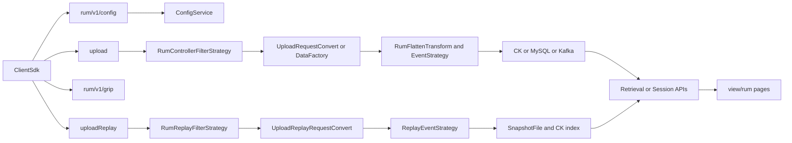

# RUM config / upload / grip / uploadReplay 字段全链路梳理

## 1. 背景与范围

- 本文覆盖 4 类接口/协议：`/rum/v1/config`、`/upload`、`/rum/v1/grip`、`/uploadReplay`。
- 梳理维度统一为：上报接入 -> 数据转换 -> 数据入库 -> 数据查询 -> 数据展示。
- 证据范围：`controller/controller`、`controller/ingester/ingester-business/ingester-rum`、`framework/plugins/rum`、`view/rum`（均位于 `newonexm` 仓库）。

## 2. 端到端流程总览

## 3. Config 协议字段与全链路

### 3.1 ConfigRequest 字段

- 顶层字段：`v`、`di`、`ai`、`ui`、`nsi`、`dfi`
- 接入：`ConfigController.handleRumConfigReq(...)`
- 转换：`RumConfigServiceImpl.execute(...)` 解析请求、校验协议参数与许可
- 入库：config 请求本身不直接入库，读取并命中已有配置缓存/DB
- 查询：`CollectConfigCache` 从配置表加载并按 app/version/group 规则命中
- 展示：前端配置页面通过 `/rest/rum/setting/collect/terminal/*` 展示被下发的配置能力

### 3.2 ConfigResponse 字段

- 顶层字段：
  - 基础：`rc`、`s`、`st`、`rct`、`sat`、`ua`
  - IP 与地址：`di`、`gdia`、`gpa`
  - 采样与开关：`sp`、`spt`、`brss`
  - 模块：`mc`
  - 自定义：`cp`、`cbhk`、`cbbk`、`cbqk`
  - 采集策略：`usc`、`hcs`、`trt`、`ntc`、`irhtc`、`reqhtk`、`reshtk`、`snr`、`prt`
  - 会话配置：`sc`（`sc.it`、`sc.mst`）
- 接入/组装：`RumConfigServiceImpl.buildConfigResponse(...)`
- 关键来源：
  - `ua` 上传地址来自 controller 端地址配置
  - `gdia` 对应 `/rum/v1/grip` 地址下发
  - `mc` 来自终端采集配置表映射
  - `snr`、trace 配置来自网络策略配置
- 入库：这些字段的来源主要在 `t_rum_config_collect_terminal` 等配置表
- 查询与展示：
  - 后端：`TerminalCollectController`、`TerminalCollectServiceImpl`
  - 前端：`ConfigCollectionTerminal` 页面各子模块读取并编辑

### 3.3 模块与嵌套字段（按协议章节）

- `ModuleConfiguration`：`n`、`c`、`tv`、`dft`、`ac`、`src`、`cs`、`lc`
- `SessionReplayConfiguration`：`ua`、`rq`、`fps`、`mci`、`sl`、`ac`、`us`、`ims`、`uc`、`dt`
- `ActionAnalyseConfiguration`：`ac`、`cp`、`mmd`、`aot`
- `LagConfiguration`：`si`、`ist`、`sc`
- `CustomParam`：`log`（`upload_user_info`、`upload_logfile`、`get_logtask`）、`speed`
- `NetworkTraceConfig`：`utl`、`uwl`、`ubl`（及 `HostRule`、`RequestHeaderRule`）
- `SensitiveNetworkRule`：`t`、`sa`、`mk`、`mt`（及 scope、mask keys 子字段）

### 3.4 Config 代码证据

- 接口：`controller/controller/.../ConfigController.java`
- 业务组装：`controller/controller/.../RumConfigServiceImpl.java`
- 模块映射：`controller/controller/.../ModelBuiness.java`
- 配置缓存：`controller/controller/.../CollectConfigCache.java`
- 配置入库 SQL：`framework/plugins/rum/rum-database/.../TerminalCollectMapper.xml`
- 前端展示：`view/rum/src/packages/configurationModule/ConfigCollectionTerminal/...`

### 3.5 Config 协议字段含义（逐字段）

#### 3.5.1 ConfigRequest（客户端请求）

- `v`：探针 SDK 版本号，用于服务端按版本匹配可下发配置。
- `di`：设备信息对象，包含设备标识、机型、系统等设备维度信息。
- `ai`：应用信息对象，包含 appId、应用版本、渠道等应用维度信息。
- `ui`：用户信息对象，包含用户唯一标识及用户属性（可选）。
- `nsi`：网络状态信息对象，主要用于上报当前网络制式等网络上下文。
- `dfi`：端到端打通信息对象，承载 trace 关联所需字段（可选）。

#### 3.5.2 ConfigResponse（服务端响应）

- `rc`：响应码，标识本次 config 请求处理结果。
- `s`：会话 ID，客户端后续 upload 请求使用的会话标识。
- `st`：服务端时间（微秒时间戳），用于客户端校准时间基线。
- `rct`：常规 upload 回传周期（秒）。
- `sat`：本地存储保留时长（小时），用于客户端数据保留策略。
- `ua`：upload 上报地址，客户端按该地址发送监控数据。
- `di`：服务端识别的设备出口 IP。
- `gdia`：获取出口 IP 的接口地址（通常是 `/rum/v1/grip`）。
- `gpa`：获取 ping 目标地址（用于网络探测，可选）。
- `sp`：本次会话启动采样概率（1-100）。
- `spt`：启动采样概率有效时长（分钟）。
- `brss`：融合开关（端侧/链路融合能力总开关）。
- `mc`：模块配置数组，定义各监控模块采样、阈值和细分策略。
- `cp`：客户自定义参数（JSON 字符串，可扩展业务能力）。
- `cbhk`：请求头中需提取的自定义业务字段 key 列表。
- `cbbk`：请求体中需提取的自定义业务字段 key 列表。
- `cbqk`：URL 参数中需提取的自定义业务字段 key 列表。
- `usc`：上传场景限制（如仅 Wi-Fi 上传）。
- `hcs`：请求头采集策略（不采集/仅错误采集/全量采集）。
- `trt`：轨迹阈值（控制轨迹数据采集或裁剪阈值）。
- `ntc`：旧版端到端打通配置（兼容历史 SDK）。
- `irhtc`：请求头插入 trace 的配置对象（新版）。
- `reqhtk`：需要读取的请求头 trace 字段 key 列表。
- `reshtk`：需要读取的响应头 trace 字段 key 列表。
- `snr`：敏感网络数据脱敏规则数组。
- `prt`：pending 请求超时阈值（毫秒）。
- `sc`：会话配置对象。
- `sc.it`：无操作切会话时长阈值（毫秒）。
- `sc.mst`：单会话最大时长阈值（毫秒）。

#### 3.5.3 ModuleConfiguration（模块配置）

- `n`：模块名称（如 `network`、`view`、`action`、`sessionreplay` 等）。
- `c`：该模块采样概率（0-100）。
- `tv`：模块阈值（不同模块语义不同，如 action 异步超时阈值）。
- `dft`：丢帧检测周期（仅帧率类模块生效）。
- `ac`：操作分析配置（仅 action 模块生效）。
- `src`：会话回放配置（仅 sessionreplay 模块生效）。
- `cs`：网络采集策略（network 模块细粒度控制）。
- `cs.fc`：是否全量采集网络请求。
- `cs.wl.hr`：network host 白名单规则列表。
- `cs.wl.pr`：network path 白名单规则列表。
- `lc`：卡顿采集配置（仅 lagstuck 模块生效）。

#### 3.5.4 SessionReplayConfiguration（会话回放配置）

- `ua`：会话回放上传地址（通常为 `/uploadReplay`）。
- `rq`：录制质量（压缩质量或采样质量）。
- `fps`：截图最大采集频率。
- `mci`：最大采集间隔（秒）。
- `sl`：脱敏等级（控制遮罩范围）。
- `ac`：是否允许蜂窝网络上传回放数据。
- `us`：触发上传策略集合（如 crash、anr、lag、onlaunch）。
- `ims`：单次请求图片最大大小（MB）。
- `uc`：回放数据回传周期（秒）。
- `dt`：截图类型（完整截图或线框模式）。

#### 3.5.5 ActionAnalyseConfiguration（操作分析配置）

- `ac`：是否开启操作分析能力。
- `cp`：操作分析采集概率。
- `mmd`：方法调用最大分析深度。
- `aot`：异步操作超时阈值（毫秒）。

#### 3.5.6 LagConfiguration（卡顿采集配置）

- `si`：采样间隔（毫秒）。
- `ist`：启动阶段忽略卡顿检测时长（秒）。
- `sc`：单窗口采样次数（影响卡顿判定灵敏度）。

#### 3.5.7 CustomParam（客户自定义参数）

- `log`：日志回传配置对象，存在则开启日志回传能力。
- `log.upload_user_info`：用户信息日志上传地址。
- `log.upload_logfile`：日志文件上传地址。
- `log.get_logtask`：拉取日志任务指令地址。
- `speed`：站点测速开关对象，存在则启用测速能力。

#### 3.5.8 NetworkTraceConfig（端到端打通配置）

- `utl`：完全匹配规则列表（精确命中 URL 或请求特征）。
- `uwl`：白名单规则列表（命中即参与 trace 注入/提取）。
- `ubl`：黑名单规则列表（命中即排除 trace 注入/提取）。

`HostRule` 子字段：

- `n`：规则名称（便于管理与排查）。
- `t`：匹配类型（全匹配/前缀/后缀/正则/包含）。
- `r`：匹配规则内容。
- `rhr`：命中规则后注入的请求头规则列表。

`RequestHeaderRule` 子字段：

- `rhk`：注入的请求头 key。
- `rht`：注值类型（固定值或 trace 协议类型）。
- `rhv`：注入值（固定值模式时生效）。
- `rhsr`：采样率（trace 协议下生效）。

#### 3.5.9 SensitiveNetworkRule（敏感网络脱敏规则）

- `t`：规则组合方式（按"或"或"且"匹配生效范围）。
- `sa`：生效范围列表（host 或 url 规则）。
- `mk`：敏感字段 key 配置集合。
- `mt`：脱敏方式（不采集或混淆）。

`SensitiveNetworkRuleScope` 子字段：

- `t`：匹配内容类型（host 或 url）。
- `r`：匹配关系（等于/包含/前缀/后缀）。
- `c`：匹配内容。

`SensitiveNetworkRuleMaskKeys` 子字段：

- `aqk`：是否屏蔽全部 URL 参数。
- `areqh`：是否屏蔽全部请求头。
- `aresh`：是否屏蔽全部响应头。
- `qka`：需要脱敏的 URL 参数 key 列表。
- `reqhka`：需要脱敏的请求头 key 列表。
- `reshka`：需要脱敏的响应头 key 列表。

## 4. Upload 协议字段与全链路

### 4.1 Upload 请求字段（协议主包）

- 顶层字段：
  - 会话与时间：`s`、`mt`、`cmt`、`usd`、`sst`
  - 标识：`pid`、`v`、`tid`
  - 基础对象：`di`、`ai`、`as`
  - 状态与扩展：`fui`、`ti`、`ui`、`ds`、`nsi`、`dfi`、`eei`、`evi`、`ifd`
  - 事件：`e`
- 事件结构：
  - `Event`：`k`、`ent`、`sin`、`v`、`tri`、`revts`、`revtt`
  - `TraceInfo`：`ti`、`t`、`i`

### 4.2 Upload 响应字段

- `rc`、`oti`
- `OnlineTrackingInfo`：`tid`、`s`、`hbu`、`ict`、`hbt`

### 4.3 Upload 全链路

- 上报接入：
  - ingester 入口过滤：`RumControllerFilterStrategy.handleInput(...)`
  - 关键校验：`a/d/v/s/mt`、`brkey`、license、gzip 解压
- 数据转换：
  - 协议解析：`UploadRequestConvert.resolve(...)`
  - 通用归一：`DataFactory.buildCommonModel(...)`
  - 事件平铺：`RumFlattenTransform.preProcessing(...)` + `dfsEventFlatten(...)`
  - 事件策略：`UploadEventStrategy` 等按事件类型生成快照/聚合结果
- 数据入库：
  - CK：`CkOutputRumSnapshotStrategy`、`CkOutputRumGranStrategy`
  - MySQL 转发：`MySQLOutputUploadStrategy`
  - Kafka 转发：`DataForwarder.forwardKafka(...)`
- 数据查询：
  - 后端查询入口：`RetrievalController` 系列接口
  - 条件构造：`SnapshotBuildCondition.buildCondition(...)`
  - SQL/视图：`RumSnapshotMapper.xml`（按问题类型查询 snapshot 视图）
- 数据展示：
  - 前端接口：`view/rum/src/services/experience/request.ts`、`view/rum/src/services/retrieval/sessionDetail.ts`
  - 页面：检索中心、会话详情、问题详情页

### 4.4 Upload 关键字段映射（摘要）

- 协议 `usd` -> upload 事件 `durationUs` -> snapshot `otherIndex.duration` -> 前端耗时列
- 协议 `s` -> session 维度键 -> 查询条件与会话详情主键
- 协议 `k`(事件类型) -> 事件策略选择 -> 不同快照视图与问题详情接口
- 协议 `di/ai/ui/nsi/ds` -> `CommonModel` 对象化 -> `otherIndex`/聚合字段 -> 列表筛选与明细展示

## 5. /grip 协议字段与全链路

### 5.1 协议字段

- 返回字段核心：`di`（设备出口 IP）
- 配置联动字段：config 下发 `gdia`（获取出口 IP 地址）

### 5.2 全链路

- 上报接入：`IpController.handleRumGripReq(...)`，路由 `/rum/v1/grip`
- 数据转换：`CommonUtil.anaDeviceIp(...)` 基于 header/remoteIp 解析真实 IP
- 数据入库：无明确入库链路（即时计算即时返回）
- 数据查询：无独立查询 API（本接口直接返回）
- 数据展示：不在 `view/rum` 页面直连，主要由 SDK 侧消费

### 5.3 代码证据

- `controller/controller/.../IpController.java`
- `controller/controller/.../CommonUtil.java`
- `controller/controller/.../PrivateConfig.java`（`global.private.rum.get.ip.address` 默认 `/grip`）
- `controller/controller/.../RumConfigServiceImpl.java`（`gdia` 下发）

## 6. /uploadReplay 协议字段与全链路

> **完整入库/文件清单/查询播放**见专题文档：`会话回放上传入库与查询.md`。本节保留字段与主链路索引。

### 6.1 uploadReplay 请求字段（会话回放）

- 顶层字段：`s`、`v`、`mt`、`cmt`、`di`、`ai`、`ui`、`st`、`ud`、`wev`、`dfi`、`event`、`image`
- 上传特征：`multipart/form-data`，`event/image` 可 gzip（`BR-Content-Encoding:gzip`）
- 图片结构（`SessionReplayImage`）：`i`、`to`、`ss`、`so`、`ka`
- 事件结构（`SessionReplayEvent`）：
  - `msd`（移动端）
  - `wsd`（Web）
  - 其中移动端子字段常见 `to`、`t`、`l`、`vf`、`md`

### 6.2 全链路

- 上报接入：
  - ingester 入口：`RumReplayFilterStrategy`（`RumReplayControllerInput`）
  - `handleMultipartFormDataInput(...)` 解析 multipart attribute 与 fileUpload
- 数据转换：
  - 协议解析：`UploadReplayRequestConvert.resolve(...)`
  - 实体：`ReplayUploadRequestEntity`（`event/image` 为 `byte[]`）
  - 归一处理：`RumReplayCommonTransform.dealData(...)`
  - 策略处理：`ReplayEventStrategy`
- 数据入库：
  - 回放文件：`SnapshotFileService.saveReplaySnapshotFile(...)`
  - 存储调度：`BrfsSaveSnapshotScheduling`（BRFS/NFS）
  - 查询索引：CK replay 相关视图与 `eventFileId` 关联
- 数据查询：
  - 接口：`RumSessionReplayController`
    - `/rest/rum/session/replay/querySessionReplay`
    - `/rest/rum/session/replay/querySessionReplayData`
  - 服务：`RumCkSessionReplayServiceImpl`、`RumSessionReplayDataService4Web`、`RumSessionReplayDataService4Native`
- 数据展示：
  - 前端接口：`view/rum/src/services/retrieval/sessionDetail.ts`
  - 页面：`view/rum/src/packages/retrieval/sessionDetail/container/sessionReplay/...`
  - 播放：`VFramePlay`、`rrWebPlay`

### 6.3 代码证据

- `controller/ingester/ingester-business/ingester-rum/.../RumReplayFilterStrategy.java`
- `controller/ingester/ingester-business/ingester-rum/.../RumReplayInputTransform.java`
- `controller/ingester/ingester-business/ingester-rum/.../UploadReplayRequestConvert.java`
- `controller/ingester/ingester-business/ingester-rum/.../ReplayUploadRequestEntity.java`
- `controller/ingester/ingester-business/ingester-rum/.../ReplayEventStrategy.java`
- `controller/ingester/ingester-business/ingester-rum/.../SnapshotFileService.java`
- `framework/plugins/rum/rum-core/.../RumSessionReplayController.java`
- `framework/plugins/rum/rum-database/.../RumSessionReplayMapper.xml`
- `view/rum/src/services/retrieval/sessionDetail.ts`

## 7. 查询与展示总映射（四类协议）

- `config`：配置管理页读取配置接口，展示并编辑采样、模块、网络策略、会话策略
- `upload`：检索中心/会话详情/问题详情通过 snapshot 与问题明细接口展示
- `grip`：作为 SDK 辅助能力，主要用于出口 IP 获取，不走平台可视化页面主链
- `uploadReplay`：会话详情回放页使用 replay 查询接口，按时间轴拉取并播放 event/image

## 8. 待确认项与风险

- `upload` 与 `uploadReplay` 最外层 HTTP 接入 Controller/Gateway 不在当前四仓完整显式出现，当前证据从 ingester 的 Kafka 输入侧开始闭环
- `grip` 协议在当前范围内未见入库/查询/前端展示链路，属于"即时返回型"接口，和 upload 主数据链路性质不同
- 部分底层 topic/index 常量在本次范围仅能定位到策略与数据源枚举，若需"物理表/topic 全名单"，建议扩展到网关接入层与部署配置仓

## 9. 关键路径索引

- Config 接口：`controller/controller/.../ConfigController.java`
- Grip 接口：`controller/controller/.../IpController.java`
- Upload 过滤：`controller/ingester/ingester-business/ingester-rum/.../RumControllerFilterStrategy.java`
- UploadReplay 过滤：`controller/ingester/ingester-business/ingester-rum/.../RumReplayFilterStrategy.java`
- 通用转换：`controller/ingester/ingester-business/ingester-rum/.../DataFactory.java`
- 平铺转换：`controller/ingester/ingester-business/ingester-rum/.../RumFlattenTransform.java`
- Replay 解析：`controller/ingester/ingester-business/ingester-rum/.../UploadReplayRequestConvert.java`
- 查询 API：`framework/plugins/rum/rum-core/.../RetrievalController.java`、`RumSessionReplayController.java`
- 前端展示：`view/rum/src/services/experience/request.ts`、`view/rum/src/services/retrieval/sessionDetail.ts`

## 10. 字段级一对一映射附录

说明：以下映射以"可落证据的主链路字段"为主，格式为"协议字段 -> 内部模型字段/对象 -> 查询字段或接口参数 -> 前端展示位"。

### 10.1 config 字段映射（核心）

- `v` -> `ConfigRequestEntity.v` -> config 命中条件（app+version+group） -> 配置管理页按版本策略展示
- `ua` -> `ConfigResponseModel.uploadAddress` -> SDK 后续 upload 上报地址 -> 前端不直接展示
- `gdia` -> `ConfigResponseModel.getDeviceIpAddress` -> SDK 后续调用 `/rum/v1/grip` -> 前端不直接展示
- `mc[].n/c` -> `ModelConfigModel.modelConfig` + `collectSwitch/collectRate` -> `t_rum_config_collect_terminal` 对应列 -> `DataCollectionForm` 模块开关/采样率
- `sc.it/sc.mst` -> `sessionInactiveThreshold/sessionMaxThreshold` -> `/getSessionConf`、`/editSessionConf` -> 会话配置表单
- `snr` -> `sensitiveConfig` -> 网络脱敏策略查询与下发 -> 配置页网络相关策略项

### 10.2 upload 字段映射（核心）

- `s` -> `UploadRequestEntity.session` -> 查询参数 `session`（会话类 API） -> 会话详情主键上下文
- `v` -> `UploadRequestEntity.version` -> 维度过滤（版本） -> 详情头部/筛选条件
- `mt/cmt` -> `monitorTimeUs/configMonitorTimeUs` -> 时间窗口过滤 -> 时间轴与明细时间列
- `usd` -> upload 事件 `durationUs` -> `otherIndex.duration` -> 请求/事件耗时展示
- `e[].k` -> `EventEntity.eventType` -> 问题类型路由与 SQL 视图选择 -> 检索中心问题分类与详情页
- `e[].v` -> `EventContentEntity`（按事件类型转换） -> `otherIndex` 各字段 -> 列表列与详情字段
- `di/ai/ui/nsi/ds` -> `CommonModel` 的 device/app/user/network/deviceState -> `otherIndex` + 聚合维度 -> 列表筛选与侧边详情
- `tri` -> `TraceInfoEntity[]` -> 轨迹链路字段 -> 会话轨迹/动作关联展示

### 10.3 grip 字段映射（核心）

- `remoteIp/headers`（请求上下文） -> `CommonUtil.anaDeviceIp(...)` -> `IpResponseModel.di` -> SDK 使用（非页面展示）
- config `gdia` -> `/rum/v1/grip` 地址字符串 -> SDK 网络探测流程 -> 前端不消费

### 10.4 uploadReplay 字段映射（核心）

- `s` -> `ReplayUploadRequestEntity.session` -> `/querySessionReplay` 条件 -> 回放时间轴所属会话
- `st/ud` -> `startTimeUs/unitDurationUs` -> replay 时间片查询与排序 -> 回放进度轴
- `wev` -> `ReplayUploadRequestEntity.webEventVersion` -> replay 查询结果 `otherIndex['wev']` -> rrweb 播放兼容分支
- `event`(byte[]) -> 回放事件文件内容（`SnapshotFileService.saveReplaySnapshotFile`） -> `/querySessionReplayData` -> 播放器事件流
- `image`(byte[]) -> 回放图片文件内容 -> `/querySessionReplayData` -> 帧图渲染
- `di/ai/ui/dfi` -> 回放包基础维度对象 -> replay 记录上下文 -> 会话回放页头部/上下文信息

### 10.5 映射缺口说明

- `/upload`、`/uploadReplay` 在"最外层 HTTP 接入 -> Kafka 首跳"的字段映射未在当前四仓形成完整代码证据，本文从 ingester 输入侧开始做字段映射闭环。
- 若要做到严格"每个协议字段都有物理落点"，需补查网关/collector 接入层仓库与运行配置中心。

## 11. upload 协议逐字段完整处理与页面对照

说明：本章按 `UploadRequest`、`Event`、`TraceInfo`、`UploadDataResponse` 四层描述。每个字段按"接入与校验 -> 转换 -> 入库/索引 -> 查询 -> 页面展示"说明。

### 11.1 UploadRequest 顶层字段

- `s`（会话 ID）
  - 接入与校验：`RumControllerFilterStrategy.checkParam(...)` 作为必填参数校验。
  - 转换：`UploadRequestConvert.resolve(...)` -> `UploadRequestEntity.session`。
  - 入库/索引：进入 `CommonModel.session`，参与 snapshot/gran 记录 session 维度。
  - 查询：会话检索接口按 session 查询（`/rest/rum/session/search/*`）。
  - 页面展示：会话详情页主键上下文、会话轨迹与事件列表。

- `pid`（进程唯一标识）
  - 接入与校验：随包接收，不做强制必填。
  - 转换：`UploadRequestEntity.processId`。
  - 入库/索引：写入事件上下文维度，参与问题聚合的进程关联。
  - 查询：问题明细/会话详情中可作为扩展上下文。
  - 页面展示：主要在详情弹窗或扩展字段区域（不作为主列表默认列）。

- `v`（探针版本）
  - 接入与校验：`checkParam` 必填。
  - 转换：`UploadRequestEntity.version`。
  - 入库/索引：进入 app/version 维度，支持版本分组统计。
  - 查询：检索中心按版本筛选条件。
  - 页面展示：筛选项与详情头信息。

- `mt`（upload 监控时间）
  - 接入与校验：`checkParam` 必填，参与时间窗口合法性判断。
  - 转换：`UploadRequestEntity.monitorTimeUs`。
  - 入库/索引：作为事件时间基准之一写入索引。
  - 查询：时间范围检索、排序与分页边界。
  - 页面展示：记录时间列、详情时间轴。

- `cmt`（config 下发服务器时间）
  - 接入与校验：接收并参与时间校正逻辑。
  - 转换：`UploadRequestEntity.configMonitorTimeUs`。
  - 入库/索引：作为时间校准辅助信息。
  - 查询：一般不直接作为过滤字段。
  - 页面展示：通常不直接展示，作为内部计算字段。

- `di`（设备信息）
  - 接入与校验：对象字段按平台规则校验。
  - 转换：`DeviceInfoConvert` -> `UploadRequestEntity.deviceInfoEntity`。
  - 入库/索引：映射到设备维度字段（设备ID、品牌、型号、OS 等）。
  - 查询：设备维度过滤与聚合统计。
  - 页面展示：会话详情设备信息、问题详情设备区块。

- `ai`（应用信息）
  - 接入与校验：对象字段按 appId/version 校验。
  - 转换：`AppInfoConvert` -> `UploadRequestEntity.appInfoEntity`。
  - 入库/索引：映射到应用维度（appId、appVersion、channel）。
  - 查询：应用与版本筛选、跨版本对比。
  - 页面展示：检索筛选、详情头部。

- `as`（应用状态）
  - 接入与校验：作为状态对象接收。
  - 转换：`UploadRequestEntity.appStateInfoEntity`。
  - 入库/索引：映射前后台状态等上下文。
  - 查询：问题关联上下文筛选。
  - 页面展示：详情态展示（默认列表通常不直接展示）。

- `fui`（首个有效用户信息索引）
  - 接入与校验：可选字段。
  - 转换：`UploadRequestEntity.firstUserInfoIndex`。
  - 入库/索引：用于 user map 与事件索引关联。
  - 查询：会话用户归属推导。
  - 页面展示：用户标签/用户ID展示来源之一。

- `ti`（流量信息数组）
  - 接入与校验：可选字段。
  - 转换：`TrafficInfoConvert` -> `UploadRequestEntity.trafficInfoEntityList`。
  - 入库/索引：网络流量维度补充字段。
  - 查询：网络/会话分析中的扩展维度。
  - 页面展示：通常在详情扩展信息区。

- `ui`（用户信息 Map）
  - 接入与校验：可选，配合 `sin` 索引引用。
  - 转换：`UserInfoConvert` -> `Map<Integer, UserInfoEntity>`。
  - 入库/索引：用户维度归档并被事件引用。
  - 查询：用户筛选、用户维度聚合。
  - 页面展示：会话详情用户区块、检索筛选项。

- `ds`（设备状态 Map）
  - 接入与校验：Android/iOS/Win 常见必传。
  - 转换：`DeviceStateInfoConvert` -> map。
  - 入库/索引：电量、内存、CPU 等运行态上下文。
  - 查询：异常问题上下文分析。
  - 页面展示：详情扩展指标区域。

- `nsi`（网络状态 Map）
  - 接入与校验：按平台规则接收。
  - 转换：`NetworkStateInfoConvert` -> map。
  - 入库/索引：网络类型、运营商、信号等维度。
  - 查询：网络问题筛选和统计。
  - 页面展示：网络请求详情和会话网络上下文。

- `usd`（本次 upload 会话持续时长）
  - 接入与校验：必填语义字段。
  - 转换：在 `UploadRequestConvert.eventInfoConvert(...)` 补充为 upload 事件 `durationUs`。
  - 入库/索引：进入 snapshot `otherIndex.duration`。
  - 查询：记录明细耗时字段与耗时聚合指标。
  - 页面展示：检索列表耗时列、详情耗时展示。

- `tid`（trackID）
  - 接入与校验：可选。
  - 转换：`UploadRequestEntity.trackId`。
  - 入库/索引：链路追踪关联字段。
  - 查询：追踪场景定位与关联查询。
  - 页面展示：通常在 trace 或扩展信息区域。

- `dfi`（端到端打通信息）
  - 接入与校验：可选。
  - 转换：`DataFusionInfoConvert` -> `UploadRequestEntity.dataFusionInfoEntity`。
  - 入库/索引：trace/header 关联字段落索引。
  - 查询：跨系统打通分析。
  - 页面展示：打通链路相关详情区。

- `sst`（会话开始时间）
  - 接入与校验：随包接收。
  - 转换：`UploadRequestEntity.sessionStartTimeUs`。
  - 入库/索引：会话时长与首事件时间计算。
  - 查询：会话时间轴构建。
  - 页面展示：会话开始时间与会话概览。

- `eei`（事件扩展信息 Map）
  - 接入与校验：可选。
  - 转换：`EventExtendInfoConvert` -> map。
  - 入库/索引：事件扩展属性（业务标签等）。
  - 查询：扩展字段筛选与明细透传。
  - 页面展示：详情扩展字段区。

- `evi`（事件视图信息 Map）
  - 接入与校验：可选。
  - 转换：`EventViewInfoConvert` -> map。
  - 入库/索引：页面/视图上下文映射（pageId/pageName 相关）。
  - 查询：页面维度问题检索。
  - 页面展示：页面名称、视图路径、视图上下文。

- `e`（事件数组）
  - 接入与校验：作为核心业务数据接入。
  - 转换：`EventConvert` -> `List<EventEntity>`。
  - 入库/索引：`RumFlattenTransform` 平铺后按事件类型入 snapshot/gran。
  - 查询：问题列表、详情、会话事件时间轴的主数据来源。
  - 页面展示：检索中心列表、问题详情、会话事件流。

- `ifd`（是否首日使用）
  - 接入与校验：可选布尔。
  - 转换：`UploadRequestEntity.firstDay`。
  - 入库/索引：新老用户维度标记。
  - 查询：用户分层分析（首日/非首日）。
  - 页面展示：通常为筛选维度或统计维度。

### 11.2 Event 字段

- `k`（事件类型）
  - 处理：决定事件策略分支（network/h5/jserror/view/action/crash/anr/...）。
  - 入库：映射到不同 snapshot/gran 处理模型。
  - 查询：决定 `/problem/*/detail` 路由与 mapper SQL。
  - 展示：决定前端详情组件渲染模板。

- `ent`（事件发生时间）
  - 处理：作为单事件时间戳，参与预处理修正与排序。
  - 入库：落入时间字段用于时序检索。
  - 查询：列表排序、时间过滤、时间轴聚合。
  - 展示：列表时间列与详情时间。

- `sin`（状态索引）
  - 处理：引用 `ui/ds/nsi/eei/evi` map 中状态快照。
  - 入库：事件关联状态上下文后写索引。
  - 查询：上下文字段回放与明细显示。
  - 展示：详情上下文区块（用户/设备状态/网络状态）。

- `v`（事件内容）
  - 处理：按 `k` 使用对应 Convert 与 Strategy 解析。
  - 入库：写入 `otherIndex` 或结构化字段。
  - 查询：详情字段、列表列值直接来源。
  - 展示：问题详情主体内容（URL、错误信息、页面指标等）。

- `tri`（轨迹数组）
  - 处理：转为 `TraceInfoEntity[]`，关联页面跳转/动作轨迹。
  - 入库：轨迹字段写入会话/事件上下文。
  - 查询：会话轨迹类接口读取。
  - 展示：会话轨迹线、关联事件跳转。

- `revts`（关联事件数组）
  - 处理：作为事件关联关系输入（时间/堆栈关联）。
  - 入库：形成关联链路上下文。
  - 查询：问题详情关联事件读取。
  - 展示：关联事件列表或跳转入口。

- `revtt`（关联类型）
  - 处理：标识关联规则（无/按时间/按堆栈）。
  - 入库：关联关系类型字段。
  - 查询：关联事件选择策略。
  - 展示：关联信息说明或标签。

### 11.3 TraceInfo 字段

- `ti`：轨迹时间。用于轨迹时间排序与播放定位。
- `t`：轨迹类型（launch/view/action/h5/statechange/routechange）。用于前端轨迹节点渲染样式。
- `i`：轨迹信息内容。用于节点文案展示与关联跳转参数。

### 11.4 UploadDataResponse 字段

- `rc`
  - 处理：服务端处理结果返回码。
  - 页面对照：SDK 消费为主，平台前端不直接展示。
- `oti`
  - 处理：在线追踪配置对象。
  - 页面对照：SDK 消费为主，平台前端不直接展示。
- `oti.tid/s/hbu/ict/hbt`
  - 处理：在线追踪会话、心跳地址、即时上传与心跳周期。
  - 页面对照：主要用于端侧行为控制，不作为 RUM Web 管理端常规展示字段。

### 11.5 页面查询展示对照（按功能页面）

- 检索中心列表页（问题/记录列表）
  - 主要来源字段：`e[].k`、`ent`、`e[].v`、`usd(映射duration)`、`ai/di/ui` 维度。
  - 后端接口：`/rest/rum/retrieve-center/record-list`、`/record-stat`。
  - 前端位置：`view/rum/src/packages/retrieval/*` + `view/rum/src/services/experience/request.ts`。

- 问题详情页（network/js/crash/anr/view/action 等）
  - 主要来源字段：事件 `v` 解析后的 `otherIndex` 字段，辅以 `sin` 关联状态。
  - 后端接口：`/rest/rum/problem/*/detail`。
  - 前端位置：`view/rum/src/packages/retrieval/sessionDetail/utils/*` 与各问题详情组件。

- 会话详情页
  - 主要来源字段：`s`、`sst`、`ent`、`tri`、`ui/ds/nsi/evi`、各事件 `v`。
  - 后端接口：`/rest/rum/session/search/*`、`/rest/rum/problem/*/detail`。
  - 前端位置：`view/rum/src/packages/retrieval/sessionDetail/sessionDetail.tsx`。

- 回放页（与 upload 关联）
  - 主要来源字段：upload 提供的会话与事件上下文 + uploadReplay 提供的 event/image。
  - 后端接口：`/rest/rum/session/replay/querySessionReplay*`。
  - 前端位置：`view/rum/src/packages/retrieval/sessionDetail/container/sessionReplay/*`。

## 12. upload 字段矩阵（评审版）

说明：以下为 upload 主字段矩阵，按"字段一行"给出处理位置与展示归宿，便于评审和补证。

- `s` | 接入校验: `RumControllerFilterStrategy.checkParam` | 转换: `UploadRequestEntity.session` | 查询接口: `/rest/rum/session/search/*` | 页面: 会话详情
- `pid` | 接入校验: 可选透传 | 转换: `UploadRequestEntity.processId` | 查询接口: 问题详情扩展上下文 | 页面: 详情扩展字段
- `v` | 接入校验: `checkParam` 必填 | 转换: `UploadRequestEntity.version` | 查询接口: 检索筛选条件 | 页面: 筛选与详情头部
- `mt` | 接入校验: `checkParam` 必填 | 转换: `monitorTimeUs` | 查询接口: 记录列表时间过滤 | 页面: 时间列/时间轴
- `cmt` | 接入校验: 接收并参与时间校正 | 转换: `configMonitorTimeUs` | 查询接口: 内部时间基线 | 页面: 通常不直出
- `di` | 接入校验: 对象合法性 | 转换: `deviceInfoEntity` | 查询接口: 设备维度筛选 | 页面: 设备信息区域
- `ai` | 接入校验: app/version 语义校验 | 转换: `appInfoEntity` | 查询接口: 应用/版本筛选 | 页面: 详情头与筛选
- `as` | 接入校验: 状态对象透传 | 转换: `appStateInfoEntity` | 查询接口: 上下文维度 | 页面: 详情扩展信息
- `fui` | 接入校验: 可选索引 | 转换: `firstUserInfoIndex` | 查询接口: 用户归属推断 | 页面: 用户信息区域
- `ti` | 接入校验: 可选数组 | 转换: `trafficInfoEntityList` | 查询接口: 网络扩展维度 | 页面: 详情扩展信息
- `ui` | 接入校验: map 可选 | 转换: `userInfoEntityMap` | 查询接口: 用户筛选/聚合 | 页面: 用户区块
- `ds` | 接入校验: 平台相关规则 | 转换: `deviceStateInfoEntityMap` | 查询接口: 设备状态分析 | 页面: 详情状态区
- `nsi` | 接入校验: 平台相关规则 | 转换: `networkStateInfoEntityMap` | 查询接口: 网络维度筛选 | 页面: 网络上下文
- `usd` | 接入校验: 语义必填 | 转换: `durationUs`(upload event) | 查询接口: `record-list` 耗时相关字段 | 页面: 耗时列
- `tid` | 接入校验: 可选 | 转换: `trackId` | 查询接口: trace 关联查询 | 页面: 链路扩展信息
- `dfi` | 接入校验: 可选对象 | 转换: `dataFusionInfoEntity` | 查询接口: 打通链路分析 | 页面: trace 相关区域
- `sst` | 接入校验: 接收透传 | 转换: `sessionStartTimeUs` | 查询接口: 会话时间轴 | 页面: 会话概览
- `eei` | 接入校验: 可选 map | 转换: `eventExtendInfoEntityMap` | 查询接口: 扩展字段筛选 | 页面: 详情扩展信息
- `evi` | 接入校验: 可选 map | 转换: `eventViewInfoEntityMap` | 查询接口: 页面维度查询 | 页面: 页面/视图信息
- `e` | 接入校验: 核心事件数组 | 转换: `eventEntityList` | 查询接口: `record-list` + `/problem/*/detail` | 页面: 列表与问题详情
- `ifd` | 接入校验: 可选布尔 | 转换: `firstDay` | 查询接口: 新老用户分层分析 | 页面: 统计筛选维度

### 12.1 Event 字段矩阵

- `k` | 转换: `EventEntity.eventType` | 查询: 选择问题详情接口与 SQL 视图 | 页面: 决定详情组件类型
- `ent` | 转换: `eventTime` | 查询: 时间排序与过滤 | 页面: 时间列
- `sin` | 转换: 状态索引引用 | 查询: 关联 `ui/ds/nsi/eei/evi` | 页面: 上下文区块
- `v` | 转换: 事件内容对象 | 查询: `otherIndex` 字段读取 | 页面: 详情主体字段
- `tri` | 转换: `TraceInfoEntity[]` | 查询: 轨迹相关查询 | 页面: 轨迹链路显示
- `revts` | 转换: 关联事件数组 | 查询: 关联事件读取 | 页面: 关联事件区
- `revtt` | 转换: 关联类型 | 查询: 关联策略判断 | 页面: 关联标签/说明

### 12.2 TraceInfo 字段矩阵

- `ti` | 转换: 轨迹时间 | 查询: 轨迹排序与定位 | 页面: 轨迹节点时间
- `t` | 转换: 轨迹类型 | 查询: 节点类型过滤 | 页面: 节点样式与图标
- `i` | 转换: 轨迹描述 | 查询: 轨迹明细 | 页面: 节点文案

---

## 修订记录

| 日期 | 修订类型 | 修订内容 | 依据 |
|------|---------|---------|------|
| 2026-07-30 | 增量 | §6 增加会话回放专题文档交叉引用 | 新建 `会话回放上传入库与查询.md` |
