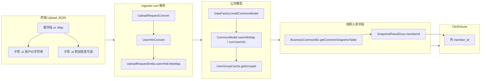

# 数据上报其他逻辑

本文整合三类与数据上报链路相关但相互独立的专题：
1. **brKey 上传去重设计**：基于 `brKey` 的短时去重方案，减少重复上报导致的重复解析与入库。
2. **晚回数据处理**：RUM 模块对监控时间与上报时间存在较大差异的数据的时间戳校验与过滤逻辑。
3. **memberId 全链路**：`memberId` 字段从 Upload 协议 JSON 到 ClickHouse 入库再到查询侧的完整生命周期。

涉及代码仓：`controller/ingester/ingester-business/ingester-rum`（主） + `controller/ingester/ingester-base`（配置） + `controller/ingester/ingester-business/ingester-operator`（存储模型） + `controller/rum-controller`（数据调度） + `framework/plugins/rum`（查询侧），均位于 `newonexm` 仓库。

---

# 第一部分：brKey 上传去重设计

## 一、文档目的与范围

本部分说明 **ingester-rum** 侧与 **brKey** 相关的数据流、既有排重行为，以及基于「**单次 HTTP/SDK 上报维度唯一**」的 brKey 做短时去重、降低重复入库风险的技术方案。

范围侧重 **Controller 标准上报链路**（经 `RumControllerFilterStrategy` → `UploadDataModel` → `CommonModel` → `RumFlattenTransform` 等）。会话回放等其它入口可单独评审是否复用同一套键与开关。

## 二、术语与 brKey 粒度

### 2.1 brKey 粒度定义

**brKey 在一次 HTTP/SDK 上报（单次 upload 请求）内唯一，且随每次新上报重新生成。**

据此可得：

- 同一物理上报若因网络、网关、Kafka 等被 **重复投递**，其 brKey **相同**，属于本方案要消除的「重复」场景。
- **同一会话内**若客户端按协议为 **每一次新的 upload 请求** 分配新 brKey，则多次上报互不冲突，不应被本方案误杀。
- 若客户端实现违反上述约定（例如在多次独立 upload 中复用同一 brKey），启用强去重后可能 **误丢弃合法数据**，属客户端缺陷，需通过 SDK/接入规范约束与监控发现。

### 2.2 与「会话」的关系

去重语义以 **「上报请求」** 为边界，**不以 session 为唯一键**。session 仍用于业务关联；Redis 幂等键推荐带 **应用维度 + brKey**（见下文），避免跨应用碰撞。

## 三、当前链路梳理

### 3.1 接入层（Filter）

类：`com.bonree.one.ingester.rum.filter.RumControllerFilterStrategy`
路径：`controller/ingester/ingester-business/ingester-rum/src/main/java/com/bonree/one/ingester/rum/filter/RumControllerFilterStrategy.java`

| 步骤 | 行为 |
|------|------|
| 读取 | 优先 Kafka Header `brkey`；否则使用 URL 查询参数中的 `brkey`（含 `p` 参数 Base64 解码合并后的参数表）。 |
| 校验 | `brKey` 为空则记录告警并 **丢弃本条**，不向后续算子输出。 |
| 传递 | 构造 `UploadDataModel`（含 `brKey`）；若开启数据转发，经 `DataForwarder` 写入转发 PB 的 `brKey` 字段。 |

### 3.2 模型传递

- `UploadDataModel.brKey` → `DataFactory.buildCommonModel` → `CommonModel.brKey`。
- 下游 Flatten、事件策略等可通过 `CommonModel` 读取 brKey。

### 3.3 既有 Redis 排重（崩溃）

类：`com.bonree.one.ingester.rum.transfer.rumflatten.RumFlattenTransform` 的 `preProcessing`。
路径：`controller/ingester/ingester-business/ingester-rum/src/main/java/com/bonree/one/ingester/rum/transfer/rumflatten/RumFlattenTransform.java`

- **仅**在事件类型为 **崩溃（CRASH）** 时生效。
- Redis 逻辑键形式：`one:brKeyCrash:` + `commonModel.getBrKey()`（经 `RedisUtils.formatKey` 等与现有 RUM 前缀规则一致）。
- 实现为「先 `get`，若已存在则清空本批崩溃事件列表；否则 `set` 带 TTL」，TTL 来自配置 `uploadRepeatValidMinute`（`RumBaseConfig`）。
- **注意**：该逻辑只去掉 **崩溃类型事件**，**不**阻止同包内其它事件类型入库。

### 3.4 常量与历史命名

`ConstantKeys` 中存在 `uploadBrKeyFilter`、`UPLOAD_REPEAT_KEY` 等与「upload 排重」相关的命名；若当前工程内无实际读写，可视为预留或与未来布隆方案统一规划，避免与本文推荐的 Redis 键前缀重复含义、混淆运维。

## 四、业界针对「网络等因素导致重复上报」的常见解决方案

客户端探针 / SDK 在上报路径上常遇到：**超时重试、网关重复转发、负载均衡重放、进程被杀后队列重放、Kafka 至少一次投递** 等，应用层表现为「同一批业务数据被多次送达服务端」。业界通常不追求分布式意义上的严格 exactly-once，而是 **「至少一次投递 + 某层的幂等 / 去重」**。以下按层次归纳常见做法，并与本文 brKey 方案对照。

### 4.1 客户端 / SDK 侧

| 做法 | 说明 | 与本文关系 |
|------|------|------------|
| **幂等键（Idempotency Key）** | 每次「一次业务意义上的上报请求」生成唯一标识（UUID/ULID/业务号），重试时 **原样复用** 同一键；服务端按该键去重。 | **brKey 即此类键**；前提是「单次 HTTP/SDK 上报唯一」且重试不换新键。 |
| **本地持久化发送队列** | 未收到成功确认前保留记录；重试仍发同一载荷与同一幂等键，避免「一次失败生成两个不同 ID」的假重复。 | 与 brKey 语义一致时可显著减少服务端误判。 |
| **退避与抖动（Backoff + Jitter）** | 降低重试风暴导致服务端与网络同时放大。 | 不替代去重，但降低重复包峰值。 |
| **响应语义约定** | 区分可重试错误与不可重试错误；仅在超时/可重试场景重试，减少无谓双写。 | 需接入层与 SDK 协同文档化。 |

### 4.2 传输与 HTTP 接入

| 做法 | 说明 |
|------|------|
| **HTTP `Idempotency-Key` 头** | 支付、开放 API 常见（如 Stripe）：相同键在窗口内重复 POST 返回同一逻辑结果；RUM 可用自定义头或 query 承载等价语义。 |
| **条件请求** | `If-Match` / ETag 等多用于资源更新；对批量遥测较少单独使用，但思想类似「带版本的条件写」。 |

传输层（TCP/QUIC）重传由协议栈处理；**应用仍可能因「客户端认为超时、服务端已处理」而重发**，故仅靠传输层无法消除业务重复。

### 4.3 消息中间件与采集管道

| 做法 | 说明 |
|------|------|
| **Kafka Producer 幂等** | `enable.idempotence=true` 等，避免 **单 producer 会话内** 因重试导致的日志重复写入 broker。 |
| **事务型 Producer + 消费隔离** | `transactional.id` 与 `read_committed`；多用于「多分区、多消息」强一致场景，成本与运维复杂度高于 RUM 常见 ingest。 |
| **Broker / Connect 去重** | 部分托管管道提供基于 key 的重复数据折叠；仍常与下游业务幂等键配合。 |

注意：消息层幂等多解决 **producer 到 broker** 段；**跨系统、跨消费组重放、业务重试** 仍依赖 **业务幂等键**（如 brKey）或下游去重。

### 4.4 服务端摄入（Ingest / 流计算）

| 做法 | 说明 | 与本文关系 |
|------|------|------------|
| **短时 KV 去重（SET NX + TTL）** | 窗口内同一键只处理一次；实现简单，适合「重试 + 重复投递」时间窗有限。 | **本文推荐主路径**。 |
| **布隆 / 布谷鸟等概率结构** | 省内存、可承载更大量级；存在可控误判（假阳性丢弃需业务容忍或二次校验）。 | 与 `ConstantKeys` 中历史命名可衔接；适合超大规模或成本敏感场景；**详设见第八节**。 |
| **有状态流处理** | Flink `KeyedProcessFunction` / 状态 TTL、Kafka Streams 等按 key 做窗口内去重。 | 与 Redis 方案二选一或组合（状态在算子 vs 在外部 Redis）；**Flink 详设见第九节**。 |

### 4.5 存储与查询层（最终一致）

| 做法 | 说明 |
|------|------|
| **主键 / 唯一约束 + Upsert** | 如 PostgreSQL `ON CONFLICT DO NOTHING`、MySQL 唯一键忽略插入；**幂等键需能映射到稳定主键**。 |
| **ClickHouse `ReplacingMergeTree` / 版本列** | 异步合并去重；查询侧需注意 `FINAL` 或聚合策略对性能的影响。 |
| **湖仓表格式** | Iceberg、Delta 等提供的 merge/duplicate handling，偏离线或准实时数仓链路。 |

业界 APM / RUM / 错误监控类产品，对外多强调 **采样、压缩、边缘接入**；对内通常至少具备 **请求级或事件级幂等键 + ingest 窗口去重 + 存储合并** 中若干层的组合，以覆盖「客户端—网关—消息—计算—存储」全链路的重复来源。

### 4.6 与本方案的组合建议

- **客户端**：保证 brKey 与「一次上报」绑定且重试复用（§2.1）。
- **Ingest**：短时 Redis `SET NX`（第六节）拦截重复包。
- **存储**（按需）：对计费、合规强场景增加 **库表级幂等**（第五节非目标中已说明可另立项）。

## 五、目标与非目标

### 5.1 目标

- 在 **brKey 粒度 = 单次 HTTP/SDK 上报唯一** 的前提下，对 **重复消息**（同 app + 同 brKey 在 TTL 窗口内再次进入 ingest）进行拦截，减少 **重复解析与重复入库**。
- 与现有 **崩溃专用** brKey 排重并存时，职责清晰、可观测、可灰度。

### 5.2 非目标（可另立项）

- 不替代存储层长期幂等（Redis TTL 过期后仍可能重复写库，若业务要求「永久不重复」需 **库表 / 引擎级** 去重）。
- 不修正客户端错误复用 brKey 的数据；仅能通过规范与告警治理。

## 六、推荐方案概述

在 **Flatten 层**（`commonModel` 已构建、`appId` 与 `brKey` 可用）或 **Filter 层**（更早、更省算力）增加 **整包 upload 级** 去重：

- 使用 Redis **`SET` + `NX` + `EX`/`PX`**（或等价 `SET key value NX EX ttl`），保证并发下仅 **一个** 消费者认为「首次」。
- 键必须包含 **应用隔离**，例如：
  `one:brKeyUpload:{appId}:{brKey}`
  与 `one:brKeyCrash:{brKey}` 前缀区分：**upload 包级** vs **崩溃事件级**。
- **物理 key** 必须与现有 `RedisUtils` 对 `one:brKey*` 的 `formatKey` / RUM 前缀规则一致（与 `one:brKeyCrash` 同一套规范），避免写到错误集群或前缀。

**与崩溃排重的关系：**

- 若 **upload 包级** 判定为重复：建议 **整包不再向下游输出**（所有事件类型均不进入后续 Flatten 输出），则不会触发同包内崩溃分支的二次写入问题。
- 若 **未** 命中 upload 重复：各事件类型仍走原逻辑；崩溃分支仍可使用 `one:brKeyCrash:{brKey}` 做崩溃维度的短时保护（两键职责不同，可同时存在）。

## 七、详细设计

### 7.1 判定时机与一致性语义

| 策略 | 含义 | 适用 |
|------|------|------|
| 先占位后处理 | `SET NX` 成功后再解析/写库；失败则整包丢弃。吞吐高，实现简单。 | 默认可选；存在进程在占位成功后崩溃导致 **at-most-once** 业务丢数风险。 |
| 写库成功后再占位 | 重复消费仍会多次写库，需配合幂等写或事务 OUTBOX。 | 对一致性要求极高时考虑，实现成本高。 |

在「brKey = 单次上报唯一」前提下，**短时窗口内**重复多为重试/重投，工程上多采用 **先占位后处理** 并接受极端故障下的漏数风险，或通过 **缩短单次处理时间 + 监控** 缓解。

### 7.2 TTL 与配置建议（Nacos / RumBaseConfig）

建议独立或复用已有分钟级配置，便于灰度：

| 配置项（示例键名） | 说明 |
|--------------------|------|
| `upload.brkey.dedup.enabled` | 是否启用整包 brKey 去重，默认 `false`，便于灰度。 |
| `upload.brkey.dedup.minute` | TTL（分钟）；可与 `uploadRepeatValidMinute` 一致或略大，以覆盖 Kafka 滞后与客户端重试。 |

### 7.3 可观测性

- **日志**：与崩溃告警区分文案，建议使用固定前缀，例如：`重复的brKey上传[upload packet]`，并带上 `appId`、`brKey`（必要时脱敏）、`session`、`appMd5` 等定位字段。
- **统计**：可走现有算子「数据主动过滤」类统计（如 `FILTER_COMPONENT_ERROR`），或单独指标名，便于大盘区分 **upload 包级** 与 **crash 事件级** 丢弃量。

### 7.4 回放与其它入口

会话回放若同样携带 brKey 且语义为「单次回放请求唯一」，可复用同一键前缀但建议 **增加来源维度**（例如 `one:brKeyUpload:replay:{appId}:{brKey}`），避免与 Controller 上报互相误伤。未评审前默认 **仅 Controller 链路** 启用。

### 7.5 测试与验收要点

- 同 `appId` + 同 `brKey` 在 TTL 内第二次进入：应丢弃且日志/指标符合预期。
- TTL 过期后同 `brKey` 再次上报：应视为新周期，允许通过（若客户端每次新上报均换新 brKey，则与业务一致）。
- 不同 `appId`、相同 `brKey` 字符串：应 **互不** 去重（验证应用隔离）。
- 并发：多 subtask 同时消费「逻辑上同一条重复消息」时，仅一条 `SET NX` 成功，其余应丢弃。

## 八、备选详设一：布隆过滤器（Bloom Filter）去重

**适用场景**：QPS 极高、**可接受极低比例误判丢弃**（假阳性），希望 **显著降低 Redis 内存与单次远程访问**；与 `ConstantKeys.uploadBrKeyFilter` 等「upload 级布隆」命名空间可自然衔接。

### 8.1 原理与在「重复上报」中的语义

- 布隆过滤器用多个哈希函数将元素映射到 **定长 bit 数组**；只支持 **插入** 与 **「可能存在」查询**。
- **性质**：对已插入的 `dedupKey`（建议 `appId + ":" + brKey` 的稳定字符串或其哈希），查询为 **真** 的概率为 1；对 **未插入** 的键，查询仍可能为 **真**（**假阳性**），概率记为 \(p\)。**不存在假阴性**（未插入却判为「一定不存在」——即判「不存在」时可认为此前未见过该键）。
- **去重判定（保守策略）**：
  - 若 `mightContain(dedupKey) == false` → 视为 **首次**，放行并执行 `put(dedupKey)`。
  - 若 `mightContain(dedupKey) == true` → 视为 **可能重复**，**丢弃**（其中含 \(p\) 比例的 **误杀**）。

因此布隆方案本质是 **用可控误判换内存与吞吐**；RUM 若对「少丢一条真实数据」极敏感，应优先 **Redis SET NX** 或 **存储层幂等**，布隆作辅或仅作 **预过滤**（阳性再走 Redis 精确确认）。

### 8.2 工程形态（三选一或组合）

| 形态 | 做法 | 要点 |
|------|------|------|
| **RedisBloom（BF / CF）** | 使用带 RedisBloom 模块的集群；`BF.ADD` / `BF.EXISTS` 或布谷鸟 `CF`。 | 与现有 `RedisUtils` 封装风格统一；需运维确认模块与内存上限。 |
| **应用内布隆 + 周期快照** | JVM 内 `BloomFilter`（Guava 等），定期持久化到磁盘 / 上传至对象存储；多实例各自一份或分片。 | 无 Redis 依赖；多副本间 **不天然一致**，重复在副本切换时仍可能出现，需 **分片路由** 或接受弱一致。 |
| **分片布隆** | `dedupKey` 哈希到固定分片，每分片独立布隆（或 Redis 单 key）。 | 控制单过滤器元素规模，使 \(p\) 维持在目标以下。 |

### 8.3 参数设计（与窗口/TTL 对齐）

- 预估窗口内 **不重复** 上报条数上限 \(n\)（可按 app 分片则每片 \(n\) 更小）、可接受假阳性率上界 \(p\)（如 `1e-4`～`1e-6`），由经典公式确定 **bit 数组长度 \(m\)** 与 **哈希函数个数 \(k\)**（实现库通常提供 `expectedInsertions` + `fpp` 构造器）。
- **时间维度**：布隆一般 **不带 TTL**；要与「仅短时重复有意义」对齐，可采用：
  - **滚动时间桶**：按分钟/小时切换 `BloomKey_202604231430`，过期桶整段淘汰；或
  - **双层**：当前桶布隆 + 上一桶布隆，重叠覆盖重试长尾。
- **键空间**：`dedupKey = f(appId, brKey)`，必须 **与第六节中应用隔离语义一致**。

### 8.4 与主路径（SET NX）的衔接方式

- **布隆前置**：先 `BF.EXISTS`，为 `false` 则放行；为 `true` 再调 **精确去重**（如 `SET NX` 或 DB）二次确认，降低 Redis 写放大，仅放大读与 CPU。
- **仅布隆**：无二次确认时实现最简单，但需 **压测标定 fpp** 并接受误杀 SLA。

### 8.5 可观测与验收

- 指标：`bloom_positive_total`、`bloom_false_positive_estimate`（由理论 fpp 与流量估算）、`after_bloom_second_check_pass` 等。
- 验收：在目标 \(n\)、\(p\) 下做 **随机键压测**，观测误杀率是否落在模型上界内；线上可 **采样对账**（布隆判重后仍异步写审计队列抽验）。

## 九、备选详设二：Flink 按窗口 + 键控状态去重

**适用场景**：重复已进入 **Kafka / Flink 管道**，希望在 **流计算层** 统一折叠；具备 Flink 运维与 **状态后端**（RocksDB）容量规划能力。

### 9.1 核心思路

- 对逻辑键 **`dedupKey = appId + ":" + brKey`**（或 `Tuple2`）做 **`keyBy`**，保证 **同一键同一并行度子任务** 上串行更新状态，从而在分布式下仍保持 **每个键一条语义序列**。
- 在 **时间窗口** 内「每个键只保留第一次」或「只保留最后一次」，典型用于 **重试窗口内的重复包**；窗口外的新上报应使用 **新 brKey**（§2.1），故跨窗口与业务语义一致。

### 9.2 处理时间 vs 事件时间

| 模式 | 含义 | RUM ingest 建议 |
|------|------|-----------------|
| **Processing Time** | 以算子机器处理时刻为时间轴。 | **默认推荐**：与「服务端收到重复包」语义一致，实现简单，Watermark 乱序压力小。 |
| **Event Time** | 以业务时间戳为轴，需 Watermark 与 **迟到数据** 策略。 | 仅当重复判定必须与 **用户设备时间** 严格对齐时采用；需评估乱序与窗口延迟。 |

### 9.3 典型实现模式

**模式 A：键控状态 + 状态 TTL（与业务 TTL 对齐，推荐与 §7.2 分钟数一致）**

- API 思路（概念代码）：`keyBy(dedupKey)` → `KeyedProcessFunction`，在 `ValueState<Boolean>` 或 `MapState` 中记录「本键是否已放行」；为状态配置 **State TTL**（如 `ProcessingTime` 下 `updateTTLOnCreateAndWrite` + `ttl` = 去重窗口分钟数）。
- **首次**到达：`state.value() == null` → 置位、**侧输出/下游** 放行；**重复**到达：状态仍存在 → **丢弃**。
- **优点**：不依赖窗口边界对齐，逻辑等价于 **每个 dedupKey 一个滑动过期**；与 Redis TTL 语义接近。
- **注意**：Checkpoint 恢复后状态恢复，仍满足「窗口内不重复」；需为状态配置 **最小空闲状态保留时间** 与 **RocksDB 增量 TTL 压缩** 等运维参数。

**模式 B：滚动 / 滑动窗口 + 归约**

- `keyBy(dedupKey).window(TumblingProcessingTimeWindows.of(Time.minutes(W)))`：窗口内多条仅保留一条（如 `reduce` 取第一条非空载荷）。
- **边界问题**：同一 `brKey` 若在 **相邻两个窗口各出现一次**（极端时钟或超长重试），可能被各窗口各放行 **一次** → **重复入库**。缓解：
  - 将窗口长度 **设为不小于** 客户端+Kafka 重试上界，且与 §2.1「每次新上报新 brKey」联调；或
  - 与 **模式 A** 或 **Redis SET NX** 组合，由外层强幂等兜底。

**模式 C：`KeyedStream` 去重算子（若使用 Flink SQL）**

- `Deduplicate` / `ROW_NUMBER() OVER (PARTITION BY dedupKey ORDER BY proc_time)` 保留 `rn=1` 等（具体语法随 Flink 版本变化），本质仍为 **键控 + 时间排序**。

### 9.4 并行度、Checkpoint 与端到端语义

- **并行度**：`keyBy` 后同一 `dedupKey` 固定到同一 subtask，去重逻辑 **线程安全** 由单线程保证。
- **Checkpoint**：启用 **Exactly-once checkpoint** 时，状态与 Kafka offset 可一起恢复，**已确认去重的键** 在故障重启后仍不重复放行（在 TTL 内）。
- **端到端**：若 Sink 为 **至少一次**，Flink 内去重后仍可能因 Sink 重试产生重复写，需 **Sink 幂等**（幂等键或 CK ReplacingMergeTree）闭环。

### 9.5 与 Redis 主路径的对比与选型

| 维度 | Redis `SET NX` + TTL | Flink 状态 / 窗口去重 |
|------|----------------------|-------------------------|
| 重复发生位置 | 任意多实例 ingest **共享** Redis 即可全局一致 | 依赖 **同一 Flink 作业** 内状态；多作业重复消费需额外协调 |
| 运维 | Redis 集群与键规范 | Job 并行度、状态大小、Checkpoint 存储 |
| 延迟 | 单次网络 RTT | 通常在流内完成，无额外 RPC（除非 chained 外 sink） |
| 与现有 ingester-rum 集成 | 在现有 Filter/Flatten 旁路调用即可 | 需在 **Flink 作业** 中实现独立算子或子图，与当前 Java 算子链改造量较大 |

**结论**：若当前架构以 **Kafka + 多实例 Java ingester** 为主，**Redis SET NX** 仍为落地成本最低的全局去重；Flink 详设适用于 **已存在或规划将 ingest 迁入 Flink** 的路线。布隆适合 **超大规模下的成本优化** 或与 Redis **二级过滤**组合。

## 十、风险与依赖

| 风险 | 说明与缓解 |
|------|------------|
| 客户端复用 brKey | 违反「单次上报唯一」时误杀；缓解：SDK 文档、线上告警、采样对账。 |
| Redis 不可用 | 需定义失败策略（放行则可能重复入库；拒绝则丢数）；建议熔断与监控。 |
| 与崩溃键混淆 | 严格区分 `one:brKeyUpload:` 与 `one:brKeyCrash:` 前缀及文档。 |
| 布隆假阳性 | 仅布隆无精确确认时可能误丢数据；缓解：§8 降 fpp、滚动桶、或与 Redis 二级确认。 |
| Flink 窗口边界 | 纯滚动窗口可能跨窗重复放行；缓解：§9 状态 TTL 模式或与 Redis 组合。 |

## 十一、实施顺序建议

1. 发布/对齐 SDK 与接入文档：**brKey 必须每次 HTTP/SDK 上报唯一生成**。
2. 落地 Redis `SET NX` + 应用维度键 + Nacos 开关，默认关闭。
3. 灰度开启，观察 upload 级与 crash 级丢弃指标及业务投诉。
4. 若有「TTL 外仍绝不重复」的合规或计费要求，补充 **存储层幂等**（唯一键或 ReplacingMergeTree 等）。

---

# 第二部分：晚回数据处理

## 十二、概述

本部分详细分析 RUM 模块如何处理晚回数据（late data），以及时间戳的校验过滤逻辑。

### 12.1 核心概念

#### 时间字段说明

- **monitorTime (mt)**：监控时间，事件实际发生的时间（微秒，需要除以1000转换为毫秒）
- **uploadTime**：上报时间，数据上报到服务器的时间
- **eventTime**：事件时间，单个事件的发生时间
- **configMonitorTime (cmt)**：配置监控时间

#### 晚回数据定义

晚回数据是指监控时间（monitorTime）与上报时间（uploadTime）之间存在较大时间差的数据，通常由于：
- 客户端网络延迟
- 客户端离线后重新上线
- 数据重传机制
- 系统时间不同步

## 十三、时间戳校验过滤逻辑

### 13.1 配置参数

#### 时间窗口配置

```java
// 配置项位置：RumBaseConfig.java
// 路径：controller/ingester/ingester-common/src/main/java/com/bonree/one/ingester/common/config/rum/RumBaseConfig.java

/**
 * 事件时间校验 - 过去多少小时
 * 默认值：24小时
 * 配置键：global.private.rum.controller.rowPastLimitDay
 */
public Integer controllerRowPastLimitDay;  // 默认：24

/**
 * 事件时间校验 - 未来多少小时
 * 默认值：12小时
 * 配置键：global.private.rum.controller.rowFutureLimitDay
 */
public Integer controllerRowFutureLimitDay;  // 默认：12

/**
 * 数据保存时间限制开关
 * 配置键：global.private.rum.data.save.ent.limit
 */
public boolean dataSavaEntLimit;

/**
 * 数据修正开关（时间校准）
 * 默认值：true（开启）
 * 配置键：global.private.rum.controller.time.aligned
 */
public boolean controllerTimeAligned;  // 默认：true
```

#### 时间窗口计算

```java
// 代码位置：DataFactory.java, DataSchedulingServer.java

Date nowDate = new Date();
// 计算时间窗口：当前时间往前推 controllerRowPastLimitDay 小时
Date beforeDate = DateUtils.addHours(nowDate, -RumBaseConfig.getInstance().controllerRowPastLimitDay);
// 计算时间窗口：当前时间往后推 controllerRowFutureLimitDay 小时
Date afterDate = DateUtils.addHours(nowDate, RumBaseConfig.getInstance().controllerRowFutureLimitDay);
```

**默认时间窗口**：
- 过去：当前时间 - 24小时
- 未来：当前时间 + 12小时
- 有效范围：[当前时间-24小时, 当前时间+12小时]

### 13.2 时间戳校验核心逻辑

#### checkTimeRange 方法

**代码位置**：`DataCheckUtil.checkTimeRange()`
路径：`controller/ingester/ingester-assemble/src/main/java/com/bonree/one/ingester/assemble/operator/rum/util/DataCheckUtil.java`（也存在于 `controller/rum-controller/data-handler/` 下）

```java
/**
 * 时间范围校验
 * @param nowDate 当前时间
 * @param beforeDate 时间窗口起始时间（当前时间 - controllerRowPastLimitDay小时）
 * @param afterDate 时间窗口结束时间（当前时间 + controllerRowFutureLimitDay小时）
 * @param monitorTime 监控时间（毫秒）
 * @param sessionId 会话ID
 * @param appMd5 应用MD5
 * @param event 事件类型
 * @return 0：需要替换monitorTime为当前时间
 *         1：事件过滤掉（丢弃数据）
 *         2：不需要处理（时间在有效范围内）
 */
public static Integer checkTimeRange(Date nowDate, Date beforeDate, Date afterDate,
                                     Long monitorTime, String sessionId, String appMd5, String event) {
    // 判断是否开启时间控制
    boolean timeFlag = false;
    if (baseConfig.dataSavaEntLimit && monitorTime != null) {
        // 判断监控时间是否在时间窗口外
        timeFlag = beforeDate.getTime() > monitorTime || afterDate.getTime() < monitorTime;
    }

    // 时间不符合配置，需要过滤或校准处理
    if (timeFlag) {
        if (baseConfig.controllerTimeAligned) {
            // 开启时间校准：将时间替换成当前时间，并记录警告日志
            log.warn(
                "[time range check][time aligned][{}]"
                + "upload monitor time is not within the specified range "
                + "[mt:{}][sessionId:{}][appMd5:{}][modify current time:{}]",
                event, monitorTime, sessionId, appMd5, nowDate.getTime());
            return 0;  // 需要替换时间
        } else {
            // 没有时间校准：直接过滤数据，并记录过滤日志
            log.warn(
                "[time range check][data filter][{}]"
                + "upload monitor time is not within the specified range "
                + "[mt:{}][sessionId:{}][appMd5:{}][current time:{}]",
                event, monitorTime, sessionId, appMd5, nowDate.getTime());
            return 1;  // 事件过滤掉
        }
    }
    return 2;  // 时间在有效范围内，不需要处理
}
```

#### 校验逻辑流程图

```
开始
  ↓
检查 dataSavaEntLimit 是否开启
  ↓ 否
直接返回 2（不处理）
  ↓ 是
检查 monitorTime 是否为空
  ↓ 是
返回 2（不处理）
  ↓ 否
判断 monitorTime 是否在时间窗口内
  ↓
[beforeDate, afterDate] 范围内？
  ↓ 是
返回 2（时间有效，不处理）
  ↓ 否
检查 controllerTimeAligned 是否开启
  ↓ 是
返回 0（需要替换为当前时间）
  ↓ 否
返回 1（过滤掉数据）
```

### 13.3 数据上报层校验

#### 上报数据时间校验

**代码位置**：`DataFactory.convertOtherInfo()`, `DataSchedulingServer.dataScheduling()`

```java
// 1. 校验 upload mt 时间
Date nowDate = new Date();
Date beforeDate = DateUtils.addHours(nowDate, -RumBaseConfig.getInstance().controllerRowPastLimitDay);
Date afterDate = DateUtils.addHours(nowDate, RumBaseConfig.getInstance().controllerRowFutureLimitDay);

if (uploadRequestEntity.getMonitorTimeUs() != null) {
    Integer checkTimeRange = DataCheckUtil.checkTimeRange(
        nowDate, beforeDate, afterDate,
        uploadRequestEntity.getMonitorTimeUs() / 1000L,  // 微秒转毫秒
        uploadRequestEntity.getSession(),
        param.get("a"), "upload");

    if (checkTimeRange == 0) {
        // 需要替换monitorTime为当前时间
        uploadRequestEntity.setMonitorTimeUs(nowDate.getTime() * 1000L);
    } else if (checkTimeRange == 1) {
        // 事件过滤掉（丢弃整个上报包）
        throw new RuntimeException("upload time out of range");
        // 或 return;（在 DataSchedulingServer 中）
    }
}
```

#### 精简模式（PruneMode）处理

```java
boolean isPruneMode = Objects.equals(mode, "1");

if (isPruneMode) {
    // 如果 monitorTimeUs 为空，尝试从参数中获取
    if (uploadRequestEntity.getMonitorTimeUs() == null) {
        if (param.containsKey("mt")) {
            uploadRequestEntity.setMonitorTimeUs(Long.valueOf(param.get("mt")));
        } else {
            // 如果参数中也没有，使用当前时间
            uploadRequestEntity.setMonitorTimeUs(nowDate.getTime() * 1000L);
        }
    }

    // 同样处理 configMonitorTimeUs
    if (uploadRequestEntity.getConfigMonitorTimeUs() == null) {
        if (param.containsKey("cmt")) {
            uploadRequestEntity.setConfigMonitorTimeUs(Long.valueOf(param.get("cmt")));
        } else {
            uploadRequestEntity.setConfigMonitorTimeUs(nowDate.getTime() * 1000L);
        }
    }
}
```

### 13.4 事件层校验

#### 事件时间校验

**代码位置**：`DataSchedulingServer.filterEvent()`
路径：`controller/rum-controller/data-handler/src/main/java/com/bonree/rum/data/business/DataSchedulingServer.java`

```java
public static Map<EventTypeEnum, List<EventEntity>> filterEvent(
    CommonModel commonModel, List<EventEntity> eventList,
    Date nowDate, Date beforeDate, Date afterDate, boolean isPruneMode) {

    Map<EventTypeEnum, List<EventEntity>> eventMenu = new HashMap<>();
    for (EventEntity event : eventList) {
        // 精简模式：只允许自定义事件
        if (isPruneMode && !pruneModeEvent.contains(event.getType())) {
            log.warn("pruneMode event filter: {}", event.getType());
            continue;
        }

        // 校验事件时间
        if (event.getEventTime() != null) {
            Integer checkTimeRange = DataCheckUtil.checkTimeRange(
                nowDate, beforeDate, afterDate,
                event.getEventTime() / 1000L,  // 微秒转毫秒
                commonModel.getSession(),
                commonModel.getAppInfoEntity().getAppMD5(),
                event.getType().getType());

            if (checkTimeRange == 0) {
                // 需要替换eventTime为当前时间
                event.setEventTime(nowDate.getTime() * 1000L);
            } else if (checkTimeRange == 1) {
                // 事件过滤掉（跳过该事件）
                continue;
            }
        }

        // JS错误事件的特殊处理：校验 pageCreateTime
        if (EventTypeEnum.JS_ERROR_EVENT.equals(event.getType())) {
            JSErrorEventEntity jsErrorEventEntity = (JSErrorEventEntity) event.getEvent();
            if (jsErrorEventEntity.getPageCreateTime() != null) {
                Integer checkJsTimeRange = DataCheckUtil.checkTimeRange(
                    nowDate, beforeDate, afterDate,
                    jsErrorEventEntity.getPageCreateTime() / 1000L,
                    commonModel.getSession(),
                    commonModel.getAppInfoEntity().getAppMD5(),
                    event.getType().getType());

                if (checkJsTimeRange == 0) {
                    jsErrorEventEntity.setPageCreateTime(nowDate.getTime() * 1000L);
                } else if (checkJsTimeRange == 1) {
                    continue;  // 过滤掉该事件
                }
            }
        }

        // 其他业务过滤逻辑
        if (DataCheckUtil.eventEntityFilter(commonModel, event, isPruneMode)) {
            continue;
        }

        // 递归过滤子事件
        filterChildEvents(commonModel, event, nowDate, beforeDate, afterDate, isPruneMode);

        // 添加到结果集
        eventMenu.computeIfAbsent(event.getType(), k -> new ArrayList<>()).add(event);
    }
    return eventMenu;
}
```

#### 子事件递归校验

**代码位置**：`DataSchedulingServer.filterChildEvents()`

```java
private static void filterChildEvents(CommonModel commonModel, EventEntity parentEvent,
                                      Date nowDate, Date beforeDate, Date afterDate, boolean isPruneMode) {
    if (parentEvent.getRelatedEvents() != null && !parentEvent.getRelatedEvents().isEmpty()) {
        List<EventEntity> filtered = new ArrayList<>();
        for (EventEntity eventRelatedItem : parentEvent.getRelatedEvents()) {
            // 先进行业务过滤
            if (!DataCheckUtil.eventEntityFilter(commonModel, eventRelatedItem, isPruneMode)) {

                // 校验子事件时间
                if (eventRelatedItem.getEventTime() != null) {
                    Integer checkTimeRange = DataCheckUtil.checkTimeRange(
                        nowDate, beforeDate, afterDate,
                        eventRelatedItem.getEventTime() / 1000L,
                        commonModel.getSession(),
                        commonModel.getAppInfoEntity().getAppMD5(),
                        eventRelatedItem.getType().getType());

                    if (checkTimeRange == 0) {
                        eventRelatedItem.setEventTime(nowDate.getTime() * 1000L);
                    } else if (checkTimeRange == 1) {
                        continue;  // 过滤掉该子事件
                    }
                }

                // JS错误事件的特殊处理
                if (EventTypeEnum.JS_ERROR_EVENT.equals(eventRelatedItem.getType())) {
                    // ... 类似处理
                }
            }

            // 递归处理子事件的子事件
            filterChildEvents(commonModel, eventRelatedItem, nowDate, beforeDate, afterDate, isPruneMode);
            filtered.add(eventRelatedItem);
        }
        if (!filtered.isEmpty()) {
            parentEvent.setRelatedEvents(filtered);
        }
    }
}
```

## 十四、处理策略

### 策略 1：时间校准模式（controllerTimeAligned = true）
- **行为**：将超出时间窗口的监控时间替换为当前时间
- **优点**：保留数据，避免数据丢失
- **缺点**：时间不准确，可能影响数据分析
- **日志**：记录警告日志，包含原始时间和替换后的时间

### 策略 2：数据过滤模式（controllerTimeAligned = false）
- **行为**：直接丢弃超出时间窗口的数据
- **优点**：保证数据时间准确性
- **缺点**：数据丢失，可能影响数据完整性
- **日志**：记录过滤日志，包含被过滤的数据信息

## 十五、校验层级

### 层级 1：上报包级别
- **位置**：`DataFactory.convertOtherInfo()`, `DataSchedulingServer.dataScheduling()`
- **校验对象**：`uploadRequestEntity.getMonitorTimeUs()`
- **处理方式**：
  - checkTimeRange = 0：替换为当前时间
  - checkTimeRange = 1：丢弃整个上报包

### 层级 2：事件级别
- **位置**：`DataSchedulingServer.filterEvent()`
- **校验对象**：`event.getEventTime()`
- **处理方式**：
  - checkTimeRange = 0：替换为当前时间
  - checkTimeRange = 1：跳过该事件（不影响其他事件）

### 层级 3：子事件级别
- **位置**：`DataSchedulingServer.filterChildEvents()`
- **校验对象**：`eventRelatedItem.getEventTime()`
- **处理方式**：
  - checkTimeRange = 0：替换为当前时间
  - checkTimeRange = 1：跳过该子事件（不影响父事件和其他子事件）

### 层级 4：特殊字段级别
- **位置**：`DataSchedulingServer.filterEvent()`（JS错误事件）
- **校验对象**：`jsErrorEventEntity.getPageCreateTime()`
- **处理方式**：与事件级别相同

## 十六、配置建议

### 场景 1：严格时间要求
```properties
# 开启时间限制
global.private.rum.data.save.ent.limit=true
# 关闭时间校准（直接过滤）
global.private.rum.controller.time.aligned=false
# 过去时间窗口：24小时
global.private.rum.controller.rowPastLimitDay=24
# 未来时间窗口：12小时
global.private.rum.controller.rowFutureLimitDay=12
```
**效果**：超出时间窗口的数据会被直接过滤，保证数据时间准确性

### 场景 2：数据完整性优先
```properties
# 开启时间限制
global.private.rum.data.save.ent.limit=true
# 开启时间校准（替换时间）
global.private.rum.controller.time.aligned=true
# 过去时间窗口：48小时（放宽限制）
global.private.rum.controller.rowPastLimitDay=48
# 未来时间窗口：24小时（放宽限制）
global.private.rum.controller.rowFutureLimitDay=24
```
**效果**：超出时间窗口的数据会被保留，但时间会被替换为当前时间

### 场景 3：关闭时间校验
```properties
# 关闭时间限制
global.private.rum.data.save.ent.limit=false
```
**效果**：不进行时间校验，所有数据都会被处理（不推荐）

## 十七、晚回数据处理总结

RUM 模块通过多层级的时间戳校验机制来处理晚回数据：

1. **时间窗口机制**：默认允许过去24小时和未来12小时的数据
2. **双重策略**：支持时间校准（替换时间）和数据过滤（丢弃数据）两种策略
3. **多层级校验**：从上报包级别到事件级别，再到子事件级别，逐层校验
4. **灵活配置**：通过配置项可以调整时间窗口大小和处理策略
5. **日志记录**：所有时间异常都会记录详细日志，便于问题排查

这种设计既保证了数据的准确性，又兼顾了数据的完整性，可以根据实际业务需求灵活调整。

---

# 第三部分：memberId 从 Upload 到入库全链路

## 十八、术语与字段对应关系

| 概念 | 协议/模型中的位置 | 说明 |
|------|------------------|------|
| 上报用户标识 | Upload JSON：`ui` 对象下各子项的内层字段 **`ui`（文本）** | 由 `UserInfoConvert` 解析为 `UserInfoEntity.userId`（Java 字段名是 `userId`，语义即会员/用户 ID） |
| 入库列名 | ClickHouse：`member_id`（String） | `SnapshotResultZeus.setMemberId` → `CkSnapshot.memberId` |
| 查询 API 字段 | 会话列表等：`memberId` | CK `argMax("memberId", "monitor_time")` 映射到 `SessionModel.memberId` |

**注意**：外层 upload 根节点上的 **`ui` 是一个 Map**（多个用户状态块，key 为索引字符串）；每个 value 对象里再用 **`ui` 表示用户 ID 字符串**。解析代码见 `UploadRequestConvert.userInfoListConvert` 与 `UserInfoConvert.resolve`。

## 十九、总体数据流（从上报到 CK）



## 二十、阶段一：Upload 协议取值（原始 JSON）

### 20.1 入口：协议解析主类

- 文件：`controller/ingester/ingester-business/ingester-rum/src/main/java/com/bonree/one/ingester/rum/convert/UploadRequestConvert.java`
- 方法：`resolve(JsonNode json)`
  - 调用 `userInfoListConvert(uploadRequestEntity, json.path("ui"))`，即 **根节点 `ui`**。

### 20.2 `ui` Map 的拆解

- 方法：`userInfoListConvert`
- 逻辑：遍历 `ui` 下每个 field（如 `"0"`, `"1"`…），对每个非空子节点调用 `UserInfoConvert.getInstance().convert(mark)`，放入 `userInfoEntityMap`。

### 20.3 单条用户信息的字段

- 文件：`controller/ingester/ingester-business/ingester-rum/src/main/java/com/bonree/one/ingester/rum/convert/common/UserInfoConvert.java`
- `resolve(JsonNode json)`：
  - `userInfoEntity.setUserId(json.path("ui").textValue());` — **内层 `ui` 文本 → `UserInfoEntity.userId`**
  - 若存在 `ei`：`setExtraInfo(json.path("ei").textValue())`

### 20.4 Java 模型上的注解（与 JSON 的对应）

- 文件：`controller/ingester/ingester-business/ingester-rum/src/main/java/com/bonree/one/ingester/rum/model/dto/UserInfoEntity.java`
  - `@JsonProperty("ui") private String userId` — 若走 Jackson 反序列化同一结构，与 `UserInfoConvert` 手工解析一致：**协议字段名均为 `ui`**。

## 二十一、阶段二：进入计算链路（Flink / 算子前置）

### 21.1 输入封装

- 文件：`controller/ingester/ingester-business/ingester-rum/src/main/java/com/bonree/one/ingester/rum/input/RumInputTransform.java`
- 将 Kafka 消息格式化为 `UploadDataModel`，并放入 `TransformConstants.UPLOAD_MODEL`，供后续 `RumFlattenTransform` 使用。

### 21.2 JSON → `UploadRequestEntity`

- 文件：`controller/ingester/ingester-business/ingester-rum/src/main/java/com/bonree/one/ingester/rum/factory/DataFactory.java`
- `dataConvert(UploadDataModel)`：`UploadRequestConvert.getInstance().convert(json)`，再做 `convertOtherInfo`（精简模式下的 `mt`/`cmt` 补全、**上报时间窗口校验**等）。

> **注**：`convertOtherInfo` 中的时间窗口校验逻辑详见本文第二部分「晚回数据处理」。

### 21.3 `UploadRequestEntity` → `CommonModel`（核心：用户 Map + 默认用户 + 用户组）

- 仍在 `DataFactory.buildCommonModel(...)`：
  1. **`model.setUserInfoMap(userInfoEntityMap)`** — 与事件 `stateIndex` 关联的用户块集合。
  2. **用户组解析**：对 `userInfoEntityMap` 中 **`getUserId()` 非空** 的项，调用 `UserGroupCache.getGroupId(appId, userId, accountUserId)`，写入 `UserInfoEntity.groupId`。
  3. **`currUserInfo`**：若 map 非空，取 **`values().stream().findFirst()`** 的第一个作为 `CommonModel.currUserInfo`（注释说明：visit 等场景需要一个代表用户信息）。
  4. **事件侧取用户**：`SinStateInfoWrapper.getUsiModel(commonModel, event)` — 非精简模式从 `userInfoMap.get(event.getStateIndex()[0])` 取；精简模式用 `commonModel.getCurrUserInfo()`。

## 二十二、阶段三：数据判断与业务处理（写入快照前的 `memberId` / `memberType`）

### 22.1 快照公共构造：`BusinessCommonBiz.getCommonSnapshotTable`

- 文件：`controller/ingester/ingester-business/ingester-rum/src/main/java/com/bonree/one/ingester/rum/biz/BusinessCommonBiz.java`

**`memberId` 赋值规则：**

```text
若 uiModel != null 且 StringUtils.isNotEmpty(uiModel.getUserId())
  → snapshotResult.setMemberId(uiModel.getUserId())
  → snapshotResult.setMemberType(MemberTypeEnum.REAL_USER)
否则
  → 仅 setMemberType(VISITOR)
  → 不设置 memberId（代码中曾用 deviceId 作为 memberId 的逻辑已注释掉）
```

**拨测**：若 `commonModel.isDialingUser()`，则 **`memberType` 强制为 `DIALING_USER(3)`**（仍依赖上面是否已设置 `memberId`）。

**`memberType` 枚举**：`controller/ingester/ingester-business/ingester-rum/src/main/java/com/bonree/one/ingester/rum/enums/MemberTypeEnum.java`
- `VISITOR(1)`、`REAL_USER(2)`、`DIALING_USER(3)`。

### 22.2 与 `deviceId` 的兜底关系（业务工具类）

- 文件：`controller/ingester/ingester-business/ingester-rum/src/main/java/com/bonree/one/ingester/rum/util/BizRuleUtil.java`
- `getUserId(UserInfoEntity uiModel, DeviceInfoModel deviceInfoModel)`：
  - 优先 `uiModel.getUserId()` 非空；
  - 否则返回 **`deviceInfoModel.getDeviceId()`**；
  - 用于部分 **业务 JSON/指标** 构造（如网络事件 biz 字段中的 `user_id`），**与 CK 快照行是否写入 `member_id` 的路径可能不同**，需按具体 Convert 区分。

### 22.3 Upload 事件补充快照示例

- 文件：`controller/ingester/ingester-business/ingester-rum/src/main/java/com/bonree/one/ingester/rum/transfer/rumflatten/strategy/impl/upload/UploadSnapshotResultZeusConvert.java`
- 使用 **`commonModel.getCurrUserInfo()`** 调用 `BusinessCommonBiz.dealCommonEventSnapshot`，因此 **upload 补充快照行的 `memberId` 与「userInfoMap 的第一个 value」一致**（若 map 无序，依赖插入顺序；业务上应保证代表用户块合理）。

### 22.4 设计说明（注释）

- 文件：`controller/ingester/ingester-business/ingester-operator/src/main/java/com/bonree/one/ingester/operator/function/rum/UrlMergeFunctionV2.java` 类注释：
  **「快照的 memberId 或 memberUser：有 memberId 入 memberId，没有则入 deviceId」** — 为 **URL 合并/指标侧** 的通用说明；**当前 `BusinessCommonBiz` 对未登录用户不再给 `memberId` 赋 deviceId**（与查询侧 `RumCkSessionService` 在 **读接口** 上用 `deviceId` 兜底展示不同，见第二十四节）。

## 二十三、阶段四：入库（ClickHouse `member_id`）

### 23.1 Zeus 结果对象

- 文件：`controller/ingester/ingester-business/ingester-operator/src/main/java/com/bonree/one/ingester/operator/storage/model/enums/ck/SnapshotResultZeus.java`
- `setMemberId` → `setValue(CkSnapshot.memberId, memberId)`。

### 23.2 列定义

- 文件：`controller/ingester/ingester-business/ingester-operator/src/main/java/com/bonree/one/ingester/operator/storage/model/enums/ck/CkSnapshot.java`
  - `memberId` 对应物理列 **`member_id`**，类型 String。

### 23.3 批量写入客户端列顺序

- 文件：`controller/ingester/ingester-business/ingester-operator/src/main/java/com/bonree/one/ingester/operator/storage/client/service/impl/RecordDataClient.java`
  - `Column.string("member_id")` 与其他快照字段一并写入集成库流。

### 23.4 下游集成表 DTO（非 upload 直连，属 ETL/集成链路）

- 文件：`controller/ingester/ingester-base/src/main/java/com/bonree/one/ingester/base/operator/model/dto/RecordModelDTO.java`
- `setValue(Map data)`：`this.memberId = data.get("member_id").toString();` — 表示在 **已扁平化后的行数据** 中，`member_id` 键对应 Java `memberId`。

## 二十四、与查询侧（rum-core）的关系（读路径兜底）

会话列表等查询中，若 **`memberId` 为空**，服务层会用 **`deviceId` 填充 `memberId`**，再查用户别名得到 `memberName`：

- 文件：`framework/plugins/rum/rum-core/src/main/java/com/bonree/rum/core/session/service/impl/RumCkSessionService.java`（`getSessionListModel`）
- CK SQL 从会话视图取 `argMax("memberId", "monitor_time") memberId`：
  `framework/plugins/rum/rum-database/src/main/resources/com/bonree/rum/mysql/rumqueryservice/session/queryservice/query/xml/RumSessionMapper.xml` 的 `querySessionList`。

**小结**：
- **写路径（ingester）**：无登录用户 ID 时，快照 **`member_id` 可能为空**，但 **`member_type` 为访客**。
- **读路径（rum-core）**：列表展示时 **`memberId` 常显式兜底为 `deviceId`**，以便与 **`entity.user` 别名表（`detectedName`）** 对齐。

## 二十五、关键文件索引

| 环节 | 路径（newonexm） |
|------|------|
| Upload 根 `ui` 解析 | `controller/ingester/ingester-business/ingester-rum/src/main/java/com/bonree/one/ingester/rum/convert/UploadRequestConvert.java` |
| 子项 `ui`/`ei` 解析 | `controller/ingester/ingester-business/ingester-rum/src/main/java/com/bonree/one/ingester/rum/convert/common/UserInfoConvert.java` |
| 用户模型 | `controller/ingester/ingester-business/ingester-rum/src/main/java/com/bonree/one/ingester/rum/model/dto/UserInfoEntity.java` |
| 构建 CommonModel | `controller/ingester/ingester-business/ingester-rum/src/main/java/com/bonree/one/ingester/rum/factory/DataFactory.java` |
| 事件上取用户 | `controller/ingester/ingester-business/ingester-rum/src/main/java/com/bonree/one/ingester/rum/transfer/rumflatten/strategy/impl/SinStateInfoWrapper.java` |
| 快照 memberId/memberType | `controller/ingester/ingester-business/ingester-rum/src/main/java/com/bonree/one/ingester/rum/biz/BusinessCommonBiz.java` |
| memberType 枚举 | `controller/ingester/ingester-business/ingester-rum/src/main/java/com/bonree/one/ingester/rum/enums/MemberTypeEnum.java` |
| deviceId 兜底工具 | `controller/ingester/ingester-business/ingester-rum/src/main/java/com/bonree/one/ingester/rum/util/BizRuleUtil.java` |
| CK 列定义 | `controller/ingester/ingester-business/ingester-operator/src/main/java/com/bonree/one/ingester/operator/storage/model/enums/ck/CkSnapshot.java` |
| Zeus 结果对象 | `controller/ingester/ingester-business/ingester-operator/src/main/java/com/bonree/one/ingester/operator/storage/model/enums/ck/SnapshotResultZeus.java` |
| 写入列清单 | `controller/ingester/ingester-business/ingester-operator/src/main/java/com/bonree/one/ingester/operator/storage/client/service/impl/RecordDataClient.java` |
| 集成表 DTO | `controller/ingester/ingester-base/src/main/java/com/bonree/one/ingester/base/operator/model/dto/RecordModelDTO.java` |
| 会话查询 SQL | `framework/plugins/rum/rum-database/src/main/resources/com/bonree/rum/mysql/rumqueryservice/session/queryservice/query/xml/RumSessionMapper.xml`（`querySessionList`） |
| 查询侧 memberId 兜底 | `framework/plugins/rum/rum-core/src/main/java/com/bonree/rum/core/session/service/impl/RumCkSessionService.java` |

## 二十六、边界与注意点

1. **`UserInfoEntity.userId` 与 DB 列 `member_id`、API `memberId` 为同一业务语义**（登录用户标识）；协议 JSON 内外层均用缩写 **`ui`**，阅读协议文档时需区分层级。
2. **`currUserInfo` 取 Map 的第一个 value**：若同一 upload 包存在多用户块，依赖遍历顺序；需业务上保证「代表用户」或依赖 `stateIndex` 精确关联。
3. **访客**：ingester 侧可能 **不写 `member_id`**，仅 `member_type=1`；查询列表时再用 `deviceId` 补 `memberId`。
4. **用户组**：仅当 `userId` 非空时查询 `UserGroupCache` 填充 `groupId`。
5. **时间校验**：`DataFactory.convertOtherInfo` 对 `monitorTimeUs` 做窗口校验，异常可能抛错丢弃整包（与 `memberId` 无直接关系，但影响数据是否进入后续链路）。

---

# 附录：三部分共用的核心文件索引

| 文件 | newonexm 路径 | 涉及部分 |
|------|---------------|---------|
| `DataFactory.java` | `controller/ingester/ingester-business/ingester-rum/src/main/java/com/bonree/one/ingester/rum/factory/DataFactory.java` | 晚回数据、memberId |
| `DataCheckUtil.java` | `controller/ingester/ingester-assemble/src/main/java/com/bonree/one/ingester/assemble/operator/rum/util/DataCheckUtil.java`（也存在于 `controller/rum-controller/data-handler/` 下） | 晚回数据 |
| `DataSchedulingServer.java` | `controller/rum-controller/data-handler/src/main/java/com/bonree/rum/data/business/DataSchedulingServer.java` | 晚回数据 |
| `RumBaseConfig.java` | `controller/ingester/ingester-common/src/main/java/com/bonree/one/ingester/common/config/rum/RumBaseConfig.java` | 晚回数据、brKey 去重 |
| `RumControllerFilterStrategy.java` | `controller/ingester/ingester-business/ingester-rum/src/main/java/com/bonree/one/ingester/rum/filter/RumControllerFilterStrategy.java` | brKey 去重 |
| `RumFlattenTransform.java` | `controller/ingester/ingester-business/ingester-rum/src/main/java/com/bonree/one/ingester/rum/transfer/rumflatten/RumFlattenTransform.java` | brKey 去重 |
| `UploadRequestConvert.java` | `controller/ingester/ingester-business/ingester-rum/src/main/java/com/bonree/one/ingester/rum/convert/UploadRequestConvert.java` | memberId |
| `BusinessCommonBiz.java` | `controller/ingester/ingester-business/ingester-rum/src/main/java/com/bonree/one/ingester/rum/biz/BusinessCommonBiz.java` | memberId |
