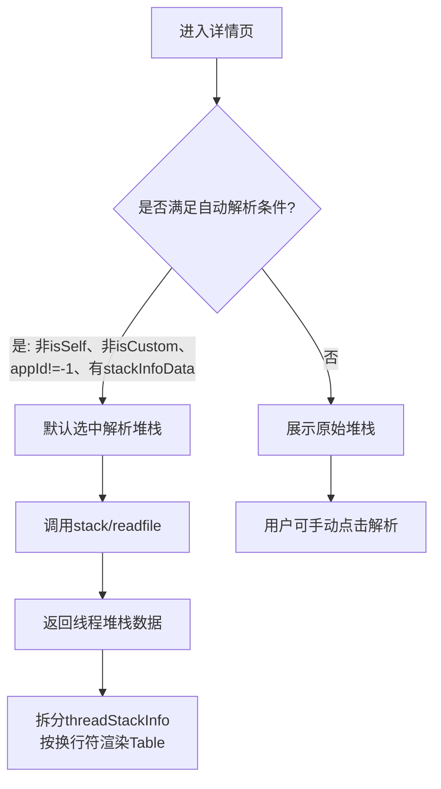
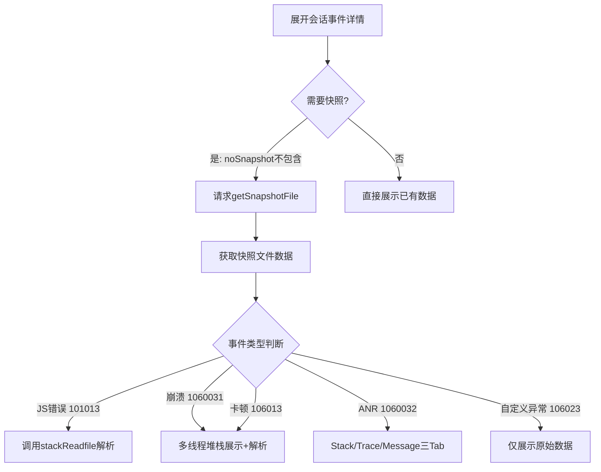
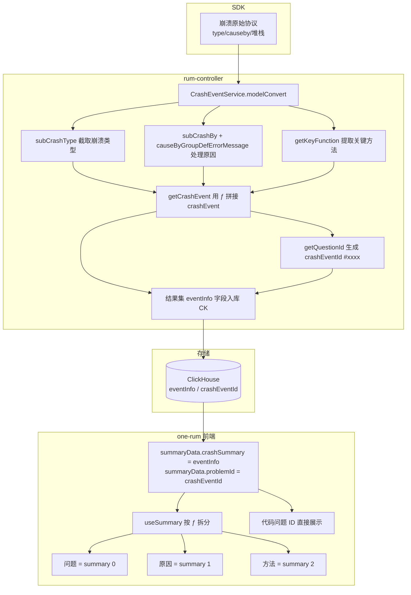
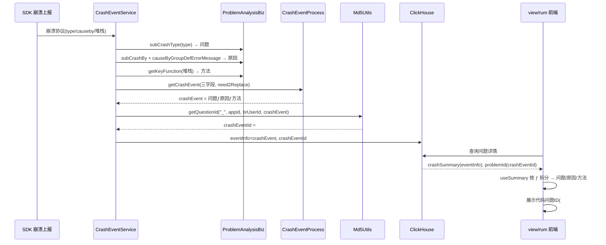

# 堆栈解析与展示

> 主题：RUM JS 错误堆栈解析全链路、多平台解析路由、前端过滤校验、代码问题摘要与问题 ID 归并。
> 仓库基准：`newonexm`（`framework/plugins/rum`、`controller/rum-controller`、`view/rum`、`ingester-rum`）。
> 衔接：符号化文件路径拼接、定时同步、iOS Info.plist 校验、操作审计详见同目录《符号化体系全链路.md》。

---

## 1. JS 错误堆栈解析全链路

### 1.1 整体架构概览

堆栈解析功能横跨四个模块：

| 模块 | 职责 |
|------|------|
| `ingester-rum` | 事件处理时把原始堆栈写入 CK 快照的 `metricInfo.dump` / `metricInfo.stackInfo` |
| `framework/plugins/rum` | 提供解析接口，按应用类型路由到不同解析引擎（Node SourceMap / Android R8-Retrace / iOS / HarmonyOS） |
| `controller/rum-controller` | 数据处理与生成（崩溃事件归并、代码问题 ID 生成） |
| `view/rum` | 详情页触发解析请求，渲染原始堆栈与解析结果的切换展示 |

### 1.2 应用类型枚举

```java
// OSPlatformTypeEnum
ANDROID(1), IOS(2), H5(3), WINDOWS(4),
MINI_PROGRAM(5), HarmonyOS(6),
TIKTOK_MINI_PROGRAM(7), MPAAS_MINI_PROGRAM(8), ALIPAY_MINI_PROGRAM(9)
```

| 枚举值 | 平台 | 说明 |
|--------|------|------|
| 1 | ANDROID | Android |
| 2 | IOS | iOS |
| 3 | H5 | Web / H5 |
| 4 | WINDOWS | Windows |
| 5 | MINI_PROGRAM | 微信小程序 |
| 6 | HarmonyOS | HarmonyOS |
| 7 | TIKTOK_MINI_PROGRAM | 抖音小程序 |
| 8 | MPAAS_MINI_PROGRAM | mPaaS 小程序 |
| 9 | ALIPAY_MINI_PROGRAM | 支付宝小程序 |

### 1.3 堆栈原始数据的写入（ingester-rum）

JS 错误事件在 `JsErrorEventStrategy.buildMetricInfo` 中将原始堆栈写入快照的 `metricInfo`：

```java
// ingester-rum: JsErrorEventStrategy.java
metricInfo.put("rowNum",    String.valueOf(model.getJsErrorEventEntity().getLine()));
metricInfo.put("columnNum", String.valueOf(model.getJsErrorEventEntity().getColumn()));
metricInfo.put("dump",      DataFormatUtil.subKeyWordFiled(model.getStack()));
```

- **字段**：`metricInfo.dump`（主要）、`metricInfo.stackInfo`（部分场景，高版本 SDK）。
- **截断处理**：`DataFormatUtil.subKeyWordFiled` 对超长堆栈做截断。
- **存储位置**：CK 快照表 `t_rum_*_snapshot` 的 `metric_info` 列（Map 类型）及 BRFS 快照文件。

### 1.4 堆栈解析接口

#### 1.4.1 主接口（详情页「解析堆栈」按钮触发）

| 项 | 内容 |
|---|---|
| **路径** | `POST /rest/rum/stack/readfile` |
| **Controller** | `RumSymbolicController.readfile` |
| **请求体** | `ReadFileCondition`：`appId`、`fileId`、`moduleType`（3=JS错误）、`monitorTime`；多线程场景还有 `tid`、`name`、`dumInfo` |
| **返回体** | `RestResponse<List<StackInfo>>`，含 `threadId`、`threadName`、`threadStackInfo` |

对于 JS 错误，返回字段的含义映射如下：

| StackInfo 字段 | JS 错误场景含义 |
|----------------|----------------|
| `threadId` | 原始堆栈行号（errorLine） |
| `threadName` | 对应的源文件名（sourceFile） |
| `threadStackInfo` | 源码上下文（context，前后若干行代码） |

#### 1.4.2 独立解析接口（当前前端未使用）

| 项 | 内容 |
|---|---|
| **路径** | `POST /rest/rum/problem/js/parse` |
| **Controller** | `RetrievalController.parseJsStack` |
| **请求体** | `JsParseCondition`：`appId`、`stackInfo`（堆栈字符串）、`fileName`（可选，用于筛选 SourceMap） |
| **解析引擎** | JVM 内 Google Closure `SourceMapConsumerV3` |
| **说明** | `view/rum` 前端当前**未调用**此接口，属于备用/独立工具接口 |

### 1.5 各应用类型堆栈解析逻辑

#### 1.5.1 JS 错误（moduleType = 3，适用于 Web/H5、小程序等）

**后端路由条件**：`ReadFileCondition.moduleType == 3`

**解析引擎**：Node.js 子进程 + `source-map` 库

**完整解析流程**：

```
1. 从快照文件的 metricInfo 中取原始堆栈
   优先：metricInfo.stackInfo
   其次：metricInfo.dump

2. 查询 t_rum_config_file 表中该 appId 上传的所有 SourceMap 文件元数据
   （type=1，无版本过滤：version=-1）

3. 用堆栈中包含的 bundle 文件名与 SourceMapEntity.originName（去掉 .map 后缀）匹配
   过滤出有效的 SourceMap 文件列表

4. 从 BRFS（存储名 T_RUM_SOURCE_MAP）或 NFS 读取 .map 文件内容
   FileUtils.getSourceMapFileStringByPath(storageType, indexName)

5. 通过 stdin 将（堆栈字符串 + map 文件内容）喂给 Node 脚本
   sourcemap-resolver.js（内嵌 classpath 资源）

6. Node 脚本：
   a. 正则匹配堆栈每一行（Chrome 风格）：
      - 带函数名：at funcName (file:line:col)
      - 不带函数名：at file:line:col
   b. 调用 source-map.SourceMapConsumer.originalPositionFor({line, column: col-1})
      （列号转为 0-based）
   c. 返回原始位置：{source, line, column, name}

7. 超时控制：30 秒，超时强制 destroyForcibly()
   Node 进程非 0 退出码 → 抛异常 → 前端收到解析失败

8. 返回：List<StackInfo>，每个元素对应一个解析成功的堆栈帧
```

**关键代码文件**：

- `rum-core/src/main/java/.../SourceMapParseByNodejsUtil.java`（Node 进程调度）
- `rum-core/src/main/resources/sourcemap-resolver.js`（堆栈还原脚本）
- `rum-core/src/main/java/.../RumSymbolicController.java`（接口入口，第 69–163 行）

**异常处理**：

- BRFS 找不到文件（`IllegalStateException`）→ 清空结果，回退走 NFS。
- Node 超时 → 抛 `RuntimeException("解析超时（30秒）")`。
- Node 退出码非 0 → 抛 `RuntimeException("解析失败，退出码：X")`。
- 单个 .map 文件解析失败 → 脚本内 `console.error` 跳过，继续处理下一个文件。

#### 1.5.2 Android 崩溃/ANR/卡顿

**后端路由条件**：`moduleType != 3` + `platform = ANDROID`

**解析引擎**：`AnalysisApi.analysisAndroid`

**分支逻辑**：

```
isNativeCrash == true  →  AndroidNativeRetrace（Native SO 符号化）
isNativeCrash == false →  RumR8Retrace（Java/Kotlin 混淆还原，R8/ProGuard mapping 文件）
```

**符号文件来源**：`t_rum_config_file` 中 `type=0`（符号文件）+ 按版本匹配 `appVersionId`。

**缓存机制**：解析成功后按"堆栈内容 Hash + 版本"做结果缓存，避免重复解析。

**符号路径**：通过 `MappingPathUtils.getAndroidSymbolPath`（Java）或 `getAndroidNativeSymbolPath`（Native）定位，详见同目录《符号化体系全链路.md》§2.4。

#### 1.5.3 iOS 崩溃

**后端路由条件**：`moduleType != 3` + `platform = IOS`

**解析引擎**：`AnalysisApi.analysisIOS` → `IOSRetrace`

**特殊处理**：

- 需要从快照的 `binaryInfo` 字段解析出**加载基址（load address）**。
- 基址用于 dSYM 符号化时的地址偏移计算。
- 符号文件类型：`.dSYM`。
- **UUID 校验**：通过 bratos 工具读取 dSYM 的 Info.plist 提取 UUID，与崩溃日志 UUID 比对。缺少 Info.plist 会导致 `APP_CHECK_UUID_FAILED`，详见同目录《符号化体系全链路.md》§3。

**符号路径**：通过 `MappingPathUtils.getIOSAppSymbolPath` 定位，详见同目录《符号化体系全链路.md》§2.3。

#### 1.5.4 HarmonyOS 崩溃/ANR

**后端路由条件**：`moduleType != 3` + `platform = HarmonyOS`

**解析引擎**：`AnalysisApi.analysisHarmonyOS` → `HarmonyRetrace`

**分支逻辑**：

```
isNativeCrash == true  →  hstack 命令行工具（Native SO 符号化）
isNativeCrash == false →  HarmonyOS ArkTS SourceMap 解析
                          （与 JS 的 Node SourceMap 是独立实现）
```

**符号路径**：通过 `MappingPathUtils.getHarmonyOSSymbolPath`（ArkTS）或 `getHarmonyOSNativeSymbolPath`（Native）定位，详见同目录《符号化体系全链路.md》§2.5。

#### 1.5.5 微信小程序（及其他小程序）的 JS 错误

**前端特殊处理**：当 `type == 3`（JS 错误）且 `isMiniProgram(appType)` 为 `true` 时：

```tsx
// Stack.tsx：小程序 JS 错误不展示原始/解析切换按钮
{type == 3 && isMiniProgram(appType) ? null : (
  <Radio.Group>  {/* 原始堆栈 / 解析堆栈 切换 */}
  ...
)}
```

- **UI 上不显示「解析堆栈」Radio 切换按钮**。
- **不自动触发解析请求**。
- **不展示 SourceMap 管理入口**。
- 仅展示原始堆栈文本。

**原因**：小程序堆栈格式多样，不一定符合 `sourcemap-resolver.js` 的 Chrome 风格正则，后端虽然接口上可以调用，但前端层面做了限制。

#### 1.5.6 Windows

**后端路由条件**：`moduleType != 3` + `platform = WINDOWS`

**解析结果**：Windows **不在** `AnalysisApi` 支持的三种平台内（ANDROID/IOS/HARMONY），Controller 层面不会赋值给 `tmpStackInfo`，最终 `StackInfo.threadStackInfo` 直接返回 `ReadFileCondition.dumInfo` 的**原始内容**，即**无符号还原，原文返回**。

### 1.6 各应用类型汇总对比

| 应用类型 | 错误类型 | 解析接口 | 解析引擎 | 说明 |
|---------|---------|---------|---------|------|
| Web / H5 | JS 错误 | `/rest/rum/stack/readfile`（moduleType=3） | Node.js + `source-map` 库 | 标准 SourceMap 还原，需上传 .map 文件 |
| 微信/抖音/支付宝小程序 | JS 错误 | 接口可调用，但**前端隐藏了解析按钮** | — | UI 层屏蔽，仅展示原始堆栈 |
| Android | 崩溃/ANR/卡顿 | `/rest/rum/stack/readfile`（moduleType≠3） | `RumR8Retrace` / `AndroidNativeRetrace` | Java 走 R8，Native SO 走 native retrace |
| iOS | 崩溃 | `/rest/rum/stack/readfile`（moduleType≠3） | `IOSRetrace`（dSYM） | 需要 binaryInfo 中的加载基址 |
| HarmonyOS | 崩溃/ANR | `/rest/rum/stack/readfile`（moduleType≠3） | `hstack`（Native）/ ArkTS SourceMap | 两种 crash 类型分支不同 |
| Windows | 崩溃 | `/rest/rum/stack/readfile`（moduleType≠3） | **无符号还原** | `AnalysisApi` 不支持，原文返回 |

### 1.7 SourceMap 上传与存储

#### 上传流程

```
用户在配置页面上传 .map 文件
    ↓
POST /rest/rum/settings/file/sourceMap/upload
    ↓
ConfigAggServiceImpl.insertSourceMapBrfs（BRFS 路径）
    ↓
1. 调用 Node 脚本 sourcemap-sources-parser.js 抽取 sources 列表
2. FileUtils.saveFilesBrfs 把完整 .map 内容存入 BRFS（存储名 T_RUM_SOURCE_MAP）
3. 写入 t_rum_config_file 表：
   - index_name = BRFS fid（文件路径）
   - parse_content = sources 列表 JSON
   - type = 1（SourceMap 文件）
   - origin_name = 原始文件名（如 app.js.map）
```

#### 数据库表：t_rum_config_file

| 字段 | 含义 |
|------|------|
| `app_id` | 所属应用 |
| `app_version_id` | 所属版本（JS 错误查询时传 -1，不限版本） |
| `type` | 0=符号文件，1=SourceMap 文件 |
| `index_name` | BRFS/NFS 存储路径（fid） |
| `parse_content` | SourceMap 中 sources 列表的 JSON |
| `origin_name` | 原始上传文件名 |

#### SourceMap 匹配策略

解析时用堆栈字符串中的 bundle 文件名匹配 `origin_name`（去掉 `.map` 后缀）：

```
堆栈行：at renderPage (https://cdn.example.com/app.min.js:1:1000)
提取：app.min.js
匹配：t_rum_config_file.origin_name LIKE '%app.min.js%'（去掉 .map 后缀后的 origin_name）
```

### 1.8 前端调用链路（view/rum）

#### 1.8.1 入口组件与调用关系

```
JSDetail（详情页）
    ├── 加载详情数据：POST /rest/rum/problem/crash/detail
    │   └── 返回中含 stackInfo / dump → 作为原始堆栈
    └── Stack 组件（堆栈展示与解析）
            ├── 「原始堆栈」：直接渲染 rawData.stackInfoData
            └── 「解析堆栈」Radio 切换 / 自动触发
                    └── parseRequest() → onParse()
                            └── getParse() → POST /rest/rum/stack/readfile
                                    参数：{ appId, fileId, moduleType: 3, monitorTime }
```

#### 1.8.2 自动触发解析的条件

```tsx
// Stack.tsx：满足以下全部条件时，页面加载完成后自动切换到「解析堆栈」并发起请求
!isSelf &&                                  // 非自定义事件
!isCustom &&                                // 非 custom 类型
appId != -1 &&                              // 有效 appId
appType != -1 &&                            // 有效 appType
!(type == 3 && isMiniProgram(appType)) &&   // 非「JS错误 + 小程序」
(rawData?.stackInfoData?.length || isJS)    // 有堆栈数据或是 JS 错误
```

#### 1.8.3 解析结果渲染

```tsx
// 每个 StackInfo 元素展示为一个 collapse 面板：
// 标题：threadId : threadName
// 内容：threadStackInfo 按 \n 拆行，每行一个 <pre>
res?.data?.map(item => ({
  header: [{ title: `${item.threadId}:${item.threadName}` }],
  content: item.threadStackInfo.split('\n').filter(Boolean).map(item => ({ item }))
}))
```

#### 1.8.4 再次解析按钮

截图中的「解析堆栈」按钮点击时调用 `parseRequest('parse')`，强制重新请求（即使 `parse` 已有缓存结果）。

### 1.9 sourcemap-resolver.js 详解

#### 1.9.1 什么情况下会用到此文件

`sourcemap-resolver.js` 仅在以下**同时满足**的条件下被调用：

| 条件 | 说明 |
|------|------|
| 接口为 `POST /rest/rum/stack/readfile` | 即用户点击详情页「解析堆栈」按钮 |
| 请求参数 `moduleType == 3` | 固定含义：JS 错误类型 |
| 该 appId 在 `t_rum_config_file` 中存在 `type=1` 的 SourceMap 记录 | 即用户已上传过 `.map` 文件 |
| BRFS / NFS 中能读取到对应的 .map 文件内容 | 文件未丢失 |

**不会使用此文件的情况**：

- `moduleType != 3`（Android/iOS/Harmony/Windows 崩溃）→ 走 `AnalysisApi` 或原文返回。
- `moduleType == 3` 但未上传 SourceMap → 接口直接返回错误 `rum.retrieval.no.found.parse.source.map`。
- 接口 `/rest/rum/problem/js/parse` → 使用的是 JVM 内 Google Closure `SourceMapConsumerV3`，**不调用此脚本**。
- SourceMap 上传时抽取 `sources` 列表 → 使用的是另一个脚本 `sourcemap-sources-parser.js`，**不是此脚本**。

#### 1.9.2 此文件的作用

**核心作用**：将压缩/混淆后的 JS 错误堆栈（bundle 文件中的行号、列号）还原为**原始源码的文件名、行号和上下文代码片段**。

**运行方式**：

Java 后端（`SourceMapParseByNodejsUtil.resolveFromSourceMapEntities`）以**子进程**方式调用：

```
node sourcemap-resolver.js __ENTITY_LIST__ <aroundLines>
```

数据通过 **stdin** 传入，格式为：

```
<originName1>===SEPARATOR===<map文件内容1>
<originName2>===SEPARATOR===<map文件内容2>
===STACK_TRACE_SEPARATOR===
<原始JS错误堆栈字符串>
```

结果通过 **stdout** 输出 JSON，Java 侧读取后解析。

#### 1.9.3 内部处理步骤

```
stdin 输入数据
    ↓
1. loadSourceMapEntities：
   按行分割 SourceMap 条目
   每条用 ===SEPARATOR=== 拆出 originName 和 map 内容
   去掉 .map 后缀得到 jsFileName（如 app.min.js）
   用 new SourceMapConsumer(mapContent) 解析，存入内存 Map 缓存

2. resolveStackTrace：
   遍历堆栈字符串的每一行（只处理第一个能成功解析的行）

3. resolveStackLine：
   正则一（带函数名）：at funcName (url:line:col)
   正则二（简单格式）：at url:line:col
   提取 url、lineNum、colNum

4. resolveLocation：
   从 URL 中提取 jsFileName（path.basename）
   从缓存中取对应的 SourceMapConsumer
   调用 consumer.originalPositionFor({ line, column: col-1 })
   ↓ 得到：originalPosition.source（原始文件名）、.line、.column

5. 读取原始源码内容：
   consumer.sourceContentFor(originalPosition.source)
   （要求 .map 文件中内嵌了 sourcesContent，否则返回 null → 解析失败）

6. 提取上下文代码：
   以 originalPosition.line 为中心，向前/后各取 aroundLines 行（默认 5 行）
   报错行用 ">>> " 前缀标记，其他行用 "    "（4 空格）缩进

7. 输出 JSON：
   {
     "sourceFile": "src/pages/home/index.js",  // 原始源文件路径
     "errorLine":  42,                          // 原始代码行号
     "context":    "    ...\n>>> 报错行代码\n    ..."  // 上下文代码片段
   }
```

#### 1.9.4 Java 侧如何使用输出结果

`RumSymbolicController` 把 Node 输出的 JSON 解析后，映射为 `StackInfo`：

| Node 输出字段 | 映射到 StackInfo 字段 | 前端展示位置 |
|-------------|---------------------|------------|
| `errorLine` | `threadId` | 面板标题左侧（行号） |
| `sourceFile` | `threadName` | 面板标题右侧（原始文件名） |
| `context` | `threadStackInfo` | 面板内容（上下文代码，带 `>>>` 标记报错行） |

#### 1.9.5 关键约束与限制

| 约束 | 说明 |
|------|------|
| **只解析第一个有效堆栈帧** | `resolveStackTrace` 遇到第一个成功解析的行就返回，不遍历全部堆栈 |
| **堆栈格式要求 Chrome 风格** | 必须包含 `at ... url:line:col` 格式，其他格式（如 Firefox 风格）无法匹配 |
| **需要 .map 文件内嵌 sourcesContent** | 若 .map 文件的 `sourcesContent` 字段为空，无法读取上下文代码 → 返回 null → 解析失败 |
| **以 jsFileName 匹配 SourceMap** | 从 URL 中取 `basename`；若 bundle 文件名与上传的 .map 文件名（去掉 .map 后）不一致，无法命中缓存 |
| **进程级缓存** | 同一次 Node 进程执行中多个 .map 文件被缓存到内存 Map，但进程退出后缓存消失（每次请求都是新进程） |
| **30 秒超时** | Java 侧强制限制，超时 destroyForcibly() |
| **临时文件机制** | 脚本从 JAR classpath 中提取到系统临时目录（`File.createTempFile`），进程退出时自动删除 |
| **NODE_PATH 环境变量** | 若未配置，自动执行 `npm -g root` 获取全局 node_modules 路径（15 秒超时兜底） |

### 1.10 堆栈格式适配方案（Firefox/Safari/WebKit 兼容）

#### 1.10.1 改动文件

```
framework/plugins/rum/rum-core/src/main/resources/sourcemap-resolver.js
```

**仅改动 `resolveStackLine` 函数**，其他逻辑（数据传输、缓存、超时、上下文提取）不变。

#### 1.10.2 各客户端堆栈格式对照

| 运行环境 | 堆栈格式 | 示例 |
|---------|---------|------|
| Chrome / Chromium / Android WebView / Node.js | `at funcName (url:line:col)` | `at renderPage (https://cdn.com/app.js:1:1000)` |
| Chrome 无函数名 | `at url:line:col` | `at https://cdn.com/app.js:1:1000` |
| Firefox | `funcName@url:line:col` | `renderPage@https://cdn.com/app.js:1:1000` |
| Safari / iOS WKWebView / iOS H5 | `funcName@url:line:col` | `U@https://cdn.com/app.js:1:41331` |
| Safari/WebKit 无函数名 | `@url:line:col` | `@https://cdn.com/app.js:1:41331` |
| WebKit 注入脚本 | `@user-script:line:col:N` | `@user-script:4:1:149079` |
| 所有环境 | `[native code]` | `nsp[native code]` |

#### 1.10.3 改动前后正则对比

**改动前（仅支持 Chrome）**：

```javascript
// 格式一：at funcName (url:line:col)
const functionRegex = /at (.*?) \((.*?):(\d+):(\d+)\)/;

// 格式二：at url:line:col
const simpleRegex = /at (.*?):(\d+):(\d+)/;
```

**改动后（Chrome + Firefox/Safari/WebKit 全覆盖）**：

```javascript
// ── Chrome / V8 / Node.js / Android WebView ─────────────────────────
// 格式一：at funcName (url:line:col)
const chromeFuncRegex = /at (.*?) \((.*?):(\d+):(\d+)\)/;

// 格式二：at url:line:col（限定 http/https，避免误匹配非 URL 内容）
const chromeSimpleRegex = /\bat (https?:\/\/[^)]*?):(\d+):(\d+)/;

// ── Firefox / Safari / WebKit / iOS WKWebView ────────────────────────
// 格式三：funcName@url:line:col 或 @url:line:col
// 仅匹配 http/https URL，天然过滤 @user-script、@native 等非网络资源
// 贪婪匹配 URL 部分，由末尾 :line:col 锚定，正确处理 URL 中含冒号的情况
const webkitRegex = /^[^@]*@(https?:\/\/.+):(\d+):(\d+)$/;
```

#### 1.10.4 关键设计决策

**决策一：Chrome 简单格式正则加 `http/https` 限定**

原正则 `at (.*?):(\d+):(\d+)` 中 `(.*?)` 非贪婪无约束，理论上会匹配 `at ` 后任意内容，存在对非 URL 内容（如本地路径、`eval` 代码等）误匹配的风险。改为 `/\bat (https?:\/\/[^)]*?):(\d+):(\d+)/`，只处理网络资源，更精确。

**决策二：WebKit 正则用贪婪匹配 + 行尾锚定**

URL 中可能包含 `:` 字符（如 `https://host:8080/...`），若用非贪婪 `.*?` 会在第一个 `:digit` 处提前截断 URL。改用贪婪 `.+` 搭配 `$` 行尾锚定：正则引擎先吃掉所有内容，再从右往左回溯找最后的 `:line:col`，始终能正确提取 URL。

```
输入：U@https://ws-s.tripcdn.cn/index-0E1Be11t.js:1:41331
匹配：URL=https://ws-s.tripcdn.cn/index-0E1Be11t.js  line=1  col=41331  ✓

输入：A@https://host:8080/app.js:2:500
匹配：URL=https://host:8080/app.js  line=2  col=500  ✓
```

**决策三：`[native code]` 提前跳过**

原代码没有对此类行做特判，`resolveLocation` 在解析时因 URL 格式非法会 `catch` 并返回 `null`，但会产生一条无意义的 `console.error` 日志。改为在入口处提前 `return null`，更清晰。

**决策四：不匹配 `@user-script:...` 等非 http URL**

WebKit 格式正则要求 `https?://`，以下特殊行天然被过滤：

| 行内容 | 过滤原因 |
|--------|---------|
| `@user-script:4:1:149079` | URL 为 `user-script`，无 `http://` |
| `@[native code]` | 无 URL |
| `setShado@https://api.map.baidu.com/getscript:5:329518` | 可以匹配，但 SourceMap 缓存中无对应文件，`getSourceMapConsumer` 返回 null，`resolveLocation` 返回 null，自然跳过 |

#### 1.10.5 处理优先级（改动后）

```
resolveStackLine(line)
    │
    ├─ 空行 / [native code]  →  return null（跳过）
    │
    ├─ Chrome 格式一：匹配 /at (.*?) \((.*?):(\d+):(\d+)\)/
    │       ✓ 命中  →  resolveLocation(url, line, col)
    │
    ├─ Chrome 格式二：匹配 /\bat (https?:\/\/...):(\d+):(\d+)/
    │       ✓ 命中  →  resolveLocation(url, line, col)
    │
    ├─ WebKit 格式：匹配 /^[^@]*@(https?:\/\/.+):(\d+):(\d+)$/
    │       ✓ 命中  →  resolveLocation(url, line, col)
    │
    └─ 均不匹配  →  return null（如 @user-script:...、普通文本行等）
```

#### 1.10.6 Firefox/Safari/WebKit 堆栈案例

真实 JS 错误（iOS 设备 Safari/WebView 上报）的原始堆栈示例：

```
@user-script:4:1:149079
setShado@https://api.map.baidu.com/getscript:5:329518
U@https://ws-s.tripcdn.cn/modules/corp/corp-hotel-book-h5-v2/index-0E1Be11t.js:1:41331
F@https://ws-s.tripcdn.cn/modules/corp/corp-hotel-book-h5-v2/index-0E1Be11t.js:1:48072
Q@https://ws-s.tripcdn.cn/modules/corp/corp-hotel-book-h5-v2/index-0E1Be11t.js:1:48887
nsp[native code]
w@https://ws-s.tripcdn.cn/modules/corp/corp-hotel-book-h5-v2/index-0E1Be11t.js:1:40787
```

**适配前的失败原因**：

1. 堆栈格式为 Firefox/Safari/WebKit 风格（`@` 分隔符），两个 Chrome 正则均无法匹配任何一行。
2. 触发设备为 iOS Safari/WebView，堆栈格式与 V8（Chrome/Node）不同。
3. 堆栈中存在无法映射的行（`@user-script`、百度地图 CDN、`[native code]`）。
4. `sourcemap-resolver.js` 只解析第一个有效帧，第一行 `@user-script:...` 必然失败，后续行又因格式问题全部跳过。

**适配后的处理结果**：

```
行1：@user-script:4:1:149079
    → Chrome 格式均不匹配（无 at）
    → WebKit 格式：URL 为 user-script，不含 https?://，不匹配
    → 跳过

行2：setShado@https://api.map.baidu.com/getscript:5:329518
    → WebKit 格式：URL=https://api.map.baidu.com/getscript，line=5，col=329518
    → resolveLocation 尝试：jsFileName=getscript（无 .js 后缀）
    → SourceMap 缓存中无 getscript 对应文件
    → getSourceMapConsumer 返回 null → resolveLocation 返回 null
    → 跳过

行3：U@https://ws-s.tripcdn.cn/modules/.../index-0E1Be11t.js:1:41331
    → WebKit 格式命中：URL=https://ws-s.tripcdn.cn/.../index-0E1Be11t.js，line=1，col=41331
    → jsFileName=index-0E1Be11t.js
    → 若用户已上传 index-0E1Be11t.js.map → SourceMap 缓存命中 → 正常解析 ✓
    → 若未上传 → 缓存未命中 → 返回 null → 继续下一行
```

**结论**：若用户上传了对应 bundle 的 `.map` 文件，适配后**可以正常解析**第 3 行及后续同域名的堆栈帧；百度地图 CDN 等第三方脚本行依然无法解析（符合预期，第三方资源无 SourceMap）。

### 1.11 解析结果是否落库

| 类型 | 是否持久化 |
|------|-----------|
| JS SourceMap（Node）解析结果 | **不落库**，实时计算后返回前端 |
| Android / iOS / Harmony 符号化结果 | **仅做进程内/BRFS 缓存**（Hash+版本为 key），不写回快照表 |
| SourceMap 文件本身 | 持久化到 **BRFS/NFS** + `t_rum_config_file` 元数据 |

### 1.12 主要相关文件路径

| 角色 | 文件路径 |
|------|---------|
| 解析接口（主） | `rum-core/.../controller/RumSymbolicController.java` |
| 解析接口（独立 JS） | `rum-core/.../controller/RetrievalController.java` |
| JS SourceMap 解析服务 | `rum-core/.../service/JsSourceMapService.java` |
| Node 进程调度工具 | `rum-core/.../service/SourceMapParseByNodejsUtil.java` |
| Node SourceMap 还原脚本 | `rum-core/src/main/resources/sourcemap-resolver.js` |
| Android/iOS/Harmony 符号化 | `symbol-analysis/.../api/AnalysisApi.java` |
| SourceMap 上传 Service | `rum-core/.../settings/service/impl/ConfigAggServiceImpl.java` |
| 快照读取 Service | `rum-core/.../retrieval/service/SnapshotService.java` |
| 原始堆栈写入（ingester） | `ingester-rum/.../impl/jserror/JsErrorEventStrategy.java` |
| 前端服务层 | `view/rum/src/services/retrieval/breakdown/index.ts` |
| 前端详情页 | `view/rum/src/packages/retrieval/breakdown/JSDetail/index.tsx` |
| 前端堆栈组件 | `view/rum/src/packages/component/breakdown/Stack/Stack.tsx` |

---

## 2. 前端过滤校验与 API 入口

### 2.1 问题类型枚举

RUM 中定义的错误/异常类型（通过 `type` 字段区分）：

| type | 枚举名 | 说明 | API 路径 |
|------|--------|------|----------|
| 3 | JS Error | JS 错误 | `/rest/rum/problem/js/detail` |
| 4 | ANR | 应用无响应 | `/rest/rum/problem/anr/detail` |
| 5 | Lag | 卡顿 | `/rest/rum/problem/lag/detail` |
| 6 | Crash | 崩溃 | `/rest/rum/problem/crash/detail` |
| 7 | Exception | 自定义异常 | `/rest/rum/problem/self-crash/detail` |

定义位置：`view/rum/src/packages/retrieval/breakdown/ProcessRequestData.ts`

### 2.2 堆栈解析核心 API

| 接口 | 方法 | 用途 |
|------|------|------|
| `/rest/rum/stack/readfile` | POST | 堆栈文件解析，按线程解析原始 dump 文件 |
| `/rest/rum/downloadSnapShotFile` | POST | 下载快照文件 |
| `/rest/rum/saveOpLog` | POST | 下载堆栈时记录操作日志 |

定义位置：`view/rum/src/services/retrieval/breakdown/index.ts`、`view/rum/src/services/common.ts`

### 2.3 解析核心流程

#### 2.3.1 解析触发时机

1. **详情页初始化时自动触发** - 当条件满足时（非自定义异常、非 Windows、有 stackInfoData），默认选中"解析堆栈"并自动调用解析接口。
2. **用户手动切换** - 点击"解析堆栈"RadioButton 或"重新解析"按钮。
3. **滚动加载** - 在解析堆栈模式下滚动到底部时，自动加载更多线程（每次 5 个）。



#### 2.3.2 分批解析机制

对于**崩溃、卡顿、ANR**等有多线程堆栈的问题，采用分批解析策略：

- 首次解析：只请求第 1 个线程（`stackInfoData.slice(0, 1)`）。
- 后续滚动加载：每次请求 5 个线程（`stackInfoData.slice(newIndex, num)`）。
- 通过 `parse.length` 判断已解析数量，控制请求范围。
- 使用 `Promise.all` 并发请求多个线程。
- 解析结果以 `threadId` 为 key 去重合并，再按原始顺序排序。

```typescript
// 示例: 按原始 stackInfoList 顺序排序解析结果
const sortedParse = stackInfoData
  .map((originalItem) => {
    const parsedItem = parsedMap.get(String(originalItem.tid))
    if (!parsedItem) return null
    return {
      content: parsedItem.threadStackInfo.split('\n').filter(Boolean).map(...),
      header: [{ dataIndex: 'item', title: `${parsedItem.threadId}:${parsedItem.threadName}` }],
    }
  })
  .filter(Boolean)
```

关键代码位置：

- `CrashDetail/index.tsx` - `onParseRecursive` 方法 (第 259 行)
- `CatonDetail/index.tsx` - `onParseRecursive` 方法 (第 236 行)
- `AnrDetail/index.tsx` - `onParseRecursive` 方法 (第 241 行)
- `drawerExpendTable/index.tsx` - `stackReadfile` 方法 (第 318 行)

#### 2.3.3 JS 错误的特殊解析

JS 错误（type=3）解析逻辑与其他类型不同：

- 不按线程分批，一次性请求。
- 前端将解析结果组装为单线程 Table 展示。
- 使用 `dump1.original`（原始）和 `dump1.original1`（解析后）字段。

关键代码位置：

- `JSDetail/index.tsx` - `onParse` 回调 (第 165 行)
- `drawerExpendTable/components/otherItem/subs/jsError.tsx` - `onShowJsErrorOriginalDump` (第 422 行)

### 2.4 不同问题类型的堆栈数据模型

#### 崩溃 (Crash, type=6)

```
stackInfoList[]        - 原始堆栈列表（多线程）
  |- tid               - 线程 ID
  |- name              - 线程名
  |- dumInfo           - 原始堆栈内容（按 \n 分割）
  |- ...
parseStackData[]       - 解析后的堆栈数据
  |- threadId          - 线程 ID
  |- threadName        - 线程名
  |- threadStackInfo   - 解析后堆栈内容
```

#### JS 错误 (JS Error, type=3)

```
dump1.original         - 原始堆栈文本
dump1.original1[]      - 解析后堆栈数组
  |- threadId          - 线程 ID
  |- threadName        - 线程名
  |- threadStackInfo   - 解析后堆栈文本
```

#### ANR (type=4)

```
stackInfoList[]        - 原始堆栈（同崩溃）
dump                   - ANR 数据
  |- original          - 原始堆栈
  |- original1         - 解析后堆栈
  |- a3                - ANR Trace
  |- a4                - ANR Message
anrTrace               - ANR Trace 文本
anrMessage             - ANR Message 文本
```

#### 卡顿 (Lag/Caton, type=5)

数据结构同崩溃。

#### 自定义异常 (Custom Exception, type=7)

```
stackInfoList[]        - 原始堆栈
dump.original          - 原始数据文本
```

**不支持解析**，仅展示原始数据（`isSelf=true`, `isCustom=true`）。

### 2.5 堆栈展示逻辑

#### 2.5.1 通用堆栈组件 - Stack.tsx

**路径**：`view/rum/src/packages/component/breakdown/Stack/Stack.tsx`

**展示模式**：

- **原始堆栈（Raw Stack）** - 默认展示，通过 Table 渲染多线程堆栈。
- **解析堆栈（Parsing Stack）** - 通过接口解析后的可读堆栈。

**按平台差异**：

| appType | 展示行为 |
|---------|---------|
| 4 (Windows) | 仅显示文件大小和下载按钮，不展示堆栈内容 |
| 3 (Web/浏览器) + isMiniProgram | JS 错误的堆栈展示，需要 SourceMap 管理跳转 |
| 1 (Android) / 2 (iOS) / 其他 | 标准堆栈展示，支持解析切换 |

#### 2.5.2 多线程堆栈展示

崩溃、卡顿、ANR 等多线程问题：

- 默认收起非主线程（使用 `SCollapse` 折叠面板）。
- 点击展开后触发更多解析请求。
- 主线程用 `<pre>` 保留格式展示。
- 应用名高亮：`realAppName` 用红色加粗标记。

#### 2.5.3 错误状态展示

当解析失败时，展示 SourceMap 图标 + 错误信息：

- `parseError.message` - 后端返回的解析失败原因。
- 空数据时显示 `<Empty />` 组件。

#### 2.5.4 下载功能

- **原始堆栈下载**：拼接 `tid + name + dumInfo`。
- **解析堆栈下载**：拼接 `threadId + threadName + threadStackInfo`。
- **Windows 平台**：下载 `.dmp` 文件。
- **其他平台**：下载 `.txt` 文件。
- 下载前调用 `/rest/rum/saveOpLog` 记录操作日志。
- 文件名格式：`{问题类型}-{堆栈类型}（crashId：{id}).txt`。

### 2.6 堆栈过滤与校验规则

#### 2.6.1 代码异常配置 (CodeException)

**路径**：`view/rum/src/packages/configurationModule/ConfigAiLag/component/CodeException/`

支持三类异常的规则配置：

| 分类 | activeKey | 业务类型 | 条件前缀 |
|------|-----------|---------|---------|
| 崩溃 | `breakdown` | 6 | `ABNORMAL_ERROR_CRASH_OPTION_` |
| 卡顿 | `block` | 5 | `ABNORMAL_ERROR_LAG_OPTION_` |
| JS 错误 | `jsError` | 3 | `ABNORMAL_ERROR_JS_OPTION_` |

**条件字段 (code)**：

| code 值 | 说明 | 适用类型 |
|---------|------|---------|
| `ABNORMAL_ERROR_CRASH_OPTION_1` | 崩溃原因 | 崩溃 |
| `ABNORMAL_ERROR_CRASH_OPTION_2` | 崩溃方法 | 崩溃 |
| `ABNORMAL_ERROR_CRASH_OPTION_3` | 崩溃问题 | 崩溃 |
| `ABNORMAL_ERROR_CRASH_OPTION_4` | 崩溃类型 | 崩溃（仅等于） |
| `ABNORMAL_ERROR_CRASH_OPTION_5` | 崩溃来源 | 崩溃（仅等于） |
| `ABNORMAL_ERROR_LAG_OPTION_1` | 卡顿方法 | 卡顿 |
| `ABNORMAL_ERROR_LAG_OPTION_2` | 卡顿类型 | 卡顿（仅等于） |
| `ABNORMAL_ERROR_JS_OPTION_1` | JS 错误信息 | JS 错误 |
| `ABNORMAL_ERROR_JS_OPTION_2` | JS 错误类型 | JS 错误 |

**操作符 (type)**：

| type 值 | 说明 | 可用条件 |
|---------|------|---------|
| `ABNORMAL_ERROR_OPTION_1` | 等于 | 所有字段 |
| `ABNORMAL_ERROR_OPTION_2` | 包含 | 大多数字段 |
| `ABNORMAL_ERROR_OPTION_ONLY_EQUL_1` | 等于(仅等于) | 崩溃类型/来源、卡顿类型 |

**限制**：崩溃类型、崩溃来源、卡顿类型 **仅支持等于操作**（`ABNORMAL_ERROR_OPTION_ONLY_EQUL`）。

**规则约束**：

- **条件数量**：最多 9 条（a-i）。
- **规则数量**：最多 10 条（黑白名单各最多 10 条）。
- **描述长度**：≤ 200 字符。
- **大小写敏感**：可选（checkbox 控制），崩溃类型/来源/卡顿类型不支持设置。
- **条件关系**：`AND`（所有条件满足）或 `OR`（任一条件满足）。

**校验规则**：

```typescript
// 描述字段校验
{ required: true, message: '不能为空' }
{ max: 200, message: '最多输入200个字符' }

// 条件值校验（字符串输入）
{ required: true, message: '不能为空' }
{ max: 200, message: '最多输入200个字符' }

// 默认规则（应用启动请求失败率阈值）
validator = (_rule, value) => {
  if (!value || value === '0') return Promise.reject('不能为空')
  if (Number(value) > 1000) return Promise.reject('最大限制为1000')
  if (!/^[1-9]\d*$/.test(value)) return Promise.reject('格式错误（必须为正整数）')
  return Promise.resolve()
}
```

#### 2.6.2 崩溃识别忽略关键字 (CollapseRecognition)

**路径**：`view/rum/src/packages/configurationModule/ConfigDistinguishTerminal/components/CollapseRecognition/CollapseRecognition.tsx`

- **用途**：配置崩溃识别的忽略关键字。
- **数量限制**：最多 10 条。
- **状态控制**：每条规则可启用/停用（StatusSwitch）。
- **搜索**：支持按关键字搜索。

API 接口：

- `/rest/rum/setting/crashRecognize/crashRecognizeList` - 查询列表
- `/rest/rum/setting/crashRecognize/switch` - 开关
- `/rest/rum/setting/crashRecognize/delCrashRecognize` - 删除

#### 2.6.3 SourceMap/符号文件管理

**JS SourceMap 上传校验**

**路径**：`view/rum/src/packages/configurationModule/ConfigDistinguishTerminal/components/UploadSourceMapModal/UploadSourceMapModal.tsx`

| 校验规则 | 说明 |
|---------|------|
| 文件类型 | 仅 `.map` 文件（`accept=".map"`） |
| 文件大小 | ≤ 50MB |
| 上传数量 | ≤ 10 个文件 |
| 上传地址 | `/rest/rum/settings/file/sourceMap/upload` |

**符号文件管理**

**路径**：`view/rum/src/packages/configurationModule/ConfigDistinguishTerminal/components/TerminalSourceMap/TerminalSourceMap.tsx`

- 别名编辑、下载、删除。
- API：`/rest/rum/settings/file/sourceMap/query` / `download` / `delete`。

> SourceMap 与符号文件的上传/删除/编辑操作日志机制详见同目录《符号化体系全链路.md》§6。

#### 2.6.4 堆栈级别的事件过滤

**事件类型白/黑名单**

在 `eventTypeConfig.tsx` 中定义了不同场景下的过滤规则：

```typescript
// 不请求快照的事件列表
noSnapshot = ['102021', '1020212', '103011', '103021', '104001', ...]

// 显示快照按钮的事件列表
showGoToFileBtnList = ['100001', '100002', ..., '106013', '106023', ...]

// 事件子类型与模块映射
eventSubTypeModuleObj = {
  '1060031': 'crash',   // 崩溃
  '1060032': 'anr',     // ANR
  '106013': 'lag',      // 卡顿
  '106023': 'selfCrash',// 自定义异常
  '101013': 'jsError',  // JS 错误
  ...
}
```

**会话详情页过滤**：

- **致命问题**：崩溃、卡顿、ANR、页面错误加载。
- **错误问题**：JS 错误、控制台错误、业务异常、阻塞操作等。
- **视图与用户操作**：视图事件、点击事件等。
- **可容忍**：慢操作、慢启动等。

### 2.7 会话详情（Session Detail）中的堆栈处理

#### 2.7.1 堆栈数据获取流程



#### 2.7.2 堆栈解析初始化

- **JS 错误**：加载完成后自动发起解析（`onShowJsErrorOriginalDump`）。
- **崩溃/卡顿/ANR**：非自定义崩溃类型自动发起解析。
- **小程序**：特殊处理，JS 错误无原始/解析切换。

#### 2.7.3 滚动加载

- **抽屉内滚动**：监听 `.bonree-drawer-body` 的滚动事件。
- **触底自动加载**：滚动到底部时自动请求更多线程解析。
- **无滚动条兜底**：如果内容高度 ≤ 容器高度（无滚动条），自动触发一次加载。

#### 2.7.4 解析错误处理

- 解析失败时设置 `dump.errorInfo` 或 `dump1.errorInfo`。
- 在 UI 上展示 SourceMap 图标 + 错误信息。
- 200 非 500 错误仅第一个线程报错，其余继续。
- 500 错误中断后续所有请求。

### 2.8 相关服务端 API 汇总

| 接口路径 | 用途 | 消费方 |
|---------|------|--------|
| `/rest/rum/stack/readfile` | 堆栈文件解析 | 所有详情页 + 会话详情 |
| `/rest/rum/problem/js/detail` | JS 错误详情 | JSDetail |
| `/rest/rum/problem/crash/detail` | 崩溃详情 | CrashDetail |
| `/rest/rum/problem/lag/detail` | 卡顿详情 | CatonDetail |
| `/rest/rum/problem/anr/detail` | ANR 详情 | AnrDetail |
| `/rest/rum/problem/self-crash/detail` | 自定义异常详情 | CustomExceptionDetail |
| `/rest/rum/downloadSnapShotFile` | 下载快照文件 | 详情页 |
| `/rest/rum/saveOpLog` | 保存下载操作日志 | 详情页 |
| `/rest/rum/settings/file/sourceMap/upload` | 上传 SourceMap | SourceMap 管理 |
| `/rest/rum/settings/file/sourceMap/query` | 查询 SourceMap | SourceMap 管理 |
| `/rest/rum/settings/file/sourceMap/download` | 下载 SourceMap | SourceMap 管理 |
| `/rest/rum/settings/file/sourceMap/delete` | 删除 SourceMap | SourceMap 管理 |
| `/rest/rum/setting/crashRecognize/crashRecognizeList` | 崩溃识别列表 | 崩溃识别管理 |
| `/rest/rum/setting/crashRecognize/switch` | 崩溃识别开关 | 崩溃识别管理 |
| `/rest/rum/setting/crashRecognize/delCrashRecognize` | 删除崩溃识别 | 崩溃识别管理 |
| `/rest/rum/common/custom/condition` | 异常条件配置选项 | CodeException 配置 |
| `/rest/rum/settings/file/sourceMap/upload` | 上传符号文件 | 符号文件管理 |

### 2.9 前端源码文件索引

| 文件路径 | 内容说明 |
|---------|---------|
| `packages/component/breakdown/Stack/Stack.tsx` | 通用堆栈展示组件 |
| `packages/component/breakdown/Stack/downloadRequest.tsx` | 堆栈下载请求 |
| `packages/retrieval/breakdown/JSDetail/index.tsx` | JS 错误详情页 |
| `packages/retrieval/breakdown/CrashDetail/index.tsx` | 崩溃详情页 |
| `packages/retrieval/breakdown/CatonDetail/index.tsx` | 卡顿详情页 |
| `packages/retrieval/breakdown/AnrDetail/index.tsx` | ANR 详情页 |
| `packages/retrieval/breakdown/CustomExceptionDetail/index.tsx` | 自定义异常详情页 |
| `packages/retrieval/breakdown/DetailRequest.tsx` | 详情页请求封装 |
| `packages/retrieval/breakdown/ProcessRequestData.ts` | 问题类型枚举 |
| `packages/retrieval/sessionDetail/container/drawerExpendTable/index.tsx` | 会话详情抽屉-堆栈主控制 |
| `packages/retrieval/sessionDetail/container/drawerExpendTable/components/otherItem/index.tsx` | 事件详情路由-按类型分发 |
| `packages/retrieval/sessionDetail/container/drawerExpendTable/components/otherItem/subs/jsError.tsx` | JS 错误堆栈子组件 |
| `packages/retrieval/sessionDetail/container/drawerExpendTable/components/otherItem/subs/anr.tsx` | ANR 堆栈子组件 |
| `packages/retrieval/sessionDetail/container/drawerExpendTable/components/otherItem/subs/customLagCrash.tsx` | 崩溃/卡顿/自定义异常子组件 |
| `packages/retrieval/sessionDetail/utils/eventTypeConfig.tsx` | 事件类型配置（事件映射/过滤/统计） |
| `packages/configurationModule/ConfigAiLag/component/CodeException/index.tsx` | 代码异常配置入口 |
| `packages/configurationModule/ConfigAiLag/component/CodeException/const.ts` | 异常条件常量 |
| `packages/configurationModule/ConfigAiLag/component/CodeException/CodeTable/index.tsx` | 异常规则表格 |
| `packages/configurationModule/ConfigAiLag/component/CodeException/components/ConditionItem/ConditionItem.tsx` | 条件项组件 |
| `packages/configurationModule/ConfigAiLag/component/CodeException/components/AddCodeCustomRuleModal/index.tsx` | 自定义规则添加/编辑 |
| `packages/configurationModule/ConfigAiLag/component/CodeException/components/DefaultRule/index.tsx` | 默认规则配置 |
| `packages/configurationModule/ConfigDistinguishTerminal/components/TerminalSourceMap/TerminalSourceMap.tsx` | SourceMap 管理 |
| `packages/configurationModule/ConfigDistinguishTerminal/components/UploadSourceMapModal/UploadSourceMapModal.tsx` | 上传 SourceMap |
| `packages/configurationModule/ConfigDistinguishTerminal/components/CollapseRecognition/CollapseRecognition.tsx` | 崩溃识别忽略关键字 |
| `services/retrieval/breakdown/index.ts` | 详情请求服务 |
| `services/common.ts` | 公共接口服务 |
| `services/experience/breakdown/index.ts` | 问题概览服务 |
| `utils/technologyType.ts` | 技术类型枚举 |

---

## 3. 代码问题摘要与问题 ID 归并

### 3.1 字段对应

崩溃（Crash）详情页「代码问题摘要」区块展示三行内容，对应后端字段如下：

| 截图标签 | 截图示例值 | 内部来源字段 |
|----------|-----------|-------------|
| 问题 | `java.lang.IndexOutOfBoundsException` | `crashType`（崩溃类型） |
| 原因 | `Caused by:120  java.lang.IndexOutOfBoundsException *` | `causeBy`（崩溃原因，已做归并） |
| 方法 | `Caused by java.lang.IndexOutOfBoundsException Index 10,Size 1` | `crashFunction`（崩溃关键方法） |
| 代码问题 ID | `#819524758` | `crashEventId`（问题归并 ID） |

这三个字段在后端被拼接为**一个字符串** `crashEvent`（前端称 `crashSummary`），用分隔符 `ƒ`（ASCII 159）连接；前端再按 `ƒ` 拆分还原为三行展示。

### 3.2 整体数据流



### 3.3 三字段的获取与处理（rum-controller）

入口：`CrashEventService.modelConvert()`（`data-handler` 模块）。

#### 3.3.1 问题（crashType）

```208:210:rum-controller/data-handler/src/main/java/com/bonree/rum/data/business/services/crash/CrashEventService.java
      //崩溃类型
      model.setCrashType(crashType);
```

崩溃类型来源于协议 `crashEntity.getType()`，经 `subCrashType()` 截断（最长 256 字符）：

```50:56:rum-controller/data-handler/src/main/java/com/bonree/rum/data/business/biz/ProblemAnalysisBiz.java
  public static String subCrashType(String crashType) {
    if (StringUtils.isEmpty(crashType)) {
      return "";
    }
    return crashType.length() > CRASH_TYPE_LENGTH ? crashType.substring(0, CRASH_TYPE_LENGTH)
      : crashType;
  }
```

对应截图：`java.lang.IndexOutOfBoundsException`。

#### 3.3.2 原因（causeBy）

崩溃原因经过两步处理：

1. **`subCrashBy(causeby, osPlatformType)`**：过滤十六进制地址（iOS 用正则、安卓按空格过滤），并截断到最长 512 字符。
2. **`causeByGroupDefErrorMessage()`**：对安卓崩溃做"自定义错误信息归并"——当 `causeBy` 用冒号 `:` 拆分后长度 ≥ 3 且第二段含 `exception`/`error` 时，把**第二个冒号之后的所有内容替换为 `*`**，从而把"同类不同详情"的崩溃归并为一个问题。

```314:326:rum-controller/data-handler/src/main/java/com/bonree/rum/data/business/biz/ProblemAnalysisBiz.java
  public static String causeByGroupDefErrorMessage(String causeBy) {
    if (StringUtils.isEmpty(causeBy)) {
      return causeBy;
    }
    String[] split = causeBy.trim().split(DelimiterTypeEnum.COLON.symbol());
    // length>=3且第二段包含Exception或Error的，需要把第二个:后的替换为*
    if (split.length < 3 || !(split[1].toLowerCase().contains("exception") || split[1].toLowerCase()
      .contains("error"))) {
      return causeBy;
    }
    return StringUtils.join(split, DelimiterTypeEnum.COLON.symbol(), 0, 2)
      + ":*";
  }
```

调用处：

```146:155:rum-controller/data-handler/src/main/java/com/bonree/rum/data/business/services/crash/CrashEventService.java
      String causedBy;
      if (osPlatformType == OSPlatformTypeEnum.APPLE
        && CrashKindEnum.watchDogCrashType.equals(crashType)) {
        causedBy = watchDogCauseBy;
      } else {
        causedBy = ProblemAnalysisBiz.causeByGroupDefErrorMessage(
          ProblemAnalysisBiz.subCrashBy(crashEntity.getCauseby(), osPlatformType));
      }
      //崩溃原因
      model.setCauseBy(causedBy);
```

对应截图：`Caused by:120  java.lang.IndexOutOfBoundsException *` —— 末尾的 `*` 即归并替换的结果。

#### 3.3.3 方法（crashFunction / 关键方法）

关键方法从**符号化解析后的堆栈**中提取，由 `getKeyFunction()` 完成：

- iOS 默认从堆栈第 3 行开始找；安卓从第 2 行开始；ANR 从第 1 行开始。
- 若崩溃堆栈包含 App 内部名（appName），则向下查找第一行包含 appName 的堆栈作为关键方法（定位到业务代码）。
- 非业务命中（系统崩溃）时去除关键方法中的行号 `:\d*`。

```196:200:rum-controller/data-handler/src/main/java/com/bonree/rum/data/business/services/crash/CrashEventService.java
      String crashKeyFunction = "";
      if (Objects.isNull(crashPlatformType) || crashPlatformType.needAnalysis()) {
        crashKeyFunction = ProblemAnalysisBiz.getKeyFunction(finalStackInfo, commonModel,
          false, osPlatformType);
      }
```

```212:213:rum-controller/data-handler/src/main/java/com/bonree/rum/data/business/services/crash/CrashEventService.java
      //崩溃关键方法
      model.setCrashFunction(crashKeyFunction);
```

对应截图：`Caused by java.lang.IndexOutOfBoundsException Index 10,Size 1`。

> 关键方法依赖符号化解析后的堆栈，符号化文件的路径定位与同步详见同目录《符号化体系全链路.md》§2 与 §4。

### 3.4 三字段的拼接（crashEvent / crashSummary）

拼接由 `CrashEventProcess.getCrashEvent()` 完成，使用分隔符 `ƒ`（`DelimiterTypeEnum.ASCII_159_DELIM`），并依据"崩溃事件归并类型"决定拼接内容：

```75:99:rum-controller/data-handler/src/main/java/com/bonree/rum/data/business/services/crash/biz/CrashEventProcess.java
  public static String getCrashEvent(CrashEventModel crash, Set<String> need2Replace) {
    if (crash.getCrashEventIdType() == ProblemConstants.CRASH_EVENT_TYPE_BONREE) {
      if (crash.isIos()) {
        return StringUtil.assembleKeyByDelimiterHasReplace(DelimiterTypeEnum.ASCII_159_DELIM.symbol(),
            need2Replace, "",
            crash.getCrashType(),
            BONREE_CRASH_REASON, BONREE_IOS_CRASH_FUNCTION);
      } else {
        return StringUtil.assembleKeyByDelimiterHasReplace(DelimiterTypeEnum.ASCII_159_DELIM.symbol(),
            need2Replace, "",
            crash.getCrashType(),
            BONREE_CRASH_REASON, BONREE_ANDROID_CRAHS_FUNCTION);
      }
    } else if (crash.getCrashEventIdType() == ProblemConstants.CRASH_EVENT_TYPE_SYSTEM) {
      //系统崩溃要去除关键方法行号
      return StringUtil.assembleKeyByDelimiterHasReplace(DelimiterTypeEnum.ASCII_159_DELIM.symbol(),
          need2Replace, "",
          crash.getCrashType(), crash.getCauseBy(),
          crash.getCrashFunction().replaceAll(":\\d*", ""));
    } else {
      return StringUtil.assembleKeyByDelimiterHasReplace(DelimiterTypeEnum.ASCII_159_DELIM.symbol(),
          need2Replace, "",
          crash.getCrashType(), crash.getCauseBy(), crash.getCrashFunction());
    }
  }
```

#### 拼接结构

```
crashEvent = 崩溃类型  ƒ  崩溃原因  ƒ  崩溃关键方法
              (问题)       (原因)        (方法)
```

| 归并类型（crashEventIdType） | 拼接内容 | 说明 |
|------------------------------|----------|------|
| `CRASH_EVENT_TYPE_BONREE`(3) iOS | `crashType ƒ "Bonree Exception" ƒ "brs_*"` | 博睿 SDK 自身异常，固定原因/方法 |
| `CRASH_EVENT_TYPE_BONREE`(3) 安卓 | `crashType ƒ "Bonree Exception" ƒ "at com.bonree.*"` | 同上 |
| `CRASH_EVENT_TYPE_SYSTEM`(1) | `crashType ƒ causeBy ƒ crashFunction(去行号)` | 系统崩溃，去关键方法行号 |
| 其他(OTHER) | `crashType ƒ causeBy ƒ crashFunction` | 普通崩溃（截图属此类） |

固定常量定义：

```15:17:rum-controller/data-handler/src/main/java/com/bonree/rum/data/business/services/crash/biz/ProblemConstants.java
  public static final String BONREE_CRASH_REASON = "Bonree Exception";
  public static final String BONREE_IOS_CRASH_FUNCTION = "brs_*";
  public static final String BONREE_ANDROID_CRAHS_FUNCTION = "at com.bonree.*";
```

#### 规则替换（need2Replace）

拼接时通过 `assembleKeyByDelimiterHasReplace()` 应用用户自定义"崩溃归并规则"：将 `need2Replace` 集合中的字符串替换为 `replaceStr`（此处为 `""`，即删除），用于把可变内容（如动态 ID、变量值）抹除，提升归并准确性：

```140:171:rum-controller/base/src/main/java/com/bonree/rum/base/tools/StringUtil.java
  public static String assembleKeyByDelimiterHasReplace(String delimiter,
      Set<String> need2Replace,  String replaceStr, Object... key) {
    ...
    for (int i = 0; i < key.length; i++) {
      String str = String.valueOf(key[i]);
      if (flag) {
        for (String need : need2Replace) {
          str = StringUtils.replace(str, need, "♠");
        }
      }
      str = str.replaceAll("♠", replaceStr);
      keyBuf.append(str);
      if (i < key.length - 1) {
        keyBuf.append(delimiter);
      }
    }
    return keyBuf.toString();
  }
```

`need2Replace` 来源：

```216:217:rum-controller/data-handler/src/main/java/com/bonree/rum/data/business/services/crash/CrashEventService.java
      Set<String> need2Replace = CacheServer.get(RuleCache.class).crashRuleReplace(
          commonModel.getBrUserId(), commonModel.getAppId());
```

#### 存储字段映射

拼接后的 `crashEvent` 写入结果集的 **`eventInfo`** 字段，最终入库 ClickHouse：

```349:349:rum-controller/data-handler/src/main/java/com/bonree/rum/data/business/services/crash/CrashEventService.java
    result.setEventInfo(crash.getCrashEvent());
```

前端读取该字段时映射为 `summaryData.crashSummary`。

### 3.5 代码问题 ID 的生成（crashEventId）

#### 3.5.1 生成调用

```220:223:rum-controller/data-handler/src/main/java/com/bonree/rum/data/business/services/crash/CrashEventService.java
      model.setCrashEventId(Md5Utils.getQuestionId(
          DelimiterTypeEnum.UNDERLINE.symbol(),
          commonModel.getAppId(),
          commonModel.getBrUserId(), crashEvent));
```

#### 3.5.2 生成算法

```96:115:rum-controller/base/src/main/java/com/bonree/rum/base/tools/Md5Utils.java
  public static String getQuestionId(String delim, Long appId, Object... values) {
    if (appId == null) {
      appId = -2L;
    }
    if (delim == null) {
      delim = "_" ;
    }
    StringBuilder keyBuf = new StringBuilder();
    for (int i = 0; i < values.length; i++) {
      keyBuf.append(values[i]);
      if (i < values.length - 1) {
        keyBuf.append(delim);
      }
    }
    String value = appId + "-" + keyBuf;
    return "#" + MathUtils.getABSValue(value.hashCode()) + "";
  }
```

#### 3.5.3 算法拆解

按调用参数 `delim="_"`、`appId`、`values=[brUserId, crashEvent]`，计算过程为：

```
keyBuf = brUserId + "_" + crashEvent
value  = appId + "-" + brUserId + "_" + crashEvent
       = appId + "-" + brUserId + "_" + (crashType ƒ causeBy ƒ crashFunction)

crashEventId = "#" + abs( value.hashCode() )
```

即截图中的 `#819524758` = `"#"` + `Math.abs((appId + "-" + brUserId + "_" + crashEvent).hashCode())`。

#### 3.5.4 关键特性

| 特性 | 说明 |
|------|------|
| 前缀 | 固定以 `#` 开头 |
| 取值范围 | Java `String.hashCode()` 取绝对值（`MathUtils.getABSValue`），为非负整数 |
| 归并维度 | `appId` + `brUserId`（主账号）+ `crashEvent`（问题特征三元组）共同决定 |
| 稳定性 | 只要三字段（类型/原因/方法）一致，同一应用下同一账号的崩溃归并为同一 ID |
| 非加密 | 使用 `hashCode()` 而非 MD5，仅作分组标识，理论上存在极低碰撞概率 |
| 与崩溃事件类型联动 | `crashEvent` 内容随 `crashEventIdType`（博睿/系统/其他）不同而不同，进而影响 ID |

> 注意：`Md5Utils` 类名虽含 MD5，但 `getQuestionId` 实际使用 `hashCode()` 生成问题 ID，并非 MD5 摘要。

### 3.6 前端展示（view/rum）

#### 3.6.1 摘要拆分

前端组件 `Summary.tsx` 调用 `useSummary()`，按 `ƒ` 拆分 `crashSummary`：

```7:8:view/rum/src/packages/component/breakdown/ProblemSummary/Summary/option.tsx
export const useSummary = (crashSummary: string | undefined, type: number): BrRecord[] => {
  const summary = crashSummary ? crashSummary.split('ƒ') : []
```

崩溃类型（`type=6`）的映射：

| 数组下标 | 标签 | 内容 |
|----------|------|------|
| `summary[0]` | 问题 | crashType |
| `summary[1]` | 原因 | causeBy |
| `summary[2]` | 方法 | crashFunction |

```10:34:view/rum/src/packages/component/breakdown/ProblemSummary/Summary/option.tsx
    case 6: {
      return [
        { title: '问题',  key: 'problem', render: () => <TooltipDom>{FalseOrZero(summary[0], '--')}</TooltipDom> },
        { title: '原因',  key: 'reason',  render: () => <TooltipDom>{FalseOrZero(summary[1], '--')}</TooltipDom> },
        { title: '方法',  key: 'method',  render: () => <TooltipDom>{FalseOrZero(summary[2], '--')}</TooltipDom> },
      ]
    }
```

#### 3.6.2 不同问题类型的字段结构

`useSummary` 中 `type` 与问题类型对应（拆分字段数不同）：

| type | 问题类型 | 摘要字段 |
|------|----------|----------|
| 6 | 崩溃 Crash | 问题、原因、方法（3 段） |
| 4 | ANR | 问题、原因、方法（3 段） |
| 7 | 自定义异常 | 问题、原因（2 段） |
| 5 | 卡顿 Caton | 方法 + 补充（2 段） |
| 3 | JS 错误 | 单段 |

#### 3.6.3 问题 ID 展示

```156:158:view/rum/src/packages/component/breakdown/ProblemSummary/Summary/Summary.tsx
                <div className={style.SummaryKey}>{problemEnum[type]?.trim() + 'ID'}</div>
                <div className={style.SummaryData}>{useSummaryId(summaryData.problemId)}</div>
```

`summaryData.problemId` 即后端 `crashEventId`，直接展示（带 `#` 前缀），无二次处理。

### 3.7 完整链路时序图



### 3.8 关键源码索引

| 功能 | 源文件 | 关键方法 |
|------|--------|----------|
| 崩溃字段处理主入口 | `data-handler/.../crash/CrashEventService.java` | `modelConvert()` |
| 崩溃类型截取 | `data-handler/.../biz/ProblemAnalysisBiz.java` | `subCrashType()` |
| 崩溃原因处理/归并 | `data-handler/.../biz/ProblemAnalysisBiz.java` | `subCrashBy()`、`causeByGroupDefErrorMessage()` |
| 关键方法提取 | `data-handler/.../biz/ProblemAnalysisBiz.java` | `getKeyFunction()` |
| 三字段拼接 | `data-handler/.../crash/biz/CrashEventProcess.java` | `getCrashEvent()` |
| 拼接+规则替换 | `base/.../tools/StringUtil.java` | `assembleKeyByDelimiterHasReplace()` |
| 问题 ID 生成 | `base/.../tools/Md5Utils.java` | `getQuestionId()` |
| 分隔符定义（ƒ） | `base/.../enums/DelimiterTypeEnum.java` | `ASCII_159_DELIM` |
| 崩溃常量 | `data-handler/.../crash/biz/ProblemConstants.java` | `BONREE_CRASH_REASON` 等 |
| 前端摘要拆分 | `view/rum/.../ProblemSummary/Summary/option.tsx` | `useSummary()` |
| 前端摘要展示 | `view/rum/.../ProblemSummary/Summary/Summary.tsx` | `Summary` 组件 |

### 3.9 要点总结

1. **三字段本质是一个拼接串**：后端 `crashEvent` = `崩溃类型 ƒ 崩溃原因 ƒ 关键方法`，分隔符为 ASCII 159（`ƒ`）；前端按 `ƒ` 拆分还原。
2. **原因字段含归并逻辑**：安卓崩溃原因第二个冒号后的内容被替换为 `*`（截图中可见），用于把同类异常归并为一个问题。
3. **关键方法优先定位业务代码**：堆栈中若包含 App 内部名则取该行作为关键方法，否则取默认行并去行号。
4. **代码问题 ID 由三字段 + appId + brUserId 决定**：`#` + `abs(("appId-brUserId_crashEvent").hashCode())`，相同特征归并为同一 ID，使用 `hashCode` 而非 MD5。
5. **博睿自身异常使用固定原因/方法**：`Bonree Exception` + `brs_*`（iOS）/ `at com.bonree.*`（安卓）。

---

## 4. 与符号化体系的衔接

堆栈解析与符号化体系在以下几个关键点衔接，详细机制详见同目录《符号化体系全链路.md》：

### 4.1 衔接点对照

| 衔接点 | 本文档章节 | 符号化体系章节 |
|--------|-----------|---------------|
| 符号文件路径拼接 | §1.5.2 / §1.5.3 / §1.5.4（各平台解析引擎调用 `MappingPathUtils.getAppSymbolPath`） | 《符号化体系全链路.md》§2 路径拼接与兼容路径 |
| `t_rum_config_file.type` 区分 | §1.5.1（JS SourceMap 走 `type=1`）、§1.5.2-1.5.4（符号文件走 `type=0`） | 《符号化体系全链路.md》§1.2 符号类型维度 |
| iOS UUID 校验依赖 Info.plist | §1.5.3（iOS 崩溃解析的特殊处理） | 《符号化体系全链路.md》§3 iOS 包结构与 Info.plist 要求 |
| 符号文件定时同步与误删防护 | §3.3.3（关键方法依赖符号化解析后的堆栈） | 《符号化体系全链路.md》§4 定时任务完整逻辑 |
| SourceMap 删除 TYPE 安全 | §1.7（SourceMap 存储与 `t_rum_config_file`） | 《符号化体系全链路.md》§5 配置表删除与 TYPE 安全 |
| 符号化文件操作审计 | §2.6.3（SourceMap/符号文件管理 UI） | 《符号化体系全链路.md》§6 操作审计完整说明 |
| PlatformEnum 平台枚举 | §1.2（应用类型枚举 OSPlatformTypeEnum） | 《符号化体系全链路.md》§1.1 PlatformEnum 全量类型 |

### 4.2 数据流衔接

```
SDK 上报崩溃/错误
    ↓
ingester-rum 写入 CK 快照（metricInfo.dump / stackInfo）
    ↓
controller/rum-controller 数据处理：
    - CrashEventService.modelConvert 提取 crashType / causeBy / crashFunction
    - crashFunction 依赖符号化解析后的堆栈（需要符号文件已同步到本地）
    - getCrashEvent 用 ƒ 拼接三字段
    - getQuestionId 生成 crashEventId
    ↓
framework/plugins/rum 解析接口：
    - JS 错误 → Node SourceMap（读取 BRFS 中的 .map 文件，type=1）
    - Android/iOS/Harmony → AnalysisApi → MappingPathUtils.getAppSymbolPath（读取本地符号文件，type=0）
    ↓
view/rum 前端展示：
    - 详情页触发解析请求
    - useSummary 按 ƒ 拆分展示问题/原因/方法
    - 展示代码问题 ID（#xxxx）
```

### 4.3 符号化文件可用性对解析的影响

| 符号化文件状态 | 对堆栈解析的影响 | 对应排查章节 |
|---------------|-----------------|-------------|
| iOS dSYM 缺少 Info.plist | UUID 校验失败，所有 iOS 崩溃堆栈无法解析 | 《符号化体系全链路.md》§3 |
| 符号文件被定时任务误删 | 解析时找不到符号文件，返回 null 或原文 | 《符号化体系全链路.md》§4.7 |
| SourceMap 删除时误删同名符号文件 | 符号文件丢失，后续崩溃无法解析 | 《符号化体系全链路.md》§5 |
| 符号文件路径拼接错误（abi/appName 不匹配） | `getAppSymbolPath` 返回 null，解析失败 | 《符号化体系全链路.md》§2.8 排查建议 |
| JS SourceMap 未上传或文件丢失 | JS 错误解析返回 `rum.retrieval.no.found.parse.source.map` | 本文 §1.9.1 |

### 4.4 平台枚举对应关系

本文档使用的 `OSPlatformTypeEnum`（应用类型枚举）与符号化体系的 `PlatformEnum`（平台枚举）对应关系：

| OSPlatformTypeEnum | PlatformEnum | 说明 |
|--------------------|--------------|------|
| ANDROID(1) | ANDROID(1) | Android |
| IOS(2) | IOS(2) | iOS |
| H5(3) | WEB(3) | Web / H5（不参与符号化） |
| WINDOWS(4) | WINDOWS(4) | Windows（不参与符号化） |
| MINI_PROGRAM(5) | WECHAT_MINI_PROGRAM(5) | 微信小程序（不参与符号化） |
| HarmonyOS(6) | HARMONY(6) | HarmonyOS |
| TIKTOK_MINI_PROGRAM(7) | — | 抖音小程序（不参与符号化） |
| MPAAS_MINI_PROGRAM(8) | — | mPaaS 小程序（不参与符号化） |
| ALIPAY_MINI_PROGRAM(9) | — | 支付宝小程序（不参与符号化） |

只有 `PlatformEnum.symbolAnalysis = true` 的三种平台（Android / iOS / HarmonyOS）才参与本地符号文件同步与解析；其余平台的 JS 错误通过 Node SourceMap 解析（读取 BRFS 中的 `.map` 文件），崩溃则原文返回。
