# RUM 模块 —— "真实用户 / 访客 / 模拟用户" 定义与识别逻辑

> 本文基于当前工作区代码梳理，覆盖 **协议层（Upload JSON）→ Ingester 业务识别 → 入库（ClickHouse member_type / member_id）→ 查询侧（rum-core）→ 前端展示（view/rum）** 的完整链路。
> 代码根目录：`D:\Bonree\CodeProject\newonexm`（`controller\ingester\ingester-business\ingester-rum`、`controller\ingester\ingester-business\ingester-operator`、`framework\plugins\rum`、`view\rum`）。

---

## 1. 用户类型总览

RUM 模块的"用户"是一个**业务概念**，需要与"设备"区分。系统按"是否登录 / 是否真实人类访问"将用户分为三类，落库与展示均使用同一套枚举：

| 类型 | 枚举常量 | type 值 | 中文展示 | 英文展示 | 说明 |
|------|----------|---------|----------|----------|------|
| 访客 | `VISITOR` | **1** | 访客 | Visitor | 未通过 SDK 注入登录用户 ID 的用户，仅靠设备 ID 标识 |
| 真实用户 | `REAL_USER` | **2** | 真实用户 | Real User | 业务 App 通过博睿 SDK 接口 `setUserId(...)` 注入了 `userId` 的用户 |
| 拨测用户 / 模拟用户 | `DIALING_USER` | **3** | 模拟用户 | Analog user | 来自外部拨测产品（端到端打通通道）的合成访问，不计入真实业务用户 |

枚举定义：

```10:25:d:/Bonree/CodeProject/newonexm/controller/ingester/ingester-business/ingester-rum/src/main/java/com/bonree/one/ingester/rum/enums/MemberTypeEnum.java
  /**
   * 访客
   */
  VISITOR(1),

  /**
   * 真实用户
   */
  REAL_USER(2),

  /**
   * 拨测用户
   */
  DIALING_USER(3),
```

入库列：`one_rum_datasource_snapshot.*` 系列快照表的 **`member_type` (Int8)** 列；同表的 **`member_id` (String)** 列保存"用户标识"。i18n 描述（OpenAPI/字段字典）也将 1/2/3 标记为 **设备 / 用户 / 模拟用户**：

```text
openapi.rum.session.userInfo.memberType=用户类型,1设备,2用户,3模拟用户
```

> 注意：i18n 字典将 `memberType=1` 描述为"设备"，而枚举名是 `VISITOR("访客")`；二者并不矛盾 —— **访客**正是用"设备 ID"作为其唯一标识（详见 §4、§7）。

---

## 2. 端上协议层：用户身份从哪里来？

### 2.1 Upload 协议中三组关键字段

终端 SDK 通过 Upload 协议上报 JSON，与"用户身份"相关的字段位于三处：

| 协议字段 | 含义 | 解析模型 |
|----------|------|----------|
| `di.di` | 设备 ID（必填） | `DeviceInfoEntity.deviceId` |
| `ui.<idx>.ui` | 登录用户 ID（**非必填**） | `UserInfoEntity.userId` |
| `ui.<idx>.ei` | 用户附加信息（非必填） | `UserInfoEntity.extraInfo` |
| `dfi.app` / `dfi.net` | 拨测产品端到端打通信息（**非必填**） | `DataFusionInfoEntity.app` / `.net` |

设备 ID 在 `di` 中是 **非空字段**：

```16:20:d:/Bonree/CodeProject/newonexm/controller/ingester/ingester-business/ingester-rum/src/main/java/com/bonree/one/ingester/rum/model/dto/DeviceInfoEntity.java
  /**
   * di: device id 设备ID [非空字段]
   */
  @JsonProperty(value = "di", required = true)
  private String deviceId;
```

用户 ID 在 `ui` 子节点的内层 `ui` 是 **非必要字段**：

```17:27:d:/Bonree/CodeProject/newonexm/controller/ingester/ingester-business/ingester-rum/src/main/java/com/bonree/one/ingester/rum/model/dto/UserInfoEntity.java
  /**
   * ui: user id 用户ID [非必要字段]
   */
  @JsonProperty(value = "ui", required = true)
  private String userId;

  /**
   * ei: extra info 附加信息 [非必要字段]
   */
  @JsonProperty(value = "ei", required = true)
  private String extraInfo;
```

外层根字段 `ui` 是一个 **Map**（key 为状态索引字符串如 `"0"`、`"1"`，value 为一个 UserInfo 对象），每个事件通过 `stateIndex[0]` 关联到具体的用户状态块（见 `SinStateInfoWrapper.getUsiModel`）：

```16:27:d:/Bonree/CodeProject/newonexm/controller/ingester/ingester-business/ingester-rum/src/main/java/com/bonree/one/ingester/rum/transfer/rumflatten/strategy/impl/SinStateInfoWrapper.java
    public static UserInfoEntity getUsiModel(CommonModel commonModel, EventEntity event) {
        if (commonModel != null) {
            if (commonModel.isPruneMode()) {
                return commonModel.getCurrUserInfo();
            }
            if (commonModel.getNetworkStateInfoMap() != null && !commonModel.getNetworkStateInfoMap().isEmpty()) {
                return commonModel.getUserInfoMap().get(event.getStateIndex()[0]);
            }
        }
        return null;
    }
```

`dfi` 解析为 `DataFusionInfoEntity`：

```14:29:d:/Bonree/CodeProject/newonexm/controller/ingester/ingester-business/ingester-rum/src/main/java/com/bonree/one/ingester/rum/model/dto/DataFusionInfoEntity.java
public class DataFusionInfoEntity {

  /**
   * "app": ""  //App产品数据打通信息，Json字符串，由App端设置 [非必要字段]
   * TODO WZ 正常这里是个json，应该能解析出拨测的相关数据的，当前仅根据字段存在判断拨测用户
   */
  @JsonProperty(value = "app")
  private String app;

  /**
   * "net": ""   //Net产品数据打通信息 当前无内容需求,随机字符串 [非必要字段]
   * TODO WZ 正常这里是个json，应该能解析出拨测的相关数据的，当前仅根据字段存在判断拨测用户
   */
  @JsonProperty(value = "net")
  private String net;
}
```

### 2.1.1 Web 配置化采集用户 ID（补充）

除业务侧调用 SDK `setUserId` 外，Web 还可在控制台 **实体识别 → 终端用户 → 用户 ID 采集** 配置规则（Header/Meta 等），经嵌码字段 `userdefine` 下发给自动刷新的 Web SDK，由探针采集后写入上报 `ui`。  
生效范围为 **账号 + 环境 + 应用**，详见同目录 [`用户ID采集规则下发与生效范围.md`](./用户ID采集规则下发与生效范围.md)。

### 2.2 各端"设备 ID"的生成规则（业务约定，前端文案）

i18n 文案明确：未登录用户的"访客标识"实际就是各端的 deviceId 规则：

- Android：采用 **设备 ID** 唯一标识访客
- HarmonyOS NEXT：采用 **设备 ID** 唯一标识访客
- iOS：采用 **idfv** 唯一标识访客
- Web：根据每台设备 **随机生成一个唯一 GUID** 唯一标识访客
- 小程序：参照各小程序框架的设备/openid 规则

来源：`view/rum/src/locales/config/distinguish/user/zh_CN.json`（"真实用户注册识别 / 访客识别"配置说明文案，与 `配置 → 用户识别`页一一对应）。

---

## 3. Ingester 侧：从协议到内存模型

`DataFactory.dataConvert` 把 Upload JSON 解析为 `UploadRequestEntity`，再由 `DataFactory.buildCommonModel(...)` 拼装出统一的内存模型 `CommonModel`。与用户类型识别强相关的步骤：

### 3.1 解析 `ui` Map（多用户块）

```153:169:d:/Bonree/CodeProject/newonexm/controller/ingester/ingester-business/ingester-rum/src/main/java/com/bonree/one/ingester/rum/convert/UploadRequestConvert.java
  private void userInfoListConvert(UploadRequestEntity uploadRequestEntity, JsonNode json) {
    Map<String, UserInfoEntity> userInfoEntityMap = new HashMap<>();
    if (!isEmpty(json)) {
      Iterator<Entry<String, JsonNode>> iterator = json.fields();
      JsonNode mark;
      Entry<String, JsonNode> marks;
      while (iterator.hasNext()) {
        marks = iterator.next();
        mark = marks.getValue();
        if (isEmpty(mark)) {
          continue;
        }
        userInfoEntityMap.put(marks.getKey(), UserInfoConvert.getInstance().convert(mark));
      }
    }
    uploadRequestEntity.setUserInfoEntityMap(userInfoEntityMap);
  }
```

### 3.2 解析单条用户信息（`ui.<idx>.ui` 取值）

```26:36:d:/Bonree/CodeProject/newonexm/controller/ingester/ingester-business/ingester-rum/src/main/java/com/bonree/one/ingester/rum/convert/common/UserInfoConvert.java
  @Override
  public UserInfoEntity resolve(JsonNode json) {
    if (isEmpty(json)) {
      return null;
    }
    UserInfoEntity userInfoEntity = new UserInfoEntity();
    userInfoEntity.setUserId(json.path("ui").textValue());
    if(json.has("ei")){
      userInfoEntity.setExtraInfo(json.path("ei").textValue());
    }
    return userInfoEntity;
  }
```

### 3.3 装配 `CommonModel`：用户组、代表用户、拨测标记

`DataFactory.buildCommonModel` 关键片段：

```249:340:d:/Bonree/CodeProject/newonexm/controller/ingester/ingester-business/ingester-rum/src/main/java/com/bonree/one/ingester/rum/factory/DataFactory.java
        Map<String, UserInfoEntity> userInfoEntityMap = uploadRequestEntity.getUserInfoEntityMap();
        ...
        //对用户信息处理用户组字段
        UserGroupCache userGroupCache = CacheServer.get(UserGroupCache.class);
        for (String userKey : userInfoEntityMap.keySet()) {
            UserInfoEntity userInfoEntity = userInfoEntityMap.get(userKey);
            if (userInfoEntity != null && StringUtils.isNotEmpty(userInfoEntity.getUserId())) {
                Long groupId = userGroupCache
                        .getGroupId(appEntity.getId(), userInfoEntity.getUserId(), appEntity.getUserId());
                userInfoEntity.setGroupId(groupId);
            }
        }
        model.setUserInfoMap(userInfoEntityMap);
        ...
        //取一个用户信息（作为代表用户 currUserInfo）
        if (Objects.nonNull(userInfoEntityMap) && !userInfoEntityMap.isEmpty()) {
            Optional<UserInfoEntity> first = userInfoEntityMap.values().stream().findFirst();
            if (first.isPresent()) {
                model.setCurrUserInfo(first.get());
            }
        }
        ...
        //是否是拨测用户
        if (uploadRequestEntity.getDataFusionInfoEntity() != null) {
            if (StringUtils.isNotEmpty(uploadRequestEntity.getDataFusionInfoEntity().getApp()) ||
                    StringUtils.isNotEmpty(uploadRequestEntity.getDataFusionInfoEntity().getNet())) {
                model.setDialingUser(true);
            }
        }
```

要点：

- **用户组解析**：只有 `userId` 非空时才查询 `UserGroupCache`（基于布隆过滤器的本地缓存）填充 `groupId`，访客没有用户组。
- **代表用户 `currUserInfo`**：取 `userInfoEntityMap.values().stream().findFirst()` 的第一条；**精简模式（pruneMode）**或缺失 `stateIndex` 时事件都使用该代表用户。
- **拨测判断**：`dfi.app` 与 `dfi.net` 任意一个非空即视为拨测用户（当前实现是"是否存在该字段"，不解析其 JSON 内容）。

---

## 4. 核心：`memberType` / `memberId` 三分支识别逻辑

所有快照行的"用户类型"+"用户 ID"由 `BusinessCommonBiz.getCommonSnapshotTable` 统一裁决。**这是整套识别规则的唯一权威入口**。

```99:113:d:/Bonree/CodeProject/newonexm/controller/ingester/ingester-business/ingester-rum/src/main/java/com/bonree/one/ingester/rum/biz/BusinessCommonBiz.java
    //设备id
    snapshotResult.setDeviceId(commonModel.getDeviceInfoModel().getDeviceId());
    snapshotResult.setCustomOsName(commonModel.getDeviceInfoModel().getOsCustomVersion());
    //真实用户名
    if (uiModel != null && StringUtils.isNotEmpty(uiModel.getUserId())) {
      snapshotResult.setMemberId(uiModel.getUserId());
      snapshotResult.setMemberType(MemberTypeEnum.REAL_USER.getType());
    } else {
      snapshotResult.setMemberType(MemberTypeEnum.VISITOR.getType());
//      snapshotResult.setMemberId(commonModel.getDeviceInfoModel().getDeviceId());
    }

    //是否是拨测用户
    if (commonModel.isDialingUser()) {
      snapshotResult.setMemberType(MemberTypeEnum.DIALING_USER.getType());
    }
```

### 4.1 决策表（写库行为）

| 输入条件（按顺序判断） | `member_type` | `member_id` |
|------------------------|---------------|-------------|
| `uiModel != null && userId 非空` | **2 / REAL_USER** | **`userId`**（即 SDK `setUserId` 传入的业务 ID） |
| 上一条不成立 | **1 / VISITOR** | **不设置**（CK 列写空字符串） |
| 在上面基础上 `commonModel.isDialingUser()==true` | **3 / DIALING_USER** | 沿用上面的设置：拨测+登录时为 `userId`，拨测+未登录时为空 |

关键观察：

1. **决策顺序固定**：先按 `uiModel.userId` 决定真实用户 vs 访客 → 再用 `isDialingUser` 覆盖 `memberType` 为模拟用户。
   因此**拨测用户的 `memberType` 始终是 3**，与是否登录无关；但 `memberId` 仍按是否登录区分。
2. **访客不写 `memberId`**：早期版本曾把 `deviceId` 填入 `memberId`，现已被注释（`// snapshotResult.setMemberId(commonModel.getDeviceInfoModel().getDeviceId());`）。
   **入库时访客的 `member_id` 为空**；查询展示再通过 `deviceId` 兜底（§7）。
3. **`memberType` 不被 SDK 直接控制**：完全由服务端推断，端上无法显式上报"我是访客"。

### 4.2 写库下游链路

`getCommonSnapshotTable` 返回的 `SnapshotResultZeus`：

```41:44:d:/Bonree/CodeProject/newonexm/controller/ingester/ingester-business/ingester-operator/src/main/java/com/bonree/one/ingester/operator/storage/model/enums/ck/SnapshotResultZeus.java
  private  String                  sdkVersion    ;
  private  String                  memberId      ;
  private  Integer                 memberType        ;
  private  Long                    userGroupId   ;
```

CK 列定义：

```49:49:d:/Bonree/CodeProject/newonexm/controller/ingester/ingester-business/ingester-operator/src/main/java/com/bonree/one/ingester/operator/storage/model/enums/ck/CkSnapshot.java
  public static final CkColumn  memberType      = new CkColumn("member_type"     , CkColumnType.int8       );
```

批量写入列序：

```313:316:d:/Bonree/CodeProject/newonexm/controller/ingester/ingester-business/ingester-operator/src/main/java/com/bonree/one/ingester/operator/storage/client/service/impl/RecordDataClient.java
            columnList.add(Column.string("member_id"));
            // 用户类型：访客、真实用户
            columnList.add(Column.int8("member_type"));
            columnList.add(Column.int64("user_group_id"));
```

最终在所有 RUM 快照表（`t_rum_common_snapshot`、`t_rum_action_snapshot`、`t_rum_h5_snapshot`、`t_rum_crash_snapshot`、`t_rum_net_snapshot`、`t_rum_jserror_snapshot`、`t_rum_launch_snapshot`、`t_rum_lag_snapshot`）中以 `member_id (String)` + `member_type (Int8)` 列出现。

---

## 5. 拨测/模拟用户（`DIALING_USER`）的识别细节

### 5.1 触发条件

仅依赖 Upload 协议的 `dfi`（DataFusionInfo）节点：**`dfi.app` 或 `dfi.net` 任一非空即为拨测**（详见 §3.3 与 §2.1 的代码注释 "当前仅根据字段存在判断拨测用户"）。

### 5.2 与登录态的关系

拨测用户**优先级最高**，即使同时携带了 `userId`（登录态），`memberType` 也会被强制改写为 3。
但 `memberId` 不被改写 —— 即：
- 拨测 + 登录：`member_type=3`, `member_id=userId`
- 拨测 + 未登录：`member_type=3`, `member_id` 为空

### 5.3 Replay 链路同样支持

`DataFactory.buildCommonModel(ReplayUploadRequestEntity)`（会话回放数据）与 Upload 走的是同一套判断逻辑：

```396:400:d:/Bonree/CodeProject/newonexm/controller/ingester/ingester-business/ingester-rum/src/main/java/com/bonree/one/ingester/rum/factory/DataFactory.java
        //是否是拨测用户
        if (replayUploadRequestEntity.getDataFusionInfoEntity() != null){
            if (StringUtils.isNotEmpty(replayUploadRequestEntity.getDataFusionInfoEntity().getApp()) ||          StringUtils.isNotEmpty(replayUploadRequestEntity.getDataFusionInfoEntity().getNet())) {
                model.setDialingUser(true);
            }
        }
```

### 5.4 单元测试佐证

`BusinessCommonBizTest#testGetCommonSnapshotTableWithDialingUser`：

```165:182:d:/Bonree/CodeProject/newonexm/controller/ingester/ingester-business/ingester-rum/src/test/java/com/bonree/one/ingester/rum/biz/BusinessCommonBizTest.java
    @Test
    @DisplayName("测试 getCommonSnapshotTable 方法 - 拨测用户")
    void testGetCommonSnapshotTableWithDialingUser() {
        ...
        commonModel.setDialingUser(true);
        ...
        SnapshotResultZeus result = BusinessCommonBiz.getCommonSnapshotTable(...);
        // 拨测用户的 memberType 应该被设置
    }
```

---

## 6. 辅助逻辑：业务侧"用户 ID 兜底"

除了 §4 中"快照行写库"主路径，还有一些 **业务 biz 字段构造**（如网络事件 biz JSON 的 `user_id`）使用了不同的工具方法：

```28:39:d:/Bonree/CodeProject/newonexm/controller/ingester/ingester-business/ingester-rum/src/main/java/com/bonree/one/ingester/rum/util/BizRuleUtil.java
  public static String getUserId(UserInfoEntity uiModel, DeviceInfoModel deviceInfoModel) {
    if (uiModel != null
            && StringUtils.isNotBlank(uiModel.getUserId())) {
      return uiModel.getUserId();
    }
    if (deviceInfoModel != null) {
      return deviceInfoModel.getDeviceId();
    }
    return null;
  }
```

特点：

- 有 `userId` → 返回 `userId`
- 否则 → 返回 `deviceId`

适用于**非快照行 / 非 `member_id` 列**的"用户标识"场景。注意 `ingester-operator/.../UrlMergeFunctionV2` 注释中的一句通用说明 "快照的 memberId 或 memberUser：有 memberId 入 memberId，没有则入 deviceId"，**该说明描述的是历史/通用的设计意图**，但**当前 `BusinessCommonBiz` 不再把 `deviceId` 写入快照 `member_id` 列**（详见 §7 兜底处理）。

---

## 7. 查询侧（rum-core）：访客的 `memberId` 由 `deviceId` 兜底

虽然 ingester 入库时**访客不写 `member_id`**，但 RUM 后端在返回前端的数据中需要一个可读的"用户标识"。`RumCkSessionService` 在装配 VO 时显式兜底：

### 7.1 用户基本信息查询 `queryUserInfo`

```146:163:d:/Bonree/CodeProject/newonexm/framework/plugins/rum/rum-core/src/main/java/com/bonree/rum/core/session/service/impl/RumCkSessionService.java
    if (appEntity != null) {
      user.setAppId(appEntity.getId());
      user.setAppName(appEntity.getAlias() == null ? appEntity.getName() : appEntity.getAlias());
    }
    user.setMemberId(EmptyUtils.isStringEmpty(user.getMemberId()) ? user.getDeviceId() : user.getMemberId());
    try {
      // 单独cache 防止查询mysql出错影响整个结果
      List<AliasEntity> alias = rumAliasService.getAlias(AliasEnum.USER.getId(),
          getAccountId(condition.getAccountId()), Arrays.asList(user.getMemberId()),envId);
      if (alias != null && !alias.isEmpty()) {
        user.setMemberName(alias.get(0).getAlias());
        user.setAliasId(alias.get(0).getId());
      }
```

### 7.2 会话列表 `querySessionList`（装配阶段）

```856:870:d:/Bonree/CodeProject/newonexm/framework/plugins/rum/rum-core/src/main/java/com/bonree/rum/core/session/service/impl/RumCkSessionService.java
        Long appId = session.getAppId();
        AppEntity app = ObjectUtil.isEmpty(appId) ?
            null : appCache.getCacheByAppId(appId);
        session.setMemberId(StrUtil.isEmpty(session.getMemberId())?session.getDeviceId():session.getMemberId());
        ...
        session.setMemberName(session.getMemberId());
```

要点：

- **`memberId` 为空 → 用 `deviceId` 兜底**
- **`memberName`**：先用 alias 表（`entity.user.alias`）查到的别名覆盖；查不到则用兜底后的 `memberId` 作为名字
- **`memberType` 不变**：仍然忠实返回入库时的 1/2/3

由此前端拿到的字段约束：

| 入库时 | 查询返回 |
|--------|----------|
| `memberType=2, memberId=<userId>` | `memberType=2, memberId=<userId>, memberName=<alias 或 userId>` |
| `memberType=1, memberId=""` | `memberType=1, memberId=<deviceId>, memberName=<alias 或 deviceId>` |
| `memberType=3, memberId=<userId>或""` | `memberType=3, memberId=<userId 或 deviceId>` |

---

## 8. 用户类型作为过滤维度（CMDB 字典）

`rum-core` 把"用户类型"注册为通用过滤项：

### 8.1 过滤字典映射 `FilterService`

```107:113:d:/Bonree/CodeProject/newonexm/framework/plugins/rum/rum-core/src/main/java/com/bonree/rum/core/common/service/FilterService.java
        DICT_MAP.put("problemType@NET", CmdbDictEnum.requestErrorType);
        DICT_MAP.put("requestSource", CmdbDictEnum.requestSource);
        DICT_MAP.put("metaType", CmdbDictEnum.metaType);
        DICT_MAP.put("userType", CmdbDictEnum.memberType);
        DICT_MAP.put("exceptionType", CmdbDictEnum.sessionStatus);
        DICT_MAP.put("platform", CmdbDictEnum.appType);
```

> 检索/筛选页通过键 `userType` 暴露给前端，后端用 `CmdbDictEnum.memberType` 翻译展示值。

### 8.2 字典枚举

```24:30:d:/Bonree/CodeProject/newonexm/framework/plugins/rum/rum-common/src/main/java/com/bonree/rum/common/bean/enums/CmdbDictEnum.java
    isShielded("isShielded","isShielded","isShielded","是否屏蔽"),
    pageLoadingDetailStatus("pageLoadingDetailStatus","pageLoadingDetailStatus","pageLoadingDetailStatus","加载状态详细"),
    pageLoadingStatus("pageLoadingStatus","pageLoadingStatus","pageLoadingStatus","加载状态"),
    memberType("memberType","memberType","memberType","用户类型"),
    problemStatus("problemStatus","problemStatus","problemStatus","问题状态"),
    appGround("appGround","appGround","appGround","前后台"),
```

### 8.3 OpenAPI / Swagger 描述

`rum-common` 的 i18n 文件中（`rum_zh_CN.properties`）将 `memberType` 字段统一描述为 **"用户类型,1设备,2用户,3模拟用户"**，应用于 SessionModel、SessionInfo、UserInfo 等多个 OpenAPI 接口的字段说明。

---

## 9. 前端展示（view/rum）

### 9.1 会话详情顶部头像

```168:172:d:/Bonree/CodeProject/newonexm/view/rum/src/packages/retrieval/sessionDetail/container/baseInfo/index.tsx
              <div className={style.left}>
                <span className={style.icon}>
                  {isParameTrue(baseInfo.memberType) ? baseInfo.memberType === 1 ? <SessionVisitor /> : <SessionUser /> : <SessionVisitor />}
                </span>
```

- `memberType===1` → 访客图标 `SessionVisitor`
- 其余（包含 2/3） → 用户图标 `SessionUser`
- `memberType` 为空 → 回退展示访客图标

### 9.2 用户详情页

```53:69:d:/Bonree/CodeProject/newonexm/view/rum/src/packages/experience/userDetail/components/userBaseInfo.tsx
            {isNil(baseInfo.memberType) ? null : baseInfo.memberType === 1 ? (
              <VisitorBig className={style.icon} />
            ) : baseInfo.memberType === 2 ? (
              <UserBig className={style.icon} />
            ) : (
              <DialingTestBig className={style.icon} />
            )}
          </div>
          <div className={style.propertyTit}>
            {!isNil(baseInfo.memberType)
              ? baseInfo.memberType === 1
                ? $rum.t('experience.user.session.fangke')
                : baseInfo.memberType === 2
                ? $rum.t('experience.user.session.realUser')
                : $rum.t('experience.user.session.mniUser')
              : '--'}
          </div>
```

完整使用了三个枚举值：访客 / 真实用户 / 模拟用户，配套图标 `VisitorBig`、`UserBig`、`DialingTestBig`。

### 9.3 i18n 文案对应

```10:12:d:/Bonree/CodeProject/newonexm/view/rum/src/locales/experience/userSession/zh_CN.json
  "experience.user.session.fangke": "访客",
  "experience.user.session.realUser": "真实用户",
  "experience.user.session.mniUser": "模拟用户",
```

英文版本：`"mniUser": "Analog user"`。

### 9.4 用户名展示优先级

`memberName` → `memberId` → `deviceId` → `'--'`：

```76:81:d:/Bonree/CodeProject/newonexm/view/rum/src/packages/experience/userDetail/components/userBaseInfo.tsx
                <BrName
                  text={baseInfo.memberName || baseInfo.memberId || baseInfo.deviceId || '--'}
                  onOk={saveClusterName}
                  className={style.userBrName}
                  isResources={checkPermission('one:resource:rumManageResource')}
                  enableEdit={!!baseInfo.memberId}
                />
```

注意 **`enableEdit={!!baseInfo.memberId}`**：访客的别名编辑按钮会被禁用（因为没有真实 memberId 可以挂别名）。

---

## 10. 端到端数据流（一张图概览）

```mermaid
flowchart LR
  subgraph SDK [SDK / 终端]
    UI["ui.<idx>.ui = userId (可选)"]
    DI["di.di = deviceId (必填)"]
    DFI["dfi.app / dfi.net (拨测时存在)"]
  end

  subgraph Ingester
    Convert[UploadRequestConvert<br/>UserInfoConvert]
    Factory[DataFactory.buildCommonModel<br/>setDialingUser]
    Biz[BusinessCommonBiz.<br/>getCommonSnapshotTable]
  end

  subgraph Decision [memberType / memberId 决策]
    R1["userId 非空 → 2 + memberId=userId"]
    R2["userId 为空 → 1 + memberId=空"]
    R3["+ dialing 覆盖 → memberType=3"]
  end

  subgraph CK [ClickHouse 快照表]
    COL1["member_type Int8"]
    COL2["member_id String"]
  end

  subgraph Query [rum-core]
    Fill["空 memberId → 用 deviceId 兜底"]
    Alias["alias 表查用户别名 memberName"]
  end

  subgraph UI2 [view/rum 前端]
    Icon["1→访客 / 2→真实用户 / 3→模拟用户 图标"]
    Name["memberName → memberId → deviceId"]
  end

  SDK --> Convert --> Factory --> Biz --> Decision --> CK --> Query --> UI2
```



---

## 11. 关键代码与文件索引

| 环节 | 路径 |
|------|------|
| 用户类型枚举 | `controller/ingester/ingester-business/ingester-rum/.../enums/MemberTypeEnum.java` |
| 协议 `ui` 子项解析 | `controller/ingester/ingester-business/ingester-rum/.../convert/common/UserInfoConvert.java` |
| 协议 `ui` Map 拆分 | `controller/ingester/ingester-business/ingester-rum/.../convert/UploadRequestConvert.java#userInfoListConvert` |
| 协议 `dfi` 解析 | `controller/ingester/.../convert/common/DataFusionInfoConvert.java`、`.../model/dto/DataFusionInfoEntity.java` |
| 装配 CommonModel / 拨测标记 | `controller/ingester/ingester-business/ingester-rum/.../factory/DataFactory.java#buildCommonModel` |
| 取事件对应用户块 | `controller/ingester/.../transfer/rumflatten/strategy/impl/SinStateInfoWrapper.java#getUsiModel` |
| **memberType/memberId 三分支判断** | `controller/ingester/ingester-business/ingester-rum/.../biz/BusinessCommonBiz.java#getCommonSnapshotTable` |
| 业务 biz 字段兜底取 ID | `controller/ingester/ingester-business/ingester-rum/.../util/BizRuleUtil.java#getUserId` |
| 用户组缓存（仅真实用户填充） | `controller/ingester/ingester-business/ingester-rum/.../cache/UserGroupCache.java` |
| CK 列定义 | `controller/ingester/ingester-business/ingester-operator/.../storage/model/enums/ck/CkSnapshot.java` |
| Zeus 写库结果 | `controller/ingester/ingester-business/ingester-operator/.../storage/model/enums/ck/SnapshotResultZeus.java` |
| 写入列清单 | `controller/ingester/ingester-business/ingester-operator/.../storage/client/service/impl/RecordDataClient.java` |
| 字段字典 | `framework/plugins/rum/rum-common/.../bean/enums/CmdbDictEnum.java` |
| 过滤项映射（`userType` ↔ `memberType`） | `framework/plugins/rum/rum-core/.../common/service/FilterService.java` |
| 查询侧 memberId 兜底 | `framework/plugins/rum/rum-core/.../session/service/impl/RumCkSessionService.java#queryUserInfo / 装配 sessionList` |
| 快照表（多表） `member_type` 列 | `controller/ingester/ingester-manager/src/main/resources/snapshot/one_rum_datasource_snapshot.t_rum_*_snapshot.json` |
| 前端会话详情头像 | `view/rum/src/packages/retrieval/sessionDetail/container/baseInfo/index.tsx` |
| 前端用户详情图标 / 名称 | `view/rum/src/packages/experience/userDetail/components/userBaseInfo.tsx` |
| 前端 i18n | `view/rum/src/locales/experience/userSession/zh_CN.json`、`view/rum/src/locales/config/distinguish/user/zh_CN.json` |

---

## 12. 边界与注意点

1. **`memberType` 完全由后端决定**：SDK 不能也不应该自行上报 `memberType`；端上仅决定"是否调用 setUserId"和"是否携带 dfi"。
2. **登录态翻转**：若同一设备先以访客访问、之后调用 `setUserId` 切到登录态，**新事件的 `member_type` 变为 2，`member_id` 变为 `userId`**；历史事件不变。同一会话内可能出现"前半段访客、后半段真实用户"的情况，查询侧 `argMax("memberId", "monitor_time")` 会以最近一条为准。
3. **入库访客 `member_id` 为空**：直接用 SQL 在 CK 中按 `member_id` 做精确匹配统计"访客数"会漏数据；推荐改用 `member_type=1` 过滤；统计活跃访客时一般用 `deviceId` 去重。
4. **拨测优先级最高**：`dfi.app/net` 任一非空即覆盖为模拟用户。**该判断目前不解析 dfi 内容**（代码注释 `TODO WZ ...仅根据字段存在判断`），如果业务希望区分"拨测产品"与"真实自动化测试"，需要后续扩展。
5. **`currUserInfo` 取 Map 首个**：当 upload 包内含多个用户块（多会话片段/多 stateIndex）时，**精简模式**与**部分 upload 补充快照行**会用 `userInfoMap.values().findFirst()`；依赖 `HashMap` 遍历顺序，业务上应通过协议保证"代表用户块"语义。
6. **用户组只对真实用户生效**：`UserGroupCache.getGroupId` 调用前判断了 `StringUtils.isNotEmpty(userId)`，访客的 `groupId` 永远为 null。
7. **查询展示 vs 入库不一致**：查询侧 `RumCkSessionService` 会把空 `memberId` 用 `deviceId` 兜底，前端拿到的 `memberId` **不一定**等于库里 `member_id` 列原始值；做下钻查询时应注意区分。
8. **OpenAPI 字典语义**：i18n 描述 `1=设备/2=用户/3=模拟用户` 与代码枚举 `VISITOR/REAL_USER/DIALING_USER` 一一对应；对外文档建议用 i18n 表述（更贴近业务）。
9. **会话/事件维度的 `memberType` 聚合**：会话列表 SQL 普遍用 `max("memberType") memberType`（详见 `RumSessionMapper.xml`），由于 3>2>1，**含拨测事件的会话整体会被标记为模拟用户**；含真实用户登录的访客会话会被标记为真实用户。

---

*文档生成依据：工作区静态代码阅读；如线上存在未纳入仓库的配置化规则（如 Flink 自定义算子或运行期热更脚本），需结合实际部署补充。*

---

## 修订记录

| 日期 | 修订类型 | 修订内容 | 依据 |
|------|---------|---------|------|
| 2026-07-24 | 增量 | 交叉引用：Web 端可通过「用户 ID 采集」规则配置化提取用户 ID（见同目录 `用户ID采集规则下发与生效范围.md`），与本节 `setUserId` / `ui` 上报链路衔接 | 知识库新文档回写 |
