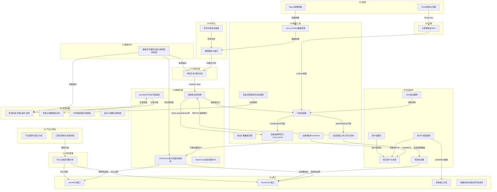

# RUM 业务逻辑及内部逻辑 - 归档梳理总索引

> 知识库根目录（Hugo）：`D:\Bonree\AiProject\forever-funny\content\zh-cn\docs\Digital Experience\rum`  
> 站点路径：`/zh-cn/docs/digital-experience/rum/`  
> 问答与回写均以本目录为准；原 `RUM-ai` 目录仅作历史备份，不再读写。

## 目录结构

```
content/zh-cn/docs/Digital Experience/rum/
├── kb-index.md                  # 关键词路由入口（原 INDEX.md；Windows 避免与 index 冲突）
├── UPDATE-PROTOCOL.md           # 知识库更新协议
├── 01-数据存储与表结构/         # ClickHouse表映射、快照表结构、MV设计、quantileDD分位字段
├── 02-接口文档/                 # recordList、sessionList、其他接口分析、部署状态终端应用列表排序
├── 03-数据上报与协议/           # 字段全链路、协议扩展、识别规则、controller处理、去重/晚回/memberId、品牌机型字典、会话回放
├── 04-符号化与堆栈解析/         # 符号化体系全链路、堆栈解析与展示
├── 05-会话与用户管理/           # 真实用户识别、用户ID采集规则、SDK启动概率、用户组缓存、有效会话数
├── 06-页面视图与性能指标/       # 终端应用逻辑、视图类型识别、H5加载字段、自定义视图与端到端
├── 07-代码异常与修复状态/       # 修复状态实现、崩溃记录页外部跳转
├── 08-计费与MAU/               # 计费逻辑、MAU完整分析
├── 09-配置与中间件/            # Nacos配置参数、Redis使用与问题
├── 10-产品分析与工程化/         # 产品调研能力分析、工程化重构与性能调优
├── 11-代码质量/                # SQL缺少时间条件、实体实例ID类型
├── 12-健康评分/                # 健康评分线性模型、规则优先级、默认规则影响范围、崩溃率口径错位
└── README.md                   # 本文件
```

## 文档速查矩阵

| 主题 | 归档文档 | 大小 | 核心内容 |
|------|---------|------|---------|
| **01-数据存储** | ClickHouse表与页面功能映射.md | 50KB | 三类CK数据源(Gran/Snapshot/TopK)、17个Gran表族、18个Snapshot视图映射、Gran入数据链路 |
| | 快照表结构清单.md | 75KB | 13张共用CkSnapshot列的快照表(每表36列)、t_rum_battery_snapshot、t_trace完整列定义 |
| | sessionList会话级表DDL与MV脚本设计.md | 33KB | 会话级预聚合表DDL、物化视图脚本、历史回填SQL、上线步骤 |
| | quantileDD分位字段映射.md | 42KB | 9个Gran表族的quantileDD分位字段与RUM页面映射、P50-P99 alias全表、故障分级 |
| **02-接口** | recordList接口文档.md | 56KB | 11种problemType快照表路由、SQL结构、字段映射、前端otherIndex/snapshotFile引用 |
| | sessionList接口文档.md | 38KB | 会话列表查询、userNum与列表条数差异分析 |
| | 其他接口分析.md | 46KB | querySessionInfo duration取值逻辑、getWebAppJsInfo嵌码配置、saveHeader表头保存 |
| | 部署状态-终端应用列表默认排序.md | 4KB | appListQuery 默认 order by updateTime desc,detectedName asc；前端 sort 未下传 |
| **03-数据上报** | config-upload-grip-uploadReplay字段全链路.md | 36KB | config/upload/grip/uploadReplay四种请求的字段全链路梳理 |
| | 协议扩展数据流程分析.md | 34KB | 协议扩展数据处理流程、页面平均耗时与P99耗时差异分析 |
| | 页面与网络请求识别规则.md | 72KB | 域名类型判断逻辑、页面与网络请求识别规则完整梳理 |
| | rum-controller数鉴数据处理流程.md | 56KB | 数鉴数据接收/处理/转换/转发全流程、特殊处理逻辑 |
| | 数据上报其他逻辑.md | 52KB | brKey上传去重设计、晚回数据处理、memberId从upload到入库全链路 |
| | 设备品牌机型纠偏与t_bas_brand字典.md | 14KB | Upload→BrandCache→CK client_*；t_bas_brand字典 vs t_bas_brand_check待办；空格/>键差异 |
| | 会话回放上传入库与查询.md | 16KB | uploadReplay→BRFS(T_RUM_SESSION_REPLAY)+CK索引；单会话*_event/*_imgs文件清单；Web wsd vs 原生 msd；querySessionReplay* |
| **04-符号化** | 符号化体系全链路.md | 64KB | 符号类型矩阵、路径拼接、iOS包结构Info.plist、定时任务误删根因与防护、操作审计 |
| | 堆栈解析与展示.md | 65KB | JS错误堆栈解析全链路、前端过滤校验、代码问题摘要与问题ID归并 |
| **05-会话用户** | 真实用户与访客定义识别逻辑.md | 30KB | 真实用户/访客定义、识别规则、memberId与userType关系 |
| | 用户ID采集规则下发与生效范围.md | 12KB | 实体识别用户ID采集、账号+环境+应用隔离、JsRuleCache→userdefine下发、开关与Web SDK生效条件 |
| | SDK启动概率与用户白名单完整逻辑.md | 46KB | 前端配置全链路、filterSdkCollectRate判定、缓存机制、交付FAQ |
| | 用户组缓存设计分析与优化方案.md | 39KB | 用户组缓存设计、匹配性能分析、优化方案 |
| | 有效会话数与活跃设备数指标分析.md | 64KB | hasSession/sessionFlag判断、预聚合查询、会话数不一致根因 |
| **06-页面视图** | 终端应用-页面-操作-请求完整逻辑.md | 60KB | 前端查询链路、原始采集入库、四类对象处理策略、四场景过滤 |
| | 页面与视图类型识别逻辑.md | 23KB | upload协议层→落库层→聚合层→前端归并层四层语义及字段映射 |
| | H5页面加载快照详情字段链路.md | 31KB | FP/FCP/LCP/TTI/页面完全加载耗时的入库与展示链路及回退逻辑 |
| | 自定义视图与端到端打通逻辑.md | 43KB | 自定义视图三层过滤设计与放开影响、service_detected_name链路与t_trace写入 |
| **07-代码异常** | 代码异常-修复状态与崩溃记录页.md | 54KB | 修复状态枚举、problem_type两套体系、状态写入/查询流程、崩溃记录页URL参数 |
| **08-计费** | 计费逻辑与MAU完整分析.md | 45KB | 计费类型/去重规则、configFilter全链路、Redis数据结构、定时Job、License缓存、问题根因 |
| **09-配置** | Nacos配置参数梳理.md | 102KB | 全部Nacos配置参数(参数名/默认值/作用)、配置管理机制、配置下发逻辑 |
| | Redis使用与问题分析.md | 39KB | BPI与RUM模块Redis Key设计、首次崩溃判断Redis内存问题与6套优化方案 |
| **10-产品工程** | 产品调研与能力分析.md | 38KB | 竞品对比矩阵、7大能力支柱对标、设计/功能/新建三类优化建议、三波路线图 |
| | 工程化重构与性能调优方案.md | 77KB | 五维问题清单、26项评估矩阵、绞杀者模式重构、Controller性能调优全参数 |
| **11-代码质量** | SQL与类型问题分析.md | 30KB | SQL缺少时间条件问题(9个接口+5个已清理)、实体实例ID类型分析、共性问题与改进 |
| **12-健康评分** | 健康评分模型与默认规则影响范围.md | 18KB | 线性评分模型(y=kx+b/T0/T1/metricDirection/zero)、规则优先级(type1/2/3)、指标缺失兜底、崩溃率100%得97.42根因(崩溃次数vs崩溃率口径错位)、默认规则copy-on-write与克隆影响范围 |

## 跨主题关联图



## 阅读指引

### 新成员 Onboarding
1. `01-数据存储/ClickHouse表与页面功能映射.md` — 理解 RUM 数据存储全貌
2. `03-数据上报/页面与网络请求识别规则.md` — 理解数据如何进入系统
3. `06-页面视图/终端应用-页面-操作-请求完整逻辑.md` — 理解前端展示逻辑
4. `05-会话用户/真实用户与访客定义识别逻辑.md` — 理解用户体系
5. `05-会话用户/用户ID采集规则下发与生效范围.md` — 理解配置化采集用户ID与生效范围
6. `04-符号化/符号化体系全链路.md` — 理解符号化机制

### 交付讲解
1. `10-产品工程化/产品调研与能力分析.md` — 产品能力全景
2. `08-计费/计费逻辑与MAU完整分析.md` — 计费口径
3. `05-会话用户/SDK启动概率与用户白名单完整逻辑.md` — 采集控制
4. `09-配置/Nacos配置参数梳理.md` — 配置参考

### 问题排查
1. `09-配置/Redis使用与问题分析.md` — Redis 内存问题
2. `04-符号化/符号化体系全链路.md` — 符号化文件缺失/误删
3. `07-代码异常/代码异常-修复状态与崩溃记录页.md` — 修复状态问题
4. `05-会话用户/有效会话数与活跃设备数指标分析.md` — 会话数不一致
5. `11-代码质量/SQL与类型问题分析.md` — SQL 性能问题
6. `01-数据存储/quantileDD分位字段映射.md` — 分位字段映射问题
7. `03-数据上报/设备品牌机型纠偏与t_bas_brand字典.md` — 品牌/机型展示异常、字典与 check 表
8. `03-数据上报/会话回放上传入库与查询.md` — 会话回放无数据/缺帧/Web与原生差异

### 架构优化
1. `10-产品工程化/工程化重构与性能调优方案.md` — 重构方案与性能调优
2. `10-产品工程化/产品调研与能力分析.md` — 能力差距与优化建议
3. `11-代码质量/SQL与类型问题分析.md` — 代码质量问题清单
4. `09-配置/Nacos配置参数梳理.md` — 配置治理参考

## 整合统计

| 指标 | 数值 |
|------|------|
| 原始文档数 | 64 份 |
| 归档文档数 | 32 份 |
| 整合比例 | 约 2.1:1 |
| 归档总大小 | 约 1.4 MB |
| 主题子目录数 | 12 个 |

## 整合原则

1. **自包含**：每份归档文档是完整的独立技术文档，不引用旧文档路径
2. **内容完整**：原始文档中的所有技术细节（代码路径、表结构、字段定义、流程图、配置项等）完整保留
3. **消除重复**：多份原始文档中重复描述的概念、链路、定义只写一次
4. **消解矛盾**：文档间结论差异已消解，采用更准确的版本并注明修正
5. **统一叙述**：代码路径统一为 newonexm 仓库路径
