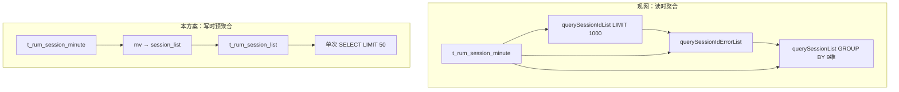
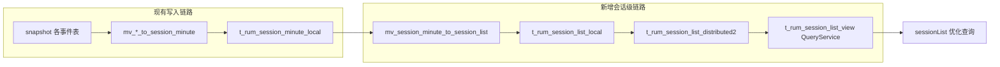

# sessionList 会话级 ClickHouse 表 DDL 与 MV 脚本设计

| 项 | 内容 |
|----|------|
| 文档版本 | v1.1 |
| 编写日期 | 2026-07-02 |
| 目标接口 | `POST /rest/rum/session/search/sessionList`（检索中心 · 用户会话） |
| 关联脚本仓库 | `script/one_framework_rum/INIT/clickhouse/` |
| 关联后端 | `RumCkSessionService.querySessionList()` / `RumSessionMapper.xml` |
| 状态 | **草案 — 待 POC 验证后合入正式版本脚本** |

---

## 1. 背景与目标

### 1.1 现状

当前 `sessionList` 查询链路（检索中心 `limit=true`）典型执行 **2~3 次** ClickHouse 查询，均基于分钟粒度表 `t_rum_session_minute_*` 经 QueryService 视图 `t_rum_session_view` 暴露：

| 步骤 | Mapper 方法 | 主要开销 |
| --- | --- | --- |
| ① | `querySessionIdList` | 时间窗内 `GROUP BY sessionId, deviceId` + `ORDER BY configTime DESC LIMIT 1000` |
| ② | `querySessionIdErrorList` | 对同一批 session 再次全量聚合（异常/满意度原始指标） |
| ③ | `querySessionList` | 9 维 `GROUP BY` + 大量 `argMax`/`sum`，仅展示当前页 ~50 条 |

分钟表 `ORDER BY` 以 `monitor_time` 为主键前缀，列表却按 **会话开始时间 `configTime`** 排序，导致每次列表查询都要跨分钟行做重聚合。

### 1.2 设计目标

新增 **会话级预聚合表** `t_rum_session_list_*`：

- **一行 ≈ 一个会话实例**（`session_id + device_id + 列表展示维度`），与 `querySessionList` 的 `GROUP BY` 粒度对齐
- **排序键对齐列表**：`(account_id, env_id, app_id, session_start_time DESC 友好)`
- **写入路径增量**：通过 MV 从 `t_rum_session_minute_local` 实时合并，不改动现有 snapshot → minute 链路
- **查询路径简化**：列表 SQL 去掉运行时 `GROUP BY`，支持 `PREWHERE + ORDER BY + LIMIT` 直出

### 1.3 非目标（本阶段不做）

- 不在 CK 内实现按 appId 的满意度规则（仍由 Java `SessionSatisfactionRowClassifier` 处理）
- 不替换 `t_rum_session_minute_*`（指标、详情、其他接口继续用 minute 表）
- 不包含 rum-core Java 改造 PR（本文仅 DDL/MV/视图与示例 SQL）

---

## 2. 核心改动、相对优势与注意事项

### 2.1 核心改动（相对现网）

| 层级 | 现网设计 | 本方案 |
| --- | --- | --- |
| **存储粒度** | `t_rum_session_minute_*`：会话 × **分钟**（`monitor_time` 一行） | 新增 `t_rum_session_list_*`：会话 × **列表维度**（一行 ≈ 一个可展示会话实例） |
| **查询入口** | `t_rum_session_view` ← minute 表 | 新增 `t_rum_session_list_view` ← list 表 |
| **写入链路** | snapshot → MV → minute（已有） | **仅新增** minute → MV → list，不改 snapshot/minute |
| **列表 SQL** | 每次请求 **2~3 次** CK 查询 + 运行时 `GROUP BY`（2~9 维） | **1~2 次**查询，`PREWHERE + ORDER BY + LIMIT`，**无运行时 GROUP BY** |
| **排序键** | `ORDER BY` 前缀为 `monitor_time`（事件分钟） | `ORDER BY` 前缀为 `session_start_time`（会话开始时间），与列表 `configTime DESC` 对齐 |
| **聚合时机** | **读时聚合**（查列表时才 sum/argMax） | **写时预聚合**（MV 从 minute 合并到 list） |
| **Java 逻辑** | `RumCkSessionService` 三段式 + `SessionSatisfactionRowClassifier` | **不变**（满意度/异常 Tab 仍在 Java；仅 Mapper 表名/SQL 可切换） |

**一句话**：把「为 sessionList 服务的 GROUP BY」从 **查询阶段**前移到 **入库 MV 阶段**，并单独建一张 **按会话开始时间排序** 的宽表。



### 2.2 相对现网方案的优势

| 维度 | 说明 | 预期收益 |
| --- | --- | --- |
| **接口延迟** | 去掉为 50 条列表服务而扫描/聚合 1000 会话 × N 分钟行 | 检索中心 `sessionList` P95 有望从 **秒级 → 数百 ms**（视数据量，需 POC 实测） |
| **CK 负载** | `read_rows` / CPU 显著下降；减少重复全表聚合 | 降低高峰期的 CK 并发压力，利于多租户共存 |
| **排序效率** | 排序键与业务字段一致，Top-N（LIMIT 1000/50）可走主键前缀 | 避免「先 GROUP BY 全量再 ORDER BY 再 LIMIT」 |
| **架构侵入小** | 不动 snapshot→minute 主链路；list 表可 **Nacos 开关灰度** | 回滚成本低（关开关即回 minute 视图） |
| **语义一致** | GROUP BY 维度与现 `querySessionList` 相同 | 列表字段、Tab 计数口径可与现网对齐（对账后） |
| **可演进** | list 表稳定后，可再拆「统计接口」、缩短 `session.list.days.ago` | 为后续产品优化留空间 |

**与「只调 Nacos / 只合并 SQL」的对比**：

- **仅合并 ①+② SQL、缩短 days.ago**：改动小，但仍在 minute 表上 GROUP BY，**排序键不匹配** 的根因未消除，收益有上限。
- **本方案**：用存储换计算，针对 sessionList **专用读模型**，性能上限更高，代价是 **磁盘 + MV 运维**。

### 2.3 需要注意的点

#### A. 设计与数据

| 序号 | 注意点 | 说明 |
| --- | --- | --- |
| A1 | **session_start_time 精度** | MV 写入暂用 `min(config_time)` 占位；展示排序应以视图层 `coalesce(min_monitor_time, config_time)` 为准，与 Java `fieldMinMonitorTime` 一致。POC 必须验证 Top-N 是否因排序键偏差漏/重会话。 |
| A2 | **维度分裂** | 同一会话若 `app_version`/`channel` 等在会话内变化，仍会产生多行（与现网 9 维 GROUP BY 行为一致），**不是新 bug**，产品口径需知晓。 |
| A3 | **过滤字段口径** | 现网部分条件下用 `monitor_time` 扩窗（`sessionQueryTimeExpansion`）；list 表以 `session_start_time` 分区/过滤，**边界会话**可能对账差 1 条，需在 §8.2 抽样验证。 |
| A4 | **满意度 / 异常 Tab** | 规则依赖按 appId 的配置，**不能**下沉到 CK；list 表只预存原始 flag/计数，Java 分类逻辑必须保留。 |

#### B. 工程与运维

| 序号 | 注意点 | 说明 |
| --- | --- | --- |
| B1 | **存储成本** | list 行数 ≪ minute 行数，但仍为 **14 天 TTL 的第二份聚合存储**，需评估磁盘（通常可接受）。 |
| B2 | **MV 双倍写入** | minute 每次写入触发 list MV；需监控 MV 延迟、Buffer 积压、`system.parts`。 |
| B3 | **ClickHouse 版本** | `argMaxOrNullMergeState` 等函数依赖集群版本；不兼容时改用 §8.1 **批式回填** 或调整 MV 写法。 |
| B4 | **QueryService -Merge** | `t_rum_session_list_view` 依赖 Zeus 对 AggregatingMergeTree 的 Merge 语义；POC 先查视图列类型是否为标量。 |
| B5 | **历史回填** | 上线前必须低峰执行 §8.1；仅 MV 无回填时，**14 天内列表会缺历史数据**。 |
| B6 | **双读与对账** | 灰度期 **Nacos 开关** `rum.session.list.use.list.view`；与 `t_rum_session_view` 结果抽样对账通过后再全量。 |

#### C. 上线与回滚

| 序号 | 注意点 | 说明 |
| --- | --- | --- |
| C1 | **默认关闭新链路** | 先发 DDL/MV + 视图，Java 默认仍走 minute，避免未回填即切换。 |
| C2 | **回滚** | 关 Nacos 开关即可回现网 SQL；`DROP MV/TABLE` 仅在 POC 失败时使用。 |
| C3 | **不影响其他接口** | `querySessionInfo`、会话详情、指标等 **继续用 minute/view**；勿全局替换 `t_rum_session_view`。 |
| C4 | **Java 改造范围** | 至少涉及 `RumSessionMapper.xml` 新 SQL + `RUMConfig` 开关；`RumCkSessionService` 三段式在开关打开时可简化为 1~2 步。 |

#### D. 验收指标（POC 建议）

| 指标 | 现网基线 | 目标 |
| --- | --- | --- |
| 单次 sessionList CK 查询次数 | 2~3 | 1~2 |
| `read_rows`（同 account/env/时间窗/appIds） | 记录 query_log | 显著下降（建议 >50%） |
| P95 接口耗时 | 记录 APM/网关 | 明显下降 |
| 列表条数 / Tab 计数 | 与现网 diff | 抽样一致或可解释 |

---

## 3. 表模型总览



| 对象 | 引擎 | 说明 |
| --- | --- | --- |
| `t_rum_session_list_local` | ReplicatedAggregatingMergeTree | 本地会话级聚合表 |
| `t_rum_session_list_buffer` | Buffer | 与 minute 表一致，吸收写入尖峰 |
| `t_rum_session_list_distributed2` | Distributed → merge/buffer | 集群查询入口 |
| `mv_t_rum_session_minute_to_t_rum_session_list_local` | Materialized View | minute → list 增量合并 |
| `t_rum_session_list_view` | QueryService 视图 | 对 Java 暴露 camelCase + -Merge 列 |

---

## 4. 字段设计（与 RumSessionMapper 对齐）

### 4.1 维度键（GROUP BY 粒度）

与 `RumSessionMapper.xml` · `querySessionList` 保持一致：

```text
session_id, app_id, app_version, client_device_name, client_os_name,
device_id, sdk_version, channel, data_center_id
```

另保留租户/环境过滤字段：`account_id`, `env_id`, `app_type`, `data_source`, `os_type`, `custom_os_name`, `client_brand_name`。

### 4.2 列表排序字段

| 逻辑字段 | 存储 | 计算规则（与 fieldMinMonitorTime 一致） |
| --- | --- | --- |
| `session_start_time` | `DateTime` | `if(min_monitor_time IS NULL, config_time, min_monitor_time)`，MV 写入时用 `minOrNullMerge` + `min` 维护 |
| `config_time` | `DateTime` | 会话 config_time 最小值（TTL 锚点） |
| `max_monitor_time` | `AggregateFunction(maxOrNull, DateTime(3))` | 最后事件时间 |

列表默认 `ORDER BY session_start_time DESC` 可直接走排序键。

### 4.3 指标列（AggregatingMergeTree）

与 `t_rum_session_minute_local` 指标列一致，QueryService 视图层做 `-Merge` 展开，供 Java 直接使用：

- 计数：`event_num`, `user_event_num`, `exception_event_num`, `acceptable_event_num`, `satisfied_event_num`, `duration`, `view_num`, `action_num` …
- 标志：`crash_flag`, `anr_flag`, `appfreeze_flag`, `selfcrash_flag`, `lag_flag`, `action_error_flag`, `h5_error_flag`, `replay_flag`
- 最新值：`member_id`, `user_group_id`, `city_id`, `netservice_id`, `access_model_id`, `client_ip`, `user_info`（`argMaxOrNull` by monitor_time）

### 4.4 预计算列（可选增强）

POC 验证通过后，可在 QueryService 视图增加：

- `session_duration_ms`：与 `fieldSessionDuration` 相同逻辑，查询时不再计算表达式
- `has_event`：`event_num > 0`，用于替代 HAVING

---

## 5. DDL 脚本（集群版 · 草案）

> 占位符 `{metadataaddr}`、`{uuid}`、`{shard}`、`{replica}` 与现有 `one_rum_datasource_snapshot.sql` 保持一致。
> 时区：`Asia/Shanghai`。TTL：**14 天**（与 minute 表对齐）。

建议脚本路径：`script/one_framework_rum/INIT/clickhouse/4.x.x.x/rum_session_list.sql`

```sql
-- =============================================================================
-- RUM 会话级列表预聚合表（sessionList 性能优化）
-- 版本：草案 v1.0 / 2026-07-02
-- =============================================================================

CREATE DATABASE IF NOT EXISTS one_rum_datasource_snapshot;

-- -----------------------------------------------------------------------------
-- 5.1 本地表
-- -----------------------------------------------------------------------------
CREATE TABLE IF NOT EXISTS one_rum_datasource_snapshot.t_rum_session_list_local
(
    `config_time` DateTime('Asia/Shanghai') COMMENT '会话 config_time 最小值（TTL 锚点）',
    `session_start_time` DateTime('Asia/Shanghai') COMMENT '列表排序用会话开始时间 = coalesce(min_monitor_time, config_time)',
    `account_id` Int64 COMMENT '帐号ID',
    `env_id` LowCardinality(String) COMMENT '环境ID',
    `data_center_id` Int64 COMMENT '数据中心Id',
    `data_source` LowCardinality(String) COMMENT '数据来源',
    `app_type` Int8 COMMENT '应用类型',
    `app_id` Int64 COMMENT '终端应用ID',
    `session_id` String COMMENT '会话ID',
    `device_id` String COMMENT '设备ID',
    `client_device_name` String COMMENT '设备机型',
    `client_brand_name` String COMMENT '设备品牌',
    `app_version` String COMMENT '应用版本',
    `channel` String COMMENT '下载渠道',
    `sdk_version` String COMMENT '探针版本',
    `client_os_name` String COMMENT '操作系统',
    `os_type` Int8 COMMENT '操作系统类型',
    `custom_os_name` String COMMENT '定制化系统',
    `member_id` AggregateFunction(argMaxOrNull, String, DateTime64(3, 'Asia/Shanghai')) COMMENT '用户ID 最新值',
    `member_type` AggregateFunction(maxOrNull, Int8) COMMENT '用户类型',
    `user_group_id` AggregateFunction(argMaxOrNull, Int64, DateTime64(3, 'Asia/Shanghai')) COMMENT '用户组ID',
    `access_model_id` AggregateFunction(argMaxOrNull, Int32, DateTime64(3, 'Asia/Shanghai')) COMMENT '接入方式',
    `netservice_id` AggregateFunction(argMaxOrNull, Int32, DateTime64(3, 'Asia/Shanghai')) COMMENT '运营商',
    `city_id` AggregateFunction(argMaxOrNull, Int32, DateTime64(3, 'Asia/Shanghai')) COMMENT '地区',
    `client_ip` AggregateFunction(argMaxOrNull, String, DateTime64(3, 'Asia/Shanghai')) COMMENT '设备IP',
    `user_info` AggregateFunction(argMaxOrNull, String, DateTime64(3, 'Asia/Shanghai')) COMMENT '用户附加信息',
    `max_monitor_time` AggregateFunction(maxOrNull, DateTime(3, 'Asia/Shanghai')) COMMENT '最后事件时间',
    `min_monitor_time` AggregateFunction(minOrNull, DateTime(3, 'Asia/Shanghai')) COMMENT '最初事件时间',
    `event_num` AggregateFunction(sumOrNull, Int64) COMMENT '总事件数',
    `user_event_num` AggregateFunction(sumOrNull, Int64) COMMENT '用户有效事件数',
    `acceptable_event_num` AggregateFunction(sumOrNull, Int64) COMMENT '可容忍事件数',
    `satisfied_event_num` AggregateFunction(sumOrNull, Int64) COMMENT '满意事件数',
    `exception_event_num` AggregateFunction(sumOrNull, Int64) COMMENT '异常事件数',
    `duration` AggregateFunction(sumOrNull, Int64) COMMENT '耗时累计(ms)',
    `view_num` AggregateFunction(sumOrNull, Int64) COMMENT '视图数',
    `action_num` AggregateFunction(sumOrNull, Int64) COMMENT '操作数',
    `serious_error_num` AggregateFunction(sumOrNull, Int64) COMMENT '致命问题数',
    `minor_error_num` AggregateFunction(sumOrNull, Int64) COMMENT '错误问题数',
    `crash_flag` AggregateFunction(maxOrNull, Int64) COMMENT '是否有崩溃',
    `selfcrash_flag` AggregateFunction(maxOrNull, Int64) COMMENT '是否有自定义异常',
    `anr_flag` AggregateFunction(maxOrNull, Int64) COMMENT '是否有ANR',
    `appfreeze_flag` AggregateFunction(maxOrNull, Int64) COMMENT '是否有应用冻结',
    `lag_flag` AggregateFunction(maxOrNull, Int64) COMMENT '是否有卡顿',
    `action_error_flag` AggregateFunction(maxOrNull, Int64) COMMENT '是否有操作异常',
    `h5_error_flag` AggregateFunction(maxOrNull, Int64) COMMENT '是否有页面异常',
    `replay_flag` AggregateFunction(maxOrNull, Int64) COMMENT '是否有会话回放',
    `other_data` AggregateFunction(argMaxOrNull, String, DateTime64(3, 'Asia/Shanghai')) COMMENT '其他附加信息',
    `snapshot_version` AggregateFunction(maxOrNull, Int32) COMMENT '快照版本',
    INDEX index_session_id_bloom_filter session_id TYPE bloom_filter GRANULARITY 1,
    INDEX index_device_id_bloom_filter device_id TYPE bloom_filter GRANULARITY 1
)
ENGINE = ReplicatedAggregatingMergeTree('{metadataaddr}:/clickhouse/tables/{uuid}/{shard}', '{replica}')
PARTITION BY toYYYYMMDD(session_start_time)
PRIMARY KEY (account_id, env_id, app_id, session_start_time, session_id, device_id)
ORDER BY (
    account_id,
    env_id,
    app_id,
    session_start_time,
    session_id,
    device_id,
    data_source,
    app_type,
    app_version,
    client_device_name,
    channel,
    sdk_version,
    client_os_name,
    os_type,
    custom_os_name,
    config_time,
    data_center_id
)
TTL toDateTime(session_start_time) + INTERVAL 14 DAY
SETTINGS index_granularity = 8192, ttl_only_drop_parts = 1;

-- -----------------------------------------------------------------------------
-- 5.2 Buffer 表（写入尖峰缓冲，参数对齐 minute buffer）
-- -----------------------------------------------------------------------------
CREATE TABLE IF NOT EXISTS one_rum_datasource_snapshot.t_rum_session_list_buffer
AS one_rum_datasource_snapshot.t_rum_session_list_local
ENGINE = Buffer(
    'one_rum_datasource_snapshot',
    't_rum_session_list_local',
    1, 60, 120,
    50000, 500000,
    20971520, 104857600
)
SETTINGS enable_buffer_wal = 1;

-- -----------------------------------------------------------------------------
-- 5.3 分布式表（4.0.0.7 风格：distributed2 → merge/buffer）
-- -----------------------------------------------------------------------------
CREATE TABLE IF NOT EXISTS one_rum_datasource_snapshot.t_rum_session_list_distributed2
AS one_rum_datasource_snapshot.t_rum_session_list_local
ENGINE = Distributed(
    'cluster',
    'one_rum_datasource_snapshot',
    't_rum_session_list_buffer',
    farmHash64(
        concat(
            toString(account_id),
            env_id,
            toString(app_id),
            session_id,
            device_id
        )
    )
);

-- 兼容 QueryService / 旧客户端：别名分布式表（可选）
CREATE TABLE IF NOT EXISTS one_rum_datasource_snapshot.t_rum_session_list_distributed
AS one_rum_datasource_snapshot.t_rum_session_list_local
ENGINE = Distributed(
    'all_distributed_clusters',
    'one_rum_datasource_snapshot',
    't_rum_session_list_distributed2',
    rand()
);
```

---

## 6. Materialized View（minute → session_list）

### 6.1 设计要点

- **触发源**：`t_rum_session_minute_local`（minute 本地表每次 INSERT/Merge 后触发）
- **目标**：`t_rum_session_list_buffer`（与现有 snapshot→minute 写入模式一致）
- **聚合**：去掉 `monitor_time` 维度，对 AggregateFunction 列使用 `*MergeState` 二次合并
- **session_start_time**：在 MV 中写 `min(config_time)` 作初值；最终排序时间由 QueryService 视图用 `min_monitor_time` / `config_time` 合并后暴露（见 §7）

### 6.2 MV DDL

```sql
DROP TABLE IF EXISTS one_rum_datasource_snapshot.mv_t_rum_session_minute_to_t_rum_session_list_local;

CREATE MATERIALIZED VIEW IF NOT EXISTS one_rum_datasource_snapshot.mv_t_rum_session_minute_to_t_rum_session_list_local
TO one_rum_datasource_snapshot.t_rum_session_list_buffer
AS
SELECT
    min(config_time) AS config_time,
    min(config_time) AS session_start_time,
    account_id,
    env_id,
    data_center_id,
    data_source,
    app_type,
    app_id,
    session_id,
    device_id,
    client_device_name,
    client_brand_name,
    app_version,
    channel,
    sdk_version,
    client_os_name,
    os_type,
    custom_os_name,
    argMaxOrNullMergeState(member_id) AS member_id,
    maxOrNullMergeState(member_type) AS member_type,
    argMaxOrNullMergeState(user_group_id) AS user_group_id,
    argMaxOrNullMergeState(access_model_id) AS access_model_id,
    argMaxOrNullMergeState(netservice_id) AS netservice_id,
    argMaxOrNullMergeState(city_id) AS city_id,
    argMaxOrNullMergeState(client_ip) AS client_ip,
    argMaxOrNullMergeState(user_info) AS user_info,
    maxOrNullMergeState(max_monitor_time) AS max_monitor_time,
    minOrNullMergeState(min_monitor_time) AS min_monitor_time,
    sumOrNullMergeState(event_num) AS event_num,
    sumOrNullMergeState(user_event_num) AS user_event_num,
    sumOrNullMergeState(acceptable_event_num) AS acceptable_event_num,
    sumOrNullMergeState(satisfied_event_num) AS satisfied_event_num,
    sumOrNullMergeState(exception_event_num) AS exception_event_num,
    sumOrNullMergeState(duration) AS duration,
    sumOrNullMergeState(view_num) AS view_num,
    sumOrNullMergeState(action_num) AS action_num,
    sumOrNullMergeState(serious_error_num) AS serious_error_num,
    sumOrNullMergeState(minor_error_num) AS minor_error_num,
    maxOrNullMergeState(crash_flag) AS crash_flag,
    maxOrNullMergeState(selfcrash_flag) AS selfcrash_flag,
    maxOrNullMergeState(anr_flag) AS anr_flag,
    maxOrNullMergeState(appfreeze_flag) AS appfreeze_flag,
    maxOrNullMergeState(lag_flag) AS lag_flag,
    maxOrNullMergeState(action_error_flag) AS action_error_flag,
    maxOrNullMergeState(h5_error_flag) AS h5_error_flag,
    maxOrNullMergeState(replay_flag) AS replay_flag,
    argMaxOrNullMergeState(other_data) AS other_data,
    maxOrNullMergeState(snapshot_version) AS snapshot_version
FROM one_rum_datasource_snapshot.t_rum_session_minute_local
GROUP BY
    account_id,
    env_id,
    data_center_id,
    data_source,
    app_type,
    app_id,
    session_id,
    device_id,
    client_device_name,
    client_brand_name,
    app_version,
    channel,
    sdk_version,
    client_os_name,
    os_type,
    custom_os_name;
```

### 6.3 MV 注意事项

1. **session_start_time 精度**：MV 写入阶段用 `min(config_time)` 占位；QueryService 视图层应改为
   `if(min_monitor_time IS NULL, config_time, min_monitor_time)`，与 Java `fieldMinMonitorTime` 一致。
   若 POC 证明排序键与真实 start_time 偏差影响 Top-N，可增加 **定时 OPTIMIZE + 投影** 或 **ReplacingMergeTree 辅表** 修正。
2. **argMaxOrNullMergeState**：需 ClickHouse 版本支持；若集群版本较旧，回退为 `argMaxOrNullMergeState` 不可用时的 **批式回填**（§8.1）。
3. **与 minute merge 表兼容**：若生产已启用 `t_rum_session_minute_merge`（4.0.0.7），MV 仍挂在 `_local` 即可；merge 引擎最终 flush 到 local，MV 只触发一次。

---

## 7. QueryService 视图（t_rum_session_list_view）

写入 `script/one_framework_rum/INIT/tdsql/all/one_rum_queryservice_view.sql`（及 dm/mariadb/oceanbase 同步）。

```sql
-- t_metadata_view 注册示例（Zeus / QueryService）
-- view_name: t_rum_session_list_view
-- schema: one_rum_datasource_snapshot

CREATE OR REPLACE VIEW one_rum_datasource_snapshot.t_rum_session_list_view AS
SELECT
    config_time AS "configTime",
    if(min_monitor_time IS NULL, config_time, min_monitor_time) AS "sessionStartTime",
    account_id,
    env_id,
    data_center_id AS "dataCenterId",
    data_source AS "dataSource",
    app_type AS "appType",
    app_id AS "appId",
    session_id AS "sessionId",
    device_id AS "deviceId",
    client_device_name AS "clientDeviceName",
    client_brand_name AS "clientBrandName",
    app_version AS "appVersion",
    channel,
    sdk_version AS "sdkVersion",
    client_os_name AS "clientOsName",
    os_type AS "osType",
    custom_os_name AS "customOsName",
    member_id AS "memberId",
    member_type AS "memberType",
    user_group_id AS "userGroupId",
    access_model_id AS "accessModelId",
    netservice_id AS "netserviceId",
    city_id AS "cityId",
    client_ip AS "clientIp",
    user_info AS "userInfo",
    max_monitor_time AS "maxMonitorTime",
    min_monitor_time AS "minMonitorTime",
    event_num AS "eventNum",
    user_event_num AS "userEventNum",
    acceptable_event_num AS "acceptableEventNum",
    satisfied_event_num AS "satisfiedEventNum",
    exception_event_num AS "exceptionEventNum",
    duration,
    view_num AS "viewNum",
    action_num AS "actionNum",
    serious_error_num AS "seriousErrorNum",
    minor_error_num AS "minorErrorNum",
    crash_flag AS "crashFlag",
    selfcrash_flag AS "selfcrashFlag",
    anr_flag AS "anrFlag",
    appfreeze_flag AS "appfreezeFlag",
    lag_flag AS "lagFlag",
    action_error_flag AS "actionErrorFlag",
    h5_error_flag AS "h5ErrorFlag",
    replay_flag AS "replayFlag",
    other_data AS "otherData",
    snapshot_version AS "snapshotVersion"
FROM one_rum_datasource_snapshot.t_rum_session_list;
```

> `t_rum_session_list` 为 QueryService 对 `t_rum_session_list_distributed2` 的逻辑表名（与现有 `t_rum_session` ← minute 命名方式一致）。
> AggregateFunction 列在 QueryService 侧自动 `-Merge`，视图直接 SELECT 标量别名。

---

## 8. 历史数据回填与校验

### 8.1 回填 SQL（一次性 · 低峰执行）

```sql
INSERT INTO one_rum_datasource_snapshot.t_rum_session_list_local
SELECT
    min(config_time) AS config_time,
    min(config_time) AS session_start_time,
    account_id, env_id, data_center_id, data_source, app_type, app_id,
    session_id, device_id, client_device_name, client_brand_name,
    app_version, channel, sdk_version, client_os_name, os_type, custom_os_name,
    argMaxOrNullMergeState(member_id),
    maxOrNullMergeState(member_type),
    argMaxOrNullMergeState(user_group_id),
    argMaxOrNullMergeState(access_model_id),
    argMaxOrNullMergeState(netservice_id),
    argMaxOrNullMergeState(city_id),
    argMaxOrNullMergeState(client_ip),
    argMaxOrNullMergeState(user_info),
    maxOrNullMergeState(max_monitor_time),
    minOrNullMergeState(min_monitor_time),
    sumOrNullMergeState(event_num),
    sumOrNullMergeState(user_event_num),
    sumOrNullMergeState(acceptable_event_num),
    sumOrNullMergeState(satisfied_event_num),
    sumOrNullMergeState(exception_event_num),
    sumOrNullMergeState(duration),
    sumOrNullMergeState(view_num),
    sumOrNullMergeState(action_num),
    sumOrNullMergeState(serious_error_num),
    sumOrNullMergeState(minor_error_num),
    maxOrNullMergeState(crash_flag),
    maxOrNullMergeState(selfcrash_flag),
    maxOrNullMergeState(anr_flag),
    maxOrNullMergeState(appfreeze_flag),
    maxOrNullMergeState(lag_flag),
    maxOrNullMergeState(action_error_flag),
    maxOrNullMergeState(h5_error_flag),
    maxOrNullMergeState(replay_flag),
    argMaxOrNullMergeState(other_data),
    maxOrNullMergeState(snapshot_version)
FROM one_rum_datasource_snapshot.t_rum_session_minute_distributed2
WHERE monitor_time >= now() - INTERVAL 14 DAY
GROUP BY
    account_id, env_id, data_center_id, data_source, app_type, app_id,
    session_id, device_id, client_device_name, client_brand_name,
    app_version, channel, sdk_version, client_os_name, os_type, custom_os_name;
```

### 8.2 数据一致性校验

对同一 `account_id + env_id + app_id + 时间窗`，抽样对比：

```sql
-- A：旧链路（minute 视图聚合）
SELECT sessionId, count() AS cnt
FROM (
    SELECT "sessionId" AS sessionId
    FROM one_rum_datasource_snapshot.t_rum_session_view
    WHERE account_id = {aid} AND env_id = {eid}
      AND monitor_time >= {t0} AND monitor_time < {t1}
    GROUP BY sessionId, deviceId
    HAVING sum("eventNum") > 0
) GROUP BY sessionId;

-- B：新链路（session_list 视图）
SELECT "sessionId" AS sessionId, count() AS cnt
FROM one_rum_datasource_snapshot.t_rum_session_list_view
WHERE account_id = {aid} AND env_id = {eid}
  AND "sessionStartTime" >= {t0} AND "sessionStartTime" < {t1}
  AND "eventNum" > 0
GROUP BY sessionId;
```

允许差异场景：回填窗口边界、minute 延迟 merge、session_start_time 与 monitor_time 过滤口径差异（需在 POC 记录）。

---

## 9. 优化后 sessionList 查询示例

Java 改造后，`RumSessionMapper.xml` 可新增 `querySessionListFromListView`（或 Nacos 开关切换表名）。

### 9.1 列表 + 异常原始指标（合并原 ①+②+③ 为 1~2 次）

```sql
-- 单次查询：当前页列表 + 异常分类所需原始字段
SELECT
    "sessionId" AS sessionId,
    toUnixTimestamp("sessionStartTime") * 1000 AS configTime,
    if("replayFlag" IS NULL, 0, "replayFlag") AS isExistSessionReplay,
    toUnixTimestamp("maxMonitorTime") * 1000 AS monitorTime,
    if("exceptionEventNum" IS NULL, 0, "exceptionEventNum") AS exceptionSessionForStatus,
    if("satisfiedEventNum" IS NULL, 0, "satisfiedEventNum") AS satisfiedSessionForStatus,
    if("acceptableEventNum" IS NULL, 0, "acceptableEventNum") AS acceptableSessionForStatus,
    if("userEventNum" IS NULL, 0, "userEventNum") AS sessionSatisfactionEventTotal,
    if(
        "minMonitorTime" IS NULL,
        if("duration" IS NULL, 0, "duration"),
        (toUnixTimestamp64Milli("maxMonitorTime") - toUnixTimestamp64Milli("minMonitorTime")) * 1000
    ) AS sessionDuration,
    if("eventNum" IS NULL, 0, "eventNum") AS eventNum,
    "appId" AS appId,
    "appVersion" AS appVersion,
    "sdkVersion" AS sdkVersion,
    "cityId" AS cityCode,
    "netserviceId" AS netServiceId,
    "accessModelId" AS accessModelId,
    "clientIp" AS dIp,
    "userInfo" AS userInfo,
    "memberId" AS memberId,
    "clientDeviceName" AS fullBrandModel,
    "clientOsName" AS osName,
    "deviceId" AS deviceId,
    channel,
    "dataCenterId" AS dataCenterId,
    round("crashFlag", 0) AS crashFlag,
    round("anrFlag", 0) AS anrFlag,
    round("appfreezeFlag", 0) AS appfreezeFlag,
    round("selfcrashFlag", 0) AS selfCrashFlag,
    round("lagFlag", 0) AS lagFlag,
    round("actionErrorFlag", 0) AS actionErrorFlag,
    round("h5ErrorFlag", 0) AS h5ErrorFlag,
    "userGroupId" AS groupId
FROM one_rum_datasource_snapshot.t_rum_session_list_view
PREWHERE
    account_id = {accountId}
    AND env_id = {envId}
    AND "sessionStartTime" >= {startTime}
    AND "sessionStartTime" < {endTime}
WHERE
    "appId" IN ({appIds})
    AND "eventNum" > 0
    -- 动态 filters 由 RumSqlFilterFactory 追加
ORDER BY configTime DESC
LIMIT {pageSize} OFFSET {offset};
```

### 9.2 Top-1000 统计（Tab 计数）

若仍需「最多 1000 条会话」产品语义，可单独轻量查询：

```sql
SELECT
    "sessionId",
    "exceptionEventNum", "satisfiedEventNum", "acceptableEventNum", "userEventNum",
    "crashFlag", "anrFlag", "appfreezeFlag", "selfCrashFlag",
    "actionErrorFlag", "h5ErrorFlag", "appId"
FROM one_rum_datasource_snapshot.t_rum_session_list_view
PREWHERE account_id = {accountId} AND env_id = {envId}
    AND "sessionStartTime" >= {startTime} AND "sessionStartTime" < {endTime}
WHERE "appId" IN ({appIds}) AND "eventNum" > 0
ORDER BY configTime DESC
LIMIT 1000;
```

相比现网，**去掉 GROUP BY**，预期 `read_rows` 数量级下降。

---

## 10. 上线步骤建议

| 阶段 | 动作 | 回滚 |
| --- | --- | --- |
| P0 POC | 测试集群执行 §5~§6 DDL；观察 MV 延迟与磁盘 | `DROP MV` + `DROP TABLE` |
| P1 回填 | 低峰 §8.1 回填 14 天；§8.2 对账 | Truncate list 表重新回填 |
| P2 双读 | Nacos 开关 `rum.session.list.use.list.view=false`（默认）；灰度 true | 关开关回 minute 视图 |
| P3 合入 | 脚本进 `4.x.x.x/rum_session_list.sql`；QueryService 元数据发版 | 保留旧 Mapper SQL |
| P4 清理 | 稳定 2 周后评估是否缩短 minute 表在列表场景的查询 | — |

### 10.1 建议 Nacos 开关（Java 侧后续）

| Key | 默认值 | 说明 |
| --- | --- | --- |
| `global.private.rum.session.list.use.list.view` | `false` | 是否走 `t_rum_session_list_view` |
| `global.private.rum.session.list.days.ago` | `7` | 列表专用扫描天数（小于 minute 的 13 天） |

---

## 11. 风险与待决问题

| 项 | 说明 | 缓解 |
| --- | --- | --- |
| MV 双倍写入 | minute + list 各存一份，磁盘约 +30%~50%（list 行数远小于 minute） | TTL 14 天；list 仅列表字段 |
| session_start_time 与排序键 | MV 初值用 config_time，与 min_monitor_time 可能不一致 | 视图层统一；必要时 OPTIMIZE FINAL 或投影 |
| 维度分裂 | 同 session 若 app_version 变更会产生多行（与现 SQL GROUP BY 一致） | 产品已接受；不在本方案改变 |
| QueryService -Merge | 依赖 Zeus 对 AggregatingMergeTree 的 Merge 语义 | POC 先验证视图列类型 |
| 满意度规则 | 仍在 Java 分类 | 保留 exception 原始列即可 |

---

## 12. 相关代码与脚本

- CK 初始化脚本：`script/one_framework_rum/INIT/clickhouse/all/one_rum_datasource_snapshot.sql`（`t_rum_session_minute_*`）
- 会话 Mapper：`framework/plugins/rum/rum-database/src/main/resources/com/bonree/rum/mysql/rumqueryservice/.../RumSessionMapper.xml`
- 会话 Service：`framework/plugins/rum/rum-core/.../RumCkSessionService.java`、`RumCkSessionSearchService.java`
- 满意度分类：`framework/plugins/rum/rum-core/.../SessionSatisfactionRowClassifier.java`
- QueryService 视图注册：`script/one_framework_rum/INIT/tdsql/all/one_rum_queryservice_view.sql`（dm/mariadb/oceanbase 同步）

---

## 13. 变更记录

| 版本 | 日期 | 作者 | 说明 |
| --- | --- | --- | --- |
| v1.1 | 2026-07-02 | AI 草案 | 新增 §2 核心改动、相对优势与注意事项 |
| v1.0 | 2026-07-02 | AI 草案 | 初版：DDL + MV + QueryService 视图 + 回填/查询示例 |
