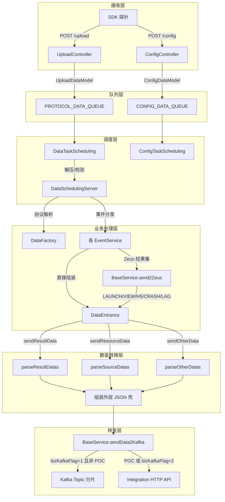
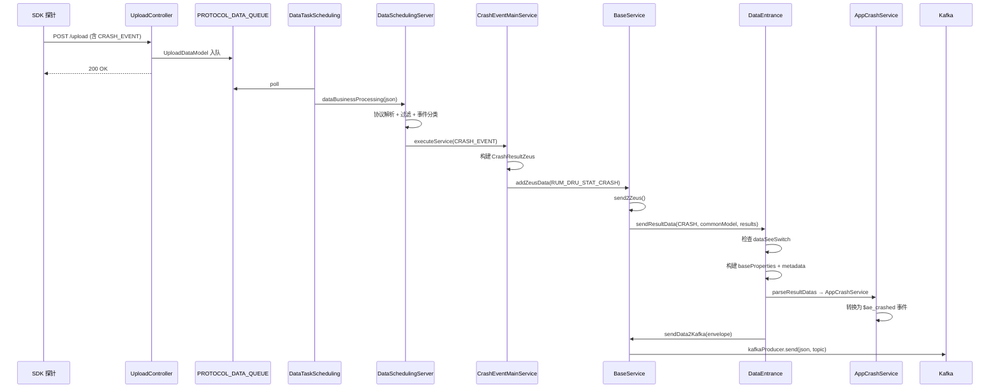
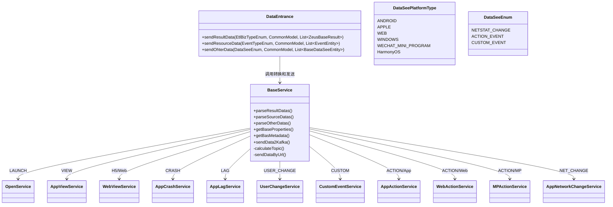
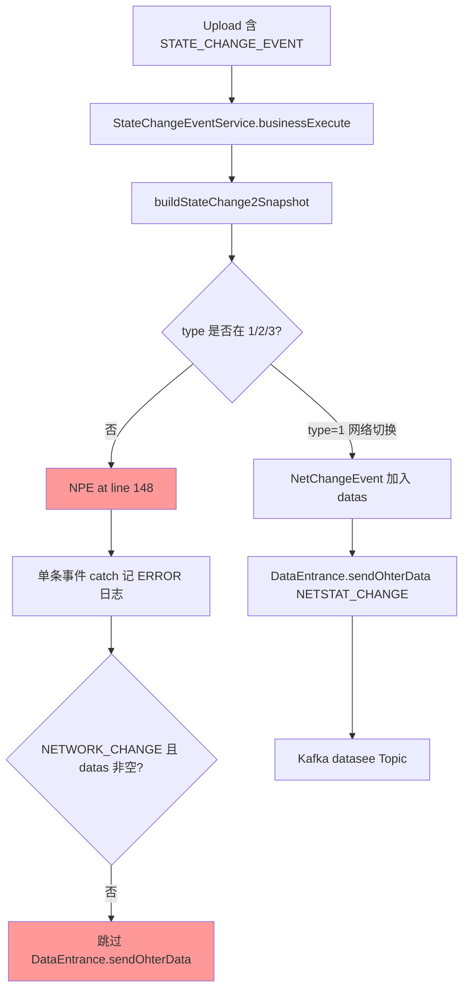
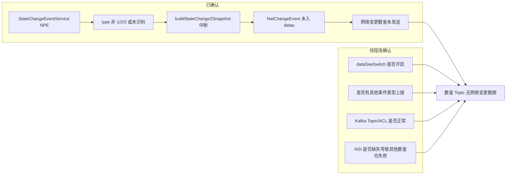

本文整合两类内容：**数鉴（DataSee）数据接收、处理、转换与转发完整流程**；以及 **rum-controller 在数据上报、解析、入库、转发、查询各阶段的特殊处理逻辑**（过滤、兼容、降级、分流、采样、去重、异常保护）。

涉及代码仓：`controller/rum-controller`（主） + `framework/plugins/rum`（查询侧 `rum-core` / `rum-database`），均位于 `newonexm` 仓库。

---

# 第一部分：数鉴（DataSee）数据接收、处理、转换与转发完整流程

## 一、概述

**数鉴（DataSee）** 是 RUM 平台向外部数据分析/用户行为分析系统推送标准化事件数据的集成通道。rum-controller 在 SDK 上报数据的常规 ETL 处理链路中，**旁路**将部分事件转换为数鉴协议格式，并通过 Kafka 或 HTTP 接口转发至下游 Integration/ETL 服务。

### 1.1 核心设计特点

| 特点 | 说明 |
|------|------|
| 开关控制 | 全局开关 `dataSeeSwitch`，默认 `false`，关闭时所有数鉴逻辑直接返回 |
| 旁路集成 | 数鉴转换不影响 RUM 主链路（Zeus/CK/ES/Biz 等），在业务处理完成后附加调用 |
| 三类入口 | 结果集数据、原始协议数据、组装数据，分别对应三种转换路径 |
| 平台适配 | 按 Android/iOS/Web/Windows/鸿蒙/微信小程序 6 种平台类型分别转换 |
| 双通道转发 | 生产环境走 Kafka 分 Topic；POC 或接口模式走 HTTP Integration |

### 1.2 模块与代码位置

```
controller/rum-controller/
├── network/          # HTTP 接收入口（/upload、/config）
├── manager/          # 异步任务调度（DataTaskScheduling、ConfigTaskScheduling）
├── data-handler/
│   └── business/
│       ├── DataSchedulingServer.java    # 业务调度主入口
│       ├── services/                    # 各事件业务处理（触发数鉴转发）
│       └── datasee/                     # 数鉴专用包
│           ├── DataEntrance.java        # 数鉴转换统一入口
│           ├── DataSeeEnum.java         # 组装事件类型枚举
│           ├── DataSeePlatformType.java # 平台类型映射
│           ├── JsonVariable.java        # 数鉴 JSON 字段常量
│           ├── DataSeeUtil.java         # JSON 写入工具
│           └── service/                 # 各事件转换实现
│               ├── BaseService.java     # 转换路由 + Kafka/HTTP 发送
│               ├── app/                 # App 端事件
│               ├── web/                 # Web 端事件
│               ├── mp/                  # 小程序事件
│               └── common/              # 通用事件
└── config/
    └── BaseConfig.java                  # 数鉴相关 Nacos 配置
```

## 二、整体架构与数据流



## 三、数据接收阶段

### 3.1 Upload 上报接收（主路径）

**入口**：`UploadController`（`POST /upload`）

**处理步骤**：

1. **参数校验**：校验 `d`（设备ID）、`a`（App MD5）、`v`（协议版本）、`s`（Session）、`mt`（监控时间）等必要参数
2. **应用与 License 校验**：验证应用存在性、License 有效性、精简模式限制
3. **brkey 校验**：Header 或 URL 参数中必须携带 `brkey`
4. **Gzip 识别**：根据 `Content-Encoding: gzip` 标记是否压缩
5. **Web IP 解析**：Web 平台从 `X-Real-IP` 等 Header 解析设备 IP
6. **入队**：构造 `UploadDataModel`，写入 `PROTOCOL_DATA_QUEUE`

```java
// UploadController.java - 入队关键代码
DataQueueBuilder.getDataQueue(baseConfig.PROTOCOL_DATA_QUEUE)
  .put(new UploadDataModel(
    requestData, uploadTime, isGzip, deviceIp, userAgent,
    brKey, param.get("v"), param.get("if"), param.get("m"), param));
```

**UploadDataModel 携带字段**：

| 字段 | 说明 |
|------|------|
| data | 原始请求体（可能 Gzip 压缩） |
| deviceIp | Web 端解析的真实 IP |
| userAgent | HTTP User-Agent |
| brKey | 请求唯一标识 |
| protocolVersion | 协议版本 `v` |
| firstUpload | 是否首次上传 `if`（Web 会话开始标志） |
| mode | 精简模式 `m=1` |
| param | URL 全部参数 |

### 3.2 Config 配置接收（精简模式启动补充）

**入口**：`ConfigController`（`POST /config`）→ `ConfigTaskScheduling`

在**精简协议模式**（`m=1`）下，SDK 可能不通过 Upload 上报启动事件，而是在 Config 请求时由 Controller 补充构造启动事件并推送数鉴。

```java
// ConfigTaskScheduling.java
if (isPruneMode && configDataModel.getConfigRequest() != null) {
    LaunchResultZeus launch = new LaunchResultZeus();
    launch.setMonitorTime(configDataModel.getConfigTime());
    launch.setMemberUser(...);
    DataEntrance.sendResultData(EtlBizTypeEnum.RUM_DRU_STAT_LAUNCH, commonModel, ...);
}
```

### 3.3 异步消费（DataTaskScheduling）

`DataTaskScheduling` 线程池从 `PROTOCOL_DATA_QUEUE` 拉取数据：

1. 等待 Zeus/Cmdb 客户端就绪
2. Gzip 解压（若标记为压缩），超大小阈值则丢弃
3. 可选：原始 JSON 旁路写入 **DataForward** 队列（与数鉴无关，独立转发通道）
4. 调用 `DataSchedulingServer.dataBusinessProcessing()` 同步处理

## 四、数据处理阶段

### 4.1 协议解析与过滤（DataSchedulingServer）

`DataSchedulingServer.dataBusinessProcessing()` 是业务处理主入口，核心步骤：

| 步骤 | 操作 | 失败行为 |
|------|------|----------|
| 1 | `DataFactory.dataConvert(json)` 协议 JSON → `UploadRequestEntity` | 返回 |
| 2 | Session 非空校验 | 丢弃 |
| 3 | 精简模式 mt/cmt 时间补全 | - |
| 4 | 监控时间范围校验（过去/未来限制） | 过滤或替换 |
| 5 | `DataFactory.buildCommonModel()` 构建 `CommonModel` | - |
| 6 | `DataCheckUtil.commonFilterIfNecessary()` 通用过滤 | 返回 |
| 7 | `filterEvent()` 事件分类、时间校验、子事件递归过滤 | - |
| 8 | **数鉴前置**：`USER_CHANGE` 事件从 eventMenu **remove** 单独处理 | - |
| 9 | **Web 首次上传**：`firstUpload=true` 时发送 `$ae_app_open` | - |
| 10 | `businessService()` 按事件类型分发到各 Service | - |
| 11 | `UploadEventService` 处理 UPLOAD 事件 | - |
| 12 | **数鉴后置**：`USER_CHANGE` 事件发送（依赖 `$ae_app_open` 先发生） | - |

> **重要时序约束**：用户变更事件（`USER_CHANGE`）必须在业务处理完成后、且 `$ae_app_open` 事件已发送之后，才调用 `DataEntrance.sendResourceData()`。代码注释明确说明："用户信息需要发到最后发送，数鉴依赖 ae_app_open 先发生"。

### 4.2 事件业务分发

`executeService()` 按 `EventTypeEnum` 路由到对应 Service，各 Service 在 `businessExecute()` 中完成 RUM 常规处理后，**附加**调用数鉴入口：

| RUM 事件类型 | 业务 Service | 数鉴触发方式 | 数鉴事件 |
|-------------|-------------|-------------|---------|
| LAUNCH_EVENT | LaunchEventService | send2Zeus 后 | `$ae_app_open` |
| VIEW_EVENT | ViewEventService | send2Zeus 后 | `$page_view`（screen action） |
| VIEW 退出 | ViewEventExitService | 直接调用 | `$app_page_exit` / `$web_page_exit` |
| H5_EVENT | H5EventService | send2Zeus 后 | `$page_view`（Web）/ screen（App H5） |
| CRASH_EVENT | CrashEventMainService | send2Zeus 后 | `$ae_crashed` |
| LAG_EVENT | LagEventMainService | send2Zeus 后 | `$ae_blocked` |
| ACTION_EVENT | ActionExitEventService | 直接调用 | `interaction` action |
| CUSTOM_EVENT | CustomEventService | 直接调用 | 自定义 event id |
| STATE_CHANGE_EVENT | StateChangeEventService | 直接调用（网络变更） | `$network_change` |
| USER_CHANGE | DataSchedulingServer 后置 | sendResourceData | people 属性变更 |
| Web 首次 Upload | DataSchedulingServer | sendResultData(null) | `$ae_app_open` |
| Config 精简模式 | ConfigTaskScheduling | sendResultData(LAUNCH) | `$ae_app_open` |

### 4.3 Zeus 结果集旁路触发

对于 LAUNCH、VIEW、H5、CRASH、LAG 五类事件，数鉴数据来源于 Zeus 结果集。在 `BaseService.send2Zeus()` 写入 Zeus 后，同步触发数鉴：

```java
// services/BaseService.java - send2Zeus()
if (EtlBizTypeEnum.RUM_DRU_STAT_LAUNCH == entry.getKey() ||
    EtlBizTypeEnum.RUM_DRU_STAT_VIEW == entry.getKey() ||
    EtlBizTypeEnum.RUM_DRU_STAT_CRASH == entry.getKey() ||
    EtlBizTypeEnum.RUM_DRU_STAT_LAG == entry.getKey() ||
    EtlBizTypeEnum.RUM_DRU_STAT_H5 == entry.getKey()) {
    DataEntrance.sendResultData(entry.getKey(), commonModel, entry.getValue());
}
```

VIEW_EXIT 不在上述列表中，由 `ViewEventExitService` 独立调用 `sendResultData(RUM_DRU_STAT_VIEW_EXIT, ...)`。

## 五、数据转换阶段

### 5.1 统一入口 DataEntrance

`DataEntrance` 提供三个静态方法，所有数鉴转换最终汇聚于此：

```java
// ① 结果集数据（Zeus 处理结果 → 数鉴）
public static void sendResultData(EtlBizTypeEnum dataTypeEnum, CommonModel commonModel, List<ZeusBaseResult> resultDatas)

// ② 原始协议数据（EventEntity 列表 → 数鉴）
public static void sendResourceData(EventTypeEnum eventType, CommonModel commonModel, List<EventEntity> events)

// ③ 组装数据（业务层预组装实体 → 数鉴）
public static void sendOhterData(DataSeeEnum eventType, CommonModel commonModel, List<BaseDataSeeEntity> events)
```

**公共转换流程**（三个方法一致）：

```
1. 检查 dataSeeSwitch → false 则 return
2. 提取 deviceIp、timeDiff（当前时间 - monitorTimeMs）
3. DataSeePlatformType.getEnumByAgentType(appType) 映射平台
4. BaseService.getBaseProperties() 构建基础属性 properties
5. BaseService.getBasMetadata() 构建 session 元数据
6. 组装外层壳：{ br_user_id, env_id, platform, datas }
7. 调用对应 parse 方法填充 datas
8. BaseService.sendData2Kafka() 发送
```

### 5.2 平台类型映射

| RUM appType | DataSeePlatformType | platform 字段 | mp_lib 字段 |
|-------------|---------------------|---------------|-------------|
| 1 | ANDROID | app | android |
| 2 | APPLE | app | iphone |
| 3 | WEB | h5 | html5 |
| 4 | WINDOWS | app | windows |
| 5 | WECHAT_MINI_PROGRAM | xcx | mp |
| 6 | HarmonyOS | app | harmonyos |

### 5.3 转换路由表

#### 5.3.1 parseResultDatas（结果集 → 数鉴）

| EtlBizTypeEnum | 数鉴 Service | 支持平台 | 数鉴事件标识 |
|----------------|-------------|---------|-------------|
| null / RUM_DRU_STAT_LAUNCH | OpenService | 全平台 | `$ae_app_open`（events.e） |
| RUM_DRU_STAT_VIEW | AppViewService | App/Win/鸿蒙 | screen（actions.a） |
| RUM_DRU_STAT_VIEW | MPViewService | 小程序 | **未实现（TODO）** |
| RUM_DRU_STAT_H5 | WebViewService | Web | `$page_view`（events.e） |
| RUM_DRU_STAT_H5 | AppH5Service | App/Win/鸿蒙 | screen（actions.a） |
| RUM_DRU_STAT_CRASH | AppCrashService | App/Win/鸿蒙 | `$ae_crashed` |
| RUM_DRU_STAT_LAG | AppLagService | App/Win/鸿蒙 | `$ae_blocked` |
| RUM_DRU_STAT_VIEW_EXIT | AppViewExitService | App/Win/鸿蒙 | `$app_page_exit` |
| RUM_DRU_STAT_VIEW_EXIT | WebViewExitService | Web | `$web_page_exit` |
| RUM_DRU_STAT_VIEW_EXIT | MPViewExitService | 小程序 | **未实现（TODO）** |

#### 5.3.2 parseSourceDatas（原始协议 → 数鉴）

| EventTypeEnum | 数鉴 Service | 数鉴结构 |
|---------------|-------------|---------|
| USER_CHANGE | UserChangeService | datas.p（people 数组） |

UserChange 支持 4 种命令：`set` / `append` / `remove` / `add`，对应 SDK 上报的 command 字段（1/2/3/4）。

#### 5.3.3 parseOtherDatas（组装数据 → 数鉴）

| DataSeeEnum | 数鉴 Service | 支持平台 | 数鉴结构 |
|-------------|-------------|---------|---------|
| NETSTAT_CHANGE | AppNetworkChangeService | 非 Web | events.e，`$network_change` |
| CUSTOM_EVENT | CustomEventService | 全平台 | events.e，event=自定义ID |
| ACTION_EVENT | WebActionService | Web | actions.a，`$web_click` |
| ACTION_EVENT | MPActionService | 小程序 | actions.a，`$ae_click` |
| ACTION_EVENT | AppActionService | App/Win/鸿蒙 | actions.a，`interaction` |

### 5.4 输出 JSON 结构

#### 外层壳（Envelope）

```json
{
  "br_user_id": 123456,
  "env_id": "default",
  "platform": "app",
  "datas": { ... }
}
```

#### datas 内三种子结构

**events 结构**（启动、页面浏览、崩溃、卡顿、网络变更、自定义事件）：

```json
{
  "datas": {
    "e": [
      {
        "event": "$ae_app_open",
        "properties": { "$app_version": "1.0", "$time": 1718000000000, ... },
        "$mp_metadata": { "$mp_session_id": "xxx", "$mp_session_start_ms": 1718000000000 },
        "$app_index": 10001,
        "$_ap_platform": "app",
        "$ip": "192.168.1.1",
        "$_time_diff": 1500
      }
    ]
  }
}
```

**actions 结构**（视图浏览、操作事件）：

```json
{
  "datas": {
    "a": [
      {
        "action": "screen",
        "properties": { ... },
        "$mp_metadata": { ... },
        "$app_index": 10001,
        ...
      }
    ]
  }
}
```

**people 结构**（用户属性变更）：

```json
{
  "datas": {
    "p": [
      {
        "$time": 1718000000000,
        "$token": "app_md5",
        "$distinct_id": "device_id",
        "$user_id": "user123",
        "set": { "age": 25, "vip": true },
        "properties": { ... },
        ...
      }
    ]
  }
}
```

### 5.5 基础属性（properties）构建

`BaseService.getBaseProperties()` 构建所有事件共享的设备/应用属性：

| 属性分类 | 字段示例 |
|---------|---------|
| 应用信息 | `$app_version`, `$lib_version`, `$app_index`, `$token` |
| 设备信息 | `$screen_width`, `$screen_height`, `$manufacturer`, `$brand`, `$model` |
| 系统信息 | `$os`, `$os_version`, `$language` |
| 网络信息 | `$carrier`, `$network`, `$wifi` |
| 用户标识 | `$distinct_id`, `$user_id`, `$is_first_day` |
| 会话回放 | `$replay_type`（固定为 1） |
| Web 特有 | `$browser_name`, `$browser_version`, `$user_agent`, `$url`, `$referrer` |
| 小程序特有 | `$scene`, `$share_depth`, `$weChatVersion`, `$lib` |
| App 特有 | `$app_build_number` |

### 5.6 Session 元数据

```json
{
  "$mp_session_id": "session_id",
  "$mp_session_start_ms": 1718000000000,
  "$mp_session_end_ms": 0
}
```

## 六、数据转发阶段

### 6.1 发送入口

`BaseService.sendData2Kafka(CommonModel, JsonNode data)` 负责最终发送：

```
1. ObjectMapper 序列化为 JSON 字符串
2. 判断发送通道：
   ├── POC 环境（ConfigUtils.checkPoc()）→ HTTP
   ├── bizKafkaFlag == 2 → HTTP
   └── 其他 → Kafka
3. Kafka 模式：按 brUserId 哈希选取 Topic
4. HTTP 模式：POST 到 Integration 接口，带 BR-API-KEY 鉴权，失败重试
```

### 6.2 Kafka 转发

**Topic 列表配置**：`global.private.common.datasee.upload.topic.list`

默认值：
```
ONE_RUM_DATASEE_TOPIC_0
ONE_RUM_DATASEE_TOPIC_1
ONE_RUM_DATASEE_TOPIC_2
ONE_RUM_DATASEE_TOPIC_3
ONE_RUM_DATASEE_TOPIC_4
```

**分片策略**：`topicIndex = brUserId % topicList.size()`

```java
private static String calculateTopic(Long accountId, BaseConfig baseConfig) {
    List<String> commonTopics = baseConfig.dataseeControllerTopicList;
    int value = (int) (accountId % commonTopics.size());
    return commonTopics.get(value);
}
```

### 6.3 HTTP 转发（POC / 接口模式）

**URL**：`globalConfig.uploadUrlInner + datasee2integrationUrl`
**默认路径**：`/integration/datasee`

**鉴权 Header**：
```
BR-API-KEY: Encrypt(brUserId + ":" + envId)
```

**重试机制**：
- 最大重试次数：`bizMaxRetryNum`（默认 60000）
- 重试间隔：10 秒
- 成功判定：响应 `code == "200"`

### 6.4 与 DataForward 的区别

rum-controller 中存在另一套独立的 **DataForward** 机制（`data-forward` 模块），用于将**原始 SDK JSON** 不经转换直接转发。两者互不影响：

| 对比项 | 数鉴（DataSee） | DataForward |
|--------|----------------|-------------|
| 开关 | `dataSeeSwitch` | `dataForwardSwitch` |
| 数据形态 | 转换后的数鉴 JSON | 原始 SDK 协议 JSON |
| 封装格式 | 数鉴 Envelope JSON | PbSdkStat Protobuf |
| 触发时机 | 业务处理后 | 队列消费时（原始 JSON） |
| 类型标识 | - | `dataSourceType=0` |

## 七、配置项汇总

| Nacos 配置 Key | 默认值 | 说明 | 热更新 |
|----------------|--------|------|--------|
| `global.private.rum.data.see.switch` | `false` | 数鉴总开关 | 是 |
| `global.private.common.datasee.upload.topic.list` | `ONE_RUM_DATASEE_TOPIC_0~4` | Kafka Topic 列表 | 否 |
| `global.private.rum.etl.url`（datasee 路径） | `/integration/datasee` | HTTP 推送地址 | 是 |
| `global.private.rum.biz.kafka.flag` | `1` | 1=Kafka, 2=HTTP | 否 |
| `global.private.rum.biz.retry.num` | `60000` | HTTP 重试次数 | 是 |

## 八、完整事件流转时序（以 App 崩溃为例）



## 九、平台与事件支持矩阵

| 事件 | Android | iOS | Web | Windows | 鸿蒙 | 微信小程序 |
|------|---------|-----|-----|---------|------|-----------|
| 应用启动 `$ae_app_open` | ✅ | ✅ | ✅ | ✅ | ✅ | ✅ |
| 页面浏览 screen/`$page_view` | ✅ | ✅ | ✅ | ✅ | ✅ | ❌ TODO |
| 页面退出 | ✅ | ✅ | ✅ | ✅ | ✅ | ❌ TODO |
| H5 页面 | ✅ | ✅ | ✅(WebView) | ✅ | ✅ | - |
| 崩溃 `$ae_crashed` | ✅ | ✅ | - | ✅ | ✅ | - |
| 卡顿 `$ae_blocked` | ✅ | ✅ | - | ✅ | ✅ | - |
| 操作 interaction/`$web_click` | ✅ | ✅ | ✅ | ✅ | ✅ | ✅ |
| 自定义事件 | ✅ | ✅ | ✅ | ✅ | ✅ | ✅ |
| 网络变更 | ✅ | ✅ | - | ✅ | ✅ | ✅ |
| 用户属性变更 | ✅ | ✅ | ✅ | ✅ | ✅ | ✅ |

## 十、关键设计约束与注意事项

### 10.1 事件发送顺序

1. **Web 首次 Upload**（`firstUpload=true`）→ 立即发送 `$ae_app_open`
2. **业务事件处理** → 各类型事件转换发送
3. **USER_CHANGE** → 最后发送（必须在 `$ae_app_open` 之后）

### 10.2 USER_CHANGE 隔离处理

`USER_CHANGE` 事件从 `eventMenu` 中 **remove**（而非 get），因为 RUM 主链路尚未使用该事件类型。若后续 RUM 需要使用该事件，需将 remove 改为 get。

### 10.3 未实现功能

- 微信小程序视图浏览（`MPViewService`）— 代码已注释
- 微信小程序视图退出（`MPViewExitService`）— 代码已注释
- App 包名（`$package_name`）— 标注 TODO，本期不关注
- 小程序 AppId（`$app_id`）— 标注 TODO，本期不关注

### 10.4 异常处理策略

数鉴转换和发送过程中的异常**仅记录日志，不影响主链路**：

```java
try {
    DataEntrance.sendResultData(...);
} catch (Exception e) {
    log.error(e.toString(), e);
}
```

### 10.5 timeDiff 含义

`$_time_diff = System.currentTimeMillis() - commonModel.getMonitorTimeMs()`

表示 Controller 处理时刻与 SDK 上报监控时间的差值（毫秒），用于下游评估数据延迟。

## 十一、类关系图



## 十二、数鉴核心源码索引

| 功能 | 源文件路径（newonexm） |
|------|-----------|
| HTTP 接收入口 | `controller/rum-controller/network/controller/UploadController.java` |
| 异步队列消费 | `controller/rum-controller/manager/threads/DataTaskScheduling.java` |
| Config 精简启动 | `controller/rum-controller/manager/threads/ConfigTaskScheduling.java` |
| 业务调度主入口 | `controller/rum-controller/data-handler/business/DataSchedulingServer.java` |
| Zeus 旁路触发 | `controller/rum-controller/data-handler/business/services/BaseService.java` (send2Zeus) |
| 数鉴统一入口 | `controller/rum-controller/data-handler/business/datasee/DataEntrance.java` |
| 转换路由与发送 | `controller/rum-controller/data-handler/business/datasee/service/BaseService.java` |
| JSON 字段定义 | `controller/rum-controller/data-handler/business/datasee/JsonVariable.java` |
| 平台类型映射 | `controller/rum-controller/data-handler/business/datasee/DataSeePlatformType.java` |
| 配置项 | `controller/rum-controller/config/config/BaseConfig.java` |
| 视图退出触发 | `controller/rum-controller/data-handler/business/services/view/ViewEventExitService.java` |
| 操作事件触发 | `controller/rum-controller/data-handler/business/services/action/ActionExitEventService.java` |
| 自定义事件触发 | `controller/rum-controller/data-handler/business/services/custom/CustomEventService.java` |
| 网络变更触发 | `controller/rum-controller/data-handler/business/services/stateChange/StateChangeEventService.java` |

## 十三、故障排查：数鉴 Topic 无数据 + StateChangeEventService NPE

> 本节基于生产环境 ERROR 日志（appId:1104，2026-06-10）及代码静态分析补充。

### 13.1 现象描述

| 现象 | 说明 |
|------|------|
| 数鉴 Topic 无成功数据 | `ONE_RUM_DATASEE_TOPIC_*` 未观察到 rum-controller 写入的有效消息 |
| 错误日志高频出现 | `StateChangeEventService:120` 报 `java.lang.NullPointerException` |
| 影响应用 | 日志上下文显示 `appId:1104` |
| 堆栈根因位置 | `buildStateChange2Snapshot(StateChangeEventService.java:148)` |

**典型错误日志：**

```
ERROR [rum_consumer_xxx] StateChangeEventService:120 - [appId:1104, appMd5:...] java.lang.NullPointerException: null
    at StateChangeEventService.buildStateChange2Snapshot(StateChangeEventService.java:148)
    at StateChangeEventService.businessExecute(StateChangeEventService.java:114)
    at BaseService.execute(BaseService.java:202)
    at DataSchedulingServer.executeService(DataSchedulingServer.java:426)
    ...
```

### 13.2 根因分析

#### 13.2.1 直接原因：switch 枚举值为 null

出错代码位于 `StateChangeEventService.buildStateChange2Snapshot()`：

```java
// StateChangeEventService.java:146-148
StateChangeTypeEnum changeTypeEnumByNumber = StateChangeTypeEnum.getChangeTypeEnumByNumber(
    entity.getType().intValue());
switch (changeTypeEnumByNumber) {   // ← NPE：changeTypeEnumByNumber 为 null 时 switch 抛异常
```

`StateChangeTypeEnum.getChangeTypeEnumByNumber()` 在找不到匹配类型时**返回 null**（而非抛异常）：

```java
// StateChangeTypeEnum.java — 仅支持 1/2/3
NETWORK_CHANGE(1), FRONT_STAGE(2), BACK_STAGE(3)
// 未知 type 值 → return null
```

而 `filterCustomerLogCommonParamError()` **只校验 type 是否为 null**，未校验 type 是否为合法枚举值：

```java
// 仅过滤 type==null，type=4/5/99 等非法值会通过过滤
if (entity.getType() == null) { return true; }
return false;
```

**结论**：SDK 上报了 `type` 非 null 但不在 `{1,2,3}` 范围内的 StateChange 事件（或探针版本新增了 Controller 未识别的类型），触发 NPE。

#### 13.2.2 与数鉴转发失败的关联链路



**关键影响点：**

| 影响项 | 说明 |
|--------|------|
| 数鉴网络变更事件丢失 | `NetChangeEvent` 仅在 `NETWORK_CHANGE` 分支（type=1）内组装并 `datas.add()`；NPE 发生在 switch 之前，该事件不会被加入 datas |
| 同包其他数鉴事件 | `StateChangeEventService` 内部 catch 了单条异常，**不会阻断**同 Upload 包内其他 EventType（Launch/Action/Custom 等）的数鉴转发 |
| 若整包仅有 StateChange | 所有 StateChange 均 NPE → `datas` 始终为空 → **该 Upload 包不会产生任何数鉴网络变更数据** |
| Zeus 快照也丢失 | NPE 发生在 `addZeusData(RUM_COMMON_SNAPSHOT)` 之前，对应 StateChange 快照同样无法入库 |

#### 13.2.3 其他可能导致数鉴 Topic 完全无数据的常见原因

除上述 NPE 外，排查时需同步确认以下配置/条件（任一不满足则**所有**数鉴事件均不会发出）：

| 排查项 | 配置 Key | 默认值 | 影响 |
|--------|---------|--------|------|
| 数鉴总开关 | `global.private.rum.data.see.switch` | `false` | **关闭时 DataEntrance 三个入口均直接 return** |
| 发送通道 | `global.private.rum.biz.kafka.flag` | `1` | `2`=走 HTTP 而非 Kafka；POC 环境也走 HTTP |
| Topic 配置 | `global.private.common.datasee.upload.topic.list` | `ONE_RUM_DATASEE_TOPIC_0~4` | Topic 名错误或 Kafka 未创建则发送失败 |
| 网络状态为空 | — | — | `DataEntrance.sendOhterData/sendResourceData` 中 `commonModel.getCurrNetStateInfo().getDeviceIp()` **无 null 保护**，NSI 缺失时数鉴转换整体 NPE |
| 属性构建 NPE | — | — | `getBaseProperties()` 直接调用 `getCurrNetStateInfo().getNetServiceName()` 等，NSI 为空时崩溃 |

### 13.3 排查方案（Step by Step）

#### 第一步：确认数鉴开关与发送通道

```bash
# 在 Nacos / 配置中心检查
global.private.rum.data.see.switch = true        # 必须为 true
global.private.rum.biz.kafka.flag = 1            # 1=Kafka（生产期望）
global.private.common.datasee.upload.topic.list  # 确认 Topic 名与 Kafka 集群一致
```

在 rum-controller 日志中搜索：

```
send datasee event success    # DEBUG 级别，确认是否有成功发送
send datasee event failed     # HTTP 模式失败重试日志
accountId:* topic:            # DEBUG 级别，确认 Topic 分片
```

若无任何 `send datasee` 相关日志 → **优先查 dataSeeSwitch 是否为 false**。

#### 第二步：确认 NPE 影响范围

在 ERROR 日志中统计：

```bash
# 搜索 StateChangeEventService NPE 频率
grep "StateChangeEventService" ERROR.log | grep "NullPointerException" | wc -l

# 确认是否仅 appId:1104
grep "StateChangeEventService" ERROR.log | grep "appId:1104"
```

在 rum-controller DEBUG 日志中确认同时间段是否有其他事件的数鉴发送：

```
grep "send datasee event success" DEBUG.log | grep "appId:1104"
```

| 日志情况 | 判断 |
|---------|------|
| 仅有 StateChange NPE，无 send datasee success | 可能开关未开，或该应用上报事件类型均未触发数鉴，或 NSI 缺失导致 DataEntrance 也 NPE |
| 有 send datasee success 但 Topic 无数据 | Kafka 连接/Topic/ACL 问题，查 Kafka Producer 异常日志 |
| 仅有 StateChange NPE，且该应用以上报 StateChange 为主 | NPE 是网络变更数鉴丢失的直接原因 |

#### 第三步：定位非法 StateChange type 值

从 Upload 原始 JSON 或 DEBUG 日志中提取 StateChange 事件的 `type` 字段：

```json
{
  "type": "STATE_CHANGE_EVENT",
  "event": {
    "type": ???   // ← 重点核对此值是否为 1/2/3
  }
}
```

对比 `StateChangeTypeEnum` 合法值：

| type 值 | 含义 | 是否产生数鉴数据 |
|---------|------|----------------|
| 1 | NETWORK_CHANGE（网络切换） | ✅ 产生 `$network_change` |
| 2 | FRONT_STAGE（置前台） | ❌ 不产生数鉴数据（仅 Zeus 快照） |
| 3 | BACK_STAGE（置后台） | ❌ 不产生数鉴数据（仅 Zeus 快照） |
| 其他/null | 未识别 | ❌ NPE，什么都不产生 |

**排查动作：**
1. 确认 appId:1104 使用的 SDK/探针版本是否新增了 StateChange type
2. 对比 SDK 协议文档与 Controller `StateChangeTypeEnum` 是否版本不一致
3. 在 Zeus/ES 中查该 app 的 StateChange 原始 type 分布

#### 第四步：排查 NSI（网络状态信息）缺失

若日志中除 StateChange NPE 外，还有其他 `DataEntrance` / `getBaseProperties` 相关 NPE：

```
grep -E "DataEntrance|getCurrNetStateInfo|getBaseProperties" ERROR.log
```

重点检查 `CommonModel.getCurrNetStateInfo()` 是否为 null（Web 端或精简模式常见）。

#### 第五步：验证 Kafka 链路

```bash
# 消费 datasee Topic 验证是否有消息
kafka-console-consumer.sh --bootstrap-server <broker> \
  --topic ONE_RUM_DATASEE_TOPIC_0 --from-beginning --max-messages 5

# 检查 rum-controller Kafka Producer 异常
grep -i "kafka\|send.*failed\|SerializationException" ERROR.log
```

确认 `brUserId % topicList.size()` 计算的目标 Topic 与消费端一致。

### 13.4 修复建议

#### 13.4.1 代码修复（推荐）

**修复 1：StateChange 非法 type 防御（解决 NPE 根因）**

在 `buildStateChange2Snapshot` 入口增加枚举 null 判断：

```java
StateChangeTypeEnum changeTypeEnumByNumber = StateChangeTypeEnum.getChangeTypeEnumByNumber(
    entity.getType().intValue());
if (changeTypeEnumByNumber == null) {
  log.warn("filter_common_param_error:event[StateChange type is invalid:{}]"
      + DataFormatUtil.getCommonLog(commonModel), entity.getType());
  return;  // 跳过非法类型，避免 NPE
}
switch (changeTypeEnumByNumber) { ... }
```

或在 `filterCustomerLogCommonParamError` 中提前过滤：

```java
if (entity.getType() == null
    || StateChangeTypeEnum.getChangeTypeEnumByNumber(entity.getType().intValue()) == null) {
  log.warn("filter_common_param_error:event[StateChange type is invalid:{}]", entity.getType());
  return true;
}
```

**修复 2：DataEntrance NSI 空指针防御**

`sendOhterData` / `sendResourceData` 中 IP 获取改为与 `sendResultData` 一致：

```java
// 当前（有风险）
String ip = commonModel.getCurrNetStateInfo().getDeviceIp();

// 建议
String ip = commonModel.getCurrNetStateInfo() == null
    ? null : commonModel.getCurrNetStateInfo().getDeviceIp();
```

`getBaseProperties()` 中对 `getCurrNetStateInfo()` 增加 null 判断。

#### 13.4.2 配置修复

| 操作 | 说明 |
|------|------|
| 开启数鉴开关 | Nacos 设置 `global.private.rum.data.see.switch=true` |
| 确认 Kafka Topic | 创建 `ONE_RUM_DATASEE_TOPIC_0~4` 并授权 rum-controller Producer |
| 确认 bizKafkaFlag | 生产环境设为 `1`（Kafka 模式） |

#### 13.4.3 SDK/协议侧

若确认 SDK 上报了新 type 值：
- **方案 A**：SDK 侧修正 type 值，与 Controller 枚举对齐
- **方案 B**：Controller 侧扩展 `StateChangeTypeEnum`，补充新 type 的处理逻辑

### 13.5 本次故障结论（appId:1104）



| 优先级 | 排查/修复动作 | 负责方 |
|--------|-------------|--------|
| P0 | 确认 `dataSeeSwitch=true` | 运维/配置 |
| P0 | 修复 StateChange 非法 type 的 NPE（代码补丁） | 研发 |
| P1 | 提取 appId:1104 的 StateChange 原始 type 值，确认是否 SDK 版本问题 | 研发+SDK |
| P1 | 搜索日志 `send datasee event success` 确认是否有其他类型成功发送 | 运维 |
| P2 | 修复 DataEntrance/getBaseProperties 的 NSI null 防御 | 研发 |
| P2 | 验证 Kafka Topic 存在且可消费 | 运维 |

### 13.6 NPE 字段在 Upload 原始协议中的位置

#### 13.6.1 协议分层结构

Upload 请求由 **URL 参数** 与 **Body JSON** 两部分组成。NPE 相关字段位于 Body JSON 的**事件数组**内，具体路径如下：

```
POST /upload?v=...&a=...&d=...&s=...&mt=...&cmt=...     ← URL 参数层（无 NPE 字段）
│
└── Request Body (JSON)                                   ← UploadRequestConvert 解析入口
    ├── s, v, mt, cmt, di, ai, ds, nsi, ui, evi ...     ← 包级公共字段
    └── e[]                                                ← 事件数组（第 1 层）
        └── [i]                                            ← 单个事件 EventEntity（第 2 层）
            ├── k: "statechange"                           ← 事件类型标识（第 3 层）
            ├── ent: 1627270000000000                      ← 事件时间（微秒）
            ├── sin: ["uiKey","dsKey","nsiKey",...]        ← 状态索引（关联 nsi/ui/ds/evi）
            └── v: {                                       ← 事件体 StateChangeEventEntity（第 4 层）
                ├── t: 1                                   ← ★ NPE 根因字段（第 5 层）
                ├── d: "optional description"              ← 附加描述（可选）
                └── tn: { dip, dsi, ns }                   ← 切换后网络状态（type=1 时使用）
            }
```

**JSONPath 定位**（用于从原始 Upload 报文中快速检索）：

| 用途 | JSONPath |
|------|----------|
| 所有 StateChange 事件 | `$.e[?(@.k=='statechange')]` |
| NPE 根因字段 | `$.e[?(@.k=='statechange')].v.t` |
| 切换后网络状态 | `$.e[?(@.k=='statechange')].v.tn` |
| 事件关联的网络状态 | `$.nsi.{sin[2]对应的key}` |

#### 13.6.2 字段解析链路（代码 → 协议）

| 协议 JSON 路径 | 协议字段 | Java 实体字段 | 解析类 | 业务使用 |
|---------------|---------|--------------|--------|---------|
| `e[].k` | 事件类型 | `EventEntity.type` | `EventConvert` | `"statechange"` → `STATE_CHANGE_EVENT` |
| `e[].ent` | 事件时间 | `EventEntity.eventTime` | `EventConvert` | 微秒时间戳 |
| `e[].sin[2]` | 网络状态索引 | `stateIndex[2]` | `EventConvert` | 关联 `nsi` Map 的 key |
| **`e[].v.t`** | **状态切换类型** | **`StateChangeEventEntity.type`** | **`StateChangeEventConvert`** | **`getChangeTypeEnumByNumber()` → switch** |
| `e[].v.d` | 描述 | `StateChangeEventEntity.description` | `StateChangeEventConvert` | 可选 |
| `e[].v.tn` | 切换后网络 | `networkStateInfoEntity` | `NetworkStateInfoConvert` | type=1 时填充数鉴 currNetwork |
| `nsi.{key}` | 切换前网络 | `NetworkStateInfoModel` | `UploadRequestConvert` | 通过 sin[2] 索引获取 |

**解析代码对应关系：**

```java
// EventConvert.java — 识别事件类型，进入 v 子对象解析
entity.setType(EventTypeEnum.getEnumByType(json.path("k").textValue()));  // k="statechange"
json = json.path("v");
eventEntity = StateChangeEventConvert.getInstance().convert(json);

// StateChangeEventConvert.java — 解析 NPE 字段
stateChangeEventEntity.setType(getDataFromNode(json, "t", Integer.class));  // ★ e[].v.t

// StateChangeEventService.java — NPE 触发点
StateChangeTypeEnum e = StateChangeTypeEnum.getChangeTypeEnumByNumber(entity.getType().intValue());
switch (e) { ... }  // e==null → NPE
```

#### 13.6.3 合法值定义

`e[].v.t` 合法值（`ProtocolCheck.STATE_CHANGE_TYPE` / `StateChangeTypeEnum`）：

| 值 | 含义 | 是否产生数鉴 `$network_change` | 备注 |
|----|------|-------------------------------|------|
| `1` | 网络切换 (NETWORK_CHANGE) | ✅ 是 | 需 `v.tn` 提供切换后网络 |
| `2` | 置前台 (FRONT_STAGE) | ❌ 否 | 仅写 Zeus 快照 |
| `3` | 置后台 (BACK_STAGE) | ❌ 否 | 仅写 Zeus 快照 |
| `null` | 缺失 | ❌ 否 | 被 filter 过滤，不 NPE |
| **其他值（4、0、99…）** | **未识别** | ❌ 否 | **通过 filter 但未拦截 → NPE** |

> 注意：协议中其他事件类型（如 `action`、`view`、`lag`）的 `v.t` 含义完全不同，不可混淆。NPE 仅发生在 `k="statechange"` 的事件上。

#### 13.6.4 协议示例

**示例 1：正常的网络切换事件（type=1，可产生数鉴数据）**

```json
{
  "s": "52e8c3b1-80e8-472e-9fd8-44d82340dc2f",
  "v": "6.3.0",
  "mt": 1627270132859000,
  "cmt": 1627270087303000,
  "di": { "di": "E51FEDD1-0543-40D1-B2F1-0F2951414C14", "m": "iPhone11,8" },
  "ai": { "ai": "0a0a3e78-048d-4f50-afea-96459169c75a", "av": "1.0.0" },
  "nsi": {
    "3818da10-8a2e-45af-9aa8-bd84ef4865ad": {
      "dip": "124.202.226.10",
      "dsi": "192.168.191.1",
      "ns": "WiFi"
    }
  },
  "e": [
    {
      "k": "statechange",
      "ent": 1627270117727000,
      "sin": [
        "11cc059d-cdea-4929-95c7-03f175215b75",
        "0b914e34-26fd-46f2-a278-87ffb0506077",
        "3818da10-8a2e-45af-9aa8-bd84ef4865ad"
      ],
      "v": {
        "t": 1,
        "d": "WiFi to 4G",
        "tn": {
          "dip": "10.0.0.5",
          "dsi": "192.168.1.1",
          "ns": "4G"
        }
      }
    }
  ]
}
```

字段说明：
- `e[0].k = "statechange"` → 路由到 `StateChangeEventService`
- `e[0].sin[2] = "3818da10-..."` → 关联 `nsi` 中切换**前**的网络（WiFi）
- `e[0].v.t = 1` → 网络切换，合法值
- `e[0].v.tn.ns = "4G"` → 切换**后**的网络，用于数鉴 `$network_change`

**示例 2：置前台事件（type=2，合法但不产生数鉴数据）**

```json
{
  "e": [
    {
      "k": "statechange",
      "ent": 1627278393404000,
      "sin": ["userKey", "dsKey", "nsiKey"],
      "v": {
        "t": 2
      }
    }
  ]
}
```

- `v.t = 2` → 合法，走 `FRONT_STAGE` 分支，写 Zeus 快照，**不**调用数鉴

**示例 3：触发 NPE 的非法 type（appId:1104 疑似场景）**

```json
{
  "e": [
    {
      "k": "statechange",
      "ent": 1627278393404000,
      "sin": ["userKey", "dsKey", "3818da10-8a2e-45af-9aa8-bd84ef4865ad"],
      "v": {
        "t": 4,
        "d": "unknown state type from SDK"
      }
    }
  ],
  "nsi": {
    "3818da10-8a2e-45af-9aa8-bd84ef4865ad": {
      "dip": "124.202.226.10",
      "dsi": "192.168.191.1",
      "ns": "WiFi"
    }
  }
}
```

处理过程：

```
e[0].v.t = 4
  → StateChangeEventConvert 正常解析，type=4 存入 entity
  → filterCustomerLogCommonParamError: type!=null，通过 ✓
  → nsiModel 通过 sin[2] 找到，通过 ✓
  → getChangeTypeEnumByNumber(4) 返回 null
  → switch(null) → NullPointerException ✗
  → NetChangeEvent 未组装，数鉴不发送
```

> 历史上 `ProtocolCheck.STATE_CHANGE_TYPE` 校验逻辑已被注释（见 `StateChangeEventService` 第 233-237 行），导致非法 `t` 值可以穿透到 switch 语句。

**示例 4：嵌套在 Action 关联事件中的 StateChange（revts）**

StateChange 也可能作为 Action 的子事件出现在 `revts` 中，路径变为：

```
e[].v.revts[].k = "statechange"
e[].v.revts[].v.t = ???    ← NPE 字段同样在此层
```

```json
{
  "e": [
    {
      "k": "action",
      "ent": 1627278394841000,
      "sin": ["userKey", "dsKey", "nsiKey"],
      "v": { "t": 1, "n": "Button", "lt": 8002000 },
      "revts": [
        {
          "k": "statechange",
          "ent": 1627278394900000,
          "sin": ["userKey", "dsKey", "nsiKey"],
          "v": {
            "t": 99
          }
        }
      ]
    }
  ]
}
```

排查时需同时搜索顶层 `e[].v.t` 和嵌套 `e[].revts[].v.t`。

#### 13.6.5 现场提取 NPE 字段的命令

**从 rum-controller DEBUG 日志提取原始 Upload JSON：**

```bash
grep "upload data appId" DEBUG.log | grep "appId:1104" | tail -5
```

**从 JSON 中提取所有 statechange 的 t 值（jq）：**

```bash
# 顶层事件
cat upload.json | jq '[.e[] | select(.k=="statechange") | {ent, t: .v.t, tn: .v.tn}]'

# 含嵌套 revts
cat upload.json | jq '[.e[] | .. | objects | select(.k?=="statechange") | {ent, t: .v.t}]'
```

**判定是否为 NPE 根因：**

```bash
# 输出非 1/2/3 的 t 值（即会触发 NPE 的值）
cat upload.json | jq '[.e[] | select(.k=="statechange") | .v.t | select(. != 1 and . != 2 and . != 3)]'
```

#### 13.6.6 协议层级与数鉴字段映射（type=1 网络切换）

当 `e[].v.t = 1` 且处理成功时，协议字段到数鉴 JSON 的映射：

| Upload 协议字段 | 数鉴输出字段 | 说明 |
|----------------|-------------|------|
| `e[].v.t = 1` | `event: "$network_change"` | 事件类型标识 |
| `e[].ent` | `properties.$time` | 事件时间（转为毫秒） |
| `nsi[sin[2]].ns` | `properties.$previous_network_type` | 切换前网络 |
| `e[].v.tn.ns` | `properties.$network` | 切换后网络 |
| `sin[0]` → `ui[userId]` | `properties.$user_id` | 用户 ID |
| `evi[sin[4]].name` | `properties.$screen_name` | 当前页面（若有 evi） |
| `di.*` / `ai.*` | `properties.$model/$app_version/...` | 设备/应用公共属性 |

---

# 第二部分：rum-controller 特殊处理逻辑（上报 / 解析 / 入库 / 查询）

> 本部分梳理 rum-controller 在数据上报、解析、入库、转发、查询各阶段的"特殊处理逻辑"（过滤、兼容、降级、分流、采样、去重、异常保护）。部分内容与第一部分数鉴流程相关联，但此处从更宏观的全链路视角组织。

## 十四、范围说明

本部分覆盖以下模块：

- `controller/rum-controller`
  - `network`（上报入口）
  - `manager`（队列调度）
  - `protocol`（协议解析）
  - `data-handler`（业务处理与入库分发）
  - `data-forward`（转发）
- `framework/plugins/rum`
  - `rum-core`（查询服务与接口）
  - `rum-database`（查询映射与 SQL）

## 十五、数据上报阶段（network + manager）特殊处理

### 15.1 上报入口参数与模式校验

- 入口：
  - `/upload`：`UploadController`
  - `/config`：`ConfigController`
  - `/uploadReplay`：`UploadReplayController`
- 特殊逻辑：
  - 支持 URL 参数 `p`（Base64）解包并合并到参数集合。
  - 精简模式 `m=1` 会走独立校验分支（必填字段减少）。
  - 当 `m=1 && agentMode=false`，直接拒绝（防止精简协议误入非精简链路）。
  - 精简模式下 US 许可证场景对 `mt` 有额外强校验。
- 影响：
  - 失败返回 `PARAM_ERROR` / `PARSE_DATA_ERROR` / `LICENSE_SUBSCRIBE_EXPIRE`，请求被丢弃。

### 15.2 gzip 与体积控制的"双重拦截"

- `config` 在入口解压并校验体积，超限直接拒绝。
- `upload` 在 manager 线程解压并再次校验体积，超限丢弃（并可能落本地备份）。
- 影响：
  - 避免大包/异常压缩包进入后续业务解析，保护处理线程与下游存储。

### 15.3 App / 设备 / License 三层过滤

- App 状态过滤（应用是否存在、是否可采）。
- Device 过滤（地区黑名单、设备 ID、平台匹配、SDK 版本条件）。
- License 过滤（`configFilter/uploadFilter`）。
- 影响：
  - 不满足条件即终止链路，防止越权/脏数据/不订阅数据进入系统。

### 15.4 SDK 启动概率 + 用户组白名单

- `ConfigController.filterSdkCollectRate()`：
  - 命中"启动白名单用户组"可 100% 放行。
  - 未命中按 `sdkCollectRate` 随机采样。
- 影响：
  - 未命中采样时返回 `SDK_COLLECT_RATE`，客户端会降级为不上报后续数据。

### 15.5 配置下发中的网络追踪/采集策略注入

- 在 `config` 下发里会组装：
  - 网络追踪域名规则（全量/白名单/黑名单）。
  - 头采集策略、trace key、敏感规则等。
- 额外特殊点：
  - 某些 header 类型会按 `traceSampleRate` 覆盖采样率。
- 影响：
  - 直接影响客户端采集范围与数据体积。

### 15.6 兼容逻辑（版本/平台）

- 版本比对后决定是否下发 `ping` 地址（新版本可不下发默认地址）。
- HarmonyOS / Web 等平台信息缺失时有回退策略。
- 镜像模式可复用 header 中会话 ID。
- 影响：
  - 以"兼容继续处理"为主，减少老探针因字段差异导致的整体失败。

## 十六、协议解析与事件分发（protocol + data-handler）特殊处理

### 16.1 事件类型白名单映射

- `EventTypeEnum.getEnumByType()` 仅识别预定义类型。
- 未知类型会返回 `null`，后续被过滤。
- 影响：
  - 防止非法类型穿透业务层；未知事件不会影响系统稳定性。

### 16.2 统一追加 `UPLOAD` 虚拟事件

- 在上传包解析后，会追加一个 `UPLOAD` 事件。
- 影响：
  - 即使业务事件被过滤，仍可支撑上传/会话类统计链路。

### 16.3 精简模式事件白名单

- 精简模式下仅允许：`CUSTOM_EVENT / UPLOAD / USER_CHANGE`。
- 其他事件统一过滤。
- 影响：
  - 强约束精简链路流量与处理范围，避免非预期事件进入。

### 16.4 `commonModel` 与单事件双层过滤

- 包级过滤：会话、设备、网络、时间等关键字段校验。
- 事件级过滤：类型、事件时间、`sin`、事件体完整性校验。
- 特殊时间策略：超范围可"修正为当前时间"或"直接过滤"（可配置语义）。
- 影响：
  - 在分发前最大程度剔除脏数据、异常时序数据。

### 16.5 兼容补齐（老版本/精简字段缺失）

- 精简模式缺 `ai`/`di` 时补默认实体。
- `ai.appMD5` 缺失时回填 URL 参数值。
- Web 缺 `nsi` 时自动注入默认网络状态，并修正事件 `stateIndex`。
- 影响：
  - 大幅提高老探针与精简上报的可处理率。

### 16.6 递归子事件过滤

- 对 `relatedEvents` 递归执行过滤与重建。
- 影响：
  - 子事件脏数据不会拖垮父事件，保留尽可能多的有效信息。

### 16.7 异常保护

- 解析入口、分发入口、按事件类型执行都做了 `try/catch` 隔离。
- `InterruptedException` 会恢复线程中断标志。
- 影响：
  - 单包/单类事件异常不扩散，整体线程持续可用。

## 十七、入库与转发（data-handler + data-forward）特殊处理

### 17.1 统一入库总线：`addZeusData` / `send2Zeus`

- 统一补公共列、统一事件计数、统一发送 CK/Zeus。
- 对 `RUM_COMMON_SNAPSHOT` 会排除部分虚拟事件计数。
- 影响：
  - 各事件服务写入行为被标准化，便于统一治理。

### 17.2 uniq 字段新老策略兼容（去重口径过渡）

- 由 `uniq12Type + 时间窗` 控制：
  - 仅旧字段 / 仅新字段 / 双写过渡。
- 影响：
  - 保障指标去重口径切换期间的数据连续性。

### 17.3 Bloom 去重（快照采样防重复）

- 非会话路径下，多个事件类型会用 Bloom 做半小时级去重。
- 去重失败（判定"已存在"）通常直接不落快照。
- 影响：
  - 控制快照量，避免重复入库与存储膨胀。

### 17.4 多路下游分发

- 主入库：CK/Zeus。
- 可选双写：VM（受 `vmSwitch` + 表类型控制）。
- 可选转发：DataForward（原始数据 type=0 / 处理后数据 type=1）。
- 大包转发兜底：超限写本地文件，不发 Kafka。
- 影响：
  - 满足多消费场景，同时控制链路稳定性和包体风险。

### 17.5 事件特有特殊逻辑（典型）

- **View**
  - 自定义视图在当前逻辑中被过滤（`custom=true` 不进入常规统计链路）。
  - 非会话路径下慢/普通视图快照使用 Bloom 去重。
- **H5**
  - 慢类型判定顺序：白屏 / 首屏 / 可交互 / 总加载。
  - 多个耗时字段若计算后为负值会过滤该条记录。
  - `TOTAL_SLOW` 使用 `loadEventEnd`，缺失回退 `domComplete`。
- **Custom Event / Log / Metric**
  - 必填字段缺失（如 id/info/name/value）直接过滤。
  - 常进入 `RUM_COMMON_SNAPSHOT` + 终端统计。
- **Action**
  - 基础字段校验严格；子事件类型白名单；method 深度和数量受配置限制。
- **Network**
  - 普通/错误/资源/错误资源分链处理。
  - 慢资源/错误资源快照多走采样策略，不是全量落库。

## 十八、数据查询与展示（rum-core + rum-database）特殊处理

### 18.1 `problemType -> 表` 的强映射分流

- 通过 `SnapshotTableEnum` 将 `problemType` 映射到不同 snapshot view 表和不同 SQL。
- 例如：
  - `9 -> t_rum_view_snapshot_view`
  - `11 -> t_rum_customevent_snapshot_view`
- 影响：
  - 同一接口按问题类型自动切换数据源与查询逻辑。

### 18.2 详情接口按类型拆分，不走统一详情

- `/problem/net/detail`、`/problem/view/detail`、`/problem/custom-event/detail` 等分别处理。
- 影响：
  - 不同类型可绑定不同存储读取策略（含 BRFS 文件读取分支）。

### 18.3 过滤条件转换与兼容

- 请求过滤会做特殊转换：
  - 错误率百分比 -> 小数。
  - traceId 条件特殊拆分（OR）。
  - aliasVersion 重写。
- SQL 构造层存在大量兼容：
  - 新老字段 OR 匹配。
  - 用户字段映射（memberId/deviceId 复合）。
  - 时间单位兼容（ms/us）。
  - `widgetType` 等缺省值兜底。
- 影响：
  - 提升跨版本数据可查性，减少"有数据查不出"。

### 18.4 统计缺失分支（部分 problemType 无统计）

- 部分类型在 `querySnapshotStatistics` 返回 `null`（如自定义事件等）。
- 服务层会回退为空统计或 0 值。
- 影响：
  - 这些类型更偏"明细检索能力"，非聚合统计能力。

### 18.5 OpenAPI 与前端接口链路差异

- `isFromApi/isFromOpenApi` 会影响：
  - 环境与账号参数处理方式。
  - 资源权限过滤拼接策略。
  - 返回结构兼容装饰。
- 影响：
  - 同一查询能力在"平台内调用"和"外部 API"下表现有细微差异。

## 十九、典型专题结论

1. **自定义视图（custom view）**：在控制器处理链路中被显式过滤，不进入常规统计/展示主链路。
2. **自定义事件（custom event）**：有完整链路（上报 -> 解析 -> 快照入库 -> `problemType=11` 查询/详情）。
3. **H5 慢加载次数**：是"多慢类型合并计数"，不是单一"资源加载完成"；其中总加载慢用 `loadEventEnd`（缺失回退 `domComplete`）。

## 二十、风险与建议

- 风险：
  - 多处"兼容回填 + 宽容捕获"会降低报错可见性，需配套监控过滤量与回填量。
  - 部分类型统计口径缺失，业务方易误解为"无数据"。
- 建议：
  - 建立"过滤原因码"统一统计（按事件类型、按模块、按版本）。
  - 将关键兼容路径（精简模式、老字段 OR 匹配、Bloom 去重）纳入回归用例。
  - 对查询链路补充"统计可用性矩阵"（按 problemType 标注是否支持统计）。

## 二十一、全链路关键代码索引

| 阶段 | 模块 | 源文件（newonexm 路径） |
|------|------|--------------------------|
| 上报入口 | network | `controller/rum-controller/network/controller/UploadController.java` |
| 上报入口 | network | `controller/rum-controller/network/controller/ConfigController.java` |
| 上报入口 | network | `controller/rum-controller/network/controller/UploadReplayController.java` |
| 调度 | manager | `controller/rum-controller/manager/threads/DataTaskScheduling.java` |
| 调度 | manager | `controller/rum-controller/manager/threads/ConfigTaskScheduling.java` |
| 解析 | protocol | `controller/rum-controller/protocol/convert/UploadRequestConvert.java` |
| 解析 | protocol | `controller/rum-controller/protocol/convert/EventConvert.java` |
| 分发 | data-handler | `controller/rum-controller/data-handler/business/DataSchedulingServer.java` |
| 入库总线 | data-handler | `controller/rum-controller/data-handler/business/services/BaseService.java` |
| 事件服务 | data-handler | `controller/rum-controller/data-handler/business/services/*` |
| 数鉴转换 | data-handler | `controller/rum-controller/data-handler/business/datasee/DataEntrance.java` |
| 数鉴发送 | data-handler | `controller/rum-controller/data-handler/business/datasee/service/BaseService.java` |
| 转发 | data-forward | `controller/rum-controller/data-forward/thread/DataForwardThread.java` |
| 转发 | data-forward | `controller/rum-controller/data-forward/service/HandleDataService.java` |
| 查询控制器 | rum-core | `framework/plugins/rum/rum-core/.../retrieval/controller/RetrievalController.java` |
| 查询服务 | rum-core | `framework/plugins/rum/rum-core/.../retrieval/service/RetrievalService.java` |
| 表映射 | rum-database | `framework/plugins/rum/rum-database/.../enums/SnapshotTableEnum.java` |
| 查询 SQL | rum-database | `framework/plugins/rum/rum-database/.../RumSnapshotMapper.xml` |
| 配置项 | config | `controller/rum-controller/config/config/BaseConfig.java` |
