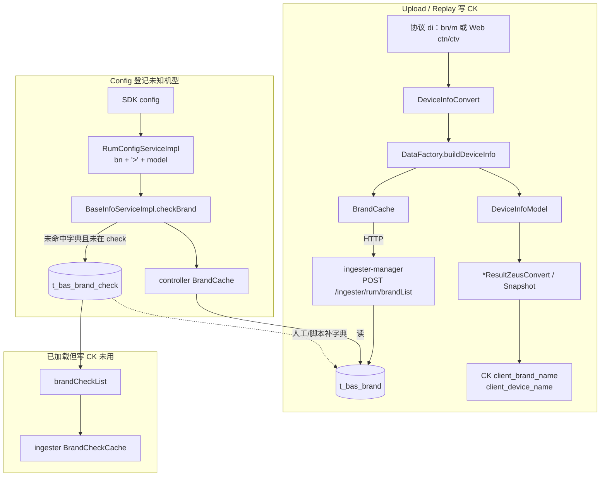

> 本文梳理 Upload/Config 链路中 **设备品牌、机型** 如何解析、纠偏并写入 ClickHouse `client_brand_name` / `client_device_name`，以及与 MySQL `br_one.t_bas_brand`、`t_bas_brand_check` 的关系。
>
> 代码根目录：`D:\Bonree\CodeProject\newone`  
> 权威分支口径：`release-4.0.0.5`（数据处理在 `controller/ingester/ingester-business/ingester-rum`，**不是**旧版 assemble）。

---

## 1. 一句话结论

| 表 / 字段 | 角色 |
|-----------|------|
| `t_bas_brand` | **正式机型字典**：Ingester `BrandCache` 加载后，对 Upload 的 `bn`/`m`（或 Web `ctn`/`ctv`）做展示名纠偏，写入 CK |
| `t_bas_brand_check` | **未知机型待办池**：Config 请求中发现「字典未登记」的机型时落库，供运维后续补进 `t_bas_brand`；**不直接参与 CK 赋值** |
| CK `client_brand_name` | 纠偏后的品牌（`DeviceInfoModel.brandName`） |
| CK `client_device_name` | 纠偏后的机型展示名（`DeviceInfoModel.deviceName`，多为字典 `device_name`） |

闭环：**运行时展示只靠字典表；check 表只做采集与扩容入口。**

---

## 2. MySQL 表结构要点

### 2.1 `br_one.t_bas_brand`

| 要点 | 说明 |
|------|------|
| 主键 | `(brand_name, platform)` |
| 关键列 | `brand_name`（查找键）、`device_name` / `device_name_en`、`brand` / `brand_en`、`platform` |
| 查找键格式 | **空格拼接**：如 `360 1501-a02`（品牌 + 空格 + 型号侧原始串） |
| 量级参考 | 开发库约数千行（字典人工/脚本维护） |

### 2.2 `br_one.t_bas_brand_check`

| 要点 | 说明 |
|------|------|
| 唯一键 | `brand_name` |
| 列 | `ID`、`brand_name`、`create_time` |
| 表注释语义 | 后续可根据该表做设备机型更新 |
| 登记键格式 | **`>` 拼接**：如 `huawei>mate40`（Config：`brandName + ">" + model`） |
| 量级参考 | 开发库约数万行（远大于字典表，因键格式与字典不一致导致大量落入） |

写入 SQL（幂等）：`insert ... where not exists (select id from t_bas_brand_check where brand_name = ?)`  
位置：`controller/controller/.../RumBaseDataMapper.insertBrandCheck`。

---

## 3. 全链路总览



---

## 4. Upload：从协议到 CK 字段

### 4.1 协议解析

`DeviceInfoConvert`（ingester-rum）：

| 平台 | 协议字段 | 进入模型 |
|------|----------|----------|
| 原生等 | `bn` / `m` | `brandName` / `model` |
| Web | `ctn` / `ctv`（容器名/版本） | 走同一套 `buildDeviceInfo` |

### 4.2 纠偏核心：`DataFactory.buildDeviceInfo`

路径：`ingester-rum/.../factory/DataFactory.java`

1. 对 brand/model 做 `trim` + `toLowerCase`
2. `getBrandName`：若 model 以 brand 为前缀则剥掉前缀，得到规范化的 `[brand, model]`
3. 查找键：`brand + " " + model`（空格，再 `trim`）
4. `BrandCache.getCache(modelType)`：
   - **命中**：中文环境用 `brand` / `device_name`；英文用 `brand_en` / `device_name_en`
   - **未命中**：保留规范化后的原始 brand/model；`deviceName` = 空格拼接串
5. 写入 `DeviceInfoModel`：
   - `brandName` → 后续 CK `client_brand_name`
   - `deviceName` → 后续 CK `client_device_name`
   - `model` 保留型号侧字段（内部用）

**Upload 未命中字典时不会写 `t_bas_brand_check`。**

### 4.3 缓存加载

| 组件 | 配置（Nacos） | API |
|------|---------------|-----|
| Ingester `BrandCache` | `rumBrandListUrl`，默认 `/ingester/rum/brandList` | `ingester-manager` `RUMController.brandList` → `BrandMapper` → `t_bas_brand` |
| Ingester `BrandCheckCache` | `rumBrandCheckListUrl`，默认 `/ingester/rum/brandCheckList` | `brandCheckList` → `t_bas_brand_check` |

Mapper 字段映射（`BrandMapper.xml`）：`BRAND_NAME`→查找键，`DEVICE_NAME`/`brand`/`DEVICE_NAME_EN`/`brand_en`/`PLATFORM`。

### 4.4 写入 Gran / Snapshot

各业务 `*ResultZeusConvert` 普遍：

```text
result.setClientDeviceName(deviceInfoModel.getDeviceName());
result.setClientBrandName(deviceInfoModel.getBrandName());
```

**Action 特例**（`ActionResultZeusConvert`）：

- `clientBrandName`：始终设置
- `clientDeviceName`：仅当 `UserDimensionCache.hasDimension` 为真时才设置（维度控制）

快照侧由公共 Snapshot 组装逻辑同样带上两字段（见 `01-数据存储与表结构/快照表结构清单.md` 列定义）。

### 4.5 查询侧使用习惯

`rum-core` 查询中更常见用 `clientDeviceName` 作为「完整品牌机型」展示（`fullBrandModel` 一类语义）；`clientBrandName` 单独使用较少。部分对外 JSON/Manager 模型可能省略 `client_brand_name`，但 CK / `CkSnapshot` Java 定义中字段存在。

---

## 5. Config：写入 `t_bas_brand_check`

### 5.1 触发点

`RumConfigServiceImpl`（config 处理）调用：

```text
baseInfoService.updateBaseInfo(
    deviceInfo.brandName + ">" + deviceInfo.model,
    appVersion, ...
);
```

### 5.2 `BaseInfoServiceImpl.checkBrand`

路径：`controller/controller/.../BaseInfoServiceImpl.java`

| 条件 | 行为 |
|------|------|
| 空或 `unknown` | 跳过 |
| `brandCache.isExit(brandName)` 已在字典（按传入整串查） | 跳过 |
| `brandCheckCache.exit` 已在待办 | 跳过 |
| 否则 | `insertBrandCheck`；成功则本地 cache `addBranName` |
| `mirror` 模式 | 不写库，模拟 insert 成功并更新本地 cache |

Controller 侧 `BrandCache` / `BrandCheckCache` 与 Ingester 侧是**两套缓存**，分别服务 Config 去重与 Upload 纠偏。

---

## 6. 两表关系与键格式陷阱

| 场景 | 键格式 | 示例 |
|------|--------|------|
| `t_bas_brand.brand_name` / Ingester 查找 | `品牌 型号`（空格） | `360 1501-a02` |
| `t_bas_brand_check.brand_name` / Config 登记 | `品牌>型号` | `huawei>mate40` |

因此 Config 用 `bn>m` 去对字典的空格键，**几乎总是 miss**，从而大量写入 check 表——这与 check 表行数远大于 brand 表的现象一致。

| 关系类型 | 说明 |
|----------|------|
| 不是双写 | 两表不是同一套数据的镜像 |
| 字典 → CK | 仅 `t_bas_brand` 影响 `client_*` |
| check → 字典 | 运维从 check 挑机型，整理后写入 `t_bas_brand`（键需改成空格格式），Ingester 缓存刷新后生效 |
| Ingester BrandCheckCache | 会拉 check 列表，但 **当前 `DataFactory` 写路径未使用** |

---

## 7. 组件对照表

| 组件 | 读/写 | 作用 |
|------|-------|------|
| `ingester-manager` `brandList` / `BrandMapper` | 读 `t_bas_brand` | 供 Ingester `BrandCache` |
| `ingester-manager` `brandCheckList` / `BrandCheckMapper` | 读 `t_bas_brand_check` | 供 Ingester `BrandCheckCache`（暂未参与赋值） |
| Controller `BrandCache` + `RumBrandMapper` | 读 `t_bas_brand` | Config 去重判断 |
| Controller `BaseInfoServiceImpl` + `insertBrandCheck` | 写 `t_bas_brand_check` | 登记未知机型 |
| `DataFactory` + Ingester `BrandCache` | 只用 `t_bas_brand` | 决定 CK 两字段展示值 |

---

## 8. 排查与运维提示

1. **CK 品牌/机型不对**：先查 Upload 原始 `bn`/`m`，再查 `t_bas_brand` 是否有对应「空格键」及中英文展示列；确认 Ingester 已刷新 `BrandCache`。
2. **check 表暴涨**：预期行为之一（键格式不一致）；清理前需区分「有价值新机型」与噪声/注入脏数据。
3. **补字典**：从 `t_bas_brand_check` 取 `brand>model`，转换为 `brand model` 写入 `t_bas_brand`（含 `platform`、中英文列），勿直接把 `>` 键原样写入字典主键。
4. **Action 机型为空、品牌有值**：核对是否维度缓存未开 `clientDeviceName` 写入条件。
5. **版本注意**：`release-4.0.0.5` 以 `ingester-rum` 为准；勿再按旧 assemble 路径理解。

---

## 9. 关联文档

| 文档 | 关联点 |
|------|--------|
| `01-数据存储与表结构/快照表结构清单.md` | CK 快照列 `client_device_name` / `client_brand_name` 定义 |
| `01-数据存储与表结构/sessionList会话级表DDL与MV脚本设计.md` | 会话级表同样保留两字段 |
| `03-数据上报与协议/config-upload-grip-uploadReplay字段全链路.md` | Config/Upload 请求字段总览 |
| `03-数据上报与协议/rum-controller数鉴数据处理流程.md` | Controller 侧 config/数据处理上下文 |

---

## 修订记录

| 日期 | 修订类型 | 修订内容 | 依据 |
|------|---------|---------|------|
| 2026-07-27 | 新文档 | 新建：Upload 纠偏写 CK、`t_bas_brand`/`t_bas_brand_check` 分工、键格式差异、Config 登记链路、Action 特例与排查提示 | 对话梳理 + `DataFactory`/`BaseInfoServiceImpl`/`BrandMapper`/`RumConfigServiceImpl`（release-4.0.0.5） |
