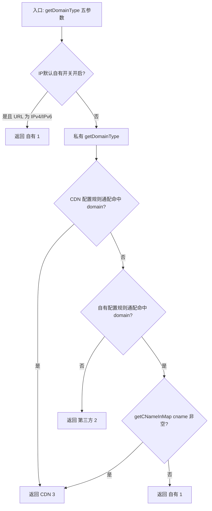
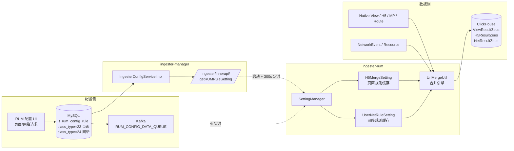
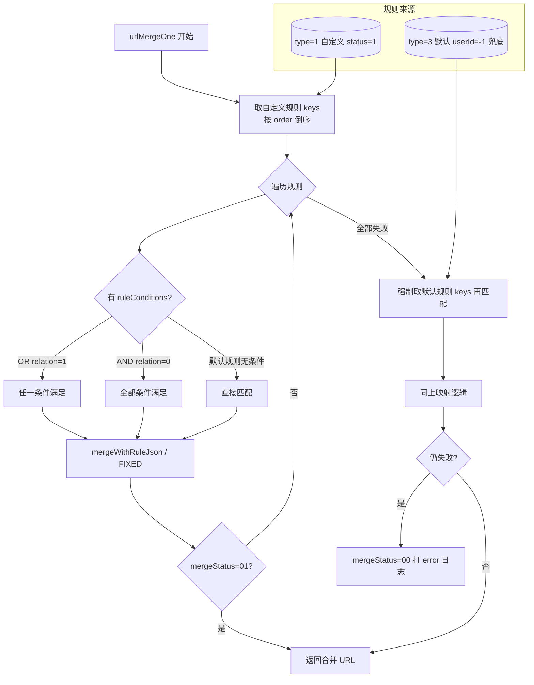
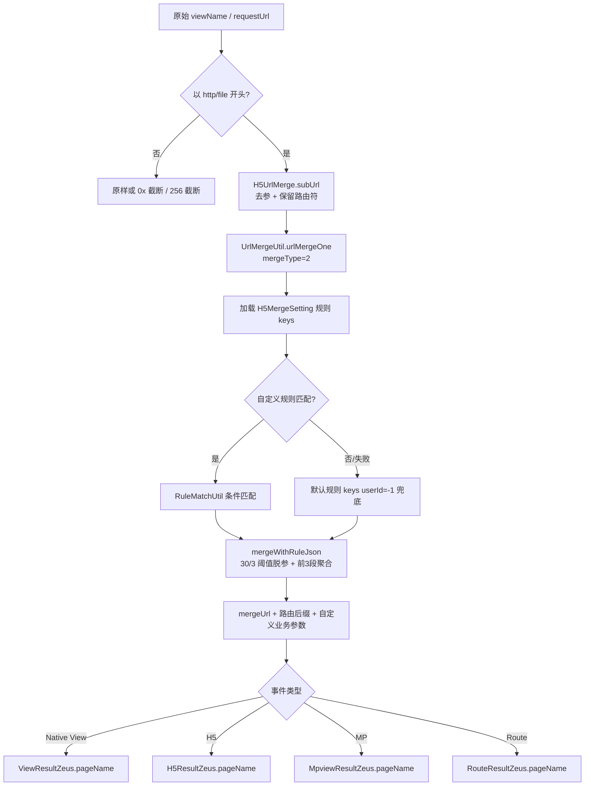
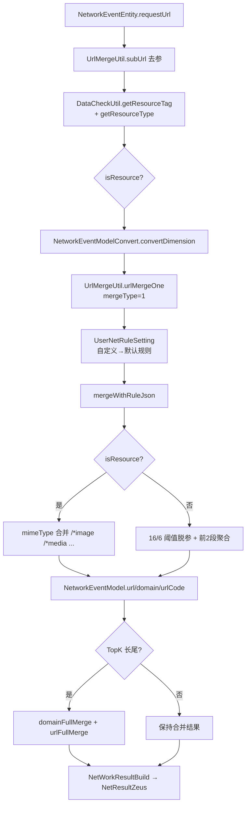
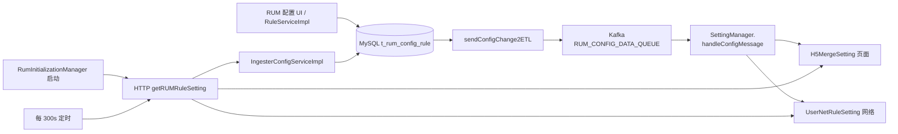

本文整合两类内容：域名类型判断逻辑（`DataFormatUtil.getDomainType`）；以及页面与网络请求识别规则的端到端代码实现（UI 配置项 ↔ Java 代码 ↔ Nacos / DB 配置 ↔ ClickHouse 字段）。

涉及代码仓：`controller/ingester/ingester-business/ingester-rum`（主） + `ingester-base`（Nacos 配置） + `ingester-operator`（`UrlMergeFunctionV2` ETL 函数） + `ingester-manager`（规则拉取） + `framework/plugins/rum`（UI 与规则枚举），均位于 `newonexm` 仓库。

---

# 第一部分：域名类型判断逻辑

## 一、返回值与业务含义

`DataFormatUtil.getDomainType` 用于区分 **自有域名（自营）**、**CDN 域名**、**第三方域名**，以及判断的 **优先级** 与关键依赖。

**源码位置**：`controller/ingester/ingester-business/ingester-rum/.../DataFormatUtil.java`
**关联枚举**：`com.bonree.one.ingester.rum.enums.DomainTypeEnum`
**配置来源**：`SettingEnum.RUM_DOMAIN_CONFIG` → `DomainConfigSetting`（按 `userId`、`envId` 加载用户「CDN 域名识别」「自有域名识别」及「IP 类 URL 默认自有」等规则）

| `DomainTypeEnum` | 数值 | 业务含义（与下游 `requestSource` 等字段对应） |
|------------------|------|-----------------------------------------------|
| `UNKNOWN`        | 0    | 本方法路径下通常不返回；枚举保留 |
| `SELF_SUPPORT`   | 1    | **自有（自营）** |
| `THIRD_PART`     | 2    | **第三方** |
| `CDN`            | 3    | **CDN** |

> 类注释中「1:自营 2:第三方 3:cdn」与上表一致；**注意与配置侧 `type`（如自有=0、CDN=1）不是同一套枚举**，配置 `type` 见 `DomainConfigSetting`。

## 二、方法结构（两个入口）

### 2.1 对外入口（五参数）

```text
getDomainType(Long userId, String domain, String cname, URLTypeEnum urlTypeEnum, String envId)
```

**作用**：在走完整域名规则前，根据 **URL 类型** 与 **用户环境开关** 做一次短路判断。

**逻辑**：

1. 读取 `DomainConfigSetting`，若用户在该环境下开启了 **「IP 类 URL 是否默认为自有域名」**（`checkIpUrlMimeFlagToSelf(userId, envId) == true`）；
2. 且 `urlTypeEnum` 为 **`IPV4_URL` 或 `IPV6_URL`**；
3. 则 **直接返回 `SELF_SUPPORT`（1）**，不再调用后续私有方法中的 CDN/自有/三方规则链。

**优先级**：在「用户配置的 CDN 域名列表」「自有域名列表」之上，属于 **采集侧对 IP 访问的优先归类**（仅当开关开启时生效）。

### 2.2 核心判定（私有，四参数）

```text
private static int getDomainType(Long userId, String domain, String cname, String envId)
```

由五参数入口在未命中「IP 默认自有」时调用，完成 **CDN 配置 → 自有配置 → 默认第三方** 的主流程。

**入参说明**：

| 参数 | 含义 |
|------|------|
| `userId` | 用户 ID，用于取该用户、该环境下的规则集合 |
| `domain` | 用于与规则做 **通配匹配** 的域名（调用方一般传 **原始域名**） |
| `cname` | DNS 解析链中与 CDN 识别相关的 CNAME（常为 **最后一跳 CNAME**）；若为占位 `RumConstants.CANME_FLAG`，则 `getCNameInMap` 不参与 CDN 判定 |
| `envId` | 环境 ID，与 `userId` 共同定位 `DomainConfigSetting` 中的规则 key |

## 三、主流程优先级（私有 `getDomainType`）

整体顺序为 **严格串行、先命中先返回**，可概括为：

```text
① 用户「CDN 域名识别」规则（通配）命中 domain
       → 返回 CDN(3)

② 否则：用户「自有域名识别」规则（通配）命中 domain
       → 再依据 getCNameInMap(cname)
            · 命中内置 CDN CNAME 库 → 返回 CDN(3)
            · 未命中 → 返回 SELF_SUPPORT(1)

③ 否则：未命中任何自有/CDN 配置规则
       → 返回 THIRD_PART(2)
```

### 3.1 第一优先级：用户配置的 CDN 域名识别规则

- 从 `DomainConfigSetting.getCdnDomainConfigByUserId(userId, envId)` 取得 CDN 规则集合 `cdns`。
- 若集合非空，则遍历每条规则，使用 **`WildcardUtil.match(domain, cdn)`** 与请求域名匹配。
- **任意一条命中即返回 `CDN(3)`**，不再判断自有规则。
- **说明**：此处 **不要求** CNAME 必须命中厂商库；是否能在后续链路填上 `cdnName` 等由 `getCNameInMap` 等单独处理（见网络转换逻辑）。

### 3.2 第二优先级：用户配置的自有域名识别规则 + CNAME 库

- 从 `DomainConfigSetting.getSelfDomainConfigByUserId(userId, envId)` 取得自有规则集合 `selfs`。
- 若集合非空，遍历 **`WildcardUtil.match(domain, self)`**。
- 一旦命中自有规则：
  - 调用 **`getCNameInMap(cname)`**：
    - **返回值非 null**（表示在 `CdnCache` 维护的 CDN CNAME 映射中识别为 CDN 特征）→ **返回 `CDN(3)`**。
    - **返回 null** → **返回 `SELF_SUPPORT(1)`**（纯自有、未识别为走 CDN 链路）。

**重要结论**：即使 **未在「CDN 域名识别」中配置** 该域名，只要 **在「自有域名识别」中命中**，且 **CNAME 能匹配内置 CDN 库**，结果仍为 **CDN(3)**。这与产品配置里的两个菜单含义不同：**「自有」配置表示业务域范围；是否标为 CDN 请求仍可能由 CNAME 二次决定。**

### 3.3 第三优先级（默认）：第三方

- 若 CDN 规则集合为空或未命中，且自有规则集合为空或未命中，则 **返回 `THIRD_PART(2)`**。

## 四、`getCNameInMap(cname)` 在判定中的角色

`getCNameInMap` 用于在 **已命中自有域名规则** 时，判断 CNAME 是否像 **已知 CDN**：

- `cname` 为空或等于 **`RumConstants.CANME_FLAG`** → 返回 **null**（不当作 CDN CNAME），自有命中路径下会得到 **自有(1)**。
- 否则依次尝试：
  - 全量 `cname` 是否在 `CdnCache.getCdnMap()` 中；
  - 按域名分段截取 **后缀 2 段 / 3 段** 等变体是否在 `cdnMap` 中（具体截取规则与 `RumConstants.CNAME_MATCH_DOMAIN` 等相关分支见源码）。

**仅影响**：私有 `getDomainType` 中 **「自有规则已命中」** 后的分支选择（自有 vs CDN）；**不单独**把未配置在任何列表里的域名变成 CDN。

## 五、与类注释的三条概述对照

源码类注释（精简意译）与实现一致：

1. **先**判断是否命中用户配置的 **CDN 域名** → 是则 **CDN**；并可结合 CNAME 库解析厂商（厂商名不在 `getDomainType` 内返回，由调用方如 `setCdnName` 处理）。
2. **再**判断是否命中用户配置的 **自有域名**；若否 → **第三方**。
3. 若 **是自有域名**，再与 **CNAME 库** 匹配：匹配上 → **CDN 请求**；否则 → **自营请求**。

## 六、流程图



## 七、实施与排障要点

1. **同一域名同时出现在「自有」与「CDN」配置**：运行时 **始终以 CDN 配置优先**（先匹配 `cdns`）。
2. **仅配置自有、仍出现 CDN 数据**：检查该请求的 **`cname` / lastCname** 是否命中 `CdnCache`（`getCNameInMap` 非空）。
3. **调用方传入 `CANME_FLAG` 作为 cname**：会跳过 CNAME 库匹配，自有命中时倾向 **自有(1)**；部分业务线（如 H5）会刻意传入以改变行为，分析时需结合调用栈。
4. **配置查重**：平台「自有 / CDN」列表在库表上按 **类型分桶** 查重，同一 `match_rule` 理论上可同时存在于不同类型记录中；与 ingester 优先级共同影响最终 **`getDomainType` 结果**。

## 八、示例：`bc.jtexpress.com.cn` 所有可能判定结果

以下均针对传入判定的 **`domain = bc.jtexpress.com.cn`**（与 `userId`、`envId`、用户规则内容、`cname`、`urlTypeEnum`、是否开启「IP 类 URL 默认自有」有关）。规则侧匹配均为 **`WildcardUtil.match(domain, 规则表达式)`**（规则可为精确域名或通配，如 `*.jtexpress.com.cn`）。

### 8.1 五参数入口：IP 默认自有短路

| 情形 | 结果 |
|------|------|
| 已开启「IP 类 URL 是否默认为自有域名」，**且** 传入的 `urlTypeEnum` 为 **`IPV4_URL` 或 `IPV6_URL`** | **`SELF_SUPPORT`（1）**，不再执行私有方法中的 CDN 配置 / 自有配置 / 默认第三方链 |

**说明**：按 `DataFormatUtil.getUrlType("bc.jtexpress.com.cn")` 的常规实现，该字符串通常被识别为 **`DOMAIN_URL`**，故在 **入参正确** 时一般不会命中本短路；若调用方将 `urlTypeEnum` **误传为 IP 类型**，仍可能得到 **自有(1)**。本条为逻辑上的**完整可能**，便于对照调用链。

### 8.2 未触发 8.1 时：私有 `getDomainType` 主链

假设 **未触发** 8.1（或等价地仅考虑四参数私有逻辑）。对 `bc.jtexpress.com.cn` **仅有下述三种互斥结果**，对应 `1 / 2 / 3`：

| 序号 | 条件（按源码执行顺序） | 结果 |
|------|------------------------|------|
| **A** | 用户「**CDN 域名识别**」规则集合非空，且 **存在一条规则** 与 `bc.jtexpress.com.cn` 通配匹配成功 | **`CDN`（3）**；不再判断自有规则，**与 `cname` 无关** |
| **B** | 不满足 **A**；用户「**自有域名识别**」规则集合非空且 **存在一条规则** 与 `bc.jtexpress.com.cn` 通配匹配成功；且 **`getCNameInMap(cname) != null`** | **`CDN`（3）** |
| **C** | 不满足 **A**；自有规则 **命中**；且 **`getCNameInMap(cname) == null`**（含：`cname` 为空、等于 `RumConstants.CANME_FLAG`、或 CNAME 未落入 `CdnCache` 映射） | **`SELF_SUPPORT`（1）** |
| **D** | 不满足 **A**；自有规则 **未命中**（集合为空或无任何一条匹配） | **`THIRD_PART`（2）**；**与 `cname` 无关** |

### 8.3「所有可能」汇总（枚举完备性）

单次调用 **`getDomainType` 的返回值**在 `1、2、3` 中 **必居其一**，对 `bc.jtexpress.com.cn` **不存在第四种数值**；也不会在一次调用中返回多个类型。

| 返回值 | 含义 | 对应上文情形 |
|--------|------|----------------|
| **1** | 自有 | **8.1** IP 短路；或 **8.2-C** |
| **2** | 第三方 | **8.2-D** |
| **3** | CDN | **8.2-A**；或 **8.2-B** |

### 8.4 配置与观测上的提示（仍属上表 A～D）

- 仅在 **自有** 中配置能匹配 `bc.jtexpress.com.cn` 的规则、**未**在 **CDN 域名识别** 中配置该 host：仍可能为 **3（B）**，取决于采集侧 **`cname` / lastCname** 是否命中内置 CDN 库。
- **`*.jtexpress.com.cn`** 等写在 **CDN** 列表：命中即为 **3（A）**，与 CNAME 无关。
- **无任何自有/CDN 规则**能匹配该域名：**恒为 2（D）**。

### 8.5 示例：自有配置 `bc.jtexpress.com.cn`、CDN 配置 `cms.jtexpress.com`

**前提**：判定对象 **`domain = bc.jtexpress.com.cn`**；用户在同一 `userId` + `envId` 下生效的规则中，**自有域名识别**含规则 **`bc.jtexpress.com.cn`**，**CDN 域名识别**含规则 **`cms.jtexpress.com`**（按题设字面；未额外写通配符）。

#### 8.5.1 是否命中「CDN 域名识别」分支（优先）

ingester 使用 **`WildcardUtil.match(domain, wildcard)`**，其中第二个参数为配置中的规则串（见 `DataFormatUtil` 私有 `getDomainType`）。

对 **`wildcard = cms.jtexpress.com`**（不含 `*`）：

- 走无通配分支时等价于 **与 `domain` 完全同长度、逐字符相等**（`WildcardUtil.stringEquals`，**默认区分大小写**）。
- `bc.jtexpress.com.cn` 与 `cms.jtexpress.com` **长度与内容均不相同** → **`match("bc.jtexpress.com.cn", "cms.jtexpress.com") == false`**。

因此在题设下 **不满足** 第八章表格中的 **A**（「CDN 配置命中 `bc.jtexpress.com.cn`」）：**不会**仅因配置了 `cms.jtexpress.com` 就把 `bc.jtexpress.com.cn` 判为 CDN。

> 若将 CDN 规则改为可匹配该 host 的通配（例如 **`*.jtexpress.com.cn`**，且以 `*` 开头时实现为 `domain.endsWith(规则去掉*后的后缀)`），则 **可能命中 A**，与下述结论不同；本节仅覆盖题设两条**字面规则**。

#### 8.5.2 是否命中「自有域名识别」分支

- **`match("bc.jtexpress.com.cn", "bc.jtexpress.com.cn")`** 为 **精确匹配** → **true**。
- 故在规则已加载到 `DomainConfigSetting`、且传入 `domain` 与配置 **一致（含大小写）** 时，**必进入自有分支**，后续只看 **`getCNameInMap(cname)`**。

#### 8.5.3 本题设下 `bc.jtexpress.com.cn` 的所有可能结果与原因

| 返回值 | 在本题设下是否出现 | 原因 |
|--------|-------------------|------|
| **`SELF_SUPPORT`（1）** | **是（常见）** | 未命中 CDN 规则 **A**；命中自有 **bc.jtexpress.com.cn**；且 **`getCNameInMap(cname) == null`**（无 CNAME、占位 `CANME_FLAG`、或 CNAME 未命中 `CdnCache`）。另：**8.1** IP 短路若成立亦为 **1**。 |
| **`CDN`（3）** | **是（取决于 CNAME）** | 题设下 **不** 来自 **A**（`cms.jtexpress.com` 不匹配 `bc...`）；但可来自 **B**：自有命中 + **`getCNameInMap(cname) != null`**。即：**仅配置题述两条规则时，`bc.jtexpress.com.cn` 仍可能为 CDN，由 DNS CNAME 是否像内置 CDN 决定**。 |
| **`THIRD_PART`（2）** | **一般不出现；特定异常下可能** | 需 **自有也未命中**（**D**），例如：传入 `domain` 与配置 **大小写不一致**、含前后空格/不可见字符、实际运行时 **未加载到** 自有规则（环境/账号/同步问题）、或 `domain` 与题设不一致等。在「配置已生效且 `domain` 字面等于 `bc.jtexpress.com.cn`」的理想条件下 **不应为 2**。 |

#### 8.5.4 小结（题设一句话）

- **`cms.jtexpress.com` 这条 CDN 规则不会匹配到 `bc.jtexpress.com.cn`**，故 **不会**走「用户 CDN 配置 → 直接 CDN」那条路。
- **`bc.jtexpress.com.cn` 命中自有配置**后，结果只能是 **`1`（自有）** 或 **`3`（CDN）`**，由 **`cname` 是否命中 `getCNameInMap`** 决定；**通常不是第三方 `2`**。

---

# 第二部分：页面与网络请求识别规则 — ingester-rum 模块代码梳理

## 九、UI 截图对应的规则总览

### 9.1 页面识别规则

| 分组 | 规则项 | UI 显示阈值 |
|---|---|---|
| **服务视图（脱参，URL 路径合并）** | 以星号 `*` 代替 URL 路径段中全部为数字的段 | — |
| | 以星号 `*` 代替 URL 路径段中长度 **≥ 30 个字符**的段 | **30** |
| | 以星号 `*` 代替 URL 路径段中长度连续 **≥ 3 个字符**的连续数字 | **3** |
| **聚合视图（按段聚合）** | 当 URL 路径前 **3 段相同**后面合并成 `*` | **3** |
| | 默认为最后一个实体 | — |
| **自定义识别规则** | 用户自定义（含启用开关、优先级排序） | — |

### 9.2 网络请求识别规则

| 分组 | 规则项 | UI 显示阈值 |
|---|---|---|
| **微参视图（脱参，URL 路径合并）** | 以星号 `*` 代替 URL 路径段中全部为数字的段 | — |
| | 以星号 `*` 代替 URL 路径段中长度 **≥ 16 个字符**的段 | **16** |
| | 以星号 `*` 代替 URL 路径段中长度连续 **≥ 6 个字符**的连续数字 | **6** |
| **聚合视图（按段聚合）** | 当 URL 路径前 **2 段相同**后面合并成 `*` | **2** |
| | 默认为最后一个域名段 | — |
| **自定义识别规则** | 用户自定义（含启用开关、优先级排序） | — |

> **重要结论**：页面阈值 **30/3** 与网络阈值 **16/6** 在 ingester-rum 的 Java 代码中**不是硬编码**，而是来自 MySQL 表 `t_rum_config_rule.rule_json`（`type=3` 默认规则），由 `IS_REPLACE_CHAR_EXCEED` / `IS_REPLACE_CONTINUOUS_NUM_EXCEED` 两个 code 携带 `value` 字段下发。Java 端仅保留**兜底默认值 `continuousNum=6`、`charExceedNum=16`**（偏向网络默认）。

## 十、核心结论速览

1. **页面识别与网络请求识别共用同一套引擎**：核心入口 `UrlMergeUtil.urlMergeOne(...)`，通过 `mergeType` 参数区分：
   - `mergeType=1` → 网络请求（NetWork）
   - `mergeType=2` → 页面（H5 / Native View / MP / SPA Route）
2. **默认识别阈值不在 Java 写死**，由 MySQL 规则表 `ruleJson` JSON 数组下发；Java 端仅有 fallback 默认值（`continuousNum=6`、`charExceedNum=16`）。
3. **不存在独立的 `view_pattern` / `url_pattern` ClickHouse 字段**：合并后的「模板 URL」（含 `*`）直接覆盖写入 `pageName`（页面）/ `url`（网络）字段。
4. **规则加载链路**：MySQL → 平台变更通知 → Kafka 广播 → `SettingManager` 实时更新内存缓存；另每 **300 秒**全量定时刷新一次兜底。
5. **自定义规则优先于默认规则**：按 `order` 倒序匹配；自定义全部失败时回退到 `userId=-1` 的默认规则。

## 十一、总体架构



## 十二、页面识别规则 — 代码实现

### 12.1 入口与触发点

页面识别在多个事件入口处被触发，统一调用 `ViewEventProcess.mergeViewName` 或直接调用 `UrlMergeUtil.urlMergeOne(..., mergeType=2, ...)`：

| 事件类型 | 入口类 | 关键方法 |
|---|---|---|
| Native 视图进入 | `ViewEventEnterStrategy` | `customConvert` → mergeType=2 |
| H5 页面 | `H5EventModelConvert` | `getH5EventModel` → mergeType=2 |
| 小程序 MP | `MpviewEventStrategy` | `customConvert` → `mergeViewName` |
| SPA 路由变更 | `RouteChangeEventStrategy` | `getH5MergeUrl` |
| JS 错误所在页面 | `JsErrorEventStrategy` | mergeType=2 |
| Action 子事件所在视图 | `ActionExitEventStrategy` / `ActionSubEventModel` | — |

**关键判断逻辑**（仅 http/file 协议才走 URL 合并，其他形如 Activity 名/小程序 `pages/index/index` 走原样截断）：

```27:55:controller/ingester/ingester-business/ingester-rum/src/main/java/com/bonree/one/ingester/rum/biz/ViewEventProcess.java
public static String mergeViewName(String viewName, ...) {
    // 仅当以 http(s):// 或 file:// 开头才走 UrlMergeUtil
    // 否则截断到 RumConstants.VIEW_NAME_LENGTH=256
}
```

### 12.2 默认规则（服务视图 + 聚合视图）的代码对照

| UI 规则（页面） | UI 阈值 | 代码中对应的 `NetH5RuleCode` | 阈值来源 |
|---|---|---|---|
| 全数字段 → `*` | — | `IS_REPLACE_CONTINUOUS_NUM`（`isReplaceAllNum`） | DB `ruleJson.isChecked` |
| 段长度 ≥ N → `*` | **30** | `IS_REPLACE_CHAR_EXCEED.value` | DB `ruleJson.value` |
| 连续数字 ≥ N → `*` | **3** | `IS_REPLACE_CONTINUOUS_NUM_EXCEED.value` | DB `ruleJson.value` |
| 前 3 段相同则聚合 | **3** | `AGG_TAP_CF_PA` + `AGG_TAP_CF_PA2`（前 N 段） | DB `ruleJson.value` |
| 默认为最后一个实体 | — | `AGG_TAP_CF_PA3`（后 1 段） / `ramainPathNum.isEmpty()` 时路径整体替换为 `/*` | DB 默认配置 |

**核心代码（脱参阈值解析）**：

```846:902:controller/ingester/ingester-business/ingester-rum/src/main/java/com/bonree/one/ingester/rum/util/UrlMergeUtil.java
boolean isReplaceAllNum = true;//全部数字是否替换
int continuousNum = 6;//连续数字
int charExceedNum = 16;
...
if (NetH5RuleCode.IS_REPLACE_CONTINUOUS_NUM.getCode().equals(code)) {
    isReplaceAllNum = "1".equals(mergeM.getType());
}
if (NetH5RuleCode.IS_REPLACE_CONTINUOUS_NUM_EXCEED.getCode().equals(code)) {
    if ("1".equals(mergeM.getType())) continuousNum = Integer.valueOf(mergeM.getValue());
    else continuousNum = 0;
}
if (NetH5RuleCode.IS_REPLACE_CHAR_EXCEED.getCode().equals(code)) {
    if ("1".equals(mergeM.getType())) charExceedNum = Integer.valueOf(mergeM.getValue());
    else charExceedNum = 0;
}
```

**核心代码（聚合视图前 N 段保留）**：

```1039:1073:controller/ingester/ingester-business/ingester-rum/src/main/java/com/bonree/one/ingester/rum/util/UrlMergeUtil.java
private static void countPathNum(Set<Integer> pathNum, int max, RuleMergeModel mergeModel) {
    // *2: 前面 N 段
    if (NetH5RuleType.AGG_TNR_CF_UP2.getCode().equals(mergeModel.getType())
        || NetH5RuleType.AGG_TAP_CF_PA2.getCode().equals(mergeModel.getType())) {
        int pathCount = Integer.parseInt(mergeModel.getValue());
        while (pathCount > 0) { pathNum.add(pathCount); pathCount--; }
    }
    // *3: 后面 N 段（"默认为最后一个实体" 对应 value=1）
    else if (NetH5RuleType.AGG_TNR_CF_UP3.getCode().equals(mergeModel.getType())
        || NetH5RuleType.AGG_TAP_CF_PA3.getCode().equals(mergeModel.getType())) {
        int pathCount = max - Integer.parseInt(mergeModel.getValue());
        while (max > pathCount) { pathCount++; pathNum.add(pathCount); }
    }
    // *1: 完整保留所有段；*4: 自定义段号
}
```

**核心代码（无聚合配置时路径整体替换为 `/*`）**：

```974:988:controller/ingester/ingester-business/ingester-rum/src/main/java/com/bonree/one/ingester/rum/util/UrlMergeUtil.java
if (ramainPathNum.isEmpty()) {
    extPath = "/*";
} else if (extArr.length == ramainPathNum.size()) {
    extPath = "/" + join(extArr);
} else {
    extPath = extPathCustom(extArr, ramainPathNum);
}
```

### 12.3 UrlMergeFunctionV2 中文档化的页面合并阈值

ETL 函数侧（不在主运行链路，但作为权威文档）对应行：

```62:65:controller/ingester/ingester-business/ingester-operator/src/main/java/com/bonree/one/ingester/operator/function/rum/UrlMergeFunctionV2.java
* 3.以星号*代替URL路径段中全部为数字的段
* 4.以星号*代替URL路径段中长度 ≥ 3个字符的连续数字
* 5.以星号*代替URL路径段中 ≥ 30个字符的段
* 6.当URL 路径前面3段相同后面合并成*
```

### 12.4 自定义识别规则（页面）

| 维度 | 实现 |
|---|---|
| 存储 | MySQL `t_rum_config_rule.class_type=23`（`RUM_H5_URL_MERGE`） |
| Java 缓存 | `H5MergeSetting`（按 `appId` / `userId` 分桶） |
| 实体 | `RuleEntity`（含 `type`、`status`、`order`、`ruleJson`、`ruleConditions`、`relation`） |
| 优先级 | `order` **大数优先**（`RuleListSortUtil.sortRulesByOrderDesc`） |
| 启用开关 | `status=1` 启用；`status=0` 或 `flag=1` 由 `RuleUtils.shouldDeleteRule` 移出缓存 |
| 匹配引擎 | `RuleMatchUtil`：等于 / 不等于 / 包含 / 不包含 / 起始于 / 结束于；支持 `pattern=1` 忽略大小写 |
| 与默认规则关系 | 先自定义（按 order 倒序），全部失败时强制回退默认规则 (`userId=-1`) |

### 12.5 写入字段（ClickHouse）

合并后的「模板 URL」直接写入对应业务表的 `pageName` 列（不存在独立 `view_pattern`）：

| 业务 | 模型 | 关键字段 |
|---|---|---|
| Native 视图 | `ViewResultZeus` | `pageName`、`onPageName`、`pageId` |
| H5 页面 | `H5ResultZeus` | `pageName`、`domain` |
| 小程序 | `MpviewResultZeus` | `pageName`、`pageId` |
| SPA 路由 | `RouteResultZeus` | `pageName`、`onPageName` |

## 十三、网络请求识别规则 — 代码实现

### 13.1 入口与触发点

| 阶段 | 类 | 说明 |
|---|---|---|
| 数据清洗 | `NetBaseStrategy.modelConvert` → `NetworkEventModelConvert.customConvert` | 主链路 |
| URL 合并 | `NetworkEventModelConvert.convertDimension` | 调用 `urlMergeOne(..., mergeType=1, isResource)` |
| 结果构建 | `NetWorkResultBuild.buildPerformanceNetResult` | 写入 `NetResultZeus.url/domain` |

**关键调用**：

```355:400:controller/ingester/ingester-business/ingester-rum/src/main/java/com/bonree/one/ingester/rum/convert/net/NetworkEventModelConvert.java
// 网络事件 URL 合并：mergeType = 1
String mergeUrl = UrlMergeUtil.urlMergeOne(brUserId, appId, ...,
    requestUrl, ..., 1 /*网络*/, isResource);
```

### 13.2 默认规则（微参视图 + 聚合视图）的代码对照

| UI 规则（网络请求） | UI 阈值 | 代码中对应的 `NetH5RuleCode` | 阈值来源 |
|---|---|---|---|
| 全数字段 → `*` | — | `IS_REPLACE_CONTINUOUS_NUM` | DB `ruleJson.isChecked` |
| 段长度 ≥ N → `*` | **16** | `IS_REPLACE_CHAR_EXCEED.value` | DB `ruleJson.value` |
| 连续数字 ≥ N → `*` | **6** | `IS_REPLACE_CONTINUOUS_NUM_EXCEED.value` | DB `ruleJson.value` |
| 前 2 段相同则合并 | **2** | `AGG_TNR_CF_UP` + `AGG_TNR_CF_UP2` | DB `ruleJson.value` |
| 默认为最后一个域名段 | — | 域名侧合并：`mergeDomain` / `domainFirstMerge` / `mergeIpDomain` | 代码 + Nacos |

> 网络与页面**共用 `UrlMergeUtil.mergeWithRuleJson` 主体逻辑**，仅靠 DB ruleJson 中下发的 `value=16/6` 与 `value=2` 与页面的 `30/3` 与 `3` 区分。

### 13.3 域名侧合并（"默认为最后一个域名段"对应实现）

`UrlMergeUtil` 内域名相关方法链：

- `localhostPortMerge`：受 Nacos `global.private.rum.url-merge.localhost-merge` 控制；127.0.0.1 / localhost 的端口被合并为 `*`
- `mergeIpDomain` / `mergeIpv6Domain`：IPv4 末段合并为 `*`；IPv6 保留前 4 段
- 域名首段长度 > **`DOMAIN_FIRST_SEGMENT_MAX_LENGTH = 16`**（硬编码常量）合并为 `*`
- 默认端口（http: 80 / https: 443）省略

### 13.4 资源类型联动（图片 / 媒体 / 文本 / 其他）

`NetworkEventModelConvert.convertDimension` 进入合并前，先做资源类型判定：

```
resourceTag = DataCheckUtil.getResourceTag(resourceType, url)   // URL 最后路径段后缀
metaType    = DataFormatUtil.getResourceType(resourceTag)        // 对照 Nacos 资源类型列表
isResource  = (metaType > 0)
```

资源请求**不被排除**，而是走更粗粒度的 **mimeType / 后缀合并**：

| metaType | 对应 Nacos Key | 合并形式 |
|---|---|---|
| 1 图片 | `global.private.rum.resource-image-type`（默认 `gif,png,bmp,jpeg,jpg`） | `/*(image)` |
| 2 媒体 | `global.private.rum.resource-media-type`（默认 `mp3,wma,flv,mp4,wmv,ogg,avi8`） | `/*(media)` |
| 3 文本 | `global.private.rum.resource-txt-type`（默认 `doc,docx,xls,...`） | `/*(txt)` 等 |
| 4 其他 | `global.private.rum.resource-other-type`（默认 `zip,exe,css,js,...`） | `/*(css)` `/*(js)` `/*(other)` |

业务请求（`isResource=false`）才走 **路径段 16/6 脱参 + 前 2 段聚合**。

### 13.5 TopK 长尾兜底合并

`NetworkEventModelConvert` 末段当某 `appId` 的合并后 URL 数量超过 TopK 阈值（防爆维度），调用：

- `domainFullMerge`：`*.example.com`
- `urlFullMerge`：`https://*.example.com/*`

### 13.6 自定义识别规则（网络）

| 维度 | 实现 |
|---|---|
| 存储 | MySQL `t_rum_config_rule.class_type=24` |
| Java 缓存 | `UserNetRuleSetting`（按 `appId` / `userId` 分桶） |
| 匹配条件维度 | 域名 / IP / URL / Header / Get 参数 / Post 参数 |
| 固定识别 | `classType=FIXED` 直接返回固定 URL，跳过路径合并 |
| 其他逻辑 | 与页面自定义规则一致（order、status、ruleConditions、relation） |

### 13.7 写入字段（ClickHouse）

| 业务 | 模型 | 关键字段 |
|---|---|---|
| 网络业务请求 | `NetResultZeus` | `url`、`domain`、`pageName`、`requestId` |
| 网络资源请求 | `NetResourceResultZeus` | `url`、`metaType` |

中间模型 `NetworkEventModel` 字段：

- `url`：合并后 URL + 自定义业务参数（受 `customBusinessTypeLinkCharacter` 控制的连接符）
- `urlCode = Md5Utils.getCodeStr(url, brUserId)`
- `noParamUrl` / `requestUrl`：去参原始 URL

## 十四、共用 URL 合并引擎 `UrlMergeUtil`

### 14.1 主流程方法链

```
urlMergeOne(brUserId, appId, ..., url, ..., mergeType, isResource)
   ↓
mergerNetWork(ruleKeys, ...)        // 遍历规则 keys 找首条匹配
   ↓
matchRuleJson(rule, conditions)     // 自定义规则条件匹配
   ↓
mergeWithRuleJson(rule.ruleJson, url, isResource, mergeType)
   ↓
   ├─ extPathRemoveRandom + StringUtil.replaceNumber2StarEachChar  // 脱参
   ├─ countPathNum + extPathCustom                                  // 聚合
   ├─ localhostPortMerge / mergeIpDomain / mergeIpv6Domain          // 域名
   └─ mimeType(...)                                                 // 资源后缀
```

### 14.2 自定义规则 vs 默认规则的执行顺序

```631:674:controller/ingester/ingester-business/ingester-rum/src/main/java/com/bonree/one/ingester/rum/util/UrlMergeUtil.java
// 1. 先取自定义规则 keys（按 order 倒序）
ruleKeys = h5MergeSetting.getAppCustomMapKeys(...) / userNetRuleSetting.getUserCustomMapKeys(...)

// 2. 无自定义则取默认规则 keys
if (ruleKeys.isEmpty()) ruleKeys = ...getAppMapKeys(...) / getUserMapKeys(...)
urlMergeModel = mergerNetWork(ruleKeys, ...)

// 3. 自定义全部失败 → 强制再走默认规则
if (urlMergeModel.isFail()) {
    ruleKeys = ...getAppMapKeys(...) / getUserMapKeys(...)
    urlMergeModel = mergerNetWork(ruleKeys, ...)
}
```



## 十五、Nacos 配置与硬编码常量一览

### 15.1 相关 Nacos 配置（位于 `RumBaseConfig`）

| Nacos Key | 默认值 | 使用位置 | 影响 |
|---|---|---|---|
| `global.private.rum.url-merge.localhost-merge` | `true` | `UrlMergeUtil.localhostPortMerge` | 127.0.0.1 / localhost 端口合并为 `*` |
| `global.private.rum.url-merge.customBusinessTypeLinkCharacter` | `$` | `UrlMergeUtil.composeCustomBusinessJson` | 自定义业务参数与 URL 之间的连接符 |
| `global.private.rum.url-merge.specialUrlChar` | `.,-,_,/,:,~,%,[,],&` | `UrlMergeUtil.isUrlChar` | 判定合法 URL 字符；`?` 不在其中→被 `subUrl` 截为参数 |
| `global.private.rum.resource-image-type` | `gif,png,bmp,jpeg,jpg` | `DataFormatUtil.getResourceType` | 资源 metaType=1（图片） |
| `global.private.rum.resource-media-type` | `mp3,wma,flv,mp4,wmv,ogg,avi8` | 同上 | metaType=2（媒体） |
| `global.private.rum.resource-txt-type` | `doc,docx,xls,...` | 同上 | metaType=3（文本） |
| `global.private.rum.resource-other-type` | `zip,exe,css,js,...` | 同上 | metaType=4（其他） |
| `global.private.rum.networkevent.maxUrl.length` | `3000` | `DataCheckUtil.truncateUrl` | 截断超长 originalUrl，**不参与合并逻辑** |
| `global.private.rum.data-cache.config-data-topic` | `RUM_CONFIG_DATA_QUEUE` | 规则 Kafka 广播 topic | 规则变更近实时推送通道 |
| `global.private.rum.rule.limit.appPageMp` | `10` | `framework` `RuleLimitConfig`（UI 端） | 小程序自定义规则数量上限；ingester 仍走 class_type=23 RUM_H5_URL_MERGE |

### 15.2 Java 硬编码常量

| 常量 | 值 | 位置 | 含义 |
|---|---|---|---|
| `continuousNum`（fallback） | **6** | `UrlMergeUtil.mergeWithRuleJson` | DB ruleJson 缺失时的连续数字阈值 |
| `charExceedNum`（fallback） | **16** | `UrlMergeUtil.mergeWithRuleJson` | DB ruleJson 缺失时的段长阈值 |
| `DOMAIN_FIRST_SEGMENT_MAX_LENGTH` | **16** | `UrlMergeUtil` | 域名首段长度超阈值合并为 `*` |
| `RumConstants.MAX_PART_LENGTH` | **16** | `RumConstants` | URL 后缀超长按 `.*` 处理 |
| `RumConstants.VIEW_NAME_LENGTH` | **256** | `RumConstants` | 视图名截断长度 |
| `RumConstants.URL_LENGTH` | **1000** | `RumConstants` | `DataFormatUtil.getLengthLimited` 通用 URL 截断 |

> Java fallback 阈值偏向**网络默认值（16/6）**：当 DB 中页面规则的 `ruleJson` 缺失/异常时，会用网络阈值兜底；这是需要关注的边界场景。

### 15.3 规则枚举（`NetH5RuleCode` / `NetH5RuleType`）

| Code | 含义 | type 取值规则 |
|---|---|---|
| `IS_REPLACE_CONTINUOUS_NUM` | 全数字段是否替换 | type=`1` 启用 |
| `IS_REPLACE_CONTINUOUS_NUM_EXCEED` | 连续数字阈值 | type=`1`+`value` 启用 |
| `IS_REPLACE_CHAR_EXCEED` | 段长阈值 | type=`1`+`value` 启用 |
| `AGG_TNR_CF_UP` / `AGG_TAP_CF_PA` | URL 路径聚合 | 通过 `*2/*3/*4` 类型细分 |
| `AGG_TNR_CF_UP2` / `AGG_TAP_CF_PA2` | 前 N 段保留 | 网络/页面 — 截图所见 |
| `AGG_TNR_CF_UP3` / `AGG_TAP_CF_PA3` | 后 N 段保留 | "默认最后一个实体/域名段" |
| `AGG_TNR_CF_UP1` / `AGG_TAP_CF_PA1` | 完整路径保留 | — |
| `AGG_TNR_CF_UP4` / `AGG_TAP_CF_PA4` | 自定义段号（逗号分隔） | — |
| `AGG_TNR_CF_DM` / `AGG_TAP_CF_DM` | 按域名维度聚合 | — |
| `AGG_TNR_CF_IP` | 按 IP 维度聚合 | — |
| `AGG_TNR_CF_HP` / `AGG_TAP_CF_HP` | Header 参数维度 | — |
| `AGG_TNR_CF_PP` | Post Body 参数维度 | — |
| `AGG_TNR_CF_GP` / `AGG_TAP_CF_UP` | Get 参数维度 | — |

## 十六、端到端流程图

### 16.1 页面识别端到端



### 16.2 网络请求识别端到端



### 16.3 规则加载与生效链路



| 触发机制 | 生效时延 |
|---|---|
| Kafka 广播 UPDATE / DELETE | **近实时**（算子 `processBroadcastElement`） |
| 启动初始化 + 每 300s 全量 refresh | 最长 **~5 分钟** 兜底 |
| Nacos 配置（specialUrlChar、resource-*-type 等） | Nacos 热更新（`RumBaseConfig`） |

## 十七、特殊场景处理

| 场景 | 处理 |
|---|---|
| URL 含 `?query` | `subUrl` / `subUrlPlus`：首个非 URL 字符处截断（`?` 不在 specialUrlChar 中） |
| URL 含 `#fragment` / SPA 路由 | H5：`H5UrlMerge.subUrl` 保留路由符；`urlMergeOne` 末尾拼回 `route` |
| `protocol://host:port` | `getDomainAndPort` 解析；http:80 / https:443 省略；localhost 端口可合并 `*` |
| IPv6 | 展开 / 压缩；`mergeIpv6Domain` 末 4 段 `*:*:*:*` |
| 不以 `http` 开头 | 页面合并跳过；只做截断/0x 处理 |
| 超长 URL | `maxUrlLength=3000` 截断 originalUrl；视图名 256 截断；通用 URL 1000 截断 |
| 小程序（MP） | pageName 形如 `pages/index/index`，**不走 URL 合并**；UI 端 `RuleLimitConfig.appPageMp:10` 仅限制规则数量；ingester 复用 class_type=23 |
| Web / Native / 鸿蒙 | Web H5：`H5EventModelConvert`（支持 `h5AppToRouteChar`）；Native：`ViewEventEnterStrategy`（http/file URL 才合并）；鸿蒙：无独立分支，复用通用 `ViewTypeEnum`（Ability/AbilitySlice） |

## 十八、UI ↔ 代码 ↔ DB ↔ CK 对照速查表

| UI 截图项 | DB class_type | 规则 code | 阈值 value | Java 接收点 | CK 字段 |
|---|---|---|---|---|---|
| 页面 - 全数字段→`*` | 23 | `IS_REPLACE_CONTINUOUS_NUM` | isChecked | `isReplaceAllNum` | `pageName` |
| 页面 - 段长 ≥30 | 23 | `IS_REPLACE_CHAR_EXCEED` | **30** | `charExceedNum` | `pageName` |
| 页面 - 连续数字 ≥3 | 23 | `IS_REPLACE_CONTINUOUS_NUM_EXCEED` | **3** | `continuousNum` | `pageName` |
| 页面 - 前3段相同合并 | 23 | `AGG_TAP_CF_PA` + `AGG_TAP_CF_PA2` | **3** | `countPathNum` | `pageName` |
| 页面 - 默认最后一个实体 | 23 | `AGG_TAP_CF_PA` + `AGG_TAP_CF_PA3` | **1** | `countPathNum`（后 N 段） | `pageName` |
| 网络 - 全数字段→`*` | 24 | `IS_REPLACE_CONTINUOUS_NUM` | isChecked | `isReplaceAllNum` | `url` |
| 网络 - 段长 ≥16 | 24 | `IS_REPLACE_CHAR_EXCEED` | **16** | `charExceedNum` | `url` |
| 网络 - 连续数字 ≥6 | 24 | `IS_REPLACE_CONTINUOUS_NUM_EXCEED` | **6** | `continuousNum` | `url` |
| 网络 - 前2段相同合并 | 24 | `AGG_TNR_CF_UP` + `AGG_TNR_CF_UP2` | **2** | `countPathNum` | `url` |
| 网络 - 默认最后一个域名段 | 24 | `AGG_TNR_CF_DM` + 域名侧合并 | — | `mergeDomain` / `mergeIpDomain` / `mergeIpv6Domain` | `domain` |
| 自定义识别规则（页面） | 23 type=1 | `ruleConditions` + `ruleJson` | — | `H5MergeSetting` | `pageName` |
| 自定义识别规则（网络） | 24 type=1 | `ruleConditions` + `ruleJson` | — | `UserNetRuleSetting` | `url` |
| 启用 / 禁用 | — | `status=1` 启用 / `status=0` 禁用 | — | `RuleUtils.shouldDeleteRule` | — |
| 优先级 | — | `order` 字段 | — | `RuleListSortUtil.sortRulesByOrderDesc` | — |

## 十九、关键源码索引

| 文件 | newonexm 仓库路径 |
|---|---|
| **URL 合并引擎** | `controller/ingester/ingester-business/ingester-rum/src/main/java/com/bonree/one/ingester/rum/util/UrlMergeUtil.java` |
| 页面入口 | `controller/ingester/ingester-business/ingester-rum/src/main/java/com/bonree/one/ingester/rum/biz/ViewEventProcess.java` |
| 网络转换 | `controller/ingester/ingester-business/ingester-rum/src/main/java/com/bonree/one/ingester/rum/convert/net/NetworkEventModelConvert.java` |
| H5 转换 | `controller/ingester/ingester-business/ingester-rum/src/main/java/com/bonree/one/ingester/rum/convert/h5/H5EventModelConvert.java` |
| 页面规则缓存 | `controller/ingester/ingester-business/ingester-rum/src/main/java/com/bonree/one/ingester/rum/setting/rum/H5MergeSetting.java` |
| 网络规则缓存 | `controller/ingester/ingester-business/ingester-rum/src/main/java/com/bonree/one/ingester/rum/setting/rum/UserNetRuleSetting.java` |
| 规则匹配 | `controller/ingester/ingester-business/ingester-rum/src/main/java/com/bonree/one/ingester/rum/util/RuleMatchUtil.java` |
| 域名类型判断 | `controller/ingester/ingester-business/ingester-rum/src/main/java/com/bonree/one/ingester/rum/util/DataFormatUtil.java` |
| Nacos 配置 | `controller/ingester/ingester-base/src/main/java/com/bonree/one/ingester/base/config/rum/RumBaseConfig.java` |
| 配置拉取 API | `controller/ingester/ingester-manager/src/main/java/com/bonree/one/ingester/manager/service/config/impl/IngesterConfigServiceImpl.java` |
| ETL 文档化函数 | `controller/ingester/ingester-business/ingester-operator/src/main/java/com/bonree/one/ingester/operator/function/rum/UrlMergeFunctionV2.java` |
| UI 规则 classType 枚举 | `framework/plugins/rum/rum-common/src/main/java/com/bonree/rum/common/bean/enums/setting/ClassTypeRuleEnum.java` |

## 二十、待跟进事项

1. **DB 默认 `rule_json` JSON 模板**：本梳理已确认页面/网络默认阈值（30/3、16/6、前 3/2 段）来自 `t_rum_config_rule.rule_json`，但具体 JSON 字段结构需结合 `framework/plugins/rum/rum-database` 初始化 SQL 或在线 DB `WHERE class_type IN (23,24) AND type=3` 查询确认。
2. **fallback 默认值偏向网络**：Java 端 `continuousNum=6 / charExceedNum=16` 对页面属于"非预期阈值"。如 DB 中页面默认规则 `ruleJson` 因升级/迁移异常缺失，页面将退化为按网络阈值合并；建议在初始化 SQL 中强校验。
3. **`rule.limit.appPageMp:10` 与 ingester 行为脱钩**：UI 端有小程序自定义规则数量上限，但 ingester 复用 class_type=23 `RUM_H5_URL_MERGE`；如未来引入独立 class_type，需同步在 `H5MergeSetting` 中加分桶。
4. **`DOMAIN_FIRST_SEGMENT_MAX_LENGTH=16` 与网络段长 16 同值但语义不同**：前者是域名首段（如 `verylongsubdomain.example.com`），后者是路径段；目前两者均硬编码 16，建议明确文档区分以避免误改。

## 二十一、规则示例与效果对照

> **说明**：以下示例均假设 DB 中默认规则 `rule_json` 与 UI 显示一致（页面 30/3 与前 3 段；网络 16/6 与前 2 段），未配置任何自定义规则，未触发 TopK 长尾。`✔` 表示该条规则被触发，`✘` 表示该条规则未触发。脱参与聚合实际是**先脱参再聚合**的串联过程，21.1.6 / 21.2.6 给出组合示例。

### 21.1 页面识别规则示例（mergeType=2，阈值 30/3、前 3 段）

#### 21.1.1 服务视图 — 全数字段 → `*`

| 输入 URL | 合并后输出 | 触发 | 说明 |
|---|---|---|---|
| `https://shop.com/user/12345/profile` | `https://shop.com/user/*/profile` | ✔ | 段 `12345` 全数字 |
| `https://shop.com/orders/2024` | `https://shop.com/orders/*` | ✔ | 段 `2024` 全数字（注：随后还会触发聚合，见 21.1.6） |
| `https://shop.com/menu/abc/list` | `https://shop.com/menu/abc/list` | ✘ | 无纯数字段 |
| `https://shop.com/v2/api/list` | `https://shop.com/v2/api/list` | ✘ | `v2` 含字母，不命中 |

#### 21.1.2 服务视图 — 段长度 ≥ **30** → `*`

| 输入 URL | 段长度 | 合并后输出 | 触发 | 说明 |
|---|---|---|---|---|
| `https://shop.com/article/abcdefghijklmnopqrstuvwxyz12345` | 31 | `https://shop.com/article/*` | ✔ | ≥30 |
| `https://shop.com/article/abcdefghijklmnopqrstuvwxyz1234` | 30 | `https://shop.com/article/*` | ✔ | =30 满足条件 |
| `https://shop.com/article/short_segment_29_chars_abcd` | 29 | `https://shop.com/article/short_segment_29_chars_abcd` | ✘ | <30，保留 |
| `https://shop.com/article/short` | 5 | `https://shop.com/article/short` | ✘ | 短段保留 |

#### 21.1.3 服务视图 — 连续数字 ≥ **3** → `*`

> 注：`StringUtil.replaceNumber2StarEachChar` 仅替换连续数字子串，**非整段**。

| 输入 URL 路径段 | 段内输出 | 触发 | 说明 |
|---|---|---|---|
| `abc123def` | `abc*def` | ✔ | "123" 连续 3 位 |
| `abc12def` | `abc12def` | ✘ | "12" 仅 2 位 |
| `1234abc5678` | `*abc*` | ✔ | 两段连续数字均被替换 |
| `v1.0.5` | `v1.0.5` | ✘ | 数字被点号隔开 |
| `2024年报告` | `*年报告` | ✔ | 中文不影响数字判定 |

#### 21.1.4 聚合视图 — 前 **3 段相同**后合并 `*`

| 输入 URL | 合并后输出 | 触发 | 说明 |
|---|---|---|---|
| `https://app.com/a/b/c/d/e/f` | `https://app.com/a/b/c/*` | ✔ | 保留前 3 段 |
| `https://app.com/api/v1/users/123/profile` | `https://app.com/api/v1/users/*/*` *（脱参后再聚合，见 21.1.6）* | ✔ | 保留 `api/v1/users` |
| `https://app.com/a/b/c` | `https://app.com/a/b/c` | ✘ | 恰好 3 段，无可合并 |
| `https://app.com/a/b` | `https://app.com/a/b` | ✘ | 不足 3 段，全部保留 |

#### 21.1.5 聚合视图 — 默认为最后一个实体（兜底，后 1 段保留）

| 场景 | 输入 URL | 输出 | 说明 |
|---|---|---|---|
| 配置 `AGG_TAP_CF_PA3` value=1 | `https://app.com/menu/cat/sub/laptop` | `https://app.com/*/*/*/laptop` | 仅保留末段（pathNum={4}） |
| `ramainPathNum.isEmpty()` | `https://app.com/anything/deep/path` | `https://app.com/*` | 路径整体替换 `/*` |

#### 21.1.6 组合示例（脱参 + 聚合串联，页面阈值 30/3、前 3 段）

| 步骤 | 内容 |
|---|---|
| 输入 | `https://shop.com/product/2024/abc123/laptop-x1carbon-thinkpad-pro/buy?ref=home` |
| ① subUrl 去参 | `https://shop.com/product/2024/abc123/laptop-x1carbon-thinkpad-pro/buy` |
| ② 脱参（全数字 / 段长 30 / 连续数字 3） | `https://shop.com/product/*/abc*/laptop-x1carbon-thinkpad-pro/buy`（段 `laptop-x1carbon-thinkpad-pro` 长度 28<30 不变；段 `abc123` 触发连续数字 ≥3） |
| ③ 聚合（前 3 段保留） | `https://shop.com/product/*/abc*/*` |
| 最终写入 `pageName` | `https://shop.com/product/*/abc*/*` |

### 21.2 网络请求识别规则示例（mergeType=1，阈值 16/6、前 2 段）

#### 21.2.1 微参视图 — 全数字段 → `*`

| 输入 URL | 合并后输出 | 触发 | 说明 |
|---|---|---|---|
| `https://api.com/order/1234567` | `https://api.com/order/*` | ✔ | 全数字段 |
| `https://api.com/v2/user/42` | `https://api.com/v2/user/*` | ✔ | 全数字段 |
| `https://api.com/health/check` | `https://api.com/health/check` | ✘ | 无纯数字段 |

#### 21.2.2 微参视图 — 段长度 ≥ **16** → `*`

| 输入 URL | 段长度 | 合并后输出 | 触发 |
|---|---|---|---|
| `https://api.com/data/abc123def456ghi789x` | 19 | `https://api.com/data/*` | ✔ |
| `https://api.com/data/abcdef0123456789` | 16 | `https://api.com/data/*` | ✔ |
| `https://api.com/data/abcdef012345678` | 15 | `https://api.com/data/abcdef*` | ✘ 段长不触发，但触发连续数字 ≥6 |

#### 21.2.3 微参视图 — 连续数字 ≥ **6** → `*`

| 输入 URL 路径段 | 段内输出 | 触发 | 说明 |
|---|---|---|---|
| `abc1234567def` | `abc*def` | ✔ | "1234567" 7 位 ≥6 |
| `abc123456def` | `abc*def` | ✔ | "123456" 6 位 |
| `abc12345def` | `abc12345def` | ✘ | "12345" 5 位 <6 |
| `12345-67890` | `12345-67890` | ✘ | 数字被 `-` 隔开 |

#### 21.2.4 聚合视图 — 前 **2 段相同**后合并 `*`

| 输入 URL（已脱参） | 合并后输出 | 触发 |
|---|---|---|
| `https://api.com/v1/user/profile/edit` | `https://api.com/v1/user/*` | ✔ |
| `https://api.com/v1/user/*` | `https://api.com/v1/user/*` | ✘ 已是 2 段 |
| `https://api.com/v1/user` | `https://api.com/v1/user` | ✘ 不足扩展段 |

#### 21.2.5 域名侧合并（"默认最后一个域名段"）

| 场景 | 输入 URL | 合并后输出 | 触发的代码 |
|---|---|---|---|
| IPv4 末段 → `*` | `http://192.168.1.100/api/v1` | `http://192.168.1.*/api/v1` | `mergeIpDomain` |
| IPv6 保留前 4 段 | `http://[2001:db8:1:2:3:4:5:6]/api` | `http://[2001:db8:1:2:*:*:*:*]/api` | `mergeIpv6Domain` |
| 域名首段 > 16 字符 | `http://verylongsubdomainname01.example.com/api` | `http://*.example.com/api` | `DOMAIN_FIRST_SEGMENT_MAX_LENGTH=16` |
| 域名首段 ≤ 16 字符 | `http://shop.example.com/api` | `http://shop.example.com/api` | 保留 |
| 默认端口省略 | `http://app.com:80/api` / `https://app.com:443/api` | `http://app.com/api` / `https://app.com/api` | `localhostPortMerge` |
| localhost 端口合并 | `http://localhost:8080/api` | `http://localhost:*/api` | Nacos `localhost-merge=true` |
| localhost 端口不合并 | `http://localhost:8080/api`（Nacos=false） | `http://localhost:8080/api` | 配置关闭 |

#### 21.2.6 资源类型合并（按后缀替换）

| 输入 URL | 合并后输出 | metaType | Nacos key |
|---|---|---|---|
| `https://cdn.com/imgs/photo123.png` | `https://cdn.com/imgs/*(image)` | 1 图片 | `resource-image-type` |
| `https://cdn.com/imgs/banner.gif` | `https://cdn.com/imgs/*(image)` | 1 图片 | 同上 |
| `https://cdn.com/videos/clip.mp4` | `https://cdn.com/videos/*(media)` | 2 媒体 | `resource-media-type` |
| `https://cdn.com/audios/song.mp3` | `https://cdn.com/audios/*(media)` | 2 媒体 | 同上 |
| `https://cdn.com/docs/report.docx` | `https://cdn.com/docs/*(txt)` | 3 文本 | `resource-txt-type` |
| `https://cdn.com/static/style.css` | `https://cdn.com/static/*(css)` | 4 其他 | `resource-other-type` |
| `https://cdn.com/static/app.js` | `https://cdn.com/static/*(js)` | 4 其他 | 同上 |
| `https://cdn.com/page/index.html` | `https://cdn.com/page/*(html)` | 4 其他 | 同上 |
| `https://cdn.com/pkg/setup.exe` | `https://cdn.com/pkg/*(other)` | 4 其他 | 同上 |
| `https://api.com/v1/user/123` | `https://api.com/v1/user/*` | 0 业务 | 走业务路径段合并 |

> 资源请求（`isResource=true`）**不走 16/6 脱参**，而是直接以 mimeType 替换最后一段。

#### 21.2.7 组合示例（脱参 + 聚合 + 域名串联，网络阈值 16/6、前 2 段）

| 步骤 | 内容 |
|---|---|
| 输入 | `https://api.example.com:443/v1/user/1234567890/orders/abcdef0123456789/detail?token=xxx` |
| ① subUrl 去参 | `https://api.example.com:443/v1/user/1234567890/orders/abcdef0123456789/detail` |
| ② 端口省略（默认 443） | `https://api.example.com/v1/user/1234567890/orders/abcdef0123456789/detail` |
| ③ 脱参（全数字 / 段长 16 / 连续数字 6） | `https://api.example.com/v1/user/*/orders/*/detail`（`1234567890` 触发全数字；`abcdef0123456789` 长 16 触发段长） |
| ④ 聚合（前 2 段保留） | `https://api.example.com/v1/user/*` |
| 最终写入 `url` | `https://api.example.com/v1/user/*` |

#### 21.2.8 TopK 长尾兜底（防爆维度）

| 场景 | 中间结果（已合并） | TopK 兜底输出 |
|---|---|---|
| 某 appId 合并后 URL 数 > TopK | `https://api.com/v1/user/*`, `https://api.com/v2/order/*` ... 1000+ 种 | `https://*.api.com/*`（`domainFullMerge` + `urlFullMerge`） |

### 21.3 特殊场景示例

| 场景 | 输入 | 输出 | 处理依据 |
|---|---|---|---|
| Query 截断 | `https://app.com/api?user=admin&pwd=123` | `https://app.com/api` | `?` 非 specialUrlChar，`subUrl` 截断 |
| SPA 路由保留（H5） | `https://app.com/index.html#/user/123/profile` | `https://app.com/index.html#/user/*/profile`（脱参后） | 路由符前合并 + 拼回 routeChar |
| 自定义业务参数拼接 | `https://api.com/order/123` + 业务参数 `bizType=login` | `https://api.com/order/*$bizType=login` | `customBusinessTypeLinkCharacter=$` |
| 超长 URL 截断 | URL 长度 > 3000 | 截断到 3000 字符后再走合并 | Nacos `networkevent.maxUrl.length=3000` |
| 视图名超长 | viewName 长度 > 256 | 截断到 256 字符 | `RumConstants.VIEW_NAME_LENGTH=256` |
| 非 http 协议（Activity） | `Activity:MainActivity` | `Activity:MainActivity` | 仅做长度截断 |
| 非 http 协议（Fragment） | `Fragment:UserListFragment` | `Fragment:UserListFragment` | 同上 |
| 小程序 pageName | `pages/order/detail` | `pages/order/detail` | 不走 URL 合并 |
| 鸿蒙 Ability | `Ability:com.xx.MainAbility` | `Ability:com.xx.MainAbility` | 仅截断 |
| file:// 协议 | `file:///local/index.html` | `file:///local/index.html` *(file URL 域名为空，仅做路径处理)* | `mergeViewName` 允许 file 协议 |

### 21.4 自定义规则示例

#### 21.4.1 固定识别（`classType=FIXED`）

**配置**：

```json
{
  "ruleConditions": [
    { "field": "URL", "op": "startsWith", "value": "/legacy/v1" }
  ],
  "ruleJson": [
    { "code": "FIXED", "value": "https://app.com/legacy" }
  ],
  "relation": 0,
  "order": 200,
  "status": 1
}
```

| 输入 URL | 输出 | 说明 |
|---|---|---|
| `https://app.com/legacy/v1/abc/123` | `https://app.com/legacy` | 命中条件后直接返回固定值，跳过默认脱参/聚合 |
| `https://app.com/legacy/v1/anything` | `https://app.com/legacy` | 任何匹配都归并到同一固定 URL |
| `https://app.com/api/v1/user` | 走默认规则 | 未命中，按默认 16/6 + 前 2 段处理 |

#### 21.4.2 条件 + 自定义合并动作

**配置**（保留 URL 前 3 段，连续数字 ≥4 替换）：

```json
{
  "ruleConditions": [
    { "field": "URL", "op": "startsWith", "value": "/api/v2", "pattern": "0" }
  ],
  "ruleJson": [
    { "code": "AGG_TNR_CF_UP", "type": "AGG_TNR_CF_UP2", "value": "3" },
    { "code": "IS_REPLACE_CONTINUOUS_NUM_EXCEED", "type": "1", "value": "4" }
  ],
  "relation": 0,
  "order": 150,
  "status": 1
}
```

| 输入 URL | 输出 | 说明 |
|---|---|---|
| `https://api.com/api/v2/users/12345/orders/9999` | `https://api.com/api/v2/users/*` | 自定义阈值（连续 4 位数字）+ 保留 3 段 |
| `https://api.com/api/v2/health/check` | `https://api.com/api/v2/health` | 保留前 3 段（不足时全部保留） |
| `https://api.com/api/v1/user/123` | 走默认规则 | 未匹配 `/api/v2`，回退默认 |

#### 21.4.3 AND vs OR 关系

| relation | 条件示例 | 命中条件 | 示例输入 ↔ 是否命中 |
|---|---|---|---|
| **0 AND** | URL 包含 `/admin` AND Header `X-Auth` 等于 `TokenX` | 两者**同时**满足 | `/admin/users` + Header `X-Auth=TokenX` → ✔ <br/> `/admin/users` + Header `X-Auth=TokenY` → ✘ |
| **1 OR** | URL 起始于 `/api/v1` OR URL 起始于 `/api/v2` | **任一**满足 | `/api/v1/abc` → ✔ <br/> `/api/v2/abc` → ✔ <br/> `/api/v3/abc` → ✘ |

#### 21.4.4 优先级排序与启用开关

**4 条规则共存场景**：

| order | status | 规则描述 | 触发顺序 |
|---|---|---|---|
| 200 | 1 启用 | RuleA：URL 包含 `/vip` → 合并为 `/vip/*` | 1st（大数优先） |
| 100 | 1 启用 | RuleB：URL 起始于 `/api` → 保留前 3 段 | 2nd |
| 50 | 0 禁用 | RuleC：URL 包含 `/old` → ... | **跳过**（status=0 由 `RuleUtils.shouldDeleteRule` 移出缓存） |
| `userId=-1` | 1 启用 | 默认规则（16/6、前 2 段） | 兜底 |

**示例输入命中链**：

| 输入 URL | 命中规则 | 输出 |
|---|---|---|
| `https://api.com/vip/user/123` | RuleA（order=200） | `https://api.com/vip/*` |
| `https://api.com/api/v2/users/123` | RuleA 不命中 → RuleB | `https://api.com/api/v2/users/*` |
| `https://api.com/old/page/123` | RuleA 不命中 → RuleB 不命中 → RuleC（禁用跳过） → 默认 | `https://api.com/old/page/*` |
| `https://api.com/random/path/123` | 全部自定义未命中 → 默认 | `https://api.com/random/path/*` |

#### 21.4.5 自定义规则失败回退默认

| 步骤 | 内容 |
|---|---|
| 输入 | `https://api.com/api/v2/users/123/orders/456` |
| ① 自定义规则匹配 | 假设条件均不命中（如要求 URL 含 `/admin`） |
| ② `mergeStatus=00` 失败 | `urlMergeModel.isFail()=true` |
| ③ 强制回退默认规则 | 取 `userId=-1` 默认规则 keys 重新匹配 |
| ④ 默认规则合并（16/6 + 前 2 段） | `https://api.com/api/v2/users/*` |
| 最终输出 | `https://api.com/api/v2/users/*` |

### 21.5 页面 vs 网络阈值差异的同 URL 对比

同一个 URL 在两条链路上的合并结果差异：

| 输入 URL | 作为页面（30/3、前 3 段）输出 | 作为网络（16/6、前 2 段）输出 |
|---|---|---|
| `https://app.com/api/v2/users/123/orders/abcdef0123456789` | `https://app.com/api/v2/users/*` *(段长 16 < 30，连续数字 ≥3 → `abcdef*`)* — 实际：`https://app.com/api/v2/users/*` *(后段聚合)* | `https://app.com/api/v2/users/*` *(段长=16 触发 → `*`；前 2 段聚合)* |
| `https://app.com/order/2024-12-25` | `https://app.com/order/*-*-*`*(连续数字 ≥3 触发 3 处)* → 聚合后 `https://app.com/order/*-*-*` | `https://app.com/order/2024-12-25` *(连续数字 4/2/2 均 <6，不触发；段长 10<16；聚合不变)* |
| `https://app.com/v1/health/check` | `https://app.com/v1/health/check` *(无数字 / 短段，未触发；前 3 段全部保留)* | `https://app.com/v1/health` *(聚合前 2 段)* |

## 二十二、通过 Nacos 私有配置修改/扩展识别规则

> **目标**：盘点所有可通过 Nacos 私有配置（`global.private.rum.*`）调整页面/网络请求识别行为的参数，以及哪些行为**无法通过 Nacos 修改**（必须改 UI、改 DB 或重新部署）。所有默认值与定义位置均来自 `ingester-base/RumBaseConfig.java` 与 `rum-core/RuleLimitConfig.java` 的实际源码。

### 22.1 可修改/扩展项总览

下表对每一项「识别行为」给出修改方式与生效路径，分为 **Nacos 可改**、**UI/DB 可改**、**硬编码（不可改）** 三类：

| 识别行为 | 当前默认 | 修改方式 | 生效路径 |
|---|---|---|---|
| 页面阈值 30 / 3 | 30 / 3 | **RUM UI** 修改默认识别规则（DB `t_rum_config_rule.rule_json`） | Kafka 近实时下发 |
| 网络阈值 16 / 6 | 16 / 6 | 同上 | 同上 |
| 前 N 段聚合（页面 3 / 网络 2） | 3 / 2 | 同上 | 同上 |
| 自定义识别规则内容 | — | UI 新增/编辑 | 同上 |
| 自定义规则数量上限 | 页面 10 / 网络 50 / 小程序 10 | **Nacos** `rule.limit.appPage` / `appNet` / `appPageMp` | Nacos 热更新 |
| URL 合法字符（决定 `?` `+` 等是否截断） | `.,-,_,/,:,~,%,[,],&` | **Nacos** `url-merge.specialUrlChar` | Nacos 热更新 |
| 自定义业务参数连接符 | `$` | **Nacos** `url-merge.customBusinessTypeLinkCharacter` | Nacos 热更新 |
| localhost 端口合并开关 | `true` | **Nacos** `url-merge.localhost-merge` | Nacos 热更新 |
| 资源类型后缀分类（image/media/txt/other） | 见 22.2.2 | **Nacos** `resource-image-type` 等 4 项 | Nacos 热更新 |
| 网络 URL 最大截断长度 | 3000 | **Nacos** `networkevent.maxUrl.length` | Nacos 热更新 |
| 视图启动过滤时间窗 | 20000000 ms | **Nacos** `view.filter.time` | Nacos 热更新 |
| Action 文本/标题长度 | 20 | **Nacos** `action.textTitle.length.limit` | Nacos 热更新 |
| 网络规则单条参数数量上限 | 64 | **Nacos** `network.rule.param.num` | Nacos 热更新 |
| Header 收集场景 | `healthy,slow,error` | **Nacos** `networkevent.includeHeader.scenarios.list` | Nacos 热更新 |
| 自身/本地 IP / 取消码 等网络过滤 | 见 22.2.5 | **Nacos** `filter.network.*` | Nacos 热更新 |
| 全量采集开关 | `0` 关闭 | **Nacos** `net.full_collection` | Nacos 热更新 |
| 域名首段 ≥16 合并 | 16 | ❌ **硬编码** `DOMAIN_FIRST_SEGMENT_MAX_LENGTH` | 改源码重部署 |
| 视图名截断 256 | 256 | ❌ **硬编码** `RumConstants.VIEW_NAME_LENGTH` | 改源码重部署 |
| 通用 URL 截断 1000 | 1000 | ❌ **硬编码** `RumConstants.URL_LENGTH` | 改源码重部署 |
| URL 后缀 16 长度 | 16 | ❌ **硬编码** `RumConstants.MAX_PART_LENGTH` | 改源码重部署 |
| Java fallback 阈值 6/16 | 6 / 16 | ❌ **硬编码** `UrlMergeUtil.mergeWithRuleJson` | 改源码重部署 |

### 22.2 Nacos 配置项分类详表

> 以下默认值均通过 `@BNacosConfigKey` 的 `:` 后部分声明，全部支持 Nacos 热更新。

#### 22.2.1 直接影响 URL 合并行为

| Nacos Key | 默认值 | 定义位置 | 作用 | 典型调优 |
|---|---|---|---|---|
| `global.private.rum.url-merge.localhost-merge` | `true` | RumBaseConfig:319 | localhost / 127.0.0.1 端口是否合并为 `*` | 测试环境保留端口 → 改 `false` |
| `global.private.rum.url-merge.customBusinessTypeLinkCharacter` | `$` | RumBaseConfig:458 | 自定义业务参数与 URL 之间的连接符 | 业务参数本身含 `$` 时改为 `;` 或 `^` |
| `global.private.rum.url-merge.specialUrlChar` | `.,-,_,/,:,~,%,[,],&` | RumBaseConfig:464 | 合法 URL 字符；非该列表的字符触发 `subUrl` 截断 | 业务路径含 `+`、`=` 时扩展 |

#### 22.2.2 资源类型分类（影响网络请求识别后的合并形态）

| Nacos Key | 默认值 | metaType | 合并形态 |
|---|---|---|---|
| `global.private.rum.resource-image-type` | `gif,png,bmp,jpeg,jpg` | 1 图片 | `/*(image)` |
| `global.private.rum.resource-media-type` | `mp3,wma,flv,mp4,wmv,ogg,avi,m3u8,ts` | 2 媒体 | `/*(media)` |
| `global.private.rum.resource-txt-type` | `doc,docx,xls,xlsx,ppt,pptx,txt,pdf` | 3 文本 | `/*(txt)` |
| `global.private.rum.resource-other-type` | `zip,exe,tat,ico,css,js,swf,apk` | 4 其他 | `/*(css)` `/*(js)` `/*(html)` `/*(other)` |

> 扩展示例：新增 `.webp` `.avif` `.svg` 等新格式归类
> `global.private.rum.resource-image-type=gif,png,bmp,jpeg,jpg,webp,avif,svg,ico`

#### 22.2.3 自定义规则数量上限（`RuleLimitConfig`）

| Nacos Key | 默认 | 适用 class_type | UI 入口 |
|---|---|---|---|
| `global.private.rum.rule.limit.appPage` | `10` | 23 页面 | 实体识别 → 页面 |
| `global.private.rum.rule.limit.appNet` | `50` | 24 网络请求 | 实体识别 → 网络请求 |
| `global.private.rum.rule.limit.appPageMp` | `10` | 62 小程序 | 实体识别 → 小程序页面 |
| `global.private.rum.rule.limit.aiNet` | `10` | AI 慢速检测 | AI 阈值监控 |
| `global.private.rum.rule.limit.abnormalNetwork` | `10` | 异常判定 | 异常网络判定 |
| `global.private.rum.rule.limit.sessionSatisfaction` | `10` | 健康评分 | 用户会话 |
| `global.private.rum.rule.limit.module` | `10` | 业务模块 | 实体识别 → 业务模块 |
| `global.private.rum.rule.limit.crashRecognize` | `10` | 崩溃识别 | 实体识别 → 崩溃 |
| `global.private.rum.rule.limit.maxLimit` | `100` | 全局上限 | — |

**范围约束**（位于 `RuleLimitConfig.getLimit()`）：

```78:104:framework/plugins/rum/rum-core/src/main/java/com/bonree/rum/core/common/config/RuleLimitConfig.java
public Integer getLimit(String type) {
    int limit = defaultLimit;
    if (type.equals(...APP_PAGE.getCharType())) { limit = appPage; }
    ...
    if (limit < defaultLimit) {
        limit = defaultLimit;     // 强制下限 10
    } else if (limit > maxLimit) {
        limit = maxLimit;         // 强制上限 100
    }
    return limit;
}
```

> **作用域**：`RuleLimitConfig` 由 **framework UI 端** 读取，约束 UI 上能创建的规则数量；ingester-rum 不直接消费，但**间接控制识别规则的复杂度上限**。
> **想突破 100**：必须同步上调 `rule.limit.maxLimit`，否则会被夹断。

#### 22.2.4 URL 长度与截断

| Nacos Key | 默认 | 作用 |
|---|---|---|
| `global.private.rum.networkevent.maxUrl.length` | `3000` | 网络事件 originalUrl 截断长度（在合并前生效） |
| `global.private.rum.network.rule.param.num` | `64` | 网络规则**单条**参数（Header/Get/Post）数量上限 |

#### 22.2.5 网络请求过滤（不进入识别）

| Nacos Key | 默认 | 作用 |
|---|---|---|
| `global.private.rum.filter.network.self-url-filter` | `` | 自身 URL 过滤列表（防止 RUM 探针采集自身请求） |
| `global.private.rum.filter.network.filter-local-ip` | `false` | 是否过滤本地 IP 请求 |
| `global.private.rum.filter.network.unfilter-642-error-app` | `` | 不过滤 642 错误码的 appId 白名单 |
| `global.private.rum.filter.network.custom-error-code` | `` | 自定义错误码（额外判定为错误的状态码） |
| `global.private.rum.filter.network.cancel-code` | `-1012,-999` | 客户端取消请求的状态码（不参与异常率统计） |

#### 22.2.6 视图过滤与 Action 关联（间接影响页面识别）

| Nacos Key | 默认 | 作用 |
|---|---|---|
| `global.private.rum.view.filter.time` | `20000000`（μs，20s） | 视图启动过滤阈值，避免短时多次进入同一视图 |
| `global.private.rum.action.methodLevel` | `100` | Action 关联方法栈最大层级 |
| `global.private.rum.action.methodMAxNum` | `1000` | Action 关联方法最大节点数 |
| `global.private.rum.action.rate` | `100` | Action 操作分析采样率（百分比） |
| `global.private.rum.action.textTitle.length.limit` | `20` | Action 操作名称合并时 `t`(text/title) 字段长度限制 |

#### 22.2.7 网络其他关联

| Nacos Key | 默认 | 作用 |
|---|---|---|
| `global.private.rum.net.full_collection` | `0` | 是否全量采集网络请求（0=否，1=是） |
| `global.private.rum.net.pending.code` | `6001` | 网络请求 pending 状态码 |
| `global.private.rum.networkevent.includeHeader.scenarios.list` | `healthy,slow,error` | Header 收集场景，可裁剪 |

#### 22.2.8 H5 性能识别阈值

| Nacos Key | 默认 | 作用 |
|---|---|---|
| `global.private.rum.h5.fp.max` | `30000`（ms） | FP（首次绘制）异常阈值 |
| `global.private.rum.h5.fcp.max` | `30000` | FCP（首次内容绘制）异常阈值 |
| `global.private.rum.h5.lcp.max` | `30000` | LCP（最大内容绘制）异常阈值 |

### 22.3 硬编码常量（不可通过 Nacos 修改）

| 常量 | 值 | 位置 | 影响 |
|---|---|---|---|
| `DOMAIN_FIRST_SEGMENT_MAX_LENGTH` | 16 | `UrlMergeUtil.java` | 域名首段超长合并为 `*` |
| `RumConstants.MAX_PART_LENGTH` | 16 | `RumConstants.java` | URL 后缀超长按 `.*` 处理 |
| `RumConstants.VIEW_NAME_LENGTH` | 256 | `RumConstants.java` | 视图名截断长度 |
| `RumConstants.URL_LENGTH` | 1000 | `RumConstants.java` | 通用 URL 截断长度 |
| fallback `continuousNum` | 6 | `UrlMergeUtil.mergeWithRuleJson` | DB ruleJson 缺失时连续数字阈值（偏向网络） |
| fallback `charExceedNum` | 16 | `UrlMergeUtil.mergeWithRuleJson` | DB ruleJson 缺失时段长阈值（偏向网络） |

### 22.4 修改/扩展场景示例

#### 22.4.1 场景一：业务路径含 `+` 号需要保留

| 项 | 说明 |
|---|---|
| 问题 | URL `https://api.com/search?q=a+b+c`，`+` 不在 specialUrlChar 中，会被 `isUrlChar` 判定为非 URL 字符 → 早于 `?` 截断 |
| Nacos 修改 | `global.private.rum.url-merge.specialUrlChar=.,-,_,/,:,~,%,[,],&,+,=` |
| 修改前合并结果 | `https://api.com/search` |
| 修改后合并结果 | `https://api.com/search`（`?` 截断仍生效，但路径侧的 `+` 不会被误截断） |

#### 22.4.2 场景二：业务参数含 `$`，与默认连接符冲突

| 项 | 说明 |
|---|---|
| 问题 | 业务参数值含 `$`，与默认 `customBusinessTypeLinkCharacter=$` 冲突，导致拼接 URL 解析异常 |
| Nacos 修改 | `global.private.rum.url-merge.customBusinessTypeLinkCharacter=;` |
| 修改前 | `https://api.com/order/*$bizType=login` |
| 修改后 | `https://api.com/order/*;bizType=login` |

#### 22.4.3 场景三：新增 `.webp` `.avif` 等图片格式

| 项 | 说明 |
|---|---|
| 问题 | `https://cdn.com/banner.webp` 现在归入 metaType=0（业务），走 16/6 + 前 2 段合并 |
| Nacos 修改 | `global.private.rum.resource-image-type=gif,png,bmp,jpeg,jpg,webp,avif,svg,ico` |
| 修改前 | `https://cdn.com/banner` 或 `https://cdn.com/*` |
| 修改后 | `https://cdn.com/*(image)` |

#### 22.4.4 场景四：测试环境保留 localhost 端口

| 项 | 说明 |
|---|---|
| 问题 | 多个本地服务（8080/8081/8082）需要区分，但默认会合并 |
| Nacos 修改 | `global.private.rum.url-merge.localhost-merge=false` |
| 修改前 | 3 个端口全合并为 `http://localhost:*/api` |
| 修改后 | 各端口保留：`http://localhost:8080/api`、`...:8081/...`、`...:8082/...` |

#### 22.4.5 场景五：业务需要 50+ 个 SPA 路由自定义规则

| 项 | 说明 |
|---|---|
| 问题 | 页面默认上限 10，超出后 UI 无法保存 |
| Nacos 修改 | `global.private.rum.rule.limit.appPage=50` |
| 注意 | 上限被 `maxLimit=100` 夹断；如需更高，同步设置 `rule.limit.maxLimit=200` |

#### 22.4.6 场景六：业务 URL 长度普遍超过 3000

| 项 | 说明 |
|---|---|
| 问题 | URL 被截断到 3000 后再合并，丢失尾部业务参数 |
| Nacos 修改 | `global.private.rum.networkevent.maxUrl.length=5000` |
| 副作用 | CK `url` 字段存储增大；合并耗时略增；建议先评估业务 URL 实际分布 |

#### 22.4.7 场景七：修改页面/网络默认阈值（30/3、16/6）

| 项 | 说明 |
|---|---|
| 能否通过 Nacos | ❌ **不能**，30/3 与 16/6 是 DB 配置 |
| 推荐方式 | RUM 配置 UI → 视图配置 → 实体识别 → 页面/网络请求 → 默认识别规则 |
| 直接改 DB（不建议） | `UPDATE t_rum_config_rule SET rule_json = '...' WHERE class_type IN (23,24) AND type = 3;` |
| 生效时延 | UI 改后通过 Kafka `RUM_CONFIG_DATA_QUEUE` 近实时下发（≤秒级） |

#### 22.4.8 场景八：修改聚合前段数（页面 3 段 / 网络 2 段）

| 项 | 说明 |
|---|---|
| 能否通过 Nacos | ❌ 同 22.4.7，需要 UI |
| UI 路径 | 默认识别规则 → 聚合视图 → URL 路径 → 前 N 段 → 修改 value |

#### 22.4.9 场景九：屏蔽自身 RUM 探针请求

| 项 | 说明 |
|---|---|
| 问题 | RUM 探针上报的 `/upload` `/uploadReplay` 请求被识别为业务请求 |
| Nacos 修改 | `global.private.rum.filter.network.self-url-filter=/upload,/uploadReplay,/healthcheck` |
| 效果 | 命中的 URL 在 `NetBaseStrategy` 早期被过滤，不进入 `UrlMergeUtil` |

#### 22.4.10 场景十：调整 view.filter.time 影响重复进入识别

| 项 | 说明 |
|---|---|
| 问题 | 短时多次进入同一视图被过滤；想保留所有进入事件 |
| Nacos 修改 | `global.private.rum.view.filter.time=0` |
| 副作用 | 同视图重复进入会产生多条 ViewResult，可能放大 CK 写入 |

### 22.5 配置生效链路与时延

| 配置类别 | 推送通道 | 生效时延 | 重启 |
|---|---|---|---|
| Nacos URL 合并 / 资源类型 / 长度限制 | Nacos 热更新（`@BNacosConfigKey`） | 秒级 | 不需要 |
| Nacos 规则数量上限（`rule.limit.*`） | Nacos 热更新 | 秒级 | 不需要 |
| Nacos 网络过滤（`filter.network.*`） | Nacos 热更新 | 秒级 | 不需要 |
| DB 默认识别规则（30/3、16/6、前 N 段） | Kafka `RUM_CONFIG_DATA_QUEUE` + 300s 定时拉 | 近实时（≤5min 兜底） | 不需要 |
| DB 自定义识别规则 | 同上 | 同上 | 不需要 |
| 硬编码常量（16/256/1000）与 fallback 6/16 | — | 需要重新部署 | **需要** |

### 22.6 调优建议

1. **首选 UI**：修改 30/3、16/6、前 N 段聚合 → **不要尝试用 Nacos**，这些参数完全由 DB 管理。
2. **次选 Nacos**：扩展 specialUrlChar / 资源后缀 / customBusinessTypeLinkCharacter → 热更新生效快、风险低。
3. **谨慎调整规则上限**：
   - `rule.limit.appPage / appNet / appPageMp` 范围 `[10, 100]`；超 100 需同步上调 `maxLimit`
   - 规则数量过多会拉长 `UrlMergeUtil.mergerNetWork` 遍历耗时
4. **避免修改**：
   - 硬编码常量（`DOMAIN_FIRST_SEGMENT_MAX_LENGTH=16`、`URL_LENGTH=1000`）—— 改之前须评估对全链路的影响
   - fallback 6/16 —— 应保证 DB 中默认规则 `ruleJson` 数据完整，不要依赖 fallback
5. **配置变更必做的回归点**：
   - 修改 `specialUrlChar` 后，验证 `?` `#` `+` `=` 边界 URL 的合并结果
   - 修改 `resource-*-type` 后，验证目标后缀的 metaType 是否切换
   - 修改 `rule.limit.*` 后，UI 端"新增规则"按钮的可点击次数是否同步
