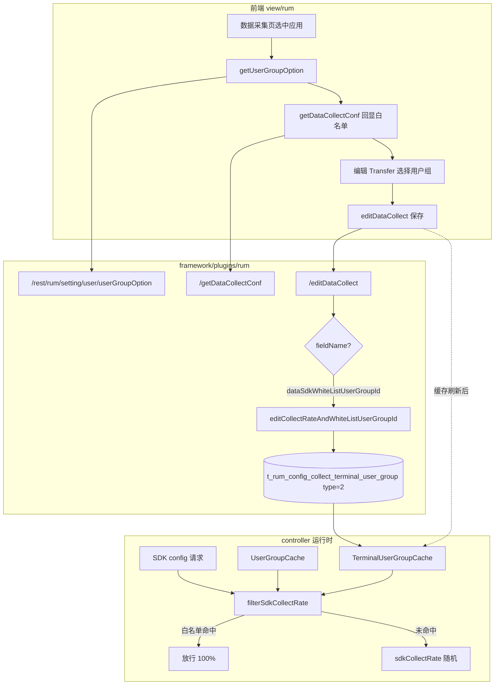
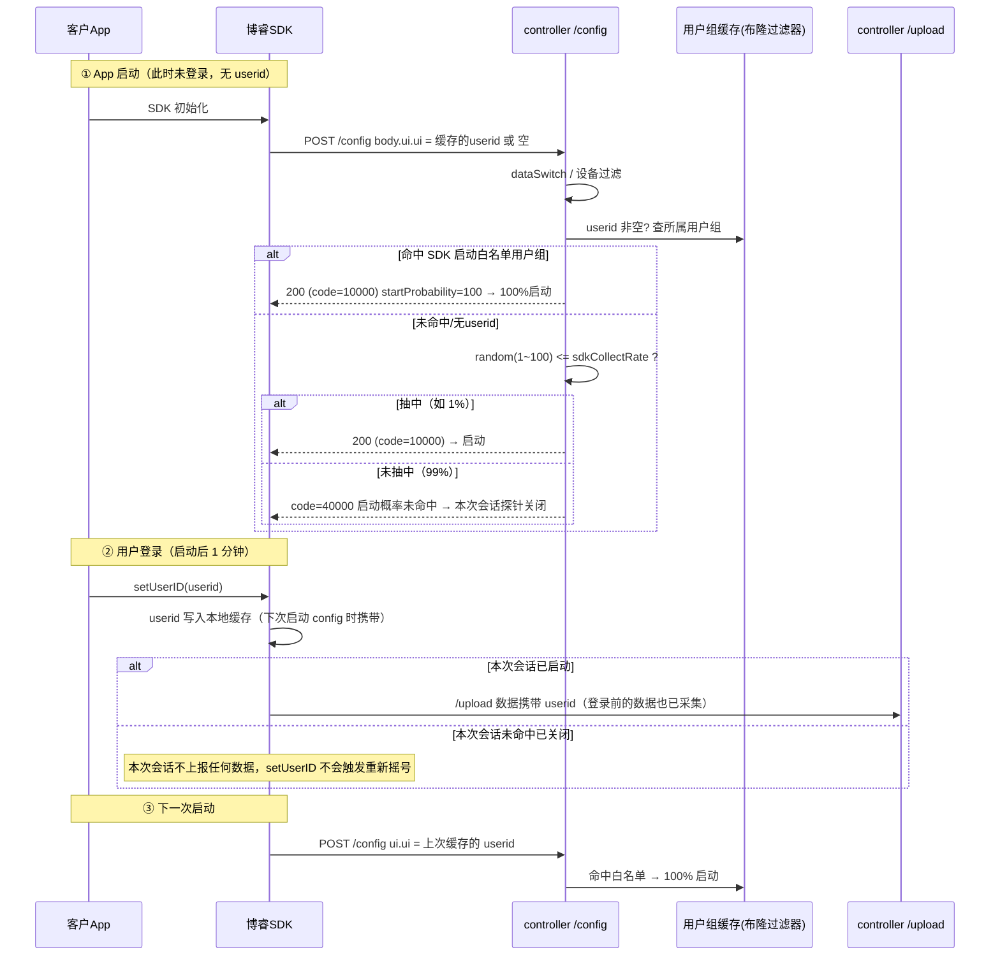

> 本文整合「配置全链路」（前端 → 后端 → 持久化）与「运行时判定 + 交付场景七问七答」两份原始分析，覆盖 SDK 启动概率与用户白名单的**产品规则、前端配置、持久化存储、运行时判定、缓存机制、时序流程、交付 FAQ、代码索引**完整链路。
> 代码根目录：`D:\Bonree\CodeProject\newonexm`（`controller\controller` 服务端判定、`framework\plugins\rum` 配置存储、`view\rum` 前端配置页）。

---

## 1. 产品概述与规则表

### 1.1 功能定位

「用户白名单」位于 **配置 → 数据采集 → 终端应用 → 数据采集** 页，嵌套在 **启动概率** 配置块内，与 **SDK 启动概率** 同属 `dataSdk` 聚合配置。

产品规则（页面提示第 1 条）：

> **启动概率**：SDK 启动概率仅针对**白名单外用户**生效，**白名单用户**的启动概率为 **100%**。

### 1.2 行为规则表

| 用户归属 | 行为 |
|----------|------|
| 属于已配置白名单用户组内的用户 | 探针 config 请求**必定通过**启动概率校验（等价 100% 启动） |
| 不属于白名单用户组 | 按应用/版本配置的 `sdkCollectRate`（1~100%）做随机采样 |
| 未配置任何白名单用户组（`-1` 或关联表为空） | 全部用户走 `sdkCollectRate` 采样逻辑 |

> **注意**：此「用户白名单」与 **网络请求白名单**（`net_white_list`）是不同概念；后者控制网络采集域名/路径，不参与 SDK 启动采样。

### 1.3 核心机制速览

1. **决策在服务端**：启动概率/白名单的判定完全在 `controller` 的 `/config` 接口完成，不是 SDK 端摇号。
2. **判定粒度是"一次启动（会话）"**：判定时机是 SDK 启动后发起 config 请求的那一刻，一次判定决定**整个会话**采不采。
3. **命中后下发 `startProbability = 100`**（服务端已替 SDK 做完决定）。
4. **未命中返回 40000**，SDK 本次会话关闭，不再上报任何数据。
5. **白名单/概率校验只存在于 config 阶段**，upload（数据上报）阶段不再做任何白名单/概率复查。

---

## 2. 前端配置（路由 / UI 组件 / 查询回显 / 保存序列化）

### 2.1 路由与模块

| 项 | 值 |
|----|-----|
| 前端路由 | `/deploy/config/collection/terminal` |
| 主 Tab | `数据采集`（`dataCollectionSwitch`） |
| 前端包 | `view/rum` → `ConfigCollectionTerminal` → `DataCollectionSwitch` → `DataCollectionForm` |

### 2.2 配置块聚合关系

`switchConfig.polymerizeConf` 将 `dataSdk*` 前缀字段聚合为「启动概率」一块：

- `dataSdk`：块标题（无独立开关，`cardSwitch=false`）
- `dataSdkCollectRate`：SDK 启动概率（%）
- `dataSdkWhiteListUserGroupId`：**用户白名单**（穿梭框）

```19:35:d:/Bonree/CodeProject/newonexm/view/rum/src/utils/switchConfig.ts
const polymerizeConf = (conf, polymericKeys, excludedKeys) => {
  // ...
  // key 为 dataSdk 时，children = 所有 dataSdk* 子字段
}
```

### 2.3 红框 UI：Transfer 穿梭框

编辑态由 `FormItem.tsx` 渲染：

- 组件：`bonree-design` **Transfer**（左「未选择」/ 右「已选择」）
- 数据源：`groupList`（用户组下拉选项）
- 标签：`config.collection.terminal.whiteList` → **用户白名单**
- **Web 应用（platform=3）不展示**该表单项（与 iOS/Android 等不同）

```389:437:d:/Bonree/CodeProject/newonexm/view/rum/src/packages/configurationModule/ConfigCollectionTerminal/components/DataCollectionSwitch/components/DataSwitchItem/components/FormItem/FormItem.tsx
} else if (item.label == 'dataSdkWhiteListUserGroupId') {
  return platform == 3 && item.label == 'dataSdkWhiteListUserGroupId' ? null : (
    <Transfer
      dataSource={groupList}
      targetKeys={targetKeys}
      onChange={onChange}
      // ...
    />
  )
}
```

截图显示 **未选择 (0/0) / 暂无数据**，表示当前账号下 **尚无可用用户组**（见 §3.1），需先在「实体识别 → 用户」模块创建用户组并维护成员。

### 2.4 用户组数据来源（白名单候选列表）

#### 2.4.1 下拉选项接口

| 接口 | 方法 | 说明 |
|------|------|------|
| `/rest/rum/setting/user/userGroupOption` | POST | 查询当前环境可选用户组 |

前端调用（进入数据采集页、选中应用后）：

```44:57:d:/Bonree/CodeProject/newonexm/view/rum/src/packages/configurationModule/ConfigCollectionTerminal/components/DataCollectionSwitch/components/DataCollectionForm/DataCollectionForm.tsx
const getUserGroup = async () => {
  const res = await request.post('/rest/rum/setting/user/userGroupOption', { appId: keyId })
  if (res.success) {
    setGroupList((res?.data || []).map((item) => ({ key: item.code, title: item.name })))
  }
}
```

后端实现：`CustomUserServiceImpl.userGroupOption` → `rumQueryServiceUserGroupMapper.queryUserGroup`（按主账号 + envId 查 CMDB/查询服务中的用户组）。

```234:246:d:/Bonree/CodeProject/newonexm/framework/plugins/rum/rum-core/src/main/java/com/bonree/rum/core/settings/service/impl/CustomUserServiceImpl.java
public List<OperateEntity> userGroupOption(ReqUserGroupQuery req) {
  req.setAccountId(userProvider.getAccountId());
  List<QueryUserGroup> userGroupList = rumQueryServiceUserGroupMapper.queryUserGroup(req, ResourceUtil.getEnvId(userProvider));
  // code = groupId, name = groupName
}
```

#### 2.4.2 用户组维护入口

用户组 CRUD 在 **配置 → 实体识别 → 用户 → 用户组**（`ConfigDistinguishUser`）：

| 接口 | 功能 |
|------|------|
| `/rest/rum/setting/user/addUserGroup` | 新增用户组 |
| `/rest/rum/setting/user/getUserGroupList` | 列表 |
| `/rest/rum/setting/user/editUserGroup` | 修改 |
| `/rest/rum/setting/user/deleteUserGroup` | 删除（会清理终端采集关联，见 §3.4） |

用户组成员通过用户导入/编辑绑定到组；运行时由 Controller 侧 `UserGroupCache`（Bloom Filter）根据 `appId + memberId` 解析用户所属 `groupId`。

### 2.5 查询配置（页面加载回显）

#### 2.5.1 主查询接口

| 接口 | 说明 |
|------|------|
| `POST /rest/rum/setting/collect/terminal/getDataCollectConf` | 查询应用/版本级数据采集开关及 SDK、会话回放等字段 |

请求体：`{ keyId, keyVersion }`（应用 ID、可选版本 ID）。

后端在 `TerminalCollectController.getDataCollectConf` 中合并多源数据，其中白名单来自：

```116:121:d:/Bonree/CodeProject/newonexm/framework/plugins/rum/rum-core/src/main/java/com/bonree/rum/core/settings/controller/TerminalCollectController.java
QueryCollectRate collectRate = terminalCollectService.getCollectRateAndWhiteListUserGroupId(req);
dataCollectConf.setDataSdkCollectRate(collectRate.getSdkCollectRate());
dataCollectConf.setDataSdkWhiteListUserGroupId(collectRate.getWhiteListUserGroupId());
```

#### 2.5.2 白名单字段回显规则

`TerminalCollectServiceImpl.getCollectRateAndWhiteListUserGroupId`：

1. 查 `t_rum_config_collect_terminal` 得 `configId`（采集配置主键）
2. 查关联表 `t_rum_config_collect_terminal_user_group`，**`type = 2`**（SDK 启动白名单）
3. 有关联记录 → `dataSdkWhiteListUserGroupId` = 逗号拼接的 `groupId`
4. 无关联或过滤后为空 → **`"-1"`**（表示未限定用户组，全员走启动概率）

```1192:1205:d:/Bonree/CodeProject/newonexm/framework/plugins/rum/rum-core/src/main/java/com/bonree/rum/core/settings/service/impl/TerminalCollectServiceImpl.java
List<ConfigCollectTerminalUserGroupEntity> list = configCollectTerminalUserGroupService.lambdaQuery()
    .eq(ConfigCollectTerminalUserGroupEntity::getConfigId, collectRate.getId()).list();
String groupIdList = list.stream().filter(item -> item.getType() == 2)...
collectRate.setWhiteListUserGroupId(groupIdList 或 "-1");
```

#### 2.5.3 前端初始化穿梭框

`FormItem` 在 `name == 'dataSdk'` 编辑态挂载时：

```47:52:d:/Bonree/CodeProject/newonexm/view/rum/src/packages/configurationModule/ConfigCollectionTerminal/components/DataCollectionSwitch/components/DataSwitchItem/components/FormItem/FormItem.tsx
tranf = dataSdkWhiteListUserGroupId?.split(',')
  ?.filter((item) => groupList.find((i) => i.key == item || item == '-1')) || []
form.setFieldsValue({ dataSdkWhiteListUserGroupId: tranf })
setTargetKeys(tranf)
```

仅保留仍存在于 `groupList` 中的 groupId，避免已删除用户组残留。

### 2.6 保存配置（编辑 → 保存）

#### 2.6.1 保存触发

用户点击 **保存** → `FormItem.onOk` → `EditComponent.handleSaveClick` → 统一接口：

| 接口 | 说明 |
|------|------|
| `POST /rest/rum/setting/collect/terminal/editDataCollect` | 按字段批量修改数据采集配置 |

请求体结构：

```json
{
  "keyId": "应用ID",
  "keyVersion": "版本ID或null",
  "id": "采集配置主键",
  "editFieldEntities": [
    { "fieldName": "dataSdkCollectRate", "fieldValue": "100" },
    { "fieldName": "dataSdkWhiteListUserGroupId", "fieldValue": "12,34" }
  ]
}
```

#### 2.6.2 前端字段序列化

`TranfFn` 对多选用户组字段的处理：

```8:13:d:/Bonree/CodeProject/newonexm/view/rum/src/packages/configurationModule/ConfigCollectionTerminal/components/DataCollectionSwitch/components/DataSwitchItem/components/common.ts
} else if (item[0] == 'dataSdkWhiteListUserGroupId' ...) {
  let arr = isArray(item[1]) ? item[1].join(',') ... : ''
  if (item[0] == 'dataSdkWhiteListUserGroupId' && !arr) {
    arr = '-1'  // 未选任何组 → 表示无白名单
  }
  return arr
}
```

| 穿梭框选中状态 | 提交 `fieldValue` |
|----------------|-------------------|
| 未选任何组 | `"-1"` |
| 选中组 12、34 | `"12,34"` |

#### 2.6.3 后端分流处理

`TerminalCollectController.editDataCollect` 对 `dataSdkWhiteListUserGroupId` **单独分支**，不走路由通用的 `editDataCollectSwitch` 字段映射：

```141:146:d:/Bonree/CodeProject/newonexm/framework/plugins/rum/rum-core/src/main/java/com/bonree/rum/core/settings/controller/TerminalCollectController.java
case "dataSdkWhiteListUserGroupId":
  handleSdkWhiteListUserGroup(req, fieldEntity);
  iterator.remove();
  break;
```

```244:251:d:/Bonree/CodeProject/newonexm/framework/plugins/rum/rum-core/src/main/java/com/bonree/rum/core/settings/controller/TerminalCollectController.java
private void handleSdkWhiteListUserGroup(...) {
  reqCollectRate.setWhiteListUserGroupId(fieldEntity.getFieldValue());
  terminalCollectService.editCollectRateAndWhiteListUserGroupId(reqCollectRate);
}
```

> SDK 启动概率 `dataSdkCollectRate` 若在同一次保存中提交，仍走 `editDataCollect` 通用逻辑更新 `sdk_collect_rate` 列；白名单只更新关联表。

---

## 3. 持久化存储（表结构 / 全量覆盖算法 / 级联清理 / 四张成员关系表）

### 3.1 关联表结构

表名：**`t_rum_config_collect_terminal_user_group`**

实体：`ConfigCollectTerminalUserGroupEntity`

| 字段 | 说明 |
|------|------|
| `id` | 主键 |
| `config_id` | 对应 `t_rum_config_collect_terminal.id` |
| `app_id` | 应用 ID |
| `group_id` | 用户组 ID |
| `type` | **1** = 会话回放用户范围；**2** = **SDK 启动白名单** |

```41:44:d:/Bonree/CodeProject/newonexm/framework/plugins/rum/rum-database/src/main/java/com/bonree/rum/setting/entity/ConfigCollectTerminalUserGroupEntity.java
/**
 * 用户组类型：1.会话 2.sdk
 */
private Integer type;
```

Controller 枚举与之一致：

```8:12:d:/Bonree/CodeProject/newonexm/controller/controller/src/main/java/com/bonree/one/controller/common/enums/TerminalUserGroupEnum.java
REPLAY(1, "会话回放"),
SDK_START(2, "sdk启动"),
```

### 3.2 四张成员关系表（白名单数据来源）

「用户白名单」本质是**用户组机制**，涉及 4 张表：

| 表 | 作用 |
|----|------|
| `t_rum_user_member` | 用户成员（member_id 即客户的 userid） |
| `t_rum_member_group_relation` | 成员 ↔ 用户组关系 |
| `t_rum_app_group` | 用户组 ↔ 应用关系 |
| `t_rum_config_collect_terminal_user_group` | 采集配置 ↔ 用户组绑定，`type=2` 表示 SDK 启动白名单 |

SDK 启动概率本身存在 `t_rum_config_collect_terminal.sdk_collect_rate`（0~100 整数，前端 `CollectionProbability.tsx` 校验 0~100）。

截图页面的「用户白名单」穿梭框选择的就是用户组下的用户成员，保存后写入上述关联表。

### 3.3 保存算法（全量覆盖）

`updateCollectRateAndWhiteListUserGroupId`：

1. `whiteListUserGroupId` 为空 → 直接返回，不改动
2. **删除**该 `configId` 下所有 **`type=2`** 的旧关联（全量更新策略）
3. 若 `whiteListUserGroupId != "-1"` → 按逗号拆分 `groupId`，**批量插入**新关联
4. 若为 `"-1"` → 仅删除、不插入 → 运行时无 SDK 白名单组

```763:782:d:/Bonree/CodeProject/newonexm/framework/plugins/rum/rum-core/src/main/java/com/bonree/rum/core/settings/service/impl/TerminalCollectServiceImpl.java
configCollectTerminalUserGroupMapper.delete(..., type=2);
if (!"-1".equals(req.getWhiteListUserGroupId())) {
  // 批量 insert groupId, configId, appId, type=2
}
```

### 3.4 用户组删除的级联

删除用户组时，`CustomUserServiceImpl` 会移除关联表中对应 `groupId` 的记录，避免脏数据。

---

## 4. 运行时判定核心（filterSdkCollectRate 权威伪代码 / 处理顺序 / license 关系）

### 4.1 config 请求处理顺序（关键：概率校验在 license 校验之前）

白名单**不下发到探针 JSON**，而是在 Controller 处理 `/config` 时，服务端根据上报用户信息做**准入过滤**。

```148:182:d:/Bonree/CodeProject/newonexm/controller/controller/src/main/java/com/bonree/one/controller/service/config/rum/impl/RumConfigServiceImpl.java
      //请求体参数验证
      if (!checkProtocolParam()) {
        return result;
      }

      //获取设备ip
      deviceIp = CommonUtil.anaDeviceIp(remoteIp, heads, privateConfig.realIpHeader);
      //请求过滤
      if (!filterApp(configRequest.getAppInfo().getAppMD5(),
        configRequest.getAppInfo().getAppVersion(), configRequest.getVersion())) {
        result.setResponseCode(ResponseCode.APP_NOT_EXIT);
        return result;
      }
      // 设备过滤
      if (!new DeviceFilter(privateConfig).filter(this)) {
        return result;
      }
      // 探针启动概率/白名单校验
      if (filterSdkCollectRate(configRequest.getUserInfo())) {
        result.setResponseCode(ResponseCode.SDK_COLLECT_RATE);
        return result;
      }

      // license 校验
      if (!checkLicense(configRequest, result)) {
        return result;
      }

      //生产 session id
      generateSessionId(heads);
      //存储基础信息,统计数据 -- 保证数据都同步存储入库后，才构造 upload 包入本地队列。
      saveData();
      //构造config响应体
      result.setResponseCode(ResponseCode.NORMAL_DEFAULT);
      buildConfigResponse();
```

> **顺序含义**：未命中启动概率的设备在 license 校验之前就被拒绝，不生成 sessionId、不入库、不计入采集 MAU/license 消耗。

### 4.2 核心判定方法 `filterSdkCollectRate()`（权威伪代码）

```367:403:d:/Bonree/CodeProject/newonexm/controller/controller/src/main/java/com/bonree/one/controller/service/config/rum/impl/RumConfigServiceImpl.java
  /**
   * 校验sdk启动概率
   * @return 返回ture则探针关闭
   */
  private boolean filterSdkCollectRate(UserInfoEntity configUserInfoEntity) {

    // 当数据采集关闭 则探针关闭
    if (!appVersionConfig.isDataSwitch()) {
      return true;
    }

    Long configId = appVersionConfig.getId();
    // sdk 启动概率 白名单 用户组
    Set<Long> sdkGroupId = terminalUserGroupCache.getReplayGroupConfig(configId,
        TerminalUserGroupEnum.SDK_START.getType());

    if (configUserInfoEntity != null &&
        StringUtils.isNotEmpty(configUserInfoEntity.getUserId()) &&
        sdkGroupId != null && sdkGroupId.size() > 0) {
      Long groupId = userGroupCache.getGroupId(rumAppDO.getId(),
          configUserInfoEntity.getUserId(), rumAppDO.getUserId());

      // 当上报用户组在白名单内，则百分之百启动
      if (sdkGroupId != null && sdkGroupId.contains(groupId)) {
        return false;
      }
    }

    // 没有用户或者没有命中白名单
    Integer sdkCollectRate = appVersionConfig.getSdkCollectRate();
    if (sdkCollectRate == 0) {
      // 探针关闭
      return true;
    } else if (sdkCollectRate < 100) {
      random = new Random();
      if (random.nextInt(100) + 1 > sdkCollectRate) {
        // 探针关闭
        return true;
      }
    }

    return false;
  }
```

判定流程拆解：

```text
数据采集总开关关闭？ ──是──> 探针关闭
        │否
        ▼
config 请求里有非空 userid？ 且 本应用配置了 SDK 启动白名单用户组？
        │是                              │否
        ▼                                ▼
userid 命中白名单用户组？          按 sdkCollectRate 随机抽样
   │命中        │未命中                 - rate=0   → 关闭
   ▼            └──────────────────>    - rate<100 → random(1~100) > rate 则关闭
100% 启动（跳过抽样）                    - rate=100 → 启动
```

**关键点：白名单优先级高于概率抽样，命中白名单的用户不受 1% 限制，也不占用 1% 配额。**

### 4.3 返回值含义与下游行为

| 返回值 | 含义 | 下游行为 |
|--------|------|----------|
| `true` | 过滤掉 | 返回 `SDK_COLLECT_RATE(40000)`，探针不获取有效配置，本次会话关闭 |
| `false` | 通过 | 继续 license、sessionId、buildConfigResponse；命中后下发 `startProbability = 100` |

命中后下发给 SDK 的 `startProbability` 恒为 **100**（服务端已替 SDK 做完决定）：

```490:491:d:/Bonree/CodeProject/newonexm/controller/controller/src/main/java/com/bonree/one/controller/service/config/rum/impl/RumConfigServiceImpl.java
      //设置启动概率--走到这里组装写死100%启动概率，配置的启动概率/白名单等校验提前
      result.setStartProbability(100);
```

未命中时返回响应码 **40000**：

```d:/Bonree/CodeProject/newonexm/controller/controller/src/main/java/com/bonree/one/controller/common/enums/ResponseCode.java
  SDK_COLLECT_RATE(40000, "启动概率未命中"),
```

### 4.4 config 请求协议中的 userid（白名单生效的唯一入口）

```d:/Bonree/CodeProject/newonexm/controller/controller/src/main/java/com/bonree/one/controller/domain/model/rum/request/ConfigRequestEntity.java
  @JsonProperty(value = "v", required = true)
  private String version;

  @JsonProperty(value = "ai", required = true)
  private AppInfoEntity appInfo;

  @JsonProperty(value = "di", required = true)
  private DeviceInfoEntity deviceInfo;

  @JsonProperty(value = "ui", required = true)
  private UserInfoEntity userInfo;
```

```d:/Bonree/CodeProject/newonexm/controller/controller/src/main/java/com/bonree/one/controller/domain/model/rum/request/UserInfoEntity.java
  /**
   * ui: user id 用户ID [非必要字段]
   */
  @JsonProperty(value = "ui", required = true)
  private String userId;

  /**
   * ei: extra info 附加信息 [非必要字段]
   */
  @JsonProperty(value = "ei", required = true)
  private String extraInfo;
```

config 请求体示例（白名单判定看 `ui.ui`）：

```json
{
  "v": "1.0",
  "ai": { "a": "appMd5...", "av": "5.2.0" },
  "di": { "...": "设备信息" },
  "ui": { "ui": "user_138001380000", "ei": "" },
  "cmt": 0,
  "nsi": { "...": "网络状态" }
}
```

> **`ui.ui` 为空 → 白名单逻辑整体跳过，直接走概率抽样。** 这是理解交付 FAQ 问题 2/3/7 的关键。

### 4.5 与「开启采集」、启动概率的关系

| 配置项 | 作用层级 |
|--------|----------|
| `dataSwitch`（开启采集） | 关闭时 `filterSdkCollectRate` 直接拒绝；Web 下发 `PROBABILITY=0` |
| `sdkCollectRate` | 仅对**非白名单**用户生效的随机百分比 |
| 用户白名单（type=2 关联） | 命中用户**绕过**随机，等价 100% 通过 config |

Web 探针 `getWebAppJsInfo` 侧下发的是千分比 `PROBABILITY`（`sdkCollectRate * 10`），**白名单逻辑仍在 Controller config 接口**，不在 JS 配置 JSON 的 `wl` 字段（该 `wl` 为网络白名单）。

### 4.6 与会话回放「用户范围」的对比

同一张关联表、同一套 Transfer UI 模式，但 **type 不同**：

| 对比项 | SDK 用户白名单 | 会话回放用户范围 |
|--------|----------------|------------------|
| 字段名 | `dataSdkWhiteListUserGroupId` | `dataSessionReplayGroupId` |
| type | **2** | **1** |
| 产品效果 | 100% 通过 SDK 启动采样 | 限制哪些用户组可录制回放 |
| Web 应用 | **隐藏**白名单 UI | 部分能力受限 |
| 保存接口分支 | `handleSdkWhiteListUserGroup` | `handleSessionReplayGroup` |

---

## 5. 缓存机制（两级缓存 / 5 分钟增量 / 每日全量 / 布隆过滤器 / 误判影响）

### 5.1 controller 侧两级缓存

调用链：

```text
SDK 发起 config 请求（携带 UserInfo.userId / memberId）
        ↓
RumConfigServiceImpl.execute()
        ↓
filterSdkCollectRate(userInfo)  // true = 拒绝下发配置（探针不启动）
        ↓
TerminalUserGroupCache（configId + type=2 → 白名单 groupId 集合）
UserGroupCache（appId + memberId → 用户所属 groupId）
        ↓
命中白名单 → 跳过概率采样
未命中     → 按 sdkCollectRate 随机
```

**① TerminalUserGroupCache**（采集配置 → 绑定了哪些白名单用户组），每 5 分钟从 `t_rum_config_collect_terminal_user_group` 全量刷新。

**② UserGroupCache**（userid 是否属于某用户组），基于**布隆过滤器**：

```d:/Bonree/CodeProject/newonexm/controller/controller/src/main/java/com/bonree/one/controller/service/config/rum/cache/UserGroupCache.java
  public Long getGroupId(Long appId, String memberId, Long userId) {
    String mapKey = getMapKey(appId, userId);

    //map存在 > 循环group的bf是否存在member > 存在则返回对应groupId
    if (app_group_map.containsKey(mapKey)) {
      final Set<String> groupKeys = app_group_map.get(mapKey);
      for (String groupKey : groupKeys) {
        if (group_member_map.containsKey(groupKey)) {
          UserGroupBloomEntity userGroupBloomEntity = group_member_map.get(groupKey);
          String memberKey = getMemberKey(appId, memberId);
          BloomFilter bloomFilter = userGroupBloomEntity.getBloomFilter();
          if (bloomFilter != null) {
            if (bloomFilter.mightContain(memberKey)) {
              return userGroupBloomEntity.getGroupId();
            }
          }
        }
      }
    }
    return null;
  }
```

### 5.2 缓存特性（对运维/交付很重要）

| 特性 | 说明 |
|------|------|
| 数据源 | `t_rum_member_group_relation` join `t_rum_user_member` join `t_rum_app_group` |
| 增量更新 | 每 5 分钟拉取当天有更新的成员 → **新增白名单用户约 5 分钟内生效** |
| 全量重建 | 每天凌晨 1 点 → **删除白名单用户最长要到次日凌晨 1 点才真正失效**（布隆过滤器不支持删除） |
| 误判方向 | 布隆过滤器按 n=200 万、p=3% 设计：**只会把"非白名单用户"误判成白名单（多采），绝不会漏掉真白名单用户**。白名单仅 300 人时实际误判率远低于 3%，可忽略 |

### 5.3 缓存刷新与配置同步

| 缓存 | 数据源 | Key |
|------|--------|-----|
| `TerminalUserGroupCache` | `t_rum_config_collect_terminal_user_group` 全表 | `configId + "_" + type` |
| `UserGroupCache` | 用户组成员 Bloom Filter | `appId + userId + memberId` |

`RumCacheTask` 定时刷新上述缓存；平台保存白名单后，需等待缓存更新周期生效。

### 5.4 布隆过滤器误判影响详解

- 代码 `p=0.03`，约 3% 误判「可能在组内」
- 应用下组越多，遍历时假阳性叠加概率越高
- 可能错绑用户组，影响会话筛选、回放白名单等
- **误判方向只会"多放行"（误判非白名单为白名单），不会"漏放行"**——真白名单用户绝不会漏采

### 5.5 删除/换组时效

布隆过滤器不支持删除。用户从组移除、换组、解绑应用后：

- 增量只会 `put` 新关系
- 旧成员仍可能 `mightContain=true`
- 通常要等到 **凌晨 1 点全量** 才纠正
- 错绑会持续写入 CK；**历史数据不回写**

这是「删除立即生效」诉求下的核心障碍，也是交付时必须向客户讲清的边界。

---

## 6. 时序与流程图

### 6.1 配置链路 flowchart



### 6.2 启动-登录时序 sequence



---

## 7. 交付 FAQ（七问七答 + 运维三问 + 银行场景 + 首启动边界）

### 7.1 七问七答速览

| # | 问题 | 结论（一句话） |
|---|------|----------------|
| 1 | 白名单 300 人 + 概率 1%，是否"1% 随机 + 300 人全采"？ | **基本是**，但有前提：白名单用户必须在「**SDK 启动时的 config 请求**」里携带 userid 才能命中白名单；首次安装首次启动带不上 userid，只能走 1% 随机 |
| 2 | App 01 分启动拉 config、02 分登录，采集逻辑？登录前数据全采吗？ | 采不采**在 01 分 config 时就一次性决定了**（会话粒度）。命中（概率或白名单）→ 本次会话从启动开始全部采集（含登录前数据）；未命中 → 本次会话**什么都不采**（含登录后数据）。登录动作不会改变本次会话的采集决定 |
| 3 | 1% 概率下白名单用户如何做到**每次启动都上报**？ | 依赖 **SDK 本地缓存 userid**：本次登录 setUserID 后 SDK 持久化，**下次启动**的 config 请求自动带上缓存 userid → 命中白名单 → 100% 启动。因此除"首次安装后的第一次启动"外，每次启动都能保证采集；首启动只能按 1% 碰运气 |
| 4 | 平台侧如何判断 userid 白名单？ | `filterSdkCollectRate()`：取 config 请求 `ui.ui`（userid）→ 在 `UserGroupCache`（布隆过滤器，数据源为用户组成员表）中查 userid 属于哪个用户组 → 该组若在本应用采集配置绑定的「SDK 启动白名单用户组」（`t_rum_config_collect_terminal_user_group`，type=2）中 → 100% 启动，跳过概率抽样 |
| 5 | 银行自身白名单策略**失效**时，我方概率最多 1% 的影响？ | 最坏情形是全量用户都启动 SDK：config 请求量变为全量月活级别（服务端压力）、实际采集量≈MAU×1%（license 消耗可控，未命中不消耗）；**关键风险**：银行白名单目标用户也退化为 1% 随机，99% 的目标用户启动数据丢失——除非在博睿平台同步配置了用户白名单做兜底 |
| 6 | 银行自身白名单策略**正常**时，我方概率最多 1% 的影响？ | **严重问题**：客户端已经筛过一遍（只有白名单用户才启动 SDK），我方再叠加 1% 抽样 → 目标用户每次启动只有 1% 被采，**99% 数据丢失**。正确做法：该场景下我方 SDK 启动概率应设 **100%**；或将同批用户配置到博睿平台白名单并保证 config 带 userid |
| 7 | SDK 启动前设置 userid，SDK 能否获取并上报？博睿白名单如何生效？ | 服务端协议**支持**：config 请求体本身就有 `ui`（userInfo）字段，只要 SDK 在发 config 时能拿到 userid（init 前注入 / 上次会话缓存），白名单即可在启动瞬间生效。能否"init 前 setUserID"取决于 SDK 端实现（需与 SDK 团队确认具体端的 API 行为），平台侧逻辑无障碍 |

### 7.2 七问七答详细解答

#### Q1：白名单 300 人 + 概率 1% = 「1% 随机全采 + 300 人全采」吗？

**结论：机制上是这样，但要加三个限定。**

- 命中逻辑：白名单用户 **100% 启动且不占 1% 配额**；其余用户按每次启动 1% 随机。预期总采集量 ≈ 2000 万 MAU × 1% + 300 白名单用户的全部启动 ≈ **20 万 MAU + 300 人全量**。
- 限定 1（最重要）：**"300 人全采"的前提是这些用户启动 SDK 时 config 请求里带有 userid**。userid 来自 SDK 本地缓存（上次登录 setUserID 后保存）。**首次安装后的第一次启动没有缓存 → 该次只能按 1% 随机**。
- 限定 2：1% 是**每次启动独立摇号**，不是"固定圈定 1% 的用户"。同一个普通用户今天可能被采、明天可能不被采；按 MAU 口径长期看约 1% 的活跃用户量级被采集，但具体人群每天在变。
- 限定 3：白名单按"用户组"配置，配置变更有缓存延迟（新增约 5 分钟生效；删除最晚次日凌晨 1 点生效）。

#### Q2：01 分启动拉 config、02 分登录，采集逻辑？登录前数据全采吗？

**结论：采不采在 01 分就定了，是"会话级全有或全无"，不存在"登录前采登录后不采"或反之。**

时间线推演（假设该用户在白名单中）：

| 时刻 | 事件 | 行为 |
|------|------|------|
| 01 分 | SDK init → 发 config | 服务端判定：取 config 里的 userid（= SDK 本地缓存值，首次安装为空）做白名单匹配；不中再按 1% 摇号 |
| 01~02 分 | 未登录期间 | 若 config 命中 → 启动数据、网络请求等**从启动起全部采集**（此时数据无 userid）；若未命中 → 探针关闭，**什么都不采** |
| 02 分 | 登录，App 调 setUserID | 仅对"已启动"的会话生效：后续上报数据携带 userid，且 SDK 将 userid 缓存到本地供**下次启动**使用。**不会**让已关闭的探针复活，也不会触发重新判定 |

所以：
- "登录之前的数据全采吗" → **如果本次启动命中了（白名单或 1%），是的，从 SDK init 那一刻起全采（包括登录前）**；如果没命中，登录前后都不采。
- 首次安装的白名单用户：第一次启动大概率（99%）未命中 → 第一次会话整体丢失；从**第二次启动**开始凭缓存 userid 100% 命中。

#### Q3：1% 启动率下，白名单用户怎么做到每次启动都上报？

**结论：靠 SDK 的 userid 本地持久化机制，把"本次登录拿到的 userid"留给"下一次启动"用。**

- 矛盾点确认：SDK init（发 config）确实早于 setUserID。**当次启动**的白名单判定用不上**当次登录**的 userid。
- 解法（现有机制）：SDK 在 setUserID 后将 userid 持久化；**下一次冷启动**发 config 时自动携带缓存 userid → 服务端白名单命中 → 100% 启动。
- 效果：白名单用户除了「首次安装后的第一次启动」（以及清除 App 数据、换设备后的第一次启动）外，**每次启动都能保证上报**。
- 无法做到 100% 严格全覆盖的场景：
  1. 首次安装首启动（无缓存）→ 1% 概率；
  2. 用户清缓存/卸载重装 → 退化为首启动；
  3. 一台设备多账号切换：config 带的是上次缓存的账号，若上个账号不在白名单而本次登录账号在 → 本次会话不保证；
  4. 服务端未命中后，**会话中途没有"补救"机制**（setUserID 不会让服务端重新判定，upload 阶段也不复查白名单）。
- 若要彻底覆盖首启动：需要 App 在 SDK init **之前/同时**注入 userid（见 Q7），银行场景"登录后才启动 SDK"恰好具备这个条件。

#### Q4：平台侧如何判断 userid 白名单？

**判定链（全部在 `/config` 接口同步完成，纯内存操作）：**

1. `appMd5` → 定位应用与采集配置 `appVersionConfig`；
2. `TerminalUserGroupCache.getReplayGroupConfig(configId, type=2)` → 该采集配置绑定的「SDK 启动白名单用户组」集合（来自 `t_rum_config_collect_terminal_user_group`，5 分钟刷新）；
3. config 请求 `ui.ui` 非空且白名单组非空时，调 `UserGroupCache.getGroupId(appId, userid, 租户accountId)`：
   - 先用 `appId_租户id` 找到该应用下存在的用户组；
   - 再对每个组的**布隆过滤器**做 `mightContain(appId_userid)`，命中返回 groupId；
4. groupId ∈ 白名单组集合 → `return false`（100% 启动）；否则落入 `sdkCollectRate` 随机抽样。

补充特性：
- userid 匹配是**精确字符串匹配**（member_id 与 SDK 上报 userid 必须完全一致，区分大小写）；
- 布隆过滤器只可能"多放行"（误判非白名单为白名单），不会"漏放行"；
- 新增白名单成员 ≈ 5 分钟生效；删除成员要等次日凌晨 1 点全量重建后生效。

#### Q5：银行自身白名单策略【失效】场景的影响分析（我方概率 ≤ 1%）

银行策略：首次登录后比对行内白名单，命中才初始化博睿 SDK；非首次按本地缓存判断。
"失效"按两种典型形态分析：

**形态 A：白名单判断失效 → 所有用户都启动了博睿 SDK（放行过度）**

| 影响面 | 分析 |
|--------|------|
| config 请求量 | 全量用户每次启动都发 config，约 2000 万 MAU 量级的启动请求全部打到 controller `/config`。该接口为内存判定、未命中即返回，单请求开销小，但需评估接入层/controller 集群容量 |
| 实际采集量 | 非白名单用户按 1% 抽样 → 约 20 万 MAU 被采集。**概率校验在 license 校验之前，未命中的 99% 不生成 session、不入库、不消耗 license MAU** |
| license/存储 | 采集 MAU 从"白名单几百人"涨到 ~20 万，license 余量、存储、ES/CK 容量需重新评估；若 license 超量，超出部分会被 `checkLicense` 拒绝 |
| **关键业务风险** | 银行真正关心的白名单用户**混在全量用户里按 1% 摇号**——如果博睿平台侧没有同步配置用户白名单，**目标用户每次启动只有 1% 被采，99% 的关键用户会话丢失**，等于监控目标失效 |
| 兜底手段 | 在博睿平台配置同一批用户白名单（用户组绑定 SDK 启动），只要 config 带 userid（第二次启动起），目标用户仍 100% 采集，不受失效影响 |

**形态 B：白名单判断失效 → 该启动的也没启动（拦截过度）**

- SDK 根本未初始化，不发 config → 平台**完全无数据、无感知**（服务端看不到任何请求，无法区分"用户没来"和"客户端拦截了"）。
- 白名单用户数据 100% 丢失，且博睿侧无任何手段补救（决策点在客户端，我方逻辑没有机会执行）。

**结论：银行客户端自建白名单是单点。强烈建议在博睿平台同步配置用户白名单作为第二道保险，双层互备。**

#### Q6：银行自身白名单策略【正常】场景的影响分析（我方概率 ≤ 1%）

银行策略正常 = **只有行内白名单用户才会初始化博睿 SDK**（客户端已经完成了人群筛选）。

| 影响面 | 分析 |
|--------|------|
| **核心矛盾** | 到达博睿的本来就全是目标用户，我方再叠加 1% 启动概率 → **每个白名单用户每次启动只有 1% 概率被采集**，平均 100 次启动才采 1 次，99% 的目标会话丢失。两层抽样是乘法关系：客户端白名单 × 服务端 1% |
| 数据完整性 | 崩溃、卡顿、网络等问题数据只剩 1% 样本，无法支撑"白名单用户全量监控"的目标；问题复现、单用户轨迹追踪基本不可用 |
| 正确配置方案 1（推荐） | 该应用的 SDK 启动概率直接设为 **100%**。采集量上限 = 银行白名单人数（几百人），完全可控，不需要再用概率限流 |
| 正确配置方案 2 | 概率保持 1%，同时把同一批 userid 配置到**博睿平台用户白名单**：命中白名单的用户 100% 启动，不受 1% 影响。前提：config 请求带 userid（首启动需 SDK 支持启动前注入 userid，银行"登录后才启动 SDK"的时序恰好能做到，见 Q7） |
| 方案 2 残留风险 | 两边白名单需要**人工保持同步**（行内白名单变更要同步到博睿平台，新增 5 分钟生效、删除次日生效）；任何一边漏配都会导致该用户退化为 1% |
| license | 无论方案 1/2，实际采集 MAU ≈ 银行白名单人数，license 消耗极小 |

**结论：此场景下"概率 1%"与业务目标直接冲突，必须用方案 1（概率 100%）或方案 2（平台白名单兜底）之一，推荐方案 1，配置最简单且无同步风险。**

#### Q7：启动 SDK 之前设置 userid，SDK 能否获取并上报？博睿白名单如何生效？

**平台/协议侧：完全支持。**
- config 请求体定义了 `ui.userId` 字段（见 §4.4），服务端 `filterSdkCollectRate()` 直接消费该字段做白名单判定。**只要 SDK 发 config 时能填上 userid，白名单在启动瞬间（首启动也包括）即生效**，并且该 userid 会随后续 upload 数据上报。

**SDK 端：取决于各端实现，有三种获取 userid 的途径**

| 途径 | 说明 | 首启动是否可命中白名单 |
|------|------|------------------------|
| ① init 之前调用 setUserID（或 init 参数携带 userid） | App 先拿到用户信息再启动 SDK——银行场景（登录后才启动 SDK）天然具备此时序。需确认各端 SDK 是否支持 init 前暂存 userid 并随首个 config 上报 | **可以** |
| ② init 之后 setUserID，SDK 本地持久化 | 当次 config 已发出，userid 只能影响**下一次启动** | 不可以（次启动起可以） |
| ③ 无任何 userid（首次安装且未登录） | config 的 `ui.ui` 为空，白名单跳过 | 不可以，按概率抽样 |

**建议（银行场景落地）：**
1. 与 SDK 团队确认目标端（Android/iOS）是否支持「init 前设置 userid」或「init 配置项传入 userid」；若支持，银行在"行内白名单校验通过 → 启动博睿 SDK"时直接带入 userid，**博睿白名单从第一次启动就 100% 生效**；
2. 若 SDK 仅支持 init 后 setUserID，则接受"首启动按概率、次启动起白名单全采"的既定行为，或将启动概率设为 100%（配合客户端白名单，见 Q6 方案 1）。

### 7.3 运维三问

#### 7.3.1 穿梭框显示「暂无数据」

原因：`userGroupOption` 返回空列表。需先在 **实体识别 → 用户 → 用户组** 创建用户组并添加成员，再回到本页编辑。

#### 7.3.2 保存后白名单不生效

排查顺序：

1. 是否选中至少一个用户组（`-1` 表示无白名单）
2. 上报用户是否能在 `UserGroupCache` 中解析到 `groupId`（memberId 识别规则）
3. `TerminalUserGroupCache` 是否已刷新（`configId` 是否为当前应用/版本配置）
4. `dataSwitch` 是否开启

#### 7.3.3 Web 应用为何没有用户白名单

`platform == 3` 时前端显式 `return null`，不渲染 `dataSdkWhiteListUserGroupId` 表单项；Web 仅配置 SDK 启动概率与会话回放等子项。

### 7.4 关键风险与建议汇总

1. **白名单 ≠ 无条件全采**：生效依赖 config 请求携带 userid。首次安装首启动、清缓存、换设备、多账号切换场景均可能漏采。交付时必须向客户讲清这一边界。
2. **会话级决策、不可中途补救**：config 返回 40000 后本次会话彻底关闭，setUserID/登录不会触发重新判定。
3. **客户端自建白名单 + 服务端低概率是乘法抽样**：两层各自独立，叠加会把目标用户数据砍到 1%。客户端已筛选人群时，服务端概率应设 100%。
4. **双层白名单互备**：客户端策略存在失效风险（Q5 形态 A/B），建议博睿平台侧始终同步配置用户白名单兜底。
5. **缓存时效**：平台白名单新增约 5 分钟生效；**删除最晚次日凌晨 1 点生效**（布隆过滤器不可删除，依赖每日全量重建）；布隆过滤器误判只会"多采"不会"漏采"。
6. **userid 精确匹配**：平台配置的用户成员 member_id 必须与 SDK 上报 userid 完全一致（含大小写），导入 300 人名单时需校验格式。
7. **概率校验早于 license 校验**：未命中启动概率的请求不消耗 license/MAU，全量用户发 config 的场景下 license 消耗仍约等于"实际采集量"，但 `/config` 接口的请求量压力需单独评估。

---

## 8. 关键代码索引（newonexm 统一路径）

| 层级 / 角色 | 路径 |
|------|------|
| 前端-表单 | `view/rum/src/packages/configurationModule/ConfigCollectionTerminal/components/DataCollectionSwitch/components/DataCollectionForm/DataCollectionForm.tsx` |
| 前端-穿梭框 | `view/rum/src/packages/configurationModule/ConfigCollectionTerminal/components/DataCollectionSwitch/components/DataSwitchItem/components/FormItem/FormItem.tsx` |
| 前端-序列化 | `view/rum/src/packages/configurationModule/ConfigCollectionTerminal/components/DataCollectionSwitch/components/DataSwitchItem/components/common.ts`（`TranfFn`） |
| 前端-启动概率配置 | `view/rum/src/packages/configurationModule/ConfigCollectionTerminal/components/CollectionProbability/CollectionProbability.tsx` |
| 前端-聚合配置 | `view/rum/src/utils/switchConfig.ts`（`polymerizeConf`） |
| 后端-查询/保存 Controller | `framework/plugins/rum/rum-core/src/main/java/com/bonree/rum/core/settings/controller/TerminalCollectController.java` |
| 后端-采集配置 Service | `framework/plugins/rum/rum-core/src/main/java/com/bonree/rum/core/settings/service/impl/TerminalCollectServiceImpl.java` |
| 后端-白名单用户组关联 Service | `framework/plugins/rum/rum-core/src/main/java/com/bonree/rum/core/settings/service/impl/RumConfigCollectTerminalUserGroupServiceImpl.java` |
| 后端-用户组 | `framework/plugins/rum/rum-core/src/main/java/com/bonree/rum/core/settings/service/impl/CustomUserServiceImpl.java` |
| 运行时-config 入口 Controller | `controller/controller/src/main/java/com/bonree/one/controller/controller/ConfigController.java` |
| **运行时-启动概率/白名单判定** | `controller/controller/src/main/java/com/bonree/one/controller/service/config/rum/impl/RumConfigServiceImpl.java`（`filterSdkCollectRate`、`setStartProbability(100)`） |
| 运行时-白名单用户组绑定缓存 | `controller/controller/src/main/java/com/bonree/one/controller/service/config/rum/cache/TerminalUserGroupCache.java` |
| 运行时-userid→用户组 布隆过滤器缓存 | `controller/controller/src/main/java/com/bonree/one/controller/service/config/rum/cache/UserGroupCache.java` |
| 运行时-用户组成员数据源 SQL | `controller/controller/src/main/java/com/bonree/one/controller/domain/mapper/UserGroupMapper.java` |
| 运行时-type 枚举（REPLAY=1, SDK_START=2） | `controller/controller/src/main/java/com/bonree/one/controller/common/enums/TerminalUserGroupEnum.java` |
| 运行时-响应码（40000 启动概率未命中） | `controller/controller/src/main/java/com/bonree/one/controller/common/enums/ResponseCode.java` |
| 运行时-config 协议请求体 | `controller/controller/src/main/java/com/bonree/one/controller/domain/model/rum/request/ConfigRequestEntity.java` |
| 运行时-config 协议 UserInfo | `controller/controller/src/main/java/com/bonree/one/controller/domain/model/rum/request/UserInfoEntity.java` |
| DB 实体-采集配置用户组关联 | `framework/plugins/rum/rum-database/src/main/java/com/bonree/rum/setting/entity/ConfigCollectTerminalUserGroupEntity.java` |

> 注：SDK 端行为（userid 本地缓存、init 前 setUserID 支持情况、收到 40000 后的处理）不在本仓库代码范围内，文中相关描述基于服务端协议字段与 SDK 通用实现惯例，落地前建议与 SDK 团队逐端确认。
