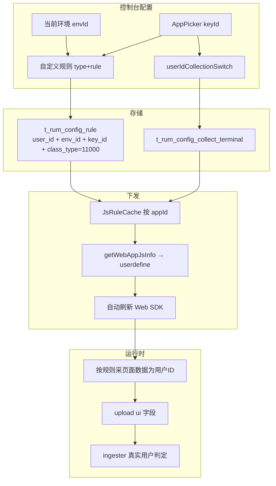

# RUM 模块 —— 用户 ID 采集规则：配置、下发与生效范围

> 本文梳理控制台 **规则配置 → 实体识别 → 终端用户 → 用户 ID 采集** 页签下自定义规则的存储隔离、开关控制、缓存加载与 Web SDK 下发链路。
> 代码根目录：`D:\Bonree\CodeProject\newone`（`framework/plugins/rum`、`view/rum`、`controller/controller`）。

---

## 1. 一句话结论（生效范围）

**自定义用户 ID 采集规则按「账号 + 当前环境 + 应用」生效，不是纯账号级全局配置。**

| 维度 | 是否隔离 | 说明 |
|------|---------|------|
| 账号 `user_id` / `accId` | 是 | 入库、列表、计数均带主账号 |
| 环境 `env_id` | 是 | 取自当前登录上下文 `ResourceUtil.getEnvId(userProvider)`；非系统账号查询带 `env_id` 条件 |
| 应用 `key_id`（AppPicker） | 是 | 规则挂在具体应用上；页面切换应用即切换规则集 |
| 采集开关 | 应用级 | `t_rum_config_collect_terminal.user_id_collection_switch`（`user_id + app_id`） |

典型场景：环境 `one_test [正式]` 下为应用 **Imlweb** 配置的规则，只作用于该账号、该环境、该应用；**不会**跨环境共享，也**不会**在同环境其它应用自动生效。

与「真实用户识别」关系：本规则负责让 Web SDK 从页面数据（Header/Meta 等）**采集**用户 ID；采集成功后上报 `ui`，由 ingester 按既有逻辑判定真实用户（见同目录 `真实用户与访客定义识别逻辑.md`）。

---

## 2. 控制台入口与前端链路

**路径：** 部署配置 → 规则配置 → 实体识别 → 终端用户 → **用户 ID 采集**

**前端目录：** `view/rum/src/packages/configurationModule/ConfigDistinguishUser/components/UserIDIdentification/`

| 能力 | 接口 | 关键参数 |
|------|------|---------|
| 开关查询/修改 | `POST /rest/rum/setting/collect/terminal/getSnapCollect` / `editSnapCollect` | `keyId`=应用 ID；字段 `userIdCollectionSwitch` |
| 规则列表 | `POST /rest/rum/settings/agg/user/list` | `type=自定义`，`keyId` |
| 规则增删改排序 | `/rest/rum/settings/agg/user/add|update|delete|sort` | `keyId` + `ruleJson` |

页面说明文案要点：**目前仅「服务器自动刷新」的 Web SDK 支持此功能**（依赖嵌码/自动嵌码刷新后的 `userdefine`，而非手工静态嵌码长期不更新）。

### 2.1 规则 JSON 结构

前端 `options.tsx` 中 `type` 枚举（1-based 写入 JSON）：

| type | 数据类型 |
|------|---------|
| 1 | CSS selector |
| 2 | Javascript variable |
| 3 | Meta tag |
| 4 | Cookie value |
| 5 | Query string |
| 6 | HTTP request header |
| 7 | HTTP response Header |

存储示例：`{"type":7,"rule":"server"}`（从响应头 `server` 取值作为用户 ID）。

后端 `classType`：`RUMClassType.RULE_TYPE_CLASS_TYPE_USER_ID_COLLECTION` = **11000**。

---

## 3. 后端配置与存储

### 3.1 服务入口

`SettingUserServiceImpl`：统一设置 `classType=11000`，委托通用 `RuleService`。

```text
add/update/list/delete/sort
  → RuleService.ruleAdd / ruleAddUpdate / ruleCustomListQuery / ruleDel / ruleSort
  → accId = userProvider.getAccountId()
  → envId = ResourceUtil.getEnvId(userProvider)   // 空则 "default"
  → keyId = 请求中的应用 ID
```

### 3.2 表结构要点

**规则表 `t_rum_config_rule`**

- 写入字段含：`user_id`、`class_type`、`key_id`、`type`、`rule_json`、`order_index`、**`env_id`** 等
- 列表/计数：`user_id` + `class_type` + `key_id` +（非系统账号时）**`env_id`**
- 条数上限：与 `ruleListQuery` 隔离维度一致（账号+环境+应用+classType），受 `RuleLimitConfig` / 默认约 10 条约束

**开关表 `t_rum_config_collect_terminal`**

- 字段：`user_id_collection_switch`
- 查询条件：`user_id` + `app_id` + `app_version_id=-1`（应用级采集配置，无独立 `env_id` 列）
- 应用本身归属环境：`AppEntity.envId`；UI 在选定环境下选应用，故开关实际仍落在「该环境下的该应用」

### 3.3 配置变更通知

规则增删改会走 `remoteService.sendConfigChange2ETL(accId, envId, ...)`（通用规则通知）。  
**注意：** controller 侧 `RumRuleClassTypeEnum.userEnvPullClassTypes()` 仅包含网络(24)、Trace(11002)，**不含 11000**；用户 ID 采集规则**不**走 `RumUserEnvConfigPull` / `RumUserAppConfigPull` 那条通用 config 同步清单。

---

## 4. 下发实现（Web SDK）

### 4.1 缓存加载：`JsRuleCache`

- 刷新策略：约 **5 分钟**（`ExecuteInterval.FIVE_MINUTE`）
- 加载 SQL：`selectRuleListCache`，条件要点：
  - `t_rum_config_rule.class_type = 11000` 且 `type = 自定义(1)` 且 `flag = 0`
  - **JOIN** `t_rum_config_collect_terminal`：`user_id_collection_switch = 1`
  - 按 `key_id`（appId）分组进 `JsRuleCacheMap`
- 缓存 SQL **未再按 `env_id` 过滤**；实践中靠 **应用 ID 全局唯一且应用绑定单一 `envId`** 实现环境隔离。若出现跨环境复用同一 `app_id` 的异常数据，缓存侧可能混入，属边界风险。

### 4.2 嵌码组装：`userdefine`

链路：

```text
getWebAppJsInfo / jsInfo
  → RumCommonServiceImpl.addPrivateWebAgentSettings(buildId, appId, userId, envId, ...)
  → JsRuleCache.getCacheByAppId(appId)
  → 各条 RuleInfo.ruleJson 用逗号拼接后包成 "[...]"
  → 写入 config.data 字段 key：userdefine（JsInfoEnum.USER_DEFINE）
  → URLEncoder 进 script 标签 data 属性（id 默认 BonreeAgent）
```

探针侧：自动刷新的 Web SDK 解析 `BonreeAgent` 的 `data`，按 `userdefine` 规则从页面采集用户 ID 并上报。

相关文档：`02-接口文档/其他接口分析.md` → getWebAppJsInfo / `userdefine` 专章。

### 4.3 生效前置条件小结

1. 当前环境 + 账号下，目标应用的 **用户 ID 采集开关 = 开**
2. 该应用下存在 `classType=11000` 自定义规则
3. Web 应用使用 **服务器自动刷新** 嵌码，使探针能拿到最新含 `userdefine` 的配置
4. 规则优先级：列表按 `order_index` 排序（控制台支持拖拽排序）

---

## 5. 端到端流程图



---

## 6. FAQ（交付常用）

**Q1：是账号级还是账号环境级？**  
A：存储与列表按 **账号 + 环境** 隔离，并进一步按 **应用** 生效。回答「账号环境级」时需补充「且按应用」；不能说成全账号一套规则。

**Q2：改规则后多久生效？**  
A：`JsRuleCache` 约 5 分钟刷新；还需 Web 自动嵌码侧拉取到新 `userdefine`。非自动刷新的手工嵌码需重新获取嵌码脚本。

**Q3：关开关后规则是否还下发？**  
A：缓存加载要求 `user_id_collection_switch=1`，关闭后该应用规则不会进入 `JsRuleCache`，嵌码不再带对应 `userdefine`。

**Q4：是否下发给移动端 config？**  
A：11000 **不在** controller `RumUserEnvConfigPull` / `RumUserAppConfigPull` 的 classType 列表中；产品文案亦限定 Web SDK。

**Q5：与 setUserID API 的关系？**  
A：业务 App 也可通过 SDK API 主动注入用户 ID；本规则是「无代码/配置化」从 DOM/Header/Meta 等提取用户 ID 的补充能力。二者最终都影响上报 `ui` 与真实用户识别。

---

## 7. 关键代码索引

| 环节 | 路径 |
|------|------|
| 前端页签 | `view/rum/.../ConfigDistinguishUser/components/UserIDIdentification/` |
| classType 枚举 | `framework/plugins/rum/rum-common/.../enums/RUMClassType.java`（11000） |
| 业务服务 | `framework/plugins/rum/rum-core/.../settings/service/impl/SettingUserServiceImpl.java` |
| 通用规则服务 | `framework/plugins/rum/rum-core/.../settings/service/impl/RuleServiceImpl.java` |
| 环境工具 | `framework/plugins/rum/rum-common/.../util/ResourceUtil.java#getEnvId` |
| 规则 Mapper | `framework/plugins/rum/rum-database/.../RumSettingRuleMapper.xml`（ruleAdd / ruleListQuery / selectRuleListCache） |
| 开关字段枚举 | `framework/plugins/rum/rum-core/.../settings/enums/SnapCollectFieldEnum.java` |
| 开关 Mapper | `framework/plugins/rum/rum-database/.../TerminalCollectMapper.xml#getSnapCollect` |
| JS 规则缓存 | `framework/plugins/rum/rum-cache/.../cacheitems/JsRuleCache.java` |
| 嵌码组装 | `framework/plugins/rum/rum-core/.../common/service/impl/RumCommonServiceImpl.java#addPrivateWebAgentSettings` |
| userdefine 字段名 | `framework/plugins/rum/rum-core/.../common/enums/JsInfoEnum.java#USER_DEFINE` |
| controller 拉取 classType | `controller/controller/.../enums/RumRuleClassTypeEnum.java`（不含 11000） |

---

## 8. 边界与注意点

1. **环境隔离依赖登录上下文**：列表/写入用 `UserProvider` 的 `envId`；切换控制台环境后看到的是另一套规则。
2. **开关表无 env 列**：靠应用归属环境间接隔离；不要假设「同 app_id 跨环境各有一份开关行」以外的模型。
3. **缓存未滤 env_id**：依赖 appId 唯一性；运维/数据修复时勿制造跨环境同 appId。
4. **不进通用 env/app 规则 Pull**：排查「config 协议里为何没有用户 ID 规则」时属预期行为。
5. **仅 Web 自动刷新 SDK**：移动端 / 非自动刷新 Web 嵌码不在本能力承诺范围内。

---

## 修订记录

| 日期 | 修订类型 | 修订内容 | 依据 |
|------|---------|---------|------|
| 2026-07-24 | 新文档 | 初版：用户 ID 采集规则的账号/环境/应用生效范围、开关、JsRuleCache→userdefine 下发链路 | 对话梳理 + SettingUserServiceImpl / RuleServiceImpl / JsRuleCache / RumCommonServiceImpl / RumSettingRuleMapper.xml 源码 |
